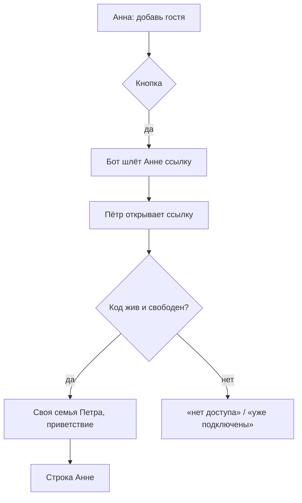

# Гостевой доступ к агенту — спецификация

**Статус:** решения приняты по рекомендациям агента (владелец велел сразу реализовать и выкатить, 07.11.2026), ждут подтверждения владельца после выпуска; задача #471
**Дата:** 2026-11-07 · **Проект:** Osinara · **Тип:** смешанный (сценарий для людей + новая роль в границе доступа) ·
**Где работает:** личный чат владельца (раздел настроек «гости»), личный чат гостя, вход Telegram, выдача инструментов и скиллов, инструкции модели
**Не применяется:** 11 (все действия мгновенные), 13 — деньги (расход модели на гостя — в «Что смотреть»).
Репозиторий публичный: люди в сценариях выдуманы.

## Коротко

**Что делаем и зачем.** Владелец хочет пускать к агенту людей не из семьи — друга, коллегу, родственника, который живёт
отдельно. Сейчас единственный путь — приглашение в семью, а оно открывает семейную память, семейные скиллы и семейные
группы. Гость получает всё, что умеет агент в личке, но живёт в своём отдельном пространстве и ничего семейного не видит.

**Как будет работать.**
1. Владелец пишет агенту «добавь гостя». Агент показывает кнопку подтверждения, после неё бот присылает владельцу
   одноразовую ссылку на сутки. Владелец пересылает её человеку.
2. Человек открывает ссылку — и сразу получает доступ, второго подтверждения нет. Владельцу приходит одна строка:
   «Гость подключился по вашей ссылке: Пётр (@petr)». Если ссылку открыл не тот, владелец сразу закрывает доступ.
3. У гостя в личке всё, что у участника семьи в личке: поиск, файлы и песочница, напоминания, сценарии, свой Google,
   голос, скиллы. Нет только настроек владельца (группы, приглашения, ключи API, доступ к сети).
4. Память, файлы, скиллы, напоминания и Google гостя — его собственные и физически отделены: гость живёт в отдельном
   «доме из одного человека», а не внутри семьи. Он не видит ничего семейного, семья не видит его.
5. Владелец в своей личке говорит «покажи гостей», «отключи Пете браузер», «выключи Пете скилл pdf», «убери Петю».
   Отключённый инструмент или скилл пропадает у гостя со следующего шага, и исполнение перепроверяет запрет.
6. «Убрать гостя» сразу закрывает ему доступ: сообщения и ждущие кнопки перестают работать, напоминания и сценарии
   встают на паузу (без тревог вам). Его записи остаются запечатанными: их никто не видит. Новая гостевая ссылка тому
   же человеку возвращает ему его же пространство. Гостя, нынешнего или бывшего, нельзя сделать участником семьи.
7. Песочница гостя работает в своей отдельной сети: открытые вами семье устройства домашней сети и ключи API семьи ей
   недоступны (найдено независимым ревью, исправлено до выпуска).

**Как построим.**
1. Гость — участник своей отдельной «семьи из одного человека» (роль «участник», без владельца). Все проверки
   доступа в проекте уже разделяют данные по семье, поэтому изоляция памяти, файлов, скиллов и Google получается
   существующей границей, а не новым набором исключений.
2. Новая таблица связывает гостя с семьёй владельца: кто пригласил, жив ли доступ, какие инструменты и скиллы
   владелец ему выключил. Список «выключено» вместо «разрешено»: новые возможности следующих релизов гость получает
   сам, как владелец и просил («всё как у меня»).
3. Приглашение — тот же механизм одноразовых ссылок, что у семьи, с пометкой «гость».
4. Управление — новый раздел `guests` в настройках владельца (`owner_settings`), рядом с группами и приглашениями.
5. Инструкции модели для гостя говорят, что он гость, семьи у него нет, а что выключено — решает владелец.

**Что смотреть.**
- Ссылка работает как ключ: кто первым откроет, тот и гость. Защита — сутки жизни, одноразовость и строка владельцу
  о каждом подключении.
- Гость тратит модель и песочницу владельца без лимита (владелец просил «всё доступно»). Лимит — отдельной доработкой,
  если расход станет заметен.
- Удаление гостя не стирает его данные, а запечатывает. Полное стирание — отдельной доработкой (F3).

**На что опирается.** Устройство внешних групп в самом проекте: владелец меняет список прав группы, выдача
инструментов читает его на каждом шаге, исполнение перепроверяет. Гостю — то же, только список «выключено».

**Нашлось по пути.** Удаления участников семьи в проекте нет вовсе (искал в `agent/lib/family-repository.ts`,
`owner-settings-sections.ts`): гостей удалять будет можно, участников семьи по-прежнему нет — это не трогаю.

**Решения (приняты по рекомендации, ждут подтверждения).**
1. Доступ сразу по ссылке, без второго подтверждения, со строкой владельцу о подключении (F1).
2. Семейные скиллы гостю не даём: у гостя встроенные скиллы и свои собственные (F2).
3. «Убрать гостя» закрывает доступ и запечатывает данные, стирание — потом (F3).
4. Выкатка — сразу на прод, по велению владельца.

**Объём:** 9 шагов, ~3 ч работы агента; дольше всего — прогоны интеграционных тестов в контейнере с потолком памяти
и CI. От владельца — после выпуска нажать «Обновить», создать гостевую ссылку и открыть её со второго аккаунта.

**Не проверено:** живой путь «ссылка → гость → ход модели» — только после выкатки, на бою.

---

# Часть 1. Для владельца

## 1. Что известно и что добавлено

- **Владелец сказал (07.11.2026):** гостевой режим; агент по просьбе владельца генерирует ссылку-приглашение в бота;
  по ссылке человек получает доступ; гость не участник семьи и доступен только в личке; владелец централизованно
  настраивает гостю скиллы и инструменты; по умолчанию у гостя всё, что у владельца в личке; память гостя своя,
  отдельная, ни с чем не пересекается. Затем: «сразу реализуй и выкатывай на продакшн».
- **Найдено в проекте:** на проде одна семья, владелец и один участник. Семья — главная граница данных: память
  (`memory_items.family_id`), скиллы семьи (`family_skills`), файлы и песочница, Google, ключи API и доступ к сети
  проверяются по `family_id`. Пользователь может состоять ровно в одной семье (`one_family_per_user`). Запросов,
  предполагающих единственную семью, нет (искал `FROM families`, `JOIN families` в `agent/`, `scripts/`).
  Обновления ПО ищут единственного владельца среди всех семей (`software-updates/repository.ts`), поэтому у семьи
  гостя владельца быть не должно.
- **Добавлено:** доступ без второго подтверждения (F1), без семейных скиллов (F2), удаление без стирания (F3),
  управление списком «выключено», строка владельцу о подключении.

## 2. Цели, не-цели, анти-цели

- **Цели:** владелец за одно сообщение и одну кнопку получает ссылку для гостя; гость по ссылке сразу работает с
  агентом в личке со всеми возможностями участника семьи; данные гостя и семьи не пересекаются ни в одну сторону;
  владелец в своей личке видит гостей, выключает им инструменты и скиллы, закрывает доступ.
- **Не-цели:** гость в группах (семейных и внешних он участвует как посторонний, как сейчас); лимиты расхода;
  перевод гостя в участники семьи (его личный чат закреплён за его пространством); стирание данных.
- **Анти-цели:** гость видит хоть одну семейную запись, файл, скилл или календарь; семья видит память гостя; гость
  получает настройки владельца; выключенный инструмент всё же исполняется.
- **Сейчас:** гостя можно только пригласить в семью — он получает семейную память и группы.

## 3. На что опирается

| Практика | Кто делает | Масштаб | Берём? | Почему | Источник |
|---|---|---|---|---|---|
| Отдельный арендатор на гостя | многопользовательские сервисы (рабочие пространства) | любой | да | изоляция существующей границей, а не исключениями по всему коду | устройство `family_id` в проекте |
| Список прав, читаемый на каждом шаге и перепроверяемый при исполнении | внешние группы проекта | любой | да | один способ выдачи прав в проекте | `agent/tools/capabilities.ts`, `external-group-memory-tools.ts` |
| Одноразовая ссылка с коротким сроком | приглашения семьи проекта | любой | да | уже проверено на бою | `agent/lib/invitation-code.ts` |
| Роль «гость» внутри семьи | — | — | нет | каждый семейный запрос пришлось бы учить исключать гостя: память, скиллы, Google, файлы, группы, подтверждения; пропуск одного — утечка | разведка, раздел 16 |

## 4. Варианты

**Масштаб:** одна семья, единицы гостей, сопровождают владелец и агенты.

| | А. Гость в своей «семье из одного» | Б. Роль «гость» в семье владельца |
|---|---|---|
| Что делает | гость живёт отдельно, связь с владельцем — таблицей | гость внутри семьи с урезанными правами |
| Защищает | изоляция всеми существующими проверками по семье | только теми местами, где не забыли исключить гостя |
| Стоит | одна таблица, одна ветка при подключении | правки в десятках запросов памяти, скиллов, Google, файлов, групп |
| Закрепляет | данные гостя в отдельной семье | гостя внутри семейных данных |

**Рекомендую А:** изоляция — главный приоритет проекта, а А делает её свойством устройства.
**Отклонено Б:** проиграло на риске утечки; вернётся, если гость должен видеть часть семейного.

## 5. Как работает

**Входы:** просьба владельца в личке → 1; ссылка, открытая человеком → 2; просьба владельца изменить гостя → 3, 4;
сообщение гостя → 5.

**Сценарий 1 — ссылка.** Владелец Анна: «добавь гостя, это мой коллега Пётр».
1. Агент вызывает `owner_settings` → `guests` `{"action":"invite"}`; приходит кнопка «создать ссылку-приглашение
   для гостя…».
2. После нажатия бот сам присылает Анне ссылку (модель её не видит). Анна пересылает её Петру.
- **Сбой:** доставка не подтвердилась — ошибка `AGENT_INVITATION_DELIVERY_AMBIGUOUS`, повтор этой ссылки
  заблокирован, Анна просит новую.

**Сценарий 2 — подключение.** Пётр открывает ссылку, бот получает `/start <код>`.
1. Код действителен и не использован → у Петра появляется своя отдельная семья, он в ней участник; ссылка погашена.
2. **Ключевой момент:** Пётр сразу видит приветствие и может писать; Анне приходит «Гость подключился по вашей
   ссылке: Пётр (@petr)…».
- **Сбой:** код истёк, использован или Пётр уже состоит в семье → «У вас нет доступа…» / «Вы уже подключены…».
  Строка Анне не дошла → в журнал `AGENT_GUEST_JOIN_OWNER_NOTICE_FAILED`, подключение остаётся.

**Сценарий 3 — настройка.** Анна: «отключи Петру браузер и скилл pdf».
1. Агент читает `{"action":"list"}`, берёт `guestUserId` и точные имена, вызывает `configure` с полными списками.
2. Кнопка подтверждения → сохранено. У Петра со следующего шага нет `agent-browser`… инструментов/скиллов из списка.

**Сценарий 4 — убрать гостя.** Анна: «убери Петра». `revoke` → кнопка → доступ закрыт, Петру на следующее
сообщение «У вас нет доступа…», его напоминания и сценарии на паузе. Новая гостевая ссылка Петру возвращает его
прежнее пространство; паузу он снимает сам.

**Сценарий 5 — гость работает.** Пётр пишет «напомни завтра в 9 позвонить врачу» — всё как у участника семьи в
личке; в памяти — только то, что рассказал Пётр.

## 6. Решения владельца

### F1. Нужно ли второе подтверждение после того, как человек открыл ссылку?
**Ситуация:** Анна переслала ссылку Петру, Пётр переслал её в общий чат, ссылку открыл чужой человек.
**Почему решать вам:** кто получает доступ к агенту и вашим расходам на модель.
- **А. Сразу по ссылке + строка вам о подключении** — гость пишет сразу; вам приходит «Гость подключился…: Пётр
  (@petr)»; чужого вы сразу убираете; стоит одно сообщение вам на каждого гостя.
- **Б. Как у семьи: заявка, затем ваше подтверждение** — гость ждёт вас; лишний шаг на каждого гостя.
- **В. Сразу по ссылке, без строки** — проще всего; о чужом вы узнаете, только посмотрев список гостей.
**Рекомендую А:** вы просили «зашёл — и доступ есть», а строка закрывает риск пересланной ссылки.
**Если никто не решил:** А.

### F2. Давать ли гостю скиллы семьи?
**Ситуация:** в библиотеке семьи есть скилл, написанный под ваши дела, — с вашими адресами, счетами, порядками.
**Почему решать вам:** скиллы семьи — семейные данные.
- **А. Не давать** — у гостя все встроенные скиллы и те, что он сохранит сам; ваши скиллы ему не видны.
- **Б. Давать выбранные** — нужен отдельный список «каким скиллам семьи открыт гость»; риск утечки содержимого.
**Рекомендую А:** «память не пересекается» в вашей просьбе логично распространить на скиллы.
**Если никто не решил:** А.

### F3. Что делать с данными убранного гостя?
**Ситуация:** вы убрали Петра; его память, файлы и напоминания остались на сервере.
- **А. Запечатать** — никто их не видит, ничего не работает; новая ссылка Петру возвращает всё как было.
- **Б. Стереть навсегда** — нужна отдельная очистка файлов песочницы, календаря Google и всех таблиц; необратимо.
**Рекомендую А сейчас, Б — отдельной доработкой по вашей просьбе:** стирание необратимо и задевает много мест.
**Если никто не решил:** А.

### Accepted
- F1 — А, F2 — А, F3 — А: приняты по рекомендации 07.11.2026, владелец велел сразу реализовать и выкатить;
  ждут подтверждения после выпуска.
- Выкатка: сразу на прод (владелец, 07.11.2026).

---

# Часть 2. Поведение

## 7. Инструмент владельца

| Инструмент | Когда | Параметры | Возвращает | Меняет | Повтор | Ошибки |
|---|---|---|---|---|---|---|
| `owner_settings` → `guests` (`manage_guest_access`) `list` | «покажи гостей», перед любым изменением | — | `guests[]`: `guestUserId`, `displayName`, `username`, `status`, `joinedAt`, `revokedAt`, `disabledTools`, `disabledSkills`, `ownSkills`; `openInvitations[]` (`expiresAt`); `toolCatalog`, `builtInSkills` | читает | — | `AGENT_OWNER_REQUIRED` |
| `invite` | «добавь гостя» | — | `{delivered, expiresAt}` | создаёт ссылку, шлёт владельцу; кнопка | по `callId` | `AGENT_INVITATION_DELIVERY_AMBIGUOUS`, `AGENT_INVITATION_EXPIRED` |
| `configure` | «отключи/включи гостю …» | `guestUserId`, `disabledTools[]`, `disabledSkills[]` (полные списки) | новые списки | права гостя; кнопка | идемпотентно | `AGENT_GUEST_NOT_FOUND`, `AGENT_GUEST_TOOL_UNKNOWN`, `AGENT_GUEST_SKILL_UNKNOWN`, `AGENT_GUEST_ACCESS_INPUT_INVALID` |
| `revoke` | «убери гостя» | `guestUserId` | `{revoked:true}` | закрывает доступ; кнопка | идемпотентно | `AGENT_GUEST_NOT_FOUND` |

## 8. Механизм

| Что ломается | Как предотвращаем | Как узнаём | Восстановление | Что теряется | Покрыто |
|---|---|---|---|---|---|
| Две вкладки открыли одну ссылку | строка приглашения блокируется `FOR UPDATE`, после гашения код недействителен | второй получает «нет доступа» | — | — | шаг 3 |
| Повтор подготовки сообщения после сбоя | подключение и сообщения идут через журнал подготовки (`telegram_preparation_effects`) | — | при повторе: «Вы уже подключены…» | — | существующее |
| Не прочиталась таблица гостя при выдаче инструментов | закрываемся: пустой набор, лог `AGENT_GUEST_POLICY_LOOKUP_FAILED` | лог | следующий шаг | один ход без инструментов | шаг 5 |
| Владелец выключил инструмент, пока висит кнопка гостя | исполнение перепроверяет запрет вживую | гость видит отказ | — | — | шаг 5 |

## 9. Ошибки

| Ситуация | Что видит человек | Выход |
|---|---|---|
| Ссылка истекла / использована | «AGENT_ACCESS_DENIED: У вас нет доступа. Попросите владельца отправить приглашение.» (как сейчас) | новая ссылка |
| Уже участник семьи или гость открыл ссылку | «AGENT_INVITATION_NOT_APPLICABLE: Вы уже подключены к агенту.» | — |
| Гость убран | «У вас нет доступа к этому семейному агенту. Попросите владельца отправить приглашение» (как сейчас) | новая ссылка |
| Выключенный инструмент на исполнении | модели: `AGENT_GUEST_TOOL_DISABLED` «Владелец выключил вам этот инструмент» | модель объясняет гостю |
| Доступ закрыт посреди хода | модели: `AGENT_GUEST_ACCESS_REVOKED` «Владелец закрыл вам доступ к агенту» | — |

## 10. Края и стыки

| Случай | Что происходит |
|---|---|
| Участник семьи открыл гостевую ссылку | «Вы уже подключены», ссылка остаётся живой |
| Гость открыл семейное приглашение | «Вы уже подключены»; перевести гостя в семью нельзя |
| Убранный гость открыл новую гостевую ссылку | возвращается в своё прежнее пространство, выключенное владельцем остаётся выключенным |
| Убранный гость открыл семейное приглашение | «AGENT_INVITATION_FORMER_GUEST: Вы были гостем этого агента, а гостя пока нельзя перевести в семью. Сообщите об этом владельцу.»; ссылка остаётся живой. Заявка, поданная до того, как человек стал гостем, при подтверждении получает тот же отказ |
| Создатель ссылки перестал быть владельцем | подключение по ссылке отказывает |

| Соседняя функция | Стык | Решение |
|---|---|---|
| Семейная группа | гость пишет в семейную группу | `family_id` гостя другой → отказ, как постороннему |
| Внешняя группа | гость участник внешней группы | участник «извне», как сейчас |
| Режим «только владелец» | — | гость не владелец этой семьи → не запускает |
| Обновления ПО | ищут единственного владельца | у семьи гостя владельца нет → не задевает |
| Напоминания, сценарии, подтверждения | проверяют членство при срабатывании | убранный гость без членства → не срабатывают |
| Скиллы семьи | `manage_skill` гостя | пишет в библиотеку своей семьи, видит только он |
| Ключи API, доступ к сети | выдаются семье владельца или группам и действуют в общей сети песочниц семьи | песочница гостя в своей сети (`ownNetwork`), прокси отказывает ей в разрешённых адресах и ключах семьи |
| Выключенный поиск при включённом `bash` | команды в песочнице ходят на сайты сами | запрет держится только на инструкции; скилл велит сказать владельцу и предложить выключить `bash` |

## 12. Тексты

| Где | Текст |
|---|---|
| Ссылка владельцу | «Одноразовая ссылка для гостя:\n<ссылка>\nДействует до <время>. Перешлите её человеку: кто первым откроет ссылку, сразу получит доступ к агенту в личном чате. Семейная память, скиллы и группы гостю не видны.» |
| Приветствие гостю | «Готово, вы подключены к агенту как гость. Пишите сюда — я помогу с поиском, файлами, напоминаниями и другими задачами. Ваша память отдельная и не пересекается с памятью других людей.» |
| Возврат гостя | «С возвращением! Доступ к агенту снова открыт, ваши прежние записи на месте.» |
| Строка владельцу | «Гость подключился по вашей ссылке: <имя> (@<username>). Посмотреть гостей, выключить им инструменты и скиллы или закрыть доступ можно здесь, в личном чате со мной.» |
| Кнопка `invite` | «создать ссылку-приглашение для гостя. Кто первым её откроет, получит доступ к агенту в личном чате» |
| Кнопка `configure` | «изменить инструменты и скиллы гостя» |
| Кнопка `revoke` | «закрыть гостю доступ к агенту. Его записи останутся запечатанными» |

## 14. Что не делаем

- Лимит расхода модели на гостя — владелец просил «всё доступно»; вернёмся, если расход гостей станет заметен.
- Стирание данных гостя — F3; по просьбе владельца.
- Перевод гостя в семью — личный чат гостя закреплён за его семьёй, перенос требует переноса данных; вернёмся по
  просьбе владельца.
- Ключи API и доступ к сети для гостя — выдаются семье владельца; вернёмся по просьбе.

## 15. Решения агента — на проверку

- Гость — роль `member` в своей семье, а не новая роль `guest`: все проверки участника работают без правок, а
  отличие гостя знает одна таблица `guest_accounts`.
- Список «выключено», а не «разрешено»: новые инструменты релизов гость получает сам.
- Приглашение гостя — строка той же таблицы `invitations` с `kind='guest'`; при подключении она сразу `approved`,
  решающий — создатель ссылки.
- Гостю видны имена его собственных скиллов в списке владельца (без содержимого) — иначе владелец не выключит их.

---

# Часть 3. Как строим

## 16. Что есть и что берём

- `agent/lib/invitation-code.ts`, `family-repository.ts` (`createInvitation`, `markInvitationDelivery*`), `telegram-delivery.ts` — коды, срок, надёжная доставка ссылки. Расширяем полем вида приглашения.
- `telegram-enrollment-boundary.ts` — точка, где `/start <код>` гасится до модели. Добавляем ветку гостя.
- `agent/tools/capabilities.ts`, `mode-tool-surface.ts` — выдача инструментов; гостю — набор участника в личке минус выключенное, с проверкой при исполнении.
- `group-skills/group-skill-resolver.ts` — выдача скиллов; гостю — минус выключенное.
- `owner-settings/` — дверь владельца; новый раздел `guests`.
- `prompt/mode-instructions.ts`, `turn-blocks.ts` — блок режима; гостю — свой вариант.
- Наследие в затронутой области не найдено, кроме отсутствия удаления участников (не трогаю).

## 17. Устройство

- Миграция `153_guest_access.sql`: `invitations.kind text NOT NULL DEFAULT 'member' CHECK (kind IN ('member','guest'))`;
  таблица `guest_accounts(user_id PK → users, guest_family_id UNIQUE → families CASCADE, host_family_id → families
  CASCADE, invitation_id → invitations, status 'active'|'revoked', disabled_tools text[], disabled_skills text[],
  created_at, updated_at, revoked_at, revoked_by → users)`; CHECK согласованности статуса и `revoked_at`.
- Подключение (одна транзакция внутри `claimInvitation`): блокировка приглашения → пользователь → проверка, что
  создатель ещё владелец → нет членства → (есть отозванный гость у того же хозяина: вернуть членство) или (новая
  семья `name='guest'`, членство `member`, строка `guest_accounts`) → приглашение `approved` → аудит `guest.joined`
  в семье хозяина.
- Удаление: `status='revoked'`, удалить строку `family_memberships` гостя — дальше всё закрывается проверками членства.
- Выдача: `resolveToolSurface` для личного чата не-владельца читает `guest_accounts` по `familyId` сессии; гость →
  набор минус `disabled_tools`, каждый инструмент обёрнут живой проверкой; сбой чтения → пустой набор.
- Скиллы: `resolveConversationSkills` для гостя убирает `disabled_skills`.
- Блок режима: гостю — память «только своя», администрирование «решает владелец», список выключенного.

## 19. Сбои на новых путях

| Путь | Сбой | Что видит человек | Покрыто |
|---|---|---|---|
| Подключение | гонка двух открытий | второй — «нет доступа» | интеграционный тест шага 3 |
| Строка владельцу | Telegram не принял | ничего; лог | тест шага 4 |
| Выдача инструментов | база недоступна | ход без инструментов | тест шага 5 |

## 21. Приоритеты

- **P0:** всё описанное выше.
- **P2:** стирание данных, лимиты, перевод в семью одной командой.

**Объём:** шаги 1–9, ~3 ч агента; прогоны тестов в контейнере и CI ~1 ч.

## 22. Шаги

**Правила каждого шага:** промпты модели по-английски, тексты людям по-русски; ошибки `AGENT_*` с русским текстом;
новый файл ≤500 строк; отказ закрывает доступ, а не открывает; тяжёлые прогоны — только в контейнере с потолком.

1. Миграция `153_guest_access.sql` + описи схемы (`memory-upgrade-ledger.integration.test.ts`).
2. `agent/lib/guests/guest-repository.ts`: политика гостя по семье, список, настройка, удаление; интеграционный тест.
3. Подключение гостя в `claimInvitation` (`agent/lib/guests/guest-enrollment.ts`); интеграционный тест: новый гость,
   повторное открытие, отозванный возвращается, участник семьи не становится гостем, изоляция памяти.
4. Граница `/start`: приветствие гостю и строка владельцу; тест на `telegram-enrollment-boundary.test.ts`.
5. Выдача инструментов и скиллов гостю с живой перепроверкой; модульные тесты.
6. Инструмент `manage_guest_access`, раздел `guests` двери владельца, карточки подтверждения; модульные тесты.
7. Блок режима для гостя; тест блока.
8. Скилл `group-admin`: раздел «Гости»; маршрут владельца.
9. Релиз: заметки `docs/releases/vVERSION.md`, CI, выкатка.

## 23. Приёмка

- Дано: Анна-владелец. Когда: `invite` и нажата кнопка. Тогда: Анне пришла ссылка, модель ссылки не видела.
- Дано: свежая гостевая ссылка. Когда: Пётр открыл. Тогда: у Петра своя семья, роль `member`, Анне строка, приглашение `approved`.
- Дано: Пётр гость. Тогда: `search_memories` Петра не находит семейных записей Анны; записи Петра не видны Анне.
- Дано: Анна выключила Петру `bash`. Тогда: в наборе Петра нет `bash`, исполнение `bash` отказывает `AGENT_GUEST_TOOL_DISABLED`.
- Дано: Анна убрала Петра. Тогда: членства нет, следующее сообщение Петра — «нет доступа»; новая ссылка возвращает прежнюю семью.

## 24. Что смотреть на ревью

- Гость не получает `owner_settings` ни в одном пути (живой ход, сценарий, подагент, продолжение после кнопки).
- Семейная группа хозяина отказывает гостю.
- Повторное открытие той же ссылки не создаёт вторую семью.
- Отказ чтения политики гостя не открывает полный набор.
- Участник семьи (не гость) получает тот же набор, что до изменения.
