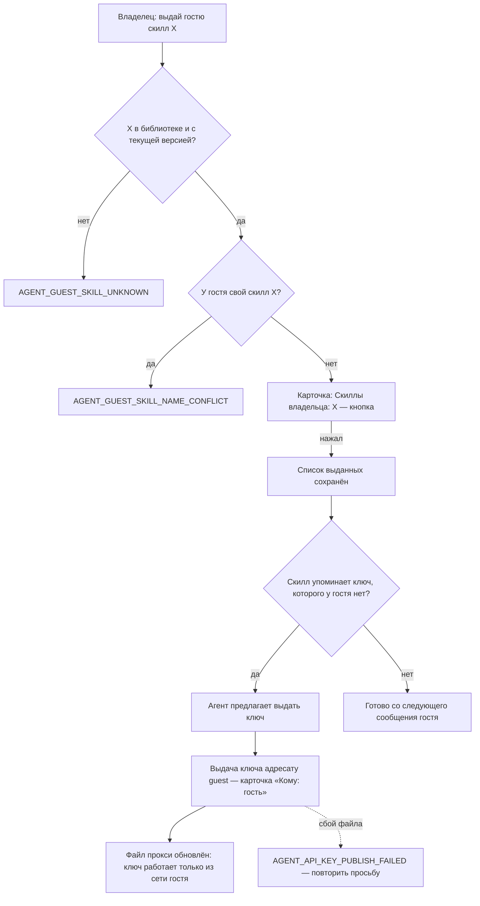
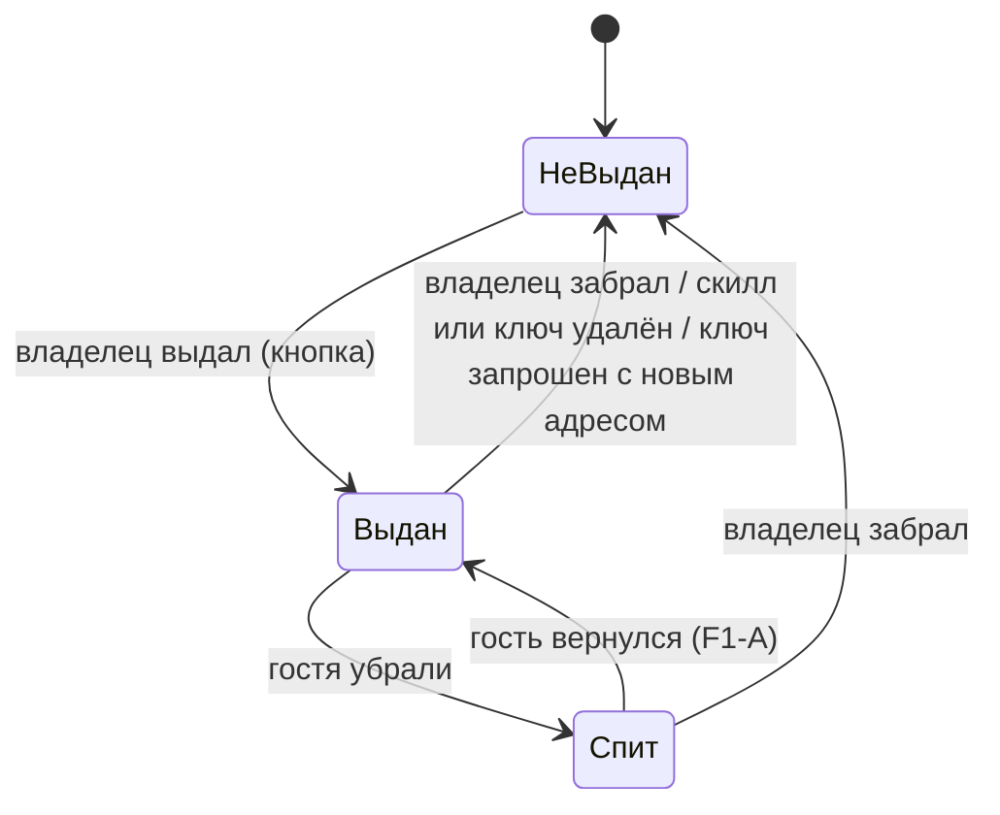

# Скиллы и ключи API владельца для гостя — спецификация

**Статус:** выпущено в v0.72.0, на проде с 08.11.2026 13:22 UTC; живая проверка на госте — за владельцем; #474 закрыт
**Дата:** 2026-11-08 · **Проект:** Osinara · **Тип:** пользовательская (новая выдача в существующей границе доступа) ·
**Где работает:** личный чат владельца (разделы настроек «гости» и «ключи API»), личный чат и песочница гостя,
выдача скиллов, шлюз ключей в egress proxy, инструкции модели
**Не применяется:** 11 — все действия мгновенные; 20 — новых фоновых механизмов нет, файл выдач ключей уже
публикуется. Репозиторий публичный: люди, скиллы и ключи в примерах выдуманы.

## Коротко

**Что делаем и зачем.** Сейчас гость (#471) получает только встроенные скиллы и те, что сохранит сам. Скиллы
из вашей библиотеки и ваши ключи API ему недоступны вообще. Нужно, чтобы вы могли сказать агенту «выдай Петру
скилл image-gen» и «дай Петру доступ к ключу imagegen», и у гостя это заработало со следующего сообщения.
Успех: выданный скилл с выданным ключом работает в песочнице гостя, а всё невыданное по-прежнему закрыто.

**Как будет работать.**
1. Вы в своей личке: «выдай Петру скилл image-gen». Агент показывает кнопку подтверждения, на карточке видно,
   какие ваши скиллы будут у Петра. После кнопки скилл у Петра со следующего сообщения. Петру ничего не
   приходит (F2).
2. «Дай Петру доступ к ключу imagegen» — то же: кнопка с «Кому: гость Пётр», и со следующей команды в песочнице
   Петра есть `IMAGEGEN_API_KEY`. Значение ключа Пётр не видит, только заглушку, а настоящий ключ подставляет
   сервер. Но всё, что этот ключ разрешает у сервиса, Пётр сделать может (F3).
3. Если выданному скиллу нужен ключ, которого у гостя нет, агент сразу говорит: «скиллу нужен ключ imagegen,
   у Петра его нет — выдать?». Иначе скилл у гостя упадёт на первом же запуске.
4. «Покажи гостей» показывает у каждого гостя выданные скиллы и ключи с числом запросов по каждому ключу.
   «Покажи ключи» показывает гостя отдельной строкой, как сейчас группы. Лимитов нет, есть только учёт
   запросов — как вы решили для ключей 01.11.
5. «Забери у Петра скилл image-gen / ключ imagegen» — со следующего сообщения скилла нет, а запросы с ключом
   прокси отклоняет.
6. Пётр получает только файлы скилла и выданные ключи. Скилл, которому нужны ваши логины, токены, сохранённые
   входы в браузере или ваша домашняя сеть, у Петра не заработает. Агент предупредит об этом при выдаче, как и
   о том, что текст и файлы скилла Пётр увидит и сможет скопировать.
7. Если вы уберёте гостя, его ключи сразу перестают работать. Вернётся по новой ссылке — выданное вернётся
   вместе с ним (F1).

**Как будем делать.**
1. Повторяем то, что уже работает для внешних групп: у группы есть список скиллов семьи и выдача ключа на её
   сеть. Гостю — то же самое, второй схемы доступа не появляется.
2. Скиллы: в записи гостя появляется список «выданные скиллы владельца» рядом со списком «выключено». Перед
   каждым ходом гостя список добавляется к его скиллам. Изменить или удалить ваш скилл гость не может: он
   лежит не в его библиотеке.
3. Ключи: новый адресат выдачи «гость» в существующем разделе ключей. Выдача привязана к личной папке гостя,
   у неё своя заглушка, и прокси принимает её только из отдельной сети гостя. Эту сеть прокси уже различает
   (#471), поэтому сам прокси не меняется.
4. Убранный гость пропадает из списка выдач, который читает прокси, — как ключи отключённой группы (#465).
5. Карточки подтверждения, инструкции гостя и служебные инструкции вашего агента учатся новому: что выдано,
   кому, откуда и что с этим можно делать.

**За чем следить.**
- Выданный скилл гость видит целиком: это выдача содержимого, а не только права запуска.
- Выданный ключ — ваши деньги без лимита и всё, что ключ разрешает у сервиса: где-то это чтение ваших данных
  у сервиса, а где-то и выпуск новых ключей (F3).
- Скилл, завязанный на ваше окружение — логины, токены, установленные у вас программы, домашнюю сеть, — у гостя
  не заработает. Это ограничение изоляции, а не сбой.
- Если после возврата гостя список ключей на сервере не обновится (очень редко — сбой записи файла), его ключи
  не заработают. Лечится повторной выдачей ключа, и агент будет об этом знать.

**На что опирается.**
- Внешние группы в проекте: список скиллов семьи на группу и выдача ключа на сеть группы — тот же доступ «извне
  по явному выбору владельца»; отключение группы убирает её ключи из прокси (#465).
- Общая практика гостевого доступа: GitHub (сторонний участник получает доступ только к репозиториям, куда его
  добавили явно) и гостевые аккаунты 1Password (гость видит только открытое ему хранилище). Берём принцип «по
  умолчанию закрыто, открывается поштучно».

**Найдено по пути.** Три места противоречат будущей выдаче, их правим в этой же работе:
- служебная инструкция вашего агента о группах и гостях (`group-admin`) говорит, что ключи семьи гостю не
  доходят;
- карточка выдачи ключа подписывает любого получателя, кроме группы, как «вся семья»;
- карточка настройки гостя показывает только выключенное.

**Решено владельцем 08.11.2026** (раздел 6, «Принято»):
1. Вернувшийся по новой ссылке гость получает обратно выданные скиллы и ключи — да (F1).
2. Гостю о выдаче не сообщаем (F2).
3. Ключ гостю без ограничения путей, как у групп: гости — друзья владельца (F3).

**Выкатка:** релиз на прод с кнопкой обновления в Telegram (F4).

**Объём:** 9 шагов; работа агента — около 3,5 ч, CI с интеграционными тестами — около 30 мин, релиз — около
40 мин. От вас — нажатие «Обновить».

**Не проверено:** вживую запрос с ключом из песочницы гостя через прокси. Что сеть гостя и прокси распознают
друг друга, видно по коду (`ownNetworkWorkspaceId`, `ensureGroupNetwork`, `sandbox-egress-proxy/main.ts`).
Проверим после выкатки по строке учёта у выдачи гостю.

---

# Часть 1. Для владельца: как это работает

## 1. Что известно и что добавлено

- **Сказал владелец (08.11.2026):** вариант Б — «чтобы я мог попросить выдать скилл нужному гостю и также выдать
  доступ к уже сохранённому ключу API».
- **Агент рекомендовал, владелец не подтверждал:** в обсуждении Б описан как «два списка, по умолчанию пустые» —
  это и выбрано. Вариант В (гость заводит свои ключи) не выбран, он в разделе 14.
- **Найдено в проекте:**
  - скиллы гостя собираются в `resolveConversationSkills` (`agent/lib/group-skills/group-skill-resolver.ts`)
    из встроенных и библиотеки его собственной «семьи из одного»; библиотека хозяина туда не попадает (решение
    F2 из `[07.11.2026]-guest-access.md`);
  - в песочницу копируются файлы скиллов хода (`agent/skills/scoped.ts` → `agent/runtime/turn/turn-skills.ts` →
    `services/sandbox-runner/skill-sync.ts`) — только файлы скилла, без `$HOME`, хранилища входов браузера и
    установленных программ владельца;
  - ключ принадлежит семье, выдача — строка `sandbox_api_key_grants` на папку (`workspaces`): адресаты
    `personal`, `family`, `group` (`agent/lib/api-keys/api-key-repository.ts`); переменные `<NAME>_API_KEY`
    песочница получает на каждую команду по своим папкам (`apiKeySandboxEnvironment`,
    `runner-sandbox-backend.ts:78`);
  - песочница гостя работает в своей сети, названной по его личной папке (`ownNetworkWorkspaceId`,
    `services/sandbox-runner/docker-sandbox-options.ts`); прокси подключается к ней под псевдонимом
    `sandbox-group-egress-proxy-<workspaceId>`, как к сети группы (`group-egress-network.ts`), — поэтому выдача
    с `network: {kind: "group", workspaceId: <личная папка гостя>}` пройдёт проверку шлюза без правок прокси;
  - шлюз передаёт любой метод и любой путь под базовым адресом ключа (`api-key-gateway.ts:144-177`): получатель
    выдачи может всё, что ключ разрешает у сервиса;
  - выдача отключённой группы остаётся в базе, но не попадает в прокси (`listProjectionGrants`, #465);
  - при удалении скилла его имя вычищается из списков групп, чтобы будущий скилл с тем же именем не выдался по
    старой записи (`familySkillChanges.remove`);
  - если скилл стоит в списке внешней группы, владелец получает уведомления о его изменениях (`concerned` в
    `family-skill-changes.ts`);
  - `manage_skill` работает только с библиотекой семьи вызывающего (`manage_skill.ts:157`), поэтому скилл хозяина
    гость изменить не может уже сейчас;
  - противоречат фиче: `config/service-skills/group-admin/SKILL.md:47,50-52` (ключи гостю «не доходят»,
    `configure` с двумя списками); `agent/lib/api-keys/api-key-approval.ts:22` («вся семья» для любого
    получателя, кроме группы); `agent/lib/telegram-interface.ts:148-156` (карточка гостя без выданного);
  - масштаб на 08.11.2026: один активный гость, в библиотеке хозяина 9 скиллов (все написаны владельцем),
    4 ключа, у 4 внешних групп в списках есть скиллы семьи.
- **Добавлено агентом:** подсказка о ключах, нужных выданному скиллу; правило при совпадении имён; уведомления
  владельцу об изменениях выданного скилла; необязательные списки в `configure` — всё в разделе 15.
- **Противоречий между источниками нет.**

## 2. Цели, не-цели, анти-цели

- **Цели:**
  1. Владелец одной фразой выдаёт гостю скилл из своей библиотеки и забирает его; работает со следующего
     сообщения гостя.
  2. Владелец одной фразой выдаёт гостю доступ к сохранённому ключу и забирает его; работает со следующей
     команды в песочнице гостя; значение ключа гость не видит.
  3. Владелец видит, что сейчас выдано каждому гостю и сколько запросов гость сделал по каждому выданному ключу.
- **Не-цели:** доступ гостя к домашней сети; лимиты расхода; свои ключи гостя (вариант В); выдача «всем гостям
  сразу»; история запросов по забранным выдачам; учёт использования скиллов гостем в статистике библиотеки
  (раздел 14).
- **Анти-цели:** гость видит хоть один невыданный скилл, ключ или семейные данные; ключ работает из любой
  песочницы, кроме песочницы этого гостя; убранный гость продолжает тратить ключ; гость меняет скилл владельца;
  скилл, удалённый и созданный заново под тем же именем, сам выдаётся гостю; правка выключенного у гостя молча
  забирает у него выданное.
- **Сейчас:** чтобы гость пользовался вашим скиллом, вы пересылаете ему файлы, а он сохраняет копию себе. Ключ
  API безопасно передать невозможно: только сам ключ в переписке, то есть утечка.

## 3. На что опирается

| Практика | Кто делает | Где окупается | Берём? | Почему | Источник, дата |
|---|---|---|---|---|---|
| Доступ стороннего участника — только к явно открытому, поштучно | GitHub (outside collaborators), 1Password (guest accounts) | любой масштаб | да | по умолчанию гость ничего вашего не видит, вы открываете по одному | [GitHub Docs](https://docs.github.com/en/enterprise-cloud@latest/organizations/managing-user-access-to-your-organizations-repositories/managing-outside-collaborators/adding-outside-collaborators-to-repositories-in-your-organization), [1Password Support](https://support.1password.com/guests/), 08.11.2026 |
| Выдача «вне семьи» тем же механизмом, что у внешних групп | Osinara: `skill_allowlist`, выдача ключа на сеть группы | этот проект | да | одна схема доступа вместо двух; уже работает на бою | `group-skill-resolver.ts`, `api-key-repository.ts` |
| Убранный адресат исчезает из прокси, выдачи сохраняются | Osinara, отключение группы (#465) | этот проект | да | убранный гость сразу ничего не тратит; при возврате не надо выдавать заново (F1) | `listProjectionGrants` |
| Ограничение выдачи ключа отдельными путями сервиса | API-шлюзы облаков (scoped tokens) | ключи к сервисам с хранимыми данными, много получателей | пока нет | у групп так же без ограничения; новый механизм в прокси — решение владельца (F3) | — |
| Лимит расхода ключа на получателя | API-шлюзы облаков | десятки получателей, чужие деньги | нет | владелец 01.11 решил «лимитов нет — только учёт»; вернёмся по просьбе | решение по v0.59.0 |

## 4. Варианты и масштаб

**Масштаб проекта:** один владелец, один активный гость, 9 скиллов и 4 ключа (боевая база, 08.11.2026);
сопровождают владелец и агенты.

Путь один: владелец выбрал вариант Б, а внешние группы уже решают ту же задачу «доступ извне по выбору
владельца». Делать для гостей иначе — значит завести вторую схему прав со своими дырами. Отличие одно: список
скиллов хранится в записи гостя рядом со списком «выключено», а не в записи группы. Отдельная развилка — F3:
ограничивать ли ключ путями.

## 5. Как это работает

**Точки входа:** фраза владельца в его личке → сценарии 1–3; сообщение гостя → сценарий 4; удаление и
возврат гостя → сценарий 5; изменение скилла в библиотеке → сценарий 6.

**Сценарий 1 — выдать скилл.** Анна (владелец) пригласила Петра гостем. Пётр попросил генерировать картинки,
у Анны есть скилл `image-gen`, который ходит в сервис по ключу `imagegen`.
1. Анна: «выдай Петру скилл image-gen». Агент смотрит список гостей: у Петра выданные скиллы и ключи, сверху
   каталог скиллов библиотеки (`hostSkills`).
2. Агент предупреждает, что Пётр увидит текст и файлы скилла и что скилл, которому нужны логины, токены,
   программы или домашняя сеть Анны, у Петра не заработает. Затем вызывает настройку гостя только с новым
   списком выданных скиллов. На карточке: «Гость: Пётр. Скиллы владельца: image-gen».
3. **Ключевой момент:** после кнопки ответ инструмента сообщает, что `image-gen` упоминает ключ `imagegen`,
   а у Петра его нет. Агент: «Скилл выдан. Ему нужен ключ imagegen — выдать Петру доступ?»
- **Сбой:** у Петра уже есть свой скилл `image-gen` → `AGENT_GUEST_SKILL_NAME_CONFLICT`, агент объясняет.
  Скилла нет в библиотеке → `AGENT_GUEST_SKILL_UNKNOWN`.

**Сценарий 2 — выдать ключ.** Продолжение.
1. Анна: «да, выдай». Агент вызывает выдачу ключа `imagegen` адресату «гость Пётр». На карточке «Кому: гость
   Пётр (личный чат и его песочница)», Анна нажимает кнопку.
2. **Ключевой момент:** со следующей команды в песочнице Петра есть `IMAGEGEN_API_KEY` (своя заглушка) и
   `IMAGEGEN_BASE_URL`. Прокси подставляет настоящий ключ только для запросов из сети Петра.
- **Сбой:** ключа нет или у него нет значения — существующие отказы раздела ключей. Не удалось обновить файл
  прокси — существующий `AGENT_API_KEY_PUBLISH_FAILED`: выдача уже записана, повтор той же просьбы её применит.

**Сценарий 3 — посмотреть и забрать.** Анна: «что у Петра есть?» — список гостей показывает выданные скиллы и
ключи с числом запросов. «Покажи ключи» — у `imagegen` строка «гость Пётр: 14 запросов, за 7 дней 9, последний
вчера». «Забери у Петра ключ» → без кнопки (забрать безопасно), прокси отклоняет следующий запрос Петра.
«Забери скилл» → кнопка, как у любой настройки гостя.

**Сценарий 4 — гость пользуется.** Пётр: «нарисуй кота в шляпе». Агент Петра видит `image-gen` среди своих скиллов
и в инструкции «выдан владельцем», загружает его и вызывает сервис через шлюз — картинка готова.
- **Сбой:** Пётр просит «поправь скилл image-gen» — по инструкции агент отвечает, что скилл выдал владелец и
  поменять его здесь нельзя. Если модель всё же вызовет `manage_skill`, библиотека Петра такого скилла не найдёт.
  Ключ забрали, пока Пётр работал → шлюз отвечает `AGENT_SANDBOX_API_KEY_NOT_GRANTED`, агент говорит, что
  доступа к ключу больше нет и выдать его снова может владелец.

**Сценарий 5 — гостя убрали и вернули.** Анна убирает Петра: доступ закрыт, выдачи ключей Петра уходят из
прокси, хотя записи остаются. Через месяц Анна присылает Петру новую ссылку, он возвращается — скиллы и ключи
снова работают (F1, вариант А).
- **Сбой:** не удалось обновить файл прокси при удалении → Анна видит «Гость убран, но его ключи API ещё не
  закрыты…» и повторяет. При возврате → в журнале `AGENT_API_KEY_PUBLISH_FAILED`, ключи Петра не работают до
  следующей записи файла; агент Петра говорит, что ключ недоступен, агент Анны по служебной инструкции
  выдаёт его повторно, и это переписывает файл.

**Сценарий 6 — скилл изменился в библиотеке.** Анна выпускает новую версию `image-gen` — Пётр получает её со
следующего сообщения. Анна удаляет `image-gen` — скилл пропадает у Петра и из списка выданных; новый скилл с
тем же именем сам не выдастся. Если выданный гостю скилл изменит или удалит другой член семьи, Анна получит
уведомление, как сейчас для скиллов внешних групп.

## 6. Решения владельца

### F1. Вернувшийся гость получает обратно выданные скиллы и ключи?
**Ситуация:** вы выдали Петру скилл и ключ, потом убрали его. Через месяц снова отправили ему ссылку, он вернулся.
**Почему решать вам:** ключ — ваши деньги, скилл — ваше содержимое; от ответа зависит, что Пётр получит без
отдельной просьбы.
- **А. Возвращаются** — Пётр сразу работает как раньше; так же устроено со списком «выключено» (возвращается
  выключенным). Цена: если вы забыли, что выдавали, ключ снова тратится; видно в «покажи гостей». Закрепляет:
  выдачи живут, пока вы их не заберёте.
- **Б. Сбрасываются при удалении гостя** — вернувшийся гость начинает с чистого листа, вы выдаёте заново.
  Цена: повтор выдачи после каждого возврата; выключенное при этом остаётся выключенным — два разных правила.
  Закрепляет: однажды сброшенное не восстановить.
**Рекомендую А:** новую ссылку тому же человеку вы отправляете сами и сознательно; одно правило для всего
«что владелец настроил гостю»; убранный гость при этом ничего не тратит.
**Если никто не решил:** А.

### F2. Сообщать ли гостю, что вы выдали или забрали скилл или ключ?
**Ситуация:** вы выдали Петру `image-gen`. Пётр не знает об этом, пока сам не спросит агента или вы ему не скажете.
**Почему решать вам:** это новое сообщение от бота человеку не из семьи.
- **А. Без сообщения** — агент Петра видит выданное со следующего сообщения и использует его, когда нужно; на
  «что ты умеешь» перечислит и выданное. Цена: Пётр узнаёт от вас или от агента.
- **Б. Строка гостю** — «Владелец открыл вам скилл «image-gen».» / «Владелец закрыл вам доступ к ключу
  «imagegen».» Цена: ещё одно сообщение и его доставка; при частых правках — шум у гостя.
**Рекомендую А:** обычно вы выдаёте по просьбе самого гостя и с ним на связи, а агент гостя и так знает выданное.
**Если никто не решил:** А.

### F3. Ограничивать ли, что гость может делать выданным ключом у сервиса?
**Ситуация:** вы выдали Петру ключ сервиса генерации картинок. Через шлюз Пётр может вызвать у этого сервиса
не только генерацию, но и всё остальное, что разрешает ключ: посмотреть вашу историю запросов, а у некоторых
сервисов — выпустить себе новый ключ, который продолжит работать, даже когда вы заберёте выдачу.
**Почему решать вам:** это граница доступа к вашим аккаунтам у внешних сервисов и ваши деньги.
- **А. Как сейчас у групп: без ограничения** — гость может всё, что позволяет ключ. Цена: ничего не строим;
  защищаетесь выбором ключей — гостю выдаются ключи сервисов, где самое страшное — расход (генерация, распознавание
  речи), а не ключи от сервисов с вашими данными или с правом выпускать ключи. Закрепляет: ничего, ограничение
  можно добавить позже.
- **Б. Выдача ключа с ограничением путей** — при выдаче вы (или агент по вашей просьбе) называете разрешённые
  адреса сервиса, например только генерацию картинок; остальное прокси отклоняет. Цена: новый механизм в прокси
  и в выдачах, отдельная проверка безопасности, правило работает и для групп; агент должен знать устройство
  API каждого сервиса, иначе нужный скилл упрётся в запрет. Закрепляет: формат выдачи с путями.
**Рекомендую А:** у вас сейчас 4 ключа и один гость, внешним группам ключ уже выдан без ограничения. Риск
снимается выбором ключа, а ограничение путей окупится, когда гостям понадобятся ключи сервисов с вашими данными.
**Если никто не решил:** А.

### F4. Куда выкатывать
**Ситуация:** отдельного тестового сервера у проекта нет.
- **А. Релиз на прод** — как обычно: CI, черновик релиза, кнопка «Обновить» в Telegram.
- **Б. Только закоммитить** — без релиза, до вашей команды.
**Рекомендую А:** иначе выданное не проверить на живом госте.
**Если никто не решил:** Б — без ответа на прод не выкатывать.

### Принято
08.11.2026, все — по рекомендации:
- F1 — А: выданное возвращается вместе с гостем.
- F2 — А: гостю о выдаче не сообщаем.
- F3 — А: ключ без ограничения путей. Владелец: «гости все мои друзья, кому я разрешаю ключ, то я не против, что
  его будут использовать».
- F4 — А: релиз на прод.

---

# Часть 2. Для исполнителя: поведение в деталях

## 7. Точки контакта — инструменты агента

| Инструмент | Когда / когда нет | Параметры | Что возвращает | Читает / меняет | Защита от повтора | Ошибки |
|---|---|---|---|---|---|---|
| `owner_settings` → `guests` (`manage_guest_access`) `list` | «покажи гостей», перед любым изменением гостя | — | как сейчас + у гостя `grantedSkills[]`, `apiKeys[]` (`{name, uses, usesLast7Days, lastUsedAt}` активных выдач), `skillsNeedingKeys[]` (`{skill, keys[]}`); сверху `hostSkills[]` (имена скиллов библиотеки с текущей версией) | читает | — | `AGENT_OWNER_REQUIRED` |
| `manage_guest_access` `configure` | «выдай/забери гостю скилл…», «выключи/включи…» | `guestUserId`, `guestDisplayName` и хотя бы одно из `disabledTools[]`, `disabledSkills[]`, `grantedSkills[]`; каждый переданный — полный новый список, непереданный не меняется | все три списка после изменения, `skillsNeedingKeys` | меняет; кнопка | идемпотентно (состояние) | существующие + `AGENT_GUEST_SKILL_UNKNOWN` (имя не из `hostSkills`), `AGENT_GUEST_SKILL_NAME_CONFLICT`; ни одного списка → `AGENT_GUEST_ACCESS_INPUT_INVALID` |
| `manage_guest_access` `revoke` | «убери гостя» | как сейчас | как сейчас | меняет; кнопка; после фиксации публикует файл прокси | идемпотентно, повтор публикует снова | + `AGENT_GUEST_KEYS_NOT_CLOSED` |
| `owner_settings` → `api_keys` (`manage_api_keys`) `grant` | «дай гостю доступ к ключу…» | `name`, `target=guest`, `guestUserId`, `guestDisplayName` | `granted` / `already_granted` (оба публикуют файл прокси) | меняет; кнопка | уникальная активная выдача `(key_id, workspace_id)` | существующие + `AGENT_GUEST_NOT_FOUND` |
| `manage_api_keys` `revoke` | «забери у гостя ключ…» | те же | `revoked` / `not_found` | меняет; без кнопки (как сейчас) | повтор безопасен, файл публикуется всегда | `AGENT_GUEST_NOT_FOUND` |
| `manage_api_keys` `list` | «покажи ключи» | — | у выдачи гостю `target: {kind: "guest", guestUserId, displayName, guestStatus}` + учёт | читает | — | — |
| `manage_skill` `save` у гостя | гость сохраняет свой скилл | как сейчас | как сейчас | — | — | + `AGENT_SKILL_NAME_TAKEN` на имя выданного ему скилла |

Карточка `configure` показывает переданные списки: «Выключенные инструменты», «Выключенные скиллы», «Скиллы
владельца» (`telegram-interface.ts`). Карточка выдачи ключа гостю: «Кому: гость Пётр (его личный чат и
песочница)» (`api-key-approval.ts`).

## 8. Механизм: файл выдач для прокси

| Что ломается | Как предотвращаем | Как узнаём | Как восстанавливаем | Что теряется | Покрыто |
|---|---|---|---|---|---|
| Выдача гостю попала в прокси как `trusted` и работает из общей сети семьи | выдача на папку семьи гостя получает `{kind: "group", workspaceId}` | тест проекции | — | — | шаг 5 |
| Убранный гость остаётся в файле прокси | выборка проекции пропускает папки семей гостей со `status = 'revoked'` | тест проекции | `revoke` гостя публикует файл | — | шаги 5, 6 |
| Публикация после удаления гостя не удалась | `revoke` после фиксации публикует; при сбое — `AGENT_GUEST_KEYS_NOT_CLOSED` с точным текстом | владелец видит текст | повторить «убери гостя» (идемпотентно, публикует снова); песочница гостя сама останавливается через 30 мин без команд (`SANDBOX_IDLE_TIMEOUT_MS`) | ничего | шаг 6 |
| Публикация после возврата гостя не удалась | сбой в журнал `AGENT_API_KEY_PUBLISH_FAILED`, вход гостя не ломается | гость видит отказ шлюза и говорит владельцу; журнал | повторная выдача ключа (`already_granted` тоже публикует) — описано в служебной инструкции `api-keys`; любая другая публикация или старт агента | ключи гостя не работают до неё | шаги 6, 8 |

## 9. Ошибки и восстановление

| Ситуация | Как предотвращаем | Что видит человек (текст) | Как выйти | Что сохраняется |
|---|---|---|---|---|
| Имя скилла не из библиотеки | каталог `hostSkills` в списке | модели: «AGENT_GUEST_SKILL_UNKNOWN: Нет такого скилла в вашей библиотеке: image-gen. Возьмите имена из hostSkills списка гостей» | агент берёт имя из списка | прежние списки |
| У гостя свой скилл с тем же именем | проверка при выдаче | модели: «AGENT_GUEST_SKILL_NAME_CONFLICT: У гостя уже есть свой скилл image-gen. Выдать ваш скилл с тем же именем нельзя, пока гость не переименует или не удалит свой» | агент объясняет владельцу | прежние списки |
| Гость не найден или имя изменилось | `guestUserId` + `guestDisplayName` сверяются в базе | существующий `AGENT_GUEST_NOT_FOUND` | агент перечитывает список гостей | — |
| Гость сохраняет свой скилл под выданным именем | отказ в `save` | модели: «AGENT_SKILL_NAME_TAKEN: Имя image-gen занято скиллом, который выдал вам владелец агента. Переименуйте скилл в SKILL.md» | агент переименовывает | папка черновика гостя |
| Ключ забрали во время работы | шлюз сверяет выдачу на каждом запросе | существующий `AGENT_SANDBOX_API_KEY_NOT_GRANTED` | агент гостя: доступа больше нет, выдать снова может владелец | — |
| Гость убран, файл прокси не обновился | см. раздел 8 | «AGENT_GUEST_KEYS_NOT_CLOSED: Гость убран, но его ключи API на сервере ещё не закрыты. Повторите «убери гостя» — повтор их закроет» | повторить | удаление гостя уже записано |
| Выдача ключа убранному гостю | проверка статуса гостя | модели: «AGENT_GUEST_REMOVED: Этот гость убран: выдать ему ключ нельзя. Выданное раньше вернётся к нему, если он придёт по новой ссылке» | агент объясняет владельцу | прежние выдачи |
| Выдача ключа: файл прокси не обновился | см. раздел 8 | существующий «AGENT_API_KEY_PUBLISH_FAILED: Не удалось применить список выданных ключей API. Попробуйте ещё раз» | повторить | выдача в базе |

## 10. Края и стыки

| Случай | Что происходит | Как обрабатываем |
|---|---|---|
| Скилл удалён из библиотеки | имя вычищается из `granted_skills` гостей этой семьи в той же транзакции | `familySkillChanges.remove`, как для `skill_allowlist` групп |
| Скилл удалён и создан заново с тем же именем | гостю не выдаётся | следует из строки выше |
| У скилла нет текущей версии | гостю не выдаётся; при выдаче — `AGENT_GUEST_SKILL_UNKNOWN` | `grantableFamilySkills`, `loadWorking` берут только текущую версию |
| Новая версия скилла | у гостя со следующего сообщения | `loadWorking` читает текущую версию на каждом ходу |
| Гонка: гость сохранил свой скилл с именем, которое владелец выдаёт в ту же секунду | в ходе гостя — свой; гость может смотреть и удалить свой скилл, как обычно | правило в резолвере; `list` владельца показывает имя и в `ownSkills`, и в `grantedSkills` |
| Скиллу нужны логины, токены, программы или домашняя сеть владельца | у гостя не работает: копируются только файлы скилла и выданные ключи | предупреждение в описании `configure`; агент гостя сам ставит недостающие программы, как для своих задач |
| Ключ удалён | выдачи гостю удаляются каскадом | существующее |
| Ключ запрошен заново с новым адресом | все выдачи, кроме личной владельца, закрываются, включая гостевые | существующее (`openIntake`) |
| Гость убран | ход без инструментов и скиллов (существующее); выдачи в базе, из прокси уходят | шаги 5, 6 |
| Гость вернулся | выдачи снова в прокси (F1-А) | публикация после `returned` |
| Выдача ключа убранному гостю | отказ `AGENT_GUEST_REMOVED`: иначе выдача молча ждала бы возврата; забрать прежнюю можно | проверка статуса в `api-key-targets.ts` |
| Скилл, выключенный гостю как свой, потом удалён гостем, затем выдан из библиотеки | имя убирается из выключенного при выдаче, иначе выданный скилл молча прятался бы | `configureGuest` |
| Выдача ключа на папку чужой семьи, которой не владеет живой гость семьи ключа | в файл прокси не попадает (закрыто по умолчанию), `trusted` никогда | `listProjectionGrants` |
| Гостю выключен `bash` | скилл со скриптами виден, но не запускается; ключ бесполезен | существующее поведение для своих скиллов гостя |
| Карточка `configure`, созданная до релиза, нажата после | входные поля прежние, `grantedSkills` необязателен — исполняется | необязательные списки |
| Владелец меняет выключенное и не передаёт выданное | выданное не меняется | необязательные списки |

| Соседняя функция | Где встречаются | Что происходит | Решение |
|---|---|---|---|
| Внешние группы | тот же скилл в списке группы и у гостя | независимы | — |
| Уведомления библиотеки (`family-skill-notices`) | изменение выданного гостю скилла | владелец получает уведомление, как для скиллов групп; гость — нет | `concerned`: владелец — если скилл у группы **или у гостя** |
| Личный вопрос `/me` | гость в группе | семейных скиллов `/me` не даёт | без изменений |
| Сценарии и подагенты гостя | тот же резолвер скиллов и та же песочница | выданное работает и там | без изменений |
| Учёт использования скиллов (`familySkillUsage`) | загрузки выданного скилла гостем | считаются в разговорах семьи гостя, в статистику библиотеки владельца не попадают | раздел 14 |
| Будущее стирание данных гостя (F3 из #471) | папки гостя удаляются каскадом | вместе с ними выдачи ключей хозяина и их учёт | раздел 14: стирание сначала забирает выдачи |

## 12. Тексты

Новых сообщений людям нет (F2-А). Тексты ошибок — в разделе 9, подписи карточек — в разделе 7. Фрагменты для
модели (английские, по правилам проекта):

| Где | Смысл |
|---|---|
| `GUEST_INTRODUCTION` | «nothing of the owner's family is visible here» → «except the skills and API keys the owner gave this guest» |
| `guestAdministrationRules` | вместо «API keys … are not available to a guest»: «The owner gave this guest skills `a`, `b` and API keys `x` (`X_API_KEY`): use them; they cannot be changed, turned off or deleted here — the owner gives and takes them back. The guest cannot add API keys of their own. When a granted key is refused, say the owner can grant it again.» Без выданного — «No skills or API keys of the owner are given to this guest.» |
| описание `manage_guest_access` | `grantedSkills` — полный список скиллов библиотеки, выданных гостю; каждый список необязателен, переданный заменяет прежний; перед выдачей предупредить, что гость увидит текст и файлы скилла и что скиллу не достанутся логины, токены, программы и домашняя сеть владельца; при `skillsNeedingKeys` предложить выдать ключ; примеры вызовов обновить |
| `config/service-skills/api-keys/SKILL.md` | адресат `target=guest` с `guestUserId` и `guestDisplayName` из списка гостей, с кнопкой; гость может всё, что ключ разрешает у сервиса — предупредить владельца; «выданный ключ у гостя не работает» → выдать повторно, это переприменяет список на сервере |
| `config/service-skills/group-admin/SKILL.md` | убрать «ключи семьи гостю не доходят»; `configure` — три необязательных списка; выдача ключей гостю — через раздел ключей |

## 13. Деньги и данные

- Деньги: запросы гостя по ключу оплачиваете вы у сервиса; лимитов нет, учёт — число запросов по выдаче
  (решение владельца по ключам от 01.11.2026). Денег проект не считает.
- Ключ: значение гость не получает ни в каком виде, но через шлюз может всё, что ключ разрешает у сервиса (F3).
- Скилл: выданный скилл раскрывает гостю своё содержимое; если гость сделал копию, отзыв её не сотрёт.

## 14. Что сознательно не делаем

- Доступ гостя к домашней сети (разрешённые адреса) — не просили; вернёмся по просьбе.
- Ограничение ключа путями сервиса — по F3-А; вернёмся, когда гостю или группе понадобится ключ сервиса с
  данными владельца.
- Лимит расхода ключа на гостя — владелец решил «только учёт»; вернёмся, если расход гостей станет заметен.
- Свои ключи гостя (вариант В) — не выбран; вернёмся по просьбе.
- Выдача «всем гостям сразу» — гость сейчас один; вернёмся, когда гостей станет несколько.
- История запросов по забранным выдачам — так же сейчас у групп: список показывает только действующие выдачи;
  вернёмся, если понадобится «сколько Пётр потратил за всё время».
- Уведомление автору скилла, что его скилл выдан гостю, — так же нет у групп; все скиллы сейчас написаны владельцем.
- Загрузки выданного скилла гостем в статистике библиотеки — статистика считает разговоры семьи; вернёмся, если
  владельцу понадобится видеть, пользуется ли гость скиллом.
- Будущее стирание данных гостя: каскад удалит выдачи ключей хозяина вместе с их учётом — при реализации
  стирания сначала забирать выдачи и решать судьбу учёта.

## 15. Решения агента — на проверку

- Скиллы гостю — в разделе «гости», ключи — в разделе «ключи API» адресатом `guest`. Так же разделено у групп:
  скиллы в `manage_telegram_group`, ключи в `manage_api_keys`. В списке гостей видно и то и другое.
- Выданные скиллы хранятся именами в `guest_accounts.granted_skills`, как `skill_allowlist` групп и
  `disabled_skills` гостя; удаление скилла вычищает имя.
- Списки `configure` становятся необязательными: переданный заменяет прежний, непереданный не меняется. Иначе
  каждая правка выключенного должна безошибочно переносить выданное, и одна ошибка модели молча забирает у
  гостя скиллы.
- При совпадении имён выдача отклоняется, гость не может сохранить свой скилл под выданным именем. Если всё же
  совпало при гонке, побеждает собственный скилл гостя: это его данные, и он может его удалить.
- Отдельных запретов на выданный скилл в `manage_skill` нет: библиотека гостя его не содержит, поэтому изменить
  его гость не может и так. Модель узнаёт о выданном из инструкции гостя.
- Выдача ключа гостю идёт на его личную папку и в файле прокси помечается сетью этой папки (`kind: "group"`).
  Контракт прокси не меняется: `group` там уже означает «отдельная сеть, названная по папке». Признак гостевой папки —
  папка другой семьи, чем у ключа; такая выдача попадает в прокси, только если папка принадлежит живому гостю семьи
  ключа, иначе отбрасывается (по итогам ревью 08.11).
- Убранный гость уходит из файла прокси, как отключённая группа (#465). В отличие от отключения группы, сбой
  публикации при удалении гостя не глотается: владелец видит `AGENT_GUEST_KEYS_NOT_CLOSED` и повторяет — иначе
  ключ остался бы открыт молча. Песочницу гостя при удалении отдельно не останавливаем: ключи закрывает
  прокси, а песочница без команд останавливается сама через 30 минут.
- Подсказка «скиллу нужен ключ»: имена ключей семьи ищутся в тексте и файлах выданных скиллов как
  `<NAME>_API_KEY` или `<NAME>_BASE_URL`; найденные, но не выданные гостю, — в `skillsNeedingKeys`. Ключ,
  который скилл упоминает иначе, подсказка не найдёт.
- Владелец получает уведомления об изменениях скилла, выданного гостю, как для скиллов внешних групп.

---

# Часть 3. Для исполнителя: как делать

## 16. Что есть и что переиспользуем

- `agent/lib/guests/guest-repository.ts` — `loadGuestAccessPolicy`, `listGuests`, `configureGuest`,
  `revokeGuest`: расширяем (выданные скиллы, ключи гостя, проверки).
- `agent/lib/guests/guest-policy.ts` — `guestPolicyFor`: без изменений, политика несёт новые поля.
- `agent/lib/group-skills/group-skill-resolver.ts` — `resolveConversationSkills`: добавляем выданные скиллы хозяина.
- `agent/lib/family-skills/family-skill-repository.ts` — `loadWorking(familyId, {names})`,
  `grantableFamilySkills`: как есть.
- `agent/lib/family-skills/family-skill-changes.ts` — `remove`, `concerned`: расширяем.
- `agent/lib/tools/manage_skill.ts` — проверка имени в `save`.
- `agent/lib/api-keys/api-key-repository.ts` — `ApiKeyTarget`, `list`, `listProjectionGrants`: расширяем; файл уже
  492 строки, поэтому `targetWorkspace` с гостем выносим в новый `agent/lib/api-keys/api-key-targets.ts`.
- `agent/lib/api-keys/api-key-approval.ts` — получатель «гость».
- `agent/lib/tools/manage_api_keys.ts` — адресат `guest`.
- `agent/lib/tools/manage_guest_access.ts` — `grantedSkills`, необязательные списки, публикация после `revoke`.
- `agent/lib/telegram-interface.ts` — карточка `manage_guest_access`.
- `agent/lib/telegram-enrollment-boundary.ts` — публикация после возврата гостя.
- `agent/lib/prompt/guest-fragments.ts`, `agent/lib/prompt/turn-blocks.ts` (`guestModeFacts`) — инструкции.
- `config/service-skills/api-keys/SKILL.md`, `config/service-skills/group-admin/SKILL.md` — служебные инструкции.
- Прокси (`services/sandbox-egress-proxy/`) и раннер песочниц — без изменений.
- Устаревшего кода в затронутой области нет. Устаревшие тексты — три места из «Найдено по пути», правятся здесь.

## 17. Устройство

**Данные.** Миграция `migrations/154_guest_shared_skills.sql`:
`ALTER TABLE guest_accounts ADD COLUMN granted_skills text[] NOT NULL DEFAULT '{}'` с комментарием на русском.
Существующие гости получают пустой список — их поведение не меняется. Выдачи ключей — строки
`sandbox_api_key_grants` на `workspaces` (`family_id` = семья гостя, `scope = 'personal'`, `owner_user_id` =
гость); схема не меняется.

**Политика гостя.** `GuestAccessPolicy` += `grantedSkills: ReadonlySet<string>`, `hostFamilyId: string`,
`grantedApiKeys: readonly string[]` (имена ключей с активной выдачей на папки семьи гостя и сохранённым
значением). Читается на каждом шаге, как сейчас.

**Резолвер скиллов (гость активен).** Итог = встроенные + свои включённые (как сейчас) +
`loadWorking(hostFamilyId, {names: [...grantedSkills]})` без имён, совпавших со встроенными или своими (свои
побеждают), затем минус `disabledSkills`. Служебные — как сейчас. Порядок: встроенные, свои, выданные. Ветка
меняется только для гостя.

**Настройка гостя.** `configure` принимает необязательные `disabledTools`, `disabledSkills`, `grantedSkills`
(хотя бы одно). В транзакции владельца переданный `grantedSkills` проверяется: каждое имя есть в
`grantableFamilySkills(client, hostFamilyId)`, иначе `AGENT_GUEST_SKILL_UNKNOWN`; ни одно не совпадает со
скиллами семьи гостя, иначе `AGENT_GUEST_SKILL_NAME_CONFLICT`. `disabledSkills` по-прежнему проверяется по
встроенным и своим скиллам гостя. Пишутся только переданные списки (уникальные, по алфавиту); метаданные
`guest.configured` содержат все три итоговых списка. Порядок блокировок — как в `updateGroupPermissions`: сначала
`pg_advisory_xact_lock` скиллов семьи хозяина (`FAMILY_SKILLS_LOCK_HASH_SEED`), чтобы удаление скилла не
разминулось с выдачей.

**Подсказка о ключах.** Новый `agent/lib/guests/guest-skill-key-needs.ts`: для выданных скиллов читает текущую
версию (markdown + текстовые файлы) и ищет `<NAME>_API_KEY` / `<NAME>_BASE_URL` по именам сохранённых ключей
семьи хозяина; возвращает `{skill, keys}` с ключами, не выданными гостю. Используется в `list` и `configure`.

**Адресат ключа `guest`.** `ApiKeyTarget` += `{kind: "guest"; guestUserId; guestDisplayName}`. В
`api-key-targets.ts`: строка `guest_accounts` с `host_family_id` = семья ключа, `user_id` и совпадающим
`users.display_name` (иначе `AGENT_GUEST_NOT_FOUND`), затем личная папка гостя в его семье — `INSERT … ON
CONFLICT` при выдаче, только поиск при отзыве. `grant` публикует файл и при `already_granted`. `list()`: у выдачи
на папку семьи гостя — `target: {kind: "guest", guestUserId, displayName, guestStatus}`.
`listProjectionGrants()`: `LEFT JOIN guest_accounts ga ON ga.guest_family_id = w.family_id`; при `ga` —
`network: {kind: "group", workspaceId: w.id}`, при `ga.status = 'revoked'` выдача пропускается.

**Удаление и возврат гостя.** `manage_guest_access revoke`: `revokeGuest` (как сейчас) → после фиксации
`apiKeyPublisher.publish()`; сбой → `AppError("AGENT_GUEST_KEYS_NOT_CLOSED", …, {cause})`. Возврат: в
`telegram-enrollment-boundary.ts` после заявки с `guest: "returned"` — внедрённая зависимость `publishApiKeys`,
сбой → `console.error` с кодом `AGENT_API_KEY_PUBLISH_FAILED`, вход продолжается (как `afterRemoval` в
`group-connection-membership.ts`).

**Права.** Изменения — только в транзакции с живой ролью владельца (`requireLiveOwner` в гостях,
`requirePrivateTelegramOwner` в ключах); семья ключа = семья владельца; гость сверяется по семье хозяина.

**Наблюдаемость.** Метаданные аудита `guest.configured` получают `grantedSkills`. Новых кодов `console.info` нет.

## 18. Ловушки платформы

- Сеть гостя создаётся при первом открытии его песочницы. Пока её нет, шлюз отказывает выдаче («network … is not
  attached»), но запросов оттуда тогда и нет. Проверка: тест проекции + живая проверка после выкатки.
- Переменные ключей песочница получает на каждую команду (`commandEnvironment` в `runner-sandbox-backend.ts`):
  выдача работает без перезапуска песочницы.
- Шлюз пропускает любой метод и путь под базовым адресом ключа (`api-key-gateway.ts:144-177`) — см. F3.

## 19. Сбои на новых путях

| Путь | Реальный сбой | Что видит человек | Покрыто |
|---|---|---|---|
| Ход гостя: загрузка выданных скиллов | база недоступна | существующий отказ хода | существующая обработка |
| Скилл выдан, ключ нет | вызов без переменной | агент гостя: ключа нет, его может выдать владелец | `skillsNeedingKeys` + инструкция гостя |
| Скилл завязан на окружение владельца | скрипт не находит токен или программу | агент гостя сообщает, чего не хватает | предупреждение владельцу при выдаче |
| `revoke` гостя прошёл, публикация упала | ключ ещё открыт | владелец: `AGENT_GUEST_KEYS_NOT_CLOSED` | шаг 6 |
| Возврат гостя, публикация упала | ключи гостя не работают | гость — отказ шлюза; владелец — по просьбе гостя повторная выдача | шаги 6, 8 |
| Совпадение имён при гонке | два скилла с одним именем | гость видит свой | шаг 3 |

## 21. Приоритеты и объём

- **P0:** шаги 1–9.
- **P1:** нет.
- **P2:** раздел 14.

**Объём:** шаги 1–2 — 50 мин, 3–4 — 40 мин, 5–6 — 60 мин, 7–8 — 40 мин, 9 — 20 мин; итого около 3,5 ч работы
агента. Интеграционные тесты гоняются в CI (на боевой машине полный прогон запрещён), около 30 мин; релиз — около
40 мин. От владельца — F1–F4 и кнопка «Обновить».

## 22. Шаги

**Правила каждого шага:**
- Ошибки для людей и модели — стабильный код + русский текст; промпты модели — на английском.
- Новый source-файл ≤ 500 строк; существующие не раздувать за 800.
- Авторизация — в backend: каждое изменение в транзакции с живой ролью владельца.
- Публикация файла прокси — после фиксации транзакции, не внутри.
- Тест раньше кода; полные `vitest`/`tsc` на боевой машине не гонять — точечные тесты локально, остальное в CI;
  `tsc` — только под жёстким потолком памяти.
- Новая миграция — строки в `agent/lib/memory-upgrade-ledger.integration.test.ts`.
- В документах и коммитах — без личных данных из боевой базы.

### Шаг 1: колонка выданных скиллов
**Файлы:** создать `migrations/154_guest_shared_skills.sql`; изменить `agent/lib/memory-upgrade-ledger.integration.test.ts`
**Даёт:** `guest_accounts.granted_skills`
**Тест:** ledger-тест принимает миграцию 154; существующий гость — `granted_skills = '{}'`.
**Закрывает:** анти-цель «гость видит невыданное» для существующих гостей.
**Готово, когда:** интеграционный ledger-тест в CI зелёный.

### Шаг 2: политика и настройка гостя, карточка
**Файлы:** изменить `agent/lib/guests/guest-repository.ts` (`GuestAccessPolicy`, `loadGuestAccessPolicy`,
`listGuests`, `configureGuest`); создать `agent/lib/guests/guest-skill-key-needs.ts`; изменить
`agent/lib/tools/manage_guest_access.ts` (необязательные списки, `grantedSkills`, `hostSkills`, описание, примеры);
изменить `agent/lib/telegram-interface.ts` (строка «Скиллы владельца»); тесты
`agent/lib/guests/guest-access.integration.test.ts`, `agent/lib/guests/manage-guest-access-tool.test.ts`, тест
карточек рядом с `telegram-interface.ts`
**Даёт:** `policy.grantedSkills`, `policy.hostFamilyId`, `policy.grantedApiKeys`, `guestSkillKeyNeeds()`
**Тест:** `configure` только с `grantedSkills: ["image-gen"]` сохраняет его и не трогает выключенное; только с
`disabledTools: ["bash"]` не трогает выданное; без списков → `AGENT_GUEST_ACCESS_INPUT_INVALID`; `["no-such"]` →
`AGENT_GUEST_SKILL_UNKNOWN`; у гостя свой `image-gen` → `AGENT_GUEST_SKILL_NAME_CONFLICT`; `list` показывает
`grantedSkills`, `apiKeys` с учётом, `hostSkills`; скилл с `IMAGEGEN_API_KEY` в тексте при невыданном ключе
`imagegen` → `skillsNeedingKeys: [{skill: "image-gen", keys: ["imagegen"]}]`; карточка `configure` с
`grantedSkills` содержит «Скиллы владельца: image-gen».
**Закрывает:** сценарии 1, 3; анти-цель «правка выключенного забирает выданное»; ошибки раздела 9 о скиллах.
**Готово, когда:** модульные тесты локально, интеграционный — в CI.

### Шаг 3: выдача скиллов в ход гостя
**Файлы:** изменить `agent/lib/group-skills/group-skill-resolver.ts`; тест `agent/lib/guests/guest-access.integration.test.ts`
**Использует:** `policy.grantedSkills`, `policy.hostFamilyId`
**Тест:** гость с выданным `image-gen` получает его вместе со встроенными; невыданный скилл хозяина — нет;
убранный гость — пустой набор; совпало со своим скиллом гостя — в наборе свой; ход владельца и члена семьи
хозяина получает тот же набор, что до изменения.
**Закрывает:** сценарий 4; анти-цель «невыданный скилл».
**Готово, когда:** CI зелёный.

### Шаг 4: библиотека и `save` гостя
**Файлы:** изменить `agent/lib/family-skills/family-skill-changes.ts` (`remove` вычищает `granted_skills` гостей
семьи; `concerned` добавляет владельца, если скилл выдан гостю); изменить `agent/lib/tools/manage_skill.ts`
(`save` с именем выданного скилла → `AGENT_SKILL_NAME_TAKEN`); тест `agent/lib/family-skills/family-skills.integration.test.ts`
**Тест:** удаление `image-gen` убирает его из `granted_skills`; новый `image-gen` после удаления гостю не выдан;
изменение выданного гостю скилла другим членом семьи ставит уведомление владельцу; гость сохраняет скилл
`image-gen` при выданном `image-gen` → `AGENT_SKILL_NAME_TAKEN`.
**Закрывает:** сценарий 6; ошибка раздела 9 о `save`.
**Готово, когда:** CI зелёный.

### Шаг 5: адресат ключа «гость» и файл прокси
**Файлы:** создать `agent/lib/api-keys/api-key-targets.ts` (перенос `targetWorkspace` + гость); изменить
`agent/lib/api-keys/api-key-repository.ts` (`ApiKeyTarget`, `list`, `listProjectionGrants`); тест
`agent/lib/api-keys/api-key-repository.integration.test.ts`
**Даёт:** `ApiKeyTarget` с `kind: "guest"`
**Тест:** выдача `imagegen` гостю создаёт выдачу на личную папку семьи гостя со своей заглушкой; проекция даёт ей
`network: {kind: "group", workspaceId: <папка гостя>}` и ни одна выдача гостю не получает `trusted`;
`apiKeySandboxEnvironment([папки гостя])` даёт `IMAGEGEN_API_KEY`; у убранного гостя выдачи в проекции нет, у
вернувшегося — есть; гость чужой семьи или неверное имя → `AGENT_GUEST_NOT_FOUND`; `list` показывает адресата
`guest` с именем и учётом.
**Закрывает:** сценарии 2, 3, 5; анти-цели «ключ из чужой сети», «убранный гость тратит».
**Готово, когда:** CI зелёный.

### Шаг 6: инструмент ключей, карточка, удаление и возврат гостя
**Файлы:** изменить `agent/lib/tools/manage_api_keys.ts` (`target=guest`, `guestUserId`, `guestDisplayName`,
кнопка, описание); изменить `agent/lib/api-keys/api-key-approval.ts` (получатель «гость <имя> (его личный чат и
песочница)»); изменить `agent/lib/tools/manage_guest_access.ts` (`revoke` → публикация,
`AGENT_GUEST_KEYS_NOT_CLOSED`); изменить `agent/lib/telegram-enrollment-boundary.ts` (публикация после
`returned`); тесты `agent/lib/api-keys/manage-api-keys-tool.test.ts`,
`agent/lib/guests/manage-guest-access-tool.test.ts`, тест границы входа рядом с ней
**Тест:** `grant` с `target=guest` без `guestUserId` → `AGENT_API_KEY_INPUT_INVALID`; `grant` гостю требует
кнопку, текст карточки содержит «Кому: гость Пётр» и не содержит «вся семья»; `revoke` гостя публикует файл, сбой
публикации → `AGENT_GUEST_KEYS_NOT_CLOSED`; при возврате гостя сбой публикации записан в журнал, приветствие
отправлено.
**Закрывает:** раздел 8; находка «карточка: вся семья».
**Готово, когда:** модульные тесты локально.

### Шаг 7: инструкции гостя
**Файлы:** изменить `agent/lib/prompt/guest-fragments.ts` (`GuestModeFacts` += `grantedSkills`,
`grantedApiKeys`; тексты раздела 12); изменить `agent/lib/prompt/turn-blocks.ts` (`guestModeFacts`); тест
`agent/lib/prompt/turn-blocks.test.ts`
**Тест:** блок режима гостя с выданными перечисляет их имена и переменную ключа; без выданных — строка «не выдано».
**Закрывает:** сценарий 4.
**Готово, когда:** тест локально; формулировки — чтением диффа.

### Шаг 8: служебные инструкции агента владельца
**Файлы:** изменить `config/service-skills/api-keys/SKILL.md`, `config/service-skills/group-admin/SKILL.md`
**Тест:** нет — формулировки проверяются чтением и живым чатом.
**Закрывает:** сценарии 1–2 (предупреждения), восстановление из раздела 8; находка «group-admin».

### Шаг 9: релиз
По `docs/production-deployment.md`: версия, `docs/releases/vX.Y.Z.md`, CI, черновик релиза, предложение
обновиться (F4). После обновления — живая проверка: критерии 1–2 раздела 23 на госте, выдача и отзыв.

## 23. Критерии приёмки

1. **Дано:** у гостя нет выданного. **Когда:** владелец «выдай гостю image-gen» и нажал кнопку. **Тогда:** на
   карточке «Скиллы владельца: image-gen»; в следующем ходе гостя `load_skill image-gen` успешен; ответ
   `configure` содержит `skillsNeedingKeys` с `imagegen`.
2. **Дано:** скилл выдан. **Когда:** владелец выдал гостю ключ `imagegen`. **Тогда:** на карточке «Кому: гость…»;
   запрос гостя через `$IMAGEGEN_BASE_URL` проходит; в `manage_api_keys list` у выдачи гостю растёт `uses`.
3. **Дано:** ключ выдан гостю. **Когда:** заглушку гостя отправили из песочницы владельца. **Тогда:**
   `AGENT_SANDBOX_API_KEY_NOT_GRANTED`.
4. **Дано:** выданы скилл и ключ. **Когда:** владелец убрал гостя. **Тогда:** выдачи гостя нет в файле прокси;
   после возврата по новой ссылке — есть (F1-А).
5. **Дано:** скилл выдан. **Когда:** владелец удалил его и создал новый с тем же именем. **Тогда:** у гостя его нет.
6. **Дано:** скилл выдан, у гостя выключен `browser`. **Когда:** владелец выключил гостю ещё `bash`, не называя
   выданное. **Тогда:** выданный скилл остался у гостя.

## 24. Что посмотреть на ревью

1. Выдача на папку гостя нигде не трактуется как `trusted` (проекция, список, переменные) — шаг 5.
2. Ход семьи хозяина не получает ничего нового: резолвер меняется только в ветке гостя — шаг 3.
3. `disabledSkills` не принимает выданные имена, а `grantedSkills` не принимает встроенные — шаг 2.
4. Публикация файла прокси — после фиксации транзакции, а не внутри неё — шаги 5–6.
5. Подсказка о ключах читает и возвращает только имена ключей, не значения и не заглушки — шаг 2.

## 25. Открытые вопросы

| Вопрос | Кто отвечает | Блокирует старт? |
|---|---|---|
| F1 — возврат выданного вернувшемуся гостю | владелец | нет: по умолчанию А |
| F2 — сообщение гостю о выдаче | владелец | нет: по умолчанию без сообщения |
| F3 — ограничение ключа путями | владелец | нет: А не требует работы; Б меняет шаги 5–6 и прокси |
| F4 — куда выкатывать | владелец | только шаг 9 |
