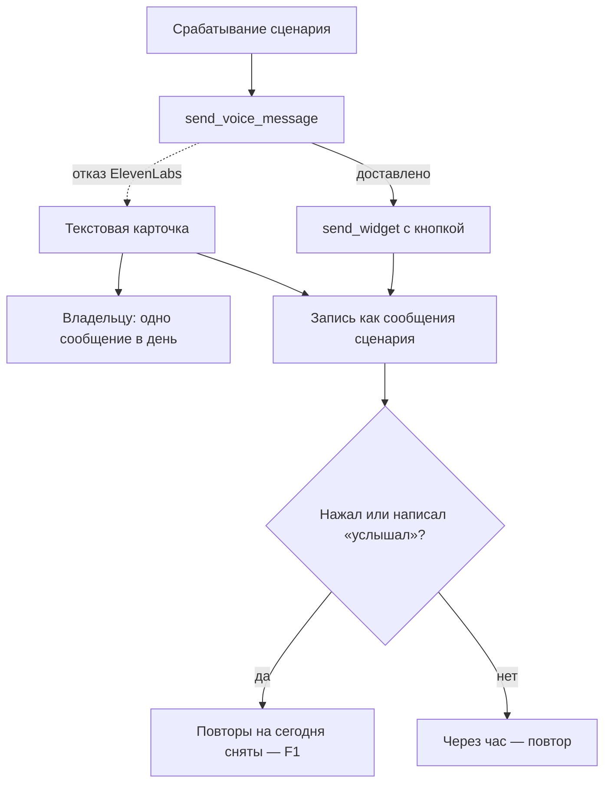

# Голос, виджеты и другие отправки в сценариях — спецификация

**Статус:** согласовано 09.11.2026, в работе — #480
**Дата:** 2026-11-09 · **Проект:** Osinara · **Тип:** смешанный (поведение сценариев для людей + запись
отправленного сценарием) · **Где работает:** запуски сценариев по расписанию в Telegram
**Не применяется:** 11 — ожидание не меняется: голосовое и виджет отправляются за секунды, сценарий и сейчас идёт
в фоне.

## Коротко

**Что строим и зачем.** Сценарий по расписанию должен уметь отправить то же, что бот умеет в живом разговоре:
голосовое, виджет с кнопками, гифку, опрос, место, контакт. Сейчас человек просит «каждое утро озвучивай задачи
голосом и дай кнопку «услышал»; не нажал — повторяй каждый час». Агент ставит два сценария, а в момент запуска у
сценария нет ни голоса, ни виджета. Модель 9 минут ставит в песочнице стороннюю озвучку, Telegram отвергает файл,
человек получает только текст; кнопки нет — повторы идут до 22:30 каждый день. Успех: голосовое и карточка с
кнопкой приходят, нажатие останавливает повторы на сегодня.

**Как будет работать.**
1. У сценария в личке и семейной группе тот же набор отправок, что у живого разговора там же: голосовое, виджет
   (только в личке — Telegram не показывает виджеты в группах), гифка, опрос, место, контакт. Запреты гостя
   действуют как вживую. Гифки, опросы, место и контакт — у всех и везде по умолчанию, сценарии внешних групп
   включительно; голос во внешней группе — по её праву, как вживую (F3).
2. Всё, что сценарий отправил этими инструментами, записывается как его сообщение: агент в чате видит его среди
   сообщений бота, список сценариев показывает «доставлено», а не «промолчал».
3. Кнопку подтверждения агент сам зашивает в сценарий и сам указывает, какой его повторяющийся сценарий она
   сбрасывает. Нажатие не вызывает агента: сервер сразу сбрасывает этот сценарий (F1), отмечает «прочитано» и
   меняет кнопку на «✅ Прочитано в 8:10». Агент видит отметку в списке сценариев (`skip`: когда нажали и до
   какого момента запуски пропускаются).
4. Создавая сценарий, агент знает, чего сценарий не умеет (сохранять в память, менять свои инструкции и скиллы,
   спрашивать разрешение на сеть или ключ, ждать ответа в самом запуске), и говорит об этом сразу.
5. Если сценарий не смог сделать часть работы, человек читает это простыми словами — без названий инструментов,
   скиллов и без чужих счетов («владельцу нужно оплатить ElevenLabs» гость не видит).
6. Аудиофайл внутри ответа уходит так, как Telegram его принимает; способ выбираем живой пробой на шаге 0.
7. Когда ElevenLabs отказывает (оплата, тариф, ключ), владелец получает одно сообщение в день с причиной (F5).

**Как будем строить.**
1. Снимаем исключения отправок для запусков по расписанию: набор инструментов (`mode-tool-surface.ts`) и правила
   для модели, которые сейчас вырезаются в сценариях (`mode-instructions.ts`).
2. Все шесть инструментов отправки пишут через одну функцию (`recordToolDeliveryInTimeline`): добавляем ветку
   сценария в уже существующую таблицу итогов сценариев (`proactive_deliveries`) и не привязываем ответы к сеансу
   сценария — как уже сделано для финального текста сценария.
3. Подсказки модели после отправки (голос, виджет) в сценарии говорят правду: доделай сценарий; нажатия придут
   агенту в чате.
4. Новый вид кнопки — «сбросить сценарий»: агент ставит её обычной кнопкой под карточкой, текстом или голосовым
   (F7) с номером сценария; сервер проверяет номер при отправке и исполняет сброс при нажатии, без модели.
5. Rich-ответ: тип вложения для голосового — по итогам шага 0.
6. Сообщение владельцу — через существующие тревоги (`agent/lib/operational-incidents/owner-alerts.ts`).

**На что смотреть.**
- **ElevenLabs с 07.11 отказывает:** три из четырёх последних озвучек провалились с «нужна оплата». По коду
  клиента так приходят и «кончились кредиты», и «голос из библиотеки требует платного тарифа». Пока это не
  исправлено в аккаунте, голос не работает нигде — ни в сценариях, ни в живых чатах. Это действие владельца.
- **Деньги на голос.** Если человек весь день не жмёт кнопку, ежечасный сценарий даёт до 16 голосовых в день
  (≈ 290 тыс. кредитов в месяц при сегодняшних 2–6 тыс.) — F4.
- **Связь кнопки со сценарием держится на номере.** Агент вписывает номер ежечасного сценария в кнопку
  утреннего; удалили ежечасный — сервер отвергнет такую кнопку при отправке, а старая кнопка ответит «этого
  напоминания больше нет».
- **Уже созданные сценарии гостя не говорят, что значит нажатие.** Без их правки нажатие повторы не остановит ни
  при каком варианте F1 — F2.
- **Ответ реплаем на голосовое сценария в семейной группе** сейчас ушёл бы в закрытый сеанс сценария — не
  регистрируем такие маршруты (шаг 2).
- **Старое нажатие.** Нажатие на вчерашнюю карточку не должно снять сегодняшние повторы — в нажатии будет время
  запуска.

**На что опираемся.**
- Telegram Bot API 10.3 (проверено 09.11.2026): в rich-сообщении есть отдельный блок голосового
  (`InputRichBlockVoiceNote`), тип медиа определяется по MIME и адресу. Почему Telegram отверг наш файл, не
  доказано — шаг 0.
- Наш код: шесть инструментов отправки пишут через одну функцию; итоги сценариев уже в `proactive_deliveries` и
  уже показываются агенту в чате; запреты гостя уже действуют в сценариях (`agent/tools/capabilities.ts:124`);
  финальный текст сценария уже не регистрирует маршрут ответа (`agent/channels/telegram.ts:349`).
- Боевые данные 08–09.11: 8 запусков сценариев гостя дошли текстом; 6 отказов `RICH_MESSAGE_DOCUMENT_INVALID`;
  журнал ElevenLabs `voice_message_operations`.

**Найдено по пути.**
- ElevenLabs отказывает с 07.11, никто не предупреждён (F5).
- Сценарий показывает человеку технический текст: «Виджетный инструмент `send_widget` в этом запуске недоступен
  (навык `widgets` не загрузился)». Убираем (шаг 3).
- Ошибка озвучки сейчас велит модели пересказать человеку причину «Владельцу нужно проверить подписку
  ElevenLabs» — гость читал бы о счетах владельца каждый час. Причину видит только владелец (шаг 3).
- Правило запуска «задай один понятный вопрос» обещает ответ, который в запуск не вернётся: ответ человека уходит
  в обычный чат. Переформулируем (шаг 3).

**Решено владельцем (09.11):** сценарии живые — их и кнопку подтверждения настраивает агент; нажатие не
вызывает агента, а сбрасывает установленный им ежечасный сценарий и засчитывается как прочитано.

**Решено владельцем (09.11):** F1 — сброс снимает оставшиеся на сегодня запуски; F2 — сценарии гостя правлю
после выпуска, показав текст заранее; F7 — кнопка сброса стоит под сообщением (под карточкой-виджетом, текстом
или голосовым), в том же сообщении.

**Решено владельцем (09.11), остальное:** скилл гостя `daily-tasks-widget` правится вместе со сценариями (F2);
сценарии внешних групп получают гифки, опросы, место и контакт по умолчанию, голос — по праву группы (F3);
лимита голосовых нет (F4); владельцу — сообщение при отказе ElevenLabs (F5); выкатка — обычным релизом (F6).

**Нужно от владельца:** разобраться с аккаунтом ElevenLabs (что именно — покажет шаг 0) — без этого голос не
заработает.

**Выкатка:** обычный релиз через CI на прод, тестового сервера нет (F6).

**Объём:** шаг 0 и 7 шагов — около 2,5 ч работы агента; кнопка сброса — ещё около 1,5 ч; прогоны в Docker и CI
релиза — около 40 мин. От вас — аккаунт ElevenLabs, ответы на вопросы и кнопка обновления в Telegram.

**Не проверено:** что именно означает отказ ElevenLabs; почему Telegram отверг файл и примет ли голосовой блок;
сработает ли нажатие на живом сценарии гостя — всё это шаг 0 и проверка после выпуска.

---

# Часть 1. Для владельца: как это работает

## 1. Что известно и что добавлено

- **Владелец сказал (09.11.2026):** «мне нужно чтобы всё работало» — в ответ на варианты «разрешить сценариям
  голос и виджеты / только виджеты / оставить как есть». И: «со мной согласовать, я ещё не давал команды».
  И: «сценарии у нас живые, агент сам их настраивает, не хочу, чтобы вмешивался бэкенд… кнопку он сам зашил…
  когда человек нажимает, не агента дёргаем, а по этой кнопке его установленный ежечасный таймер сбрасывается и
  засчитывается как прочитано».
- **Агент рекомендовал, владелец не подтвердил:** открыть сценариям гифки, опросы, место, контакт; лимит и
  сообщение владельцу — в F3–F5.
- **Найдено в проекте:**
  - запуск по расписанию идёт без `send_voice_message`, `send_widget`, `send_gif`, `send_poll`, `send_location`,
    `send_contact` (`agent/lib/tool-policy/mode-tool-surface.ts:295-322`), и правила для модели про голос,
    гифки, отправки и виджеты в сценарии вырезаются (`agent/lib/prompt/mode-instructions.ts:264-273, 343-351,
    398-403`);
  - причины в коде: голос «тратит кредиты ElevenLabs и заменяет ответ — нужен живой собеседник»; виджет «отвечает
    живому человеку, нажатия возвращаются в живой чат»; гифка, опрос, место, контакт — без довода. В спецификации
    виджетов (`docs/plans/telegram-widgets.md`) виджеты в сценариях — «не цель», без довода;
  - нажатие виджета становится сообщением нажавшего в обычной очереди чата (`agent/lib/widgets/widget-press.ts`);
  - отправленное инструментом в личке из сценария сейчас никуда не записывается
    (`agent/lib/telegram-tool-delivery-timeline.ts:80`); итог сценария — только финальный текст;
  - сценарии внешних групп живут на собственном узком списке прав: чтение памяти и `web_fetch`
    (`agent/lib/agent-schedules/external-agent-schedule-policy.ts:31-47`);
  - тип файла определяется по содержимому (`agent/lib/workspaces/workspace-file-metadata.ts:38`), голосовое Opus
    получает не просто `audio/ogg`;
  - масштаб: за всё время 35 голосовых, 2–6 тыс. кредитов в месяц; у активного гостя 4 сценария, из них ежечасный.
- **Добавлено:** [ДОПУЩЕНИЕ] одно голосовое сценария ≈ 600 кредитов (озвученный список из 5–7 задач; цена кредита
  за символ у модели `eleven_v4` не проверена); в живых ответах в среднем 120–350.

| Код | Что это | От кого, дата | Где | Вес |
|---|---|---|---|---|
| OWN | «всё должно работать» | владелец, 09.11.2026 | этот разговор | требование |
| WID | виджеты: только личка, «нет в сценариях» | владелец, 06.11.2026 | `docs/plans/telegram-widgets.md` | «только личка» остаётся, «нет в сценариях» заменяется OWN |
| TG | Bot API 10.3, rich-сообщения | Telegram, 24.08.2026 | core.telegram.org/bots/api/rich-messages | справка |

## 2. Цели, не цели, антицели

- **Цели:**
  1. Сценарий, который просили «голосом и с кнопкой», приходит голосом и с кнопкой **[OWN]**.
  2. Нажатие кнопки останавливает повторы на сегодня; нажатие на вчерашнюю карточку — нет.
  3. Агент при создании сценария не обещает того, чего сценарий не сможет.
  4. Человек не видит технических слов и чужих счетов.
  5. Владелец узнаёт, что голос перестал работать, в тот же день и с правильной причиной.
- **Не цели:** виджеты в группах; сохранение в память из сценария; другая озвучка вместо ElevenLabs.
- **Антицели:** сценарий шлёт голосовые по кругу после нажатия; одна отправка записана дважды; ответ человека
  уходит в закрытый сеанс сценария.
- **Сейчас:** голос и кнопка не приходят; человек получает текстовую карточку и ежечасные повторы до вечера.

## 3. На что опираемся

| Практика | Кто делает | Масштаб | Берём? | Почему | Источник, дата |
|---|---|---|---|---|---|
| Одинаковый набор отправок у живого хода и у сценария | наше ядро — для текста и файлов | любой | да | агенту не нужно помнить исключения | `mode-tool-surface.ts` |
| Голосовое в rich-сообщении отдельным блоком | Telegram | любой | после шага 0 | способ вложения не проверен | Bot API 10.3, 09.11.2026 |
| Бесплатная озвучка Edge TTS через неофициальный адрес | модель сама в песочнице | — | нет | неофициальный адрес, работа не гарантирована | боевой журнал хода 09.11 |
| Лимит платных вызовов на пользователя | крупные сервисы | от сотен пользователей | нет (F4) | 35 голосовых за 2,5 месяца | `voice_message_operations` |

## 4. Варианты и масштаб

**Масштаб:** одна семья с гостями, 35 голосовых за 2,5 месяца, сценариев — единицы на человека. Сопровождают
владелец и агенты.

Открыть сценариям отправки — выбор владельца (OWN); где именно — F3. Как нажатие останавливает повторы — F1.
«Пробуждение в разговоре» (там голос и виджеты уже есть) не подходит: не больше 50 запусков и трёх на чат, а
утренняя рутина — без конца.

## 5. Как работает

**Точки входа:** просьба в чате → сценарий 1; срабатывание → 2; нажатие → 3; отказ ElevenLabs → 4.

**Сценарий 1 — Постановка.** Артём, гость владельца, пишет в личку: «каждое утро в 7:30 озвучивай задачи голосом и
дай кнопку «услышал»; не нажал — повторяй каждый час до вечера».
1. Агент загружает скилл `schedules`, ставит ежечасный сценарий, затем утренний — с кнопкой сброса, в которую
   вписывает номер ежечасного.
2. **Ключевой момент:** если Артём просит то, чего сценарий не умеет («и запоминай, что я ответил»), агент говорит
   это сразу и предлагает, как иначе.

**Сценарий 2 — Утренний запуск.** 7:30.
1. Модель озвучивает задачи через `send_voice_message` — голосовое приходит в чат.
2. Модель отправляет карточку с кнопкой через `send_widget`.
3. Обе отправки записываются как сообщения сценария; ход заканчивается без лишнего текста.
4. **Ключевой момент:** у запуска в списке «доставлено»; агент в чате видит, что утром пришли голосовое и карточка.
- **Сбой ElevenLabs:** модель шлёт те же задачи текстом с фразой вроде «Голосовое сейчас не получилось — вот
  задачи текстом» и в конце «нажми кнопку или напиши «услышал»»; владельцу — сообщение (сценарий 4).
- **Сбой виджета:** задачи текстом и «напиши «услышал», когда прочитаешь».

**Сценарий 3 — Нажатие.** Артём в 8:10 жмёт «✅ Задачи на день услышаны» — кнопку, которую агент при постановке
связал с ежечасным сценарием.
1. Сервер, без модели, сбрасывает ежечасный сценарий (F1) и записывает в историю чата «Артём подтвердил: задачи на
   день услышаны, 8:10».
2. Кнопка меняется на «✅ Прочитано 8:10». Агент не отвечает.
3. **Ключевой момент:** в 8:30 голосового нет.
- **Вчерашняя карточка:** нажатие не сбрасывает сегодняшнее; кнопка отвечает «Эта карточка за вчера — подтверди
  сегодняшнюю».
- **Связанный сценарий удалён:** кнопка отвечает «Этого напоминания больше нет».
- **Если кнопки нет:** Артём пишет «услышал» — агент делает тот же сброс через управление сценариями.

**Сценарий 4 — Отказ ElevenLabs.** Первая озвучка дня получает отказ.
1. Человек получает текст вместо голосового, без причины.
2. Владелец получает одно сообщение в день по каждой причине (F5, тексты — раздел 12).

## 6. Решения владельца

### F1. Что именно делает «сброс» ежечасного сценария?
**Ситуация:** у гостя ежечасный сценарий повторяет задачи с 8:30 до 22:30. В 8:10 гость жмёт кнопку. Ночью
сценарий тоже срабатывает каждый час, но молчит — так его настроил агент.
**Почему решать вам:** от этого зависит, когда сценарий снова заговорит и что агент может задать кнопкой.
- **А. Снять оставшиеся на сегодня запуски** (по часовому поясу сценария); с полуночи сценарий идёт по своему
  расписанию. Даёт: простой и предсказуемый смысл «прочитано на сегодня»; агенту в кнопке нужно указать только
  какой сценарий. Стоит: ночные тихие запуски после полуночи остаются, как сейчас.
- **Б. Снять запуски до времени, которое агент сам указал в кнопке** (например, «до завтра 8:30»; сервер не даст
  больше 7 дней вперёд). Даёт: агент управляет тоньше — заодно убирает ночные тихие запуски. Стоит: агент может
  указать неверное время, и повторы встанут дольше, чем нужно.
**Рекомендую А:** это ровно «сбросить таймер и засчитать прочитанным»; для другого смысла агент всегда может
поменять сам сценарий.
**Если никто не решил:** А.

### F7. Какие кнопки умеют сброс?
**Ситуация:** у нас два вида кнопок. Обычная кнопка под сообщением (кнопка-ответ, разметка `<tg-button>` в тексте
ответа) — видна во всех приложениях и в группах; утром 09.11 сценарий гостя, оставшись без виджета, поставил
именно её: «✅ Задачи на день услышаны». Кнопка внутри карточки-виджета — часть самой карточки; её видят только
приложения, которые показывают виджеты.
**Проверено 09.11.2026 живой пробой:** бета `sendWidget` принимает обычные кнопки (`reply_markup`) — они стоят
прямо под карточкой, одним сообщением; нажатие такой кнопки приходит на наш обычный вебхук, как любое нажатие
(`callback_query` с `message.widget`). Наш `send_widget` сейчас кнопки не передаёт.
**Почему решать вам:** это то, где агент сможет поставить кнопку сброса.
- **А. Только обычная кнопка — под карточкой, под текстом или под голосовым.** Даёт: один путь нажатия, кнопка
  видна в любом приложении и в группе и при этом стоит прямо под карточкой. Стоит: `send_widget` учится ставить
  обычные кнопки; зелёной кнопки внутри самой карточки для сброса нет.
- **Б. Оба вида.** Даёт: агент может поставить сброс и внутри карточки. Стоит: второй путь нажатия; внутри
  карточки кнопку видят не все.
**Рекомендую А:** проба показала, что обычная кнопка встаёт прямо под карточкой, — кнопка внутри карточки для
сброса ничего не добавляет, а видна не всем.
**Если никто не решил:** А.

### F2. Что делать с уже созданными сценариями гостя?
**Ситуация:** у гостя четыре сценария; утренний и ежечасный построены под кнопку, но кнопка в их тексте не
связана с ежечасным сценарием. Без правки нажатие ничего не сбросит.
**Почему решать вам:** это правка чужих данных на проде.
- **А. С вашего разрешения после выпуска правлю текст утреннего и ежечасного сценариев:** их кнопка становится
  кнопкой сброса ежечасного сценария; условие «файл-отметка» убираю. Новый текст покажу до записи. Даёт: гость
  видит, что всё работает, ничего не делая. Стоит: одна правка боевой базы с вашего согласия.
- **Б. Не трогаю; вы просите гостя сказать боту «пересобери утренние сценарии».** Даёт: правка идёт обычным
  путём, через агента. Стоит: ваше время и сообщение гостю; до этого повторы продолжаются.
**Рекомендую А.**
**Если никто не решил:** Б.

### F3. Внешние группы — открывать ли их сценариям отправки?
**Ситуация:** в чате группы знакомых по агенту владелец разрешил голос; ведущий группы ставит сценарий «каждое утро
голосом сводка обсуждения».
**Почему решать вам:** сценарии внешних групп сейчас работают на отдельном узком списке прав, который вы выдаёте
каждому сценарию; открыть отправки — значит менять эту модель прав.
- **А. Как сейчас: сценарии внешних групп без голоса, гифок, опросов, места, контакта;** агент при постановке это
  говорит. Даёт: модель прав не меняется. Стоит: такие просьбы в группах не выполняются.
- **Б. Сценарий группы получает то, что группе выдано вживую.** Даёт: в группе всё как в живом чате. Стоит:
  сценарий получает и всё, что группе выдадут позже, без отдельного решения; кредиты ElevenLabs тратятся по
  расписанию в чужом чате.
- **В. Голос и другие отправки — отдельной галочкой в списке прав каждого сценария группы.** Даёт: точный
  контроль. Стоит: новое право в списке, которое потом нельзя убрать без поддержки старых записей; выдавать его
  каждому сценарию вручную.
**Рекомендую А:** живая внешняя группа одна, просьб о сценариях с голосом там не было.
**Если никто не решил:** А.

### F4. Ограничивать ли число голосовых от сценария?
**Ситуация:** человек уехал и весь день не смотрит в телефон; повтор каждый час с 7:30 до 22:30 — 16 голосовых.
**Почему решать вам:** деньги ElevenLabs. Одно голосовое ≈ 600 кредитов [ДОПУЩЕНИЕ]: в худший день ≈ 9,6 тыс., в
месяц ≈ 290 тыс.; если жмёт кнопку утром — ≈ 18 тыс. в месяц. Сейчас уходит 2–6 тыс. Тарифы по сторонним обзорам:
Creator ≈ $22 за ≈ 100 тыс. кредитов, Pro ≈ $99 за ≈ 500 тыс. [ДОПУЩЕНИЕ, сверим на шаге 0].
- **А. Без лимита** — сценарий звучит, как просили; в худшем случае тариф Pro.
- **Б. Не больше 3 голосовых в день от одного сценария, дальше та же карточка текстом** — потолок расхода; новое
  правило, человек может не получить голосовое, которого ждёт.
**Рекомендую А:** с надёжной остановкой по нажатию (F1) худший случай требует, чтобы человек весь день не
реагировал; сообщение F5 покажет, когда кредиты кончатся.
**Если никто не решил:** А.

### F5. Писать ли вам, когда ElevenLabs отказывает?
**Ситуация:** с 07.11 озвучка отказывает, вы об этом не знали.
**Почему решать вам:** это новое сообщение вам.
- **А. Одно сообщение в день по каждой причине** (тексты — раздел 12): кончились кредиты; нужен платный тариф;
  ключ отклонён. Даёт: узнаёте в тот же день и знаете, что делать.
- **Б. Без сообщения (как сейчас).**
**Рекомендую А.**
**Если никто не решил:** А.

### F6. Выкатка
- **А. Обычный релиз через CI на прод** — тестового сервера нет; проверка — на ближайшем утреннем запуске
  сценария гостя после F2.
**Рекомендую А.**

### Принято
- **09.11.2026, владелец:** сценарии и кнопку подтверждения настраивает агент; сервер ничего в сценарий не
  добавляет. Нажатие не вызывает агента: сервер сбрасывает связанный сценарий и засчитывает «прочитано». Выбрано
  вместо «нажатие разбирает модель» (ненадёжно и молча стоит денег) и вместо «кнопку ставит сервер» / «повтор как
  свойство сценария» (сервер вмешивается в живые сценарии).
- **09.11.2026, владелец — F1 = А:** сброс снимает оставшиеся на сегодня запуски связанного сценария по его
  часовому поясу; с полуночи сценарий идёт по расписанию. Выбрано вместо «до времени, указанного агентом».
- **09.11.2026, владелец — F7:** кнопка сброса — обычная кнопка под сообщением (`reply_markup`), в том же
  сообщении, что карточка-виджет, текст или голосовое. Живые пробы 09.11: кнопка внутри подписи виджета
  невозможна — подпись принимает только форматирование текста (`Unsupported start tag "tg-button-row"`),
  виджет нельзя вложить в rich-сообщение; кнопка внутри самой карточки видна не во всех приложениях. Кнопка
  внутри карточки для сброса не используется.
- **09.11.2026, владелец — F2 дополнительно:** вместе со сценариями правится скилл гостя `daily-tasks-widget`
  (кнопка — под карточкой и сбрасывает ежечасный сценарий; пункт про файл-отметку удаляется); текст — владельцу до
  записи.
- **09.11.2026, владелец — F3 = Б и шире:** «опросы, место, контакт и т. д. — по умолчанию всем, всегда, везде».
  Гифки, опросы, место и контакт доступны без права в живых ходах и сценариях лички, семейной группы и внешней
  группы; голос во внешней группе (платный) — по праву группы и в её сценариях. Подагентов не касается: они
  отвечают основному агенту, а не в чат.
- **09.11.2026, владелец — F4:** лимита голосовых от сценария нет.
- **09.11.2026, владелец — F5 = А:** одно сообщение владельцу в день по каждой причине отказа ElevenLabs.
- **09.11.2026, владелец — F6 = А:** обычный релиз через CI на прод.
- **09.11.2026, владелец — F2 = А:** после выпуска агент правит текст утреннего и ежечасного сценариев гостя
  (кнопка становится кнопкой сброса, условие «файл-отметка» уходит), новый текст показывается владельцу до записи.

---

# Часть 2. Для исполнителя: поведение подробно

## 7. Инструменты

| Инструмент | Что меняется в запуске по расписанию | Повтор | Ошибки |
|---|---|---|---|
| `send_voice_message` | доступен в личке и семейной группе. Описание и скилл `voice-replies`: «по явной просьбе в сообщении или в инструкции сценария». `nextStep` в сценарии: «голосовое доставлено; выполни остальные шаги сценария; если сказать больше нечего — заверши ход строкой маркера» | как сейчас: ключ по `callId` | человеку — без причины (раздел 9) |
| `send_widget` | доступен в личке. `nextStep` в сценарии: без «нажатия придут тебе» и без `update_widget` — нажатия придут агенту в чате | как сейчас | повтор `surfaceId` — исправимая ошибка |
| `send_gif`, `send_poll`, `send_location`, `send_contact` | доступны в личке и семейной группе, как вживую | как сейчас | как сейчас |
| `update_widget`, `remember`, `manage_behavior_preference`, `manage_skill` | по-прежнему нет | — | — |

## 8. Запись отправленного сценарием

| Что ломается | Как не допускаем | Как узнаём | Как восстанавливаем | Что теряется | Чем закрыто |
|---|---|---|---|---|---|
| Отправка не записана (сбой базы после ответа Telegram) | запись после подтверждения Telegram, ошибка в лог, не бросается — повторной отправки не будет | лог `failureCode` инструмента | не восстанавливаем | агент в чате не видит это сообщение; запуск «промолчал» | как сейчас в чатах |
| Одно сообщение записано дважды (повтор хода) | уникальность `(source_kind, source_id, telegram_message_id)` | — | — | — | шаг 2 |
| Ответ реплаем уходит в закрытый сеанс сценария (семейная группа) | в сценарии маршрут ответа не регистрируется — как у финального текста (`telegram.ts:349`) | — | — | — | шаг 2 |
| Запуск кончился маркером после отправок и посчитан «промолчал» | `deliveredAt` берётся из `proactive_deliveries`, куда пишутся и отправки | список сценариев | — | — | шаг 2 |

## 9. Ошибки и восстановление

| Ситуация | Что видит человек | Как выходит | Что сохраняется |
|---|---|---|---|
| ElevenLabs отказал (любая причина) | задачи текстом, первой фразой «голосовое сейчас не получилось», без причины и счетов; владелец получает причину (F5) | ждёт исправления | запуск засчитан |
| Telegram отверг виджет | те же задачи текстом и «напиши «услышал»» | пишет «услышал» | запуск засчитан |
| Сценарий просит то, чего не умеет | «Это из сценария я сделать не могу — напишите мне в чат, и я сделаю» (модель, без названий инструментов) | пишет в чат | — |
| В запуске не хватает данных | что не хватает и что написать в чат — без вопроса, ждущего ответа в запуске | пишет в чат | — |

## 10. Края и стыки

| Случай | Что происходит | Как решаем |
|---|---|---|
| Гостю выключен `send_voice_message` | сценарий без голоса | `guestScopedSurface` уже действует на сценарии; тест шага 1 |
| Повторяющийся виджет с тем же `surfaceId` | отказ «surfaceId уже был» | скилл: дата и время запуска в `surfaceId`; модель исправляется по `correction` |
| Нажатие на вчерашнюю карточку | сегодняшние повторы не снимаются | сервер сверяет день запуска, отправившего кнопку, с сегодняшним |
| Виджет «пробуждения в разговоре» | это ход самого чата | в нажатии не помечается как сценарий: виджет ищется по ходу (`agent_turn_id`), не по сеансу |
| Сценарий в семейной группе | виджетов нет, остальное есть | как вживую |

| Соседняя функция | Где встречаются | Что происходит | Как решаем |
|---|---|---|---|
| Сообщения бота в контексте чата (`<recent_proactive_deliveries>`) | отправки сценария | появляются строки «Голосовое сообщение: …», «Виджет: …» | так и нужно |
| Учёт ElevenLabs (`voice_message_operations`) | голос сценария | пишется как вживую | — |
| Тревоги владельцу (`operational_incidents`) | F5 | одна запись в день по ключу причины | — |

## 12. Тексты

| Где | Текст |
|---|---|
| Владельцу: кончились кредиты (`insufficient_credits`, `quota_exceeded`) | «В ElevenLabs закончились кредиты: голосовые сейчас уходят текстом. Пополните баланс или смените тариф ElevenLabs. Код: AGENT_VOICE_MESSAGE_PROVIDER_PAYMENT_REQUIRED» |
| Владельцу: нужен платный тариф (`paid_plan_required`, `payment_required`) | «ElevenLabs требует платный тариф для нашего голоса: голосовые сейчас уходят текстом. Оформите платный тариф ElevenLabs. Код: AGENT_VOICE_MESSAGE_PROVIDER_PAYMENT_REQUIRED» |
| Владельцу: ключ отклонён (401, 403) | «ElevenLabs отклонил ключ доступа: голосовые сейчас уходят текстом. Проверьте ключ ELEVENLABS_API_KEY и его права в ElevenLabs. Код: AGENT_VOICE_MESSAGE_PROVIDER_ACCESS_DENIED» |

## 13. Деньги, данные

- Голос сценариев тратит кредиты ElevenLabs владельца — F4.
- В `proactive_deliveries` пишется текст голосового и подпись виджета — то же, что сейчас пишется в историю живого
  чата.

## 14. Чего сознательно не делаем

- Не меняем ElevenLabs на другую озвучку — нет просьбы.
- Не открываем сценариям `update_widget` — менять показанную карточку некому, сеанс сценария закрыт.

## 15. Решения агента — на проверку

- Сценарий в нажатии ищем по ходу, отправившему виджет (`telegram_widgets.agent_turn_id` →
  `agent_schedule_runs.agent_turn_id`), а не по сеансу: у «пробуждения в разговоре» сеанс общий с чатом.
- Причину отказа ElevenLabs человеку не показываем ни в каком чате, кроме лички владельца.
- Сообщение владельцу — через существующие тревоги, а не новым каналом.
- Кнопку сброса нажимает только тот, кому адресовано сообщение, как и любую нашу кнопку-ответ: в личке — хозяин
  чата, в семейной группе — автор сценария. (В черновике было «любой участник группы»; при реализации оставлено
  общее правило кнопок, отдельный путь для одной кнопки не заводился.)
- «Прочитано» хранится у самого сценария (`agent_schedules.skipped_until`, `skipped_at`) и показывается агенту в
  списке сценариев как `skip`. (В черновике — строкой в истории чата; отметка у сценария надёжнее: не нужен
  отдельный путь записи в историю мимо модели.)
- Если человек написал «услышал» словами, агент переносит следующий запуск повторяющегося сценария на его первое
  время завтра через `manage_agent_schedule update`; отдельного действия «сброс» у инструмента нет.
- Номер сценария в кнопке сервер проверяет и при отправке (неверный — исправимая ошибка для модели), и при нажатии
  (сценарий мог быть удалён).

---

# Часть 3. Для исполнителя: как строить

## 16. Что есть и что берём

- `agent/lib/tool-policy/mode-tool-surface.ts` — набор инструментов; меняем исключения сценариев личных и
  семейных.
- `agent/lib/prompt/mode-instructions.ts` — правила для модели; в сценариях перестаём вырезать правила голоса,
  гифок, отправок и виджетов (оставляем вырезанными реакции, «реплики вслух», вставки в ход).
- `config/service-skills/voice-replies/SKILL.md`, `config/service-skills/schedules/SKILL.md` — тексты для модели.
- `agent/lib/telegram-tool-delivery-timeline.ts` — единая запись отправок шести инструментов.
- `agent/lib/proactive-deliveries/proactive-delivery-repository.ts` (`recordProactiveDelivery`),
  `agent/lib/agent-schedules/scheduled-session.ts` (`scheduledRunId`, `scheduledDeliveryMetadata`) — как есть.
- `agent/lib/widgets/send-widget.ts` (`nextStep`), `widget-press.ts`, `widget-repository.ts`.
- `agent/lib/agent-schedules/agent-schedule-dispatcher.ts` (`scheduledRunPrompt`).
- `agent/lib/voice-messages/voice-message-errors.ts`, `elevenlabs-speech-client.ts` — текст ошибки для человека и
  причина для владельца.
- `agent/lib/answer-files/answer-file-resolution.ts`, `agent/lib/telegram-rich-messages.ts` — тип вложения.
- `agent/lib/operational-incidents/owner-alerts.ts` (`recordOperationalIncident`).
- Наследие: в списке прав сценариев внешних групп два устаревших имени (`inspect_workspace_image`,
  `send_workspace_file`) — держатся ради сохранённых записей, не мешают, не трогаем.

## 17. Устройство

- Для шагов 1–7 таблиц и миграций нет. `proactive_deliveries` получает строки `source_kind='agent_schedule'`,
  `source_id=<run id>`, `telegram_message_id` отправки; уникальность уже есть.
- Нажатие: `StoredWidget` получает `scenario: { id, title, scheduledFor } | null`; `widgetPressText` добавляет
  название сценария, `schedule_id` и местное время запуска.
- Кнопка «прочитано» (F1, F7): тип `read` в разметке кнопок-ответов, `<tg-button type="read" schedule="<id>">`;
  хранится в наборе кнопок как `skipScheduleId`, Telegram получает обычное нажатие с токеном набора. Под карточкой
  виджета кнопки пишутся в конце подписи и уходят клавиатурой того же сообщения (`widget-buttons.ts`,
  происхождение набора `widget`). Нажатие: `skipAgentScheduleForDay` — сценарий того же чата и того же человека,
  день отправки карточки равен дню нажатия по часовому поясу сценария → `skipped_until` = ближайшая полночь,
  запись в журнале `agent_schedule.skipped_for_day`; ответ всплывающей строкой и «✅ Прочитано в 8:10» вместо
  кнопок (у виджета — правкой клавиатуры, отключённой кнопкой). Нажатие не становится сообщением для модели.
  Планировщик перед выдачей запусков проходит наступившие запуски до `skipped_until` без запуска
  (`passSkippedAgentSchedules`, тот же приём, что у отключённых групп). Набор с кнопкой «прочитано» не убирается,
  когда человек пишет что-то другое.
- Миграция 155: `agent_schedules.skipped_until`, `skipped_at`; у наборов кнопок — происхождение `widget` и формат
  `widget`.

## 18. Ловушки платформы

- Файл `.ogg` в rich-сообщении как `document` получил `RICH_MESSAGE_DOCUMENT_INVALID` (боевой лог 09.11). Причина
  не доказана: Telegram обычно принимает любой файл документом. Документация описывает `InputMediaVoiceNote`, а
  ссылки в разметке перечисляет как `tg://photo|video|document|audio`. Шаг 0 отвечает, что принимается.
- Голосовое Opus определяется по содержимому не как просто `audio/ogg` — сопоставление делаем по фактическому
  типу, который даёт `detectWorkspaceFileMetadata`.
- Ключ ElevenLabs может не иметь права читать подписку: 401 на `GET /v1/user/subscription` не значит «плохой
  ключ».

## 19. Сбои на новых путях

| Путь | Сбой | Что видит человек | Чем закрыто |
|---|---|---|---|
| Запись отправки сценария | база недоступна | ничего, сообщение уже пришло | лог, как сейчас |
| Поиск сценария при нажатии | ошибка запроса | нажатие не обработано, виджет показывает ошибку | тест шага 4 |
| Голосовой блок в rich | Telegram отверг | строка «файл не удалось отправить» (как сейчас) | тест шага 6 + лог после выпуска |

## 20. Сопровождение

- Признак работы: у запусков с голосом и виджетом есть `deliveredAt`; в логах нет `RICH_MESSAGE_DOCUMENT_INVALID`;
  после нажатия в тот же день нет голосовых от того же сценария (запрос: нажатия `telegram_widget_queries` →
  запуски `agent_schedule_runs` → `voice_message_operations`).
- Если голос пропал: сообщение владельцу F5 или `voice_message_operations.error_code`.

## 21. Приоритеты

- **P0:** шаги 1–6 и F1; шаг 7 при F5 = А; правка сценариев гостя при F2 = А.
- **P1, P2:** нет.

**Объём:** шаг 0 — 20 мин; шаги 1–7 — около 2 ч; кнопка сброса — около 1,5 ч; прогоны в Docker и CI релиза — около 40 мин.

## 22. Шаги

**Правила каждого шага:**
- Тексты для модели — по-английски; тексты людям — по-русски; коды ошибок `AGENT_*`.
- Тесты — точечные (один файл vitest) и интеграционные через `compose.test.yaml`; полный `npm test` и `tsc` на
  боевой машине не гонять.
- Новый файл — не более 500 строк.
- Права — только backend: запреты гостя действуют в сценариях как вживую.
- Повтор хода не отправляет сообщение второй раз: существующие защиты инструментов не трогаем.
- Репозиторий публичный: в коде, тестах, коммитах и пробах нет данных людей из боевой базы.
- Формулировки промптов проверяются чтением диффа и живым чатом, не тестами на фразы.

### Шаг 0: проверки (после команды владельца)

| Что проверяем | Как | От чего зависит | Что меняется |
|---|---|---|---|
| Причина отказа ElevenLabs | `GET /v1/user/subscription` боевым ключом, вывести только тариф, остаток и статус; при 401 — попросить владельца посмотреть в кабинете | действие владельца, F4 | кредиты / платный тариф / ключ |
| Тарифы и цена кредита `eleven_v4` | elevenlabs.io/pricing и документация | цифры F4 | уточняем F4 |
| Смена кнопки на «✅ Прочитано» под карточкой-виджетом | `editMessageReplyMarkup` на сообщении с виджетом в личке владельца | сценарий 3 (обратная связь после нажатия) | если не принимается — нажатие отвечает всплывающей строкой «Прочитано», кнопка остаётся |
| Что Telegram принимает в rich-сообщении | определить на сервере фактический тип отвергнутых файлов (только чтение, не пересылать); сделать свой файл того же кодека и ElevenLabs-файл; отправить в личку владельца с ботом: `document`, `audio`, голосовой блок | шаг 6 | если голосовой блок не принимается — голосовой файл из ответа уходит отдельным `sendVoice` после текста |

### Шаг 1: набор инструментов и правила сценария

**Файлы:** изменить `agent/lib/tool-policy/mode-tool-surface.ts` (убрать `send_*` из исключений
`TRUSTED_SCHEDULED_SURFACES`; во внешней группе вынести `send_gif`, `send_poll`, `send_location`, `send_contact` из
ветки `if (!scheduledRun)` (`:205-215`) и убрать пропуск голоса для сценария (`:229`); голос сценария внешней группы
берётся из живого права группы на момент запуска, а не из списка прав сценария — `agent-schedule-dispatcher.ts:120-124`,
`external-group-policy.ts`), `agent/lib/prompt/mode-instructions.ts` (в сценариях не вырезать правила голоса, гифок,
отправок и виджетов, включая `:398-403` внешней группы), `config/service-skills/voice-replies/SKILL.md` (когда грузить: и по
инструкции сценария); тесты `agent/lib/tool-policy/mode-tool-surface.test.ts`,
`agent/lib/voice-messages/voice-message-tool-surface.test.ts`, тест инструкций рядом с `mode-instructions.ts`
**Тест:** сценарий в личке владельца, члена семьи и гостя содержит `send_voice_message`, `send_widget`, `send_gif`
(при модели со зрением), `send_poll`, `send_location`, `send_contact`; семейная группа — без `send_widget`;
сценарий внешней группы — `send_gif` (при модели со зрением), `send_poll`, `send_location`, `send_contact` без права, `send_voice_message` — только при праве группы на голос; гость с выключенным `send_voice_message` — без; `update_widget`, `remember`,
`manage_behavior_preference`, `manage_skill` отсутствуют; скиллы `voice-replies` и `widgets` выдаются; правила
голоса и виджетов присутствуют в инструкциях сценария.
**Закрывает:** цель 1.
**Готово:** тест-файлы проходят.

### Шаг 2: запись отправок сценария

**Файлы:** изменить `agent/lib/telegram-tool-delivery-timeline.ts` (в сценарии — `recordProactiveDelivery` с
`sourceKind:"agent_schedule"`, `sourceId:<run id>`, названием и областью из `scheduledDeliveryMetadata`; журнал
группы — как сейчас; маршрут ответа не регистрировать); тест
`agent/lib/telegram-tool-delivery-timeline.integration.test.ts` (новый)
**Тест:** сценарий в личке отправляет голосовое и виджет (Telegram — заглушка) → две строки `proactive_deliveries`;
запуск кончается маркером → `lastRun.deliveredAt` не пустой; следующий ход чата видит обе строки в
`<recent_proactive_deliveries>`; повтор записи — одна строка; сценарий семейной группы — маршрута ответа к сеансу
сценария нет.
**Закрывает:** цель 2 (запись), раздел 8.
**Готово:** интеграционный прогон в `compose.test.yaml` проходит.

### Шаг 3: подсказки модели в сценарии

**Файлы:** изменить `agent/lib/agent-schedules/agent-schedule-dispatcher.ts` (`scheduledRunPrompt`: маркер
допустим и после отправок, если сказать больше нечего; невыполнимое — простыми словами без названий инструментов,
скиллов и файлов; вместо «задай вопрос» — «скажи, чего не хватает и что написать в чат»),
`agent/lib/tools/send_voice_message.ts` (описание; `nextStep` в сценарии), `agent/lib/widgets/send-widget.ts`
(`nextStep` в сценарии), `agent/lib/voice-messages/voice-message-errors.ts` (человеку без причины, кроме лички
владельца); тесты `send-voice-message-tool.test.ts`, тест `send-widget` рядом
**Тест:** в сценарии `nextStep` голосового и виджета не обещают нажатий «тебе» и не предлагают `update_widget`; в
живом ходе — прежние; `correction` ошибки ElevenLabs в чате гостя не содержит «Владельцу».
**Закрывает:** цели 4, сценарий 2.
**Готово:** тесты проходят; дифф промптов прочитан.

### Шаг 4: нажатие называет сценарий и время запуска

**Файлы:** изменить `agent/lib/widgets/widget-repository.ts` (поиск запуска по `agent_turn_id`),
`agent/lib/widgets/widget-press.ts` (`widgetPressText`); тесты `widget-press.test.ts`,
`widget-repository.integration.test.ts`
**Тест:** виджет из запуска сценария — в тексте нажатия название, `schedule_id`, местное время запуска; виджет
живого хода и «пробуждения в разговоре» — текст прежний; сценарий удалён — без сценария.
**Закрывает:** сценарий 3, цель 2 (старое нажатие).
**Готово:** тесты проходят.

### Шаг 5: что знает агент при постановке

**Файлы:** изменить `config/service-skills/schedules/SKILL.md` (раздел «Scenarios»: что сценарий отправляет; чего
не умеет; виджеты только в личке; во внешних группах голос — по праву группы; `surfaceId` с датой и временем; при сбое кнопки —
«напиши «услышал»»; правила F1); `agent/lib/tools/manage_agent_schedule.ts` (фраза-ссылка на эти правила)
**Тест:** нет (формулировки); дифф + живая постановка сценария «голосом и с кнопкой».
**Закрывает:** цель 3, сценарий 1.

### Шаг 6: аудио внутри rich-ответа

**Файлы:** изменить `agent/lib/answer-files/answer-file-resolution.ts` и `agent/lib/telegram-rich-messages.ts`
по итогам шага 0; тесты `answer-file-resolution.test.ts`, `telegram-rich-messages.test.ts`
**Тест:** голосовой файл с фактическим типом из шага 0 уходит выбранным способом; `.mp3` — как сейчас.
**Закрывает:** цель 1 для файлов в ответе.

### Шаг 7: сообщение владельцу (если F5 = А)

**Файлы:** изменить `agent/lib/tools/send_voice_message.ts` (при отказе ElevenLabs по оплате, тарифу или ключу —
`recordOperationalIncident` с ключом `voice-provider:<причина>:<дата UTC>` и текстом из раздела 12); тест
`send-voice-message-tool.test.ts`
**Тест:** два отказа одной причины за день → одна запись; разные причины → разные записи; сбой записи не меняет
ошибку для модели.
**Закрывает:** цель 5.

### Шаг F1: кнопка «прочитано»

**Файлы:** `migrations/155_scenario_sends.sql`; создать `agent/lib/agent-schedules/agent-schedule-skip.ts`,
`agent/lib/reply-buttons/reply-button-keyboard.ts`, `agent/lib/widgets/widget-buttons.ts`; изменить
`reply-button-contract.ts`, `reply-button-markup.ts`, `reply-button-repository.ts`, `reply-button-press.ts`,
`reply-button-telegram.ts`, `reply-button-delivery.ts`, `send-widget.ts`, `send_widget.ts`,
`agent-schedule-dispatch-repository.ts`, `agent-schedule-record.ts`, правила кнопок для модели
**Тест:** `agent-schedule-skip.integration.test.ts` (сброс до полуночи один раз, пропуск запусков без запуска,
`skip` в списке, вчерашняя карточка, чужой чат и человек); `reply-button-press.test.ts` (нажатие не доходит до
модели, тексты отказов, сбой на первом шаге доделывает второй); `reply-button-markup.test.ts`;
`reply-button-telegram.test.ts` (клавиатура виджета); `reply-button-repository.integration.test.ts` (набор виджета
отдельно от хода, кнопка «прочитано» не убирается); `send-widget-tool.test.ts` (кнопки клавиатурой под карточкой).

### Шаг F2: сценарии гостя

После выпуска: показать владельцу новый текст утреннего и ежечасного сценариев гостя и его скилла карточки дел,
затем записать.

### Последний шаг: релиз и живая проверка

Описание выпуска в `docs/releases/vX.Y.Z.md`, порядок — по `docs/production-deployment.md`. После выпуска, F2 и
исправления аккаунта ElevenLabs: утренний запуск сценария гостя — пришли голосовое и карточка с кнопкой; после
нажатия в тот же день голосовых нет; у запусков есть `deliveredAt`; в логах нет `RICH_MESSAGE_DOCUMENT_INVALID`.

## 23. Критерии приёмки

1. Дано: сценарий в личке «озвучь задачи и пришли карточку с кнопкой». Когда: срабатывание. Тогда: в чате
   голосовое и виджет, у запуска `deliveredAt`.
2. Дано: утренняя карточка. Когда: человек нажал кнопку в 8:10. Тогда: в 8:30 и до конца дня голосовых нет.
3. Дано: вчерашняя карточка. Когда: человек нажал её сегодня в 7:40. Тогда: сегодняшние повторы продолжаются.
4. Дано: гостю выключен `send_voice_message`. Когда: сценарий просит голос. Тогда: задачи текстом, без названий
   инструментов.
5. Дано: ElevenLabs отвечает «нужен платный тариф». Когда: два сценария за день. Тогда: оба прислали текст без
   слов о счетах, владелец получил одно сообщение про тариф.
6. Дано: человек отвечает реплаем на голосовое сценария в семейной группе. Тогда: отвечает обычный разговор
   группы.
7. Дано: просьба «запоминай мои ответы каждый вечер» сценарием. Тогда: агент сразу говорит, что сценарий этого не
   умеет, и предлагает иначе.

## 24. Что смотреть на ревью

1. Ход сценария упал после голосового и перезапущен: голосовое не уходит второй раз, строка одна — шаг 2.
2. Сценарий семейной группы: запись в журнал группы и в `proactive_deliveries` не дублирует сообщение в
   контексте — шаг 2.
3. `send_gif` в сценарии при модели без зрения отсутствует — шаг 1.
4. Нажатие на виджет «пробуждения в разговоре» не помечается как сценарий — шаг 4.
5. Тексты ошибок ElevenLabs в чате гостя — без «Владельцу» — шаг 3.

## 25. Открытые вопросы

| Вопрос | Кто отвечает | Блокирует старт? |
|---|---|---|
| F1–F6 | владелец | да, F1 и F2 |
| Причина отказа ElevenLabs | шаг 0 | нет |
