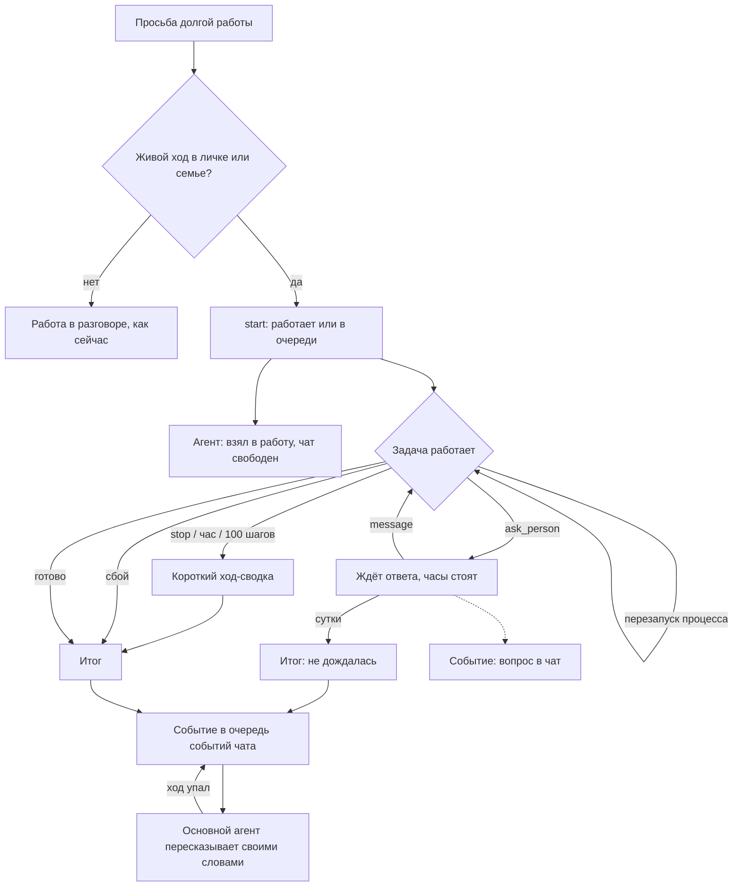
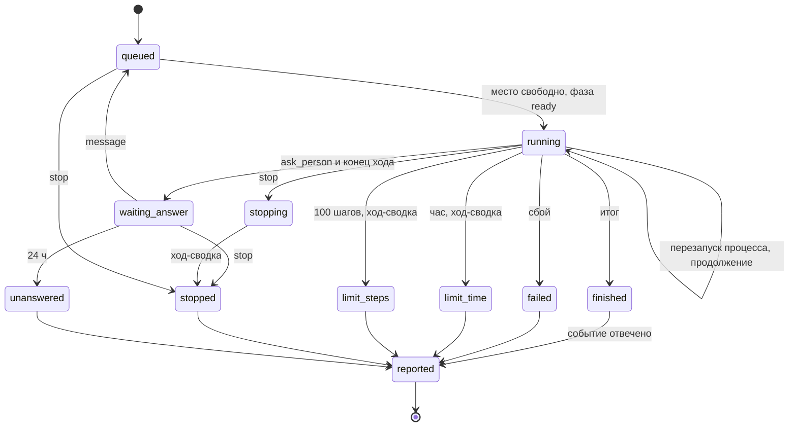

# Фоновые задачи — спецификация

**Статус:** согласовано 16.11.2026 (F1 — A, F2 — A); в работе — #519
**Задача:** https://github.com/nyxandro/osinara/issues/519
**Дата:** 2026-11-16 · **Проект:** Osinara · **Тип фичи:** смешанный (инструмент агента + механизм, работающий сам) ·
**Где работает:** Telegram — личные чаты и семейные группы; фоновые ходы в процессе агента
**Не применяется:** 12 — фиксированных текстов для людей нет: и «взял в работу», и пересказ итога агент пишет
своими словами; что получает модель при отказах — раздел 9.

## Коротко

**Что строим и зачем.**
- **Проблема.** Долгую работу агент делает прямо в разговоре: разобрать файлы, исследовать, собрать скилл. Пока она
  идёт, чат молчит, а одно из двух общих мест обработки сообщений на весь бот занято. За 30 дней в личках так было
  35 раз дольше 5 минут, 6 раз дольше 20 минут, самый долгий — 52 минуты.
- **Решение.** Фоновая задача уводит такую работу из разговора: агент отвечает «взял в работу», чат свободен, итог
  приходит позже.
- **Успех.** Долгая работа в личке и семье не держит ни свой чат, ни места обработки сообщений.

**Как будет работать.**
1. Агент сам решает, что работа долгая и самостоятельная, и запускает фоновую задачу. Можно и попросить: «сделай в
   фоне». Агент сразу отвечает, что взял в работу, и чат свободен.
2. Одновременно идут до трёх задач на весь бот, у каждой до часа работы и до 100 шагов. Четвёртая ждёт очереди
   (F2).
3. Пока всё в порядке, о ходе работы ничего не приходит. Спросишь «как там?» — агент покажет:
   - сколько прошло времени и шагов;
   - когда был последний шаг; если давно, задача, похоже, встала;
   - последнюю заметку задачи и с какими файлами она работала.
4. По твоей просьбе агент передаст задаче поправку («только 2025 год») или остановит её. Остановленная задача коротко
   пишет, что успела.
5. Если задаче нужен ответ человека, она спрашивает через основного агента, и он передаёт ей ответ. Пока задача ждёт,
   её часы стоят. Ждёт до суток, потом заканчивается с честным итогом.
6. Итог приходит в чат, основной агент пересказывает его своими словами. Так же он говорит о любом другом конце:
   сбой, выход за час или 100 шагов, остановка. Запомнить итог агент может, только если ты сам попросишь: в
   память идёт то, что пришло от человека, а не со страниц, которые читала задача.
7. Только личные чаты (гости тоже) и семейные группы. Во внешних группах фоновых задач нет, без переключателя.
   Управляют задачей только из того чата (и темы), где её запустили.
8. Выкатка задач не ждёт. Перезапуск обрывает текущий шаг, после него задача продолжает с того же места, а
   оборванное действие помечается как действие с неизвестным исходом и не повторяется.

**Как будем строить.**
1. **Запись «фоновая задача» в базе:**
   - кто и где запустил;
   - что поручено;
   - состояние;
   - время и шаги;
   - сообщения от основного агента;
   - итог.

   Обоснование и альтернатива «на планировщике» — F1.
2. **Задача — отдельный ход в своей сессии на том же ядре:** тот же цикл, журнал и восстановление. Своего
   цикла агента нет. Ход задачи запускает свой диспетчер на трёх местах, отдельно от мест сообщений.
3. **Права задачи держатся на явной метке «фоновая задача»** в правах хода. Сейчас ограничения подагента держатся
   на признаке «у хода есть родитель», а у задачи родителя нет. Все такие проверки (Google только на чтение, без
   встраивания сообщений, без ответа в чат, промпт) учат и метку задачи.
4. **Основному агенту — один инструмент `background_task`** с действиями «запустить», «статус», «написать»,
   «остановить».
5. **Итог и вопрос задачи — своя очередь событий для чата** с правилом «повторять, пока основной агент не
   ответил». Очередь пробуждений не подходит: она повторов не делает. Ход по событию идёт на месте пробуждений
   тем же способом, каким сейчас приходит пробуждение.
6. **Сообщение основного агента задача видит на ближайшем шаге** — способом встраивания сообщений в ход, с новым
   источником «сообщения задачи».
7. **Лимит часа и остановка обрывают ход через собственный сигнал отмены** диспетчера задач. Ядро такой сигнал
   принимает; прерывание извне сейчас запрещает только общий диспетчер ходов. Поэтому даже зависший шаг не держит
   место дольше часа.

**На что смотреть.**
- **Внешнюю группу это не разгрузит.** 296 из 309 сообщений, ждавших начала обработки дольше 5 минут, — во внешней
  группе, где фона нет по твоему решению. В семейной группе таких ожиданий не было, в личках — 13. Фоновые задачи
  помогают лично тебе и семье: долгая работа в личке перестанет молчать часами и занимать место обработки.
- **Нагрузка на машину.** Три часовые задачи и два разговора одновременно на машине, где уже бывал своп. Замер на
  шаге 0.
- **Общая песочница.** Задача и основной агент работают в одной песочнице чата. У задачи своя папка и своя сессия
  браузера. Но команда `bash` технически может писать куда угодно — это не запрет, а правило в инструкции.
- **Модель может уводить в фон короткие дела.** Проверим на стенде замеров, после выпуска — по логам: время до «взял
  в работу».
- **Отложено:** запуск из сценариев и пробуждений, ручная пауза (раздел 14).

**На что опирается.**
- **iva-agent:** до 3 помощников, 45 минут, 80 шагов; итог пересказывает основной агент. Берём схему, лимиты — твои.
- **Наш подагент** (`agent`, `turn/child-turns.ts`): права и правило «передай всё в поручении». Права переводим на
  метку задачи.
- **Наши пробуждения:** ход по событию на своём месте в очереди чата. Берём способ запуска хода, очередь событий —
  свою.
- **Наше встраивание сообщений в ход:** сообщение доходит до хода через результат инструмента. Берём способ поправки.

**Найдено попутно.**
- **Выкатка ждёт, пока закончатся все сценарии и пробуждения** (`runtime_is_idle` в
  `scripts/production-deploy/backup.sh`). Задача на тех же условиях держала бы выкатку. Поэтому ход задачи не держит
  допуск выкатки.
- **Долгие ходы внешней группы держат её очередь:** 12 раз за 30 дней дольше 5 минут, максимум 93 минуты. Отсюда
  296 ожиданий. Это отдельная задача #520, к фону не относится.

**Решено владельцем 16.11.2026.**
1. Задача — отдельная запись (F1 — A).
2. При трёх идущих задачах — простая очередь (F2 — A).
3. Долгие ходы внешней группы — отдельная задача #520.

**Выкатка:** через CI и релиз, обновление ставится твоей кнопкой (`docs/production-deployment.md`). Нужна
миграция базы. После выкатки — сборщик метрик на сервере и правила наблюдения на хаб.

**Объём:** шаг 0 и 12 шагов. Работа агента — около 8–10 ч (оценка). Время уходит на интеграционные прогоны в Docker
(~10 мин на прогон) и CI релиза (~25 мин). От тебя — ответы на F1–F2, кнопка обновления, живая проверка 10 минут.

**Не проверено:**
- выдерживает ли песочница чата две команды разом;
- можно ли задать задаче свою сессию браузера;
- память машины при трёх задачах;
- уникальны ли номера вызовов инструментов у боевой модели. Ключ защиты от дублей сделан с запасом — пара «ход +
  вызов».

---

# Часть 1. Для владельца: как это работает

## 1. Что известно и что добавлено

- **Владелец сказал (16.11.2026):**
  - до 3 задач одновременно, до часа и 100 шагов на задачу;
  - основной агент запускает задачу и не ждёт её, задача его не блокирует;
  - по просьбе — статус (что делает, этап, не встала ли), поправка и остановка;
  - пингов о ходе нет, статус только по вопросу;
  - вопросы человеку — через основного агента, ответ уходит в задачу; пока ждёт, часы стоят; ждёт до суток;
  - разрешено в личных чатах (гости тоже) и семейных группах; во внешних группах — жёстко нельзя, без переключателя;
  - управлять задачей — из того же чата, где её запустили; в семейной группе — любой участник;
  - выкатка: «не переживай»; можно пауза, «или это лишнее».
- **Владелец сказал 04.11.2026:** фоновые помощники — «интересно, кандидат в работу».
- **Агент рекомендовал, владелец не подтвердил:**
  - «строить на планировщике сценариев» (16.11, в чате) — после разведки рекомендация изменилась, F1;
  - «агент может запомнить итог» (16.11, в чате) — снято: правила памяти проекта (раздел 15).
- **Найдено в проекте** (за 30 дней, база и хаб, 16.11):

  | Что | Где | Сколько |
  |---|---|---|
  | Ход дольше 5 мин | лички | 35 (6 дольше 20 мин, максимум 52 мин) |
  | Ход дольше 5 мин | внешние группы | 12 (максимум 93 мин) |
  | Ход дольше 5 мин | семейная группа | 0 |
  | Сообщение ждало начала обработки дольше 5 мин | внешние группы | 296 |
  | Сообщение ждало начала обработки дольше 5 мин | лички | 13 |
  | Сообщение ждало начала обработки дольше 5 мин | семейная группа | 0 |
  | Вызовы подагента | все чаты | 9 |

  Устройство:
  - мест обработки сообщений — 2 на весь бот, пробуждений — 1;
  - лимит шагов хода — 100, лимита времени хода нет;
  - ограничения подагента держатся на `session.parent`:
    - `google-workspace-live-turn.ts:24`;
    - `turn-interjection-scope.ts:41`;
    - `turn-blocks.ts:237,377`;
    - `telegram-answer-files.ts:39`;
  - `recover` ядра продолжает все незаконченные корневые ходы (`journal-repository.ts:189`);
  - отставленные сессии живут 1 день (`SESSION_RETENTION_DAYS`).
- **Добавлено:**
  - [ДОПУЩЕНИЕ] «три одновременно» — на весь бот: машина одна;
  - [ДОПУЩЕНИЕ] задачу запускает только живой ход;
  - [ДОПУЩЕНИЕ] «тот же чат» в группе с темами — та же тема.
- **Противоречия:** нет.

## 2. Цели, не цели, антицели

- **Цели:**
  1. Долгая работа в личке и семье не держит свой чат: «взял в работу» приходит за обычное время ответа, и
     человек пишет дальше.
  2. Долгая работа в личке и семье не занимает места обработки сообщений: фоновые задачи на своих трёх местах.
  3. Человек в любой момент узнаёт состояние задачи, может её поправить и остановить.
  4. Ни одна задача не пропадает молча. Каждая заканчивается сообщением агента в чате: итог, сбой, остановка, выход
     за лимит, неотвеченный вопрос.
  5. Выкатка не ждёт фоновых задач.
- **Не цели:**
  - разгрузить внешнюю группу — фон там запрещён;
  - запуск из сценариев и пробуждений;
  - ручная пауза;
  - отчёты о ходе работы без вопроса;
  - несколько помощников на одну задачу.
- **Антицели:**
  - агент уводит в фон короткое, и человек ждёт дольше, чем раньше;
  - задача молча пропадает;
  - задача получает больше прав, чем подагент: меняет Google, пишет в чат, перехватывает сообщения человека;
  - три задачи доводят машину до свопа, и бот перестаёт отвечать всем.
- **Сейчас:** долгую работу агент делает в разговоре. Чат молчит до конца, место обработки занято. Два таких
  разговора — и ждут все чаты.

## 3. На что опирается

| Практика | Кто делает | При каком масштабе окупается | Берём сейчас? | Почему | Источник, дата |
|---|---|---|---|---|---|
| Фоновые помощники: до 3, лимит времени и шагов, итог пересказывает основной агент | iva-agent v0.5.9 | один человек и больше | да, лимиты владельца | та же задача | разбор 04.11.2026 |
| Изолированный контекст для независимой подзадачи | наш `agent`; книга «AI-агенты изнутри» | любой | да | изоляция дешевле сжатия | `agent/runtime/tools/delegate.ts` |
| Ход по событию на своём месте в очереди чата | наши пробуждения | любой | да, способ запуска хода | порядок чата сохраняется | `conversation-wakeup-drain.ts` |
| Очередь «не больше одного раза» | наши пробуждения | когда повтор опасен | нет | итог задачи нужен «хотя бы раз» | `conversation-wakeup-repository.ts` |
| Сообщение в идущий ход через результат инструмента | наше встраивание | любой | да, способ | ход не прерывается | `turn-interjection-*` |
| Отмена: просьба и подтверждённая остановка различаются | книга, гл. 6 | любой | да | статус «останавливается» до подтверждения | `chapter6.md:280` |
| Пауза перед выкаткой | — | когда шаг нельзя оборвать | нет | ядро продолжает ход после обрыва; пауза дала бы тупик при отменённой выкатке | проверка 16.11 |
| Отчёты о ходе | часть агентов | когда ход важен человеку | нет | решение владельца | 16.11.2026 |

## 4. Варианты и масштаб

**Масштаб проекта:**
- одна машина: 7,7 ГБ памяти, своп уже бывал при сборках и тестах;
- семья и гости, около 12 активных разговоров;
- долгих ходов в личках — 35 в месяц;
- обслуживают владелец и агенты, дежурный автоматический;
- модель — хаб владельца [ДОПУЩЕНИЕ: без помесячного лимита].

| | A. Отдельная запись «фоновая задача» (рекомендую) | B. Разовый сценарий в планировщике |
|---|---|---|
| Что делает | своя запись, своя сессия, своя очередь событий; ход, журнал, песочница — общие с ядром | разовый сценарий «прямо сейчас» с особыми флагами |
| Что даёт | понятные состояния; сценарии не меняются; список сценариев не смешан с задачами | меньше новых таблиц |
| Чего стоит | 3 новые таблицы, свой диспетчер на 3 места | итог основному агенту вместо чата, вопросы и ожидание, поправки, счёт активного времени, «хотя бы раз» для событий, свой список — ветки по живому механизму сценариев |
| Что закрепляет | новую сущность | сценарии и задачи в одной таблице |

**Рекомендую A** — у задачи другое поведение почти во всём, кроме «работает в своей сессии».
**Отклонено:** B — смешивает две разные вещи в механизме, на котором держатся ежедневные сценарии семьи; вернётся,
если владелец решит не заводить сущность (F1).

## 5. Как это работает

**Входы:**
- просьба в личке или семейной группе → 1;
- «как там?» → 2;
- поправка или остановка → 3;
- задаче нужен ответ → 4;
- задача закончилась → 5;
- выкатка → 6;
- просьба во внешней группе → 7.

**Сценарий 1 — запуск.** Владелец в личке: «Разбери все PDF из папки договоров и сведи в таблицу сроки и суммы».
1. Агент видит долгую самостоятельную работу и вызывает `background_task` с действием `start`. Параметры —
   название «Сводка договоров» и полное поручение: что сделать, какие файлы, куда положить итог. Задача не видит
   разговора, поэтому всё нужное агент пишет в поручение.
2. Сервер проверяет:
   - ход живой (не сценарий, не пробуждение, не подагент и не сама задача);
   - чат — личка или семейная группа;
   - права автора актуальны.

   Задача записывается: «работает», если есть место, иначе «в очереди».
3. **Ключевой момент:** агент отвечает своими словами («Взял в работу, это займёт время. Напишу, когда будет
   готово»), и его ход заканчивается. Чат свободен.
4. Задача работает в своей сессии. Её файлы — в `background/<id>/`, у неё своя сессия браузера.
- **При сбое** агент получает отказ с кодом, говорит, что запустить в фоне не вышло, и делает работу в разговоре.

**Сценарий 2 — статус.** Через 20 минут: «Как там договоры?» Агент вызывает `status`.
- Ответ инструмента:
  - состояние;
  - 18 из 60 минут, 27 из 100 шагов;
  - последний шаг 40 с назад;
  - заметка задачи: последний текст модели, до 200 знаков, например «Прочитал 14 файлов из 31, пока сроки до
    марта»;
  - последние 3 инструмента с файлом, например «read_file договор_14.pdf».
- Агент отвечает своими словами.
- **Задача встала** — последний шаг был больше 10 минут назад. Статус покажет «нет шагов 12 минут» и последний
  инструмент. Агент скажет прямо и предложит подождать или остановить. Через час задача закончится сама (лимит).

**Сценарий 3 — поправка и остановка.**
- «Скажи ей, нужны только договоры 2025 года» → `message`. Задача увидит поправку на ближайшем шаге. Если она уже
  отвечала итоговым текстом без инструментов и поправку не увидела, диспетчер не закрывает задачу. Он даёт ей ещё
  один ход с поправкой, и итог будет с учётом поправки.
- «Останови» → `stop`:
  1. Диспетчер обрывает текущий шаг своим сигналом отмены.
  2. Задача получает один короткий ход без инструментов (до 60 с), чтобы написать, что успела.
  3. Итог «остановлена» приходит событием (сценарий 5).
  4. Пока это идёт, статус показывает «останавливается».

**Сценарий 4 — вопрос человеку.** Задаче неясно, считать ли допсоглашения отдельными договорами.
1. Задача вызывает `ask_person` с вопросом. Инструмент записывает вопрос и отвечает задаче: «Вопрос отправлен.
   Закончи ход короткой заметкой, что уже сделано».
2. Ход задачи заканчивается, задача — «ждёт ответа», место свободно, часы стоят.
3. В очередь чата приходит событие. Основной агент спрашивает своими словами: «По договорам вопрос: допсоглашения
   считать отдельно или вместе с основным?»
4. Человек отвечает обычным сообщением. В контексте каждого хода чата есть строка «задача 7 ждёт ответа на: …»,
   поэтому агент понимает, что это ответ, и вызывает `message`.
5. Задача встаёт в очередь и продолжает новым ходом в своей сессии, с историей и ответом.
- **Ответа нет сутки** — задача заканчивается итогом «не дождалась ответа».

**Сценарий 5 — итог.**
1. Задача закончила. Итог (последний текст, пути файлов, время и шаги) сохраняется в записи, событие ставится в
   очередь событий чата.
2. Основной агент обычным ходом пересказывает итог своими словами.
3. Событие помечается отвеченным только после того, как этот ход закончился успешно. Если ход упал (например,
   недоступен хаб модели), событие повторяется через 5 минут, до 12 раз. Если хаб недоступен (соединение не
   открылось или он не начал отвечать), попытки не тратятся, а пауза растёт вместе с ожиданием — 5, 5, 10, 20,
   40 минут, потом раз в час; через сутки после готовности итога событие закрывается. 17.11.2026 хаб лежал час —
   ровно столько длятся 12 попыток (по замечанию ревью, 17.11). Если же пересказ мог дойти до чата — доставлен,
   исход неизвестен (Telegram ответил 5xx или связь оборвалась) или дошла часть, — событие закрывается без
   повтора: неясный исход не разрешает повтор. Итог остаётся в записи задачи. Повтор — только если до чата точно
   ничего не дошло (решение владельца 18.11: 17.11 Telegram ответил 504 на дошедший пересказ, и итог пришёл дважды).
4. Итог приходит в текущий разговор чата, даже если разговор сменился. Событие несёт название и поручение задачи,
   так что агент поймёт, о чём речь, и в новом разговоре.

| Чем закончилась | Что говорит агент |
|---|---|
| готово | итог |
| сбой | что не вышло, что успели |
| вышел час | «не уложилась в час» и что успели (короткий ход-сводка, как при остановке) |
| 100 шагов | «не уложилась в 100 шагов» и что успели |
| остановлена | что успели |
| не дождалась ответа | что успели, как запустить заново |

**Сценарий 6 — выкатка.**
1. Владелец нажал «обновить». В режиме подготовки выкатки диспетчер задач не начинает новых ходов. Идущие ходы
   задач не держат допуск выкатки, и выкатка их не ждёт.
2. Остановка процесса обрывает текущий шаг задачи.
3. После перезапуска диспетчер продолжает задачу с того же места. Действие, оборванное на середине, ядро помечает
   как действие с неизвестным исходом и не повторяет; модель увидит это и решит, что делать.
4. Часы задачи на время перезапуска стоят: счёт идёт только пока ход работает.

**Сценарий 7 — внешняя группа.** Инструмент `background_task` во внешней группе отказывает
(`AGENT_BACKGROUND_TASK_NOT_ALLOWED`). Агент делает работу в разговоре, как сейчас.

## 6. Решения владельца

### F1. Где живёт фоновая задача
**Ситуация:** 24.09 ты решил делать пробуждения переделкой планировщика сценариев, а не новой сущностью. С фоновой
задачей встаёт тот же выбор.
**Почему решаешь ты:** новая сущность в базе — и то, как фоновые задачи соседствуют с ежедневными сценариями семьи.
- **A. Отдельная запись «фоновая задача» (рекомендую)**
  - даёт: свои понятные состояния; список сценариев остаётся только сценариями; изменения не трогают
    работающие сценарии;
  - стоит: три новые таблицы (задачи, сообщения задаче, события для чата) и свой диспетчер на 3 места;
  - закрепляет: отдельную сущность.
- **B. Разовый сценарий «прямо сейчас»**
  - даёт: меньше новых таблиц;
  - стоит: в механизм сценариев — итог основному агенту вместо чата, вопросы и ожидание, поправки, счёт активного
    времени, повтор событий «хотя бы раз», свой список. Каждая правка сценариев потом трогает задачи;
  - закрепляет: сценарии и задачи в одной таблице.
- **C. Фоновый режим у нынешнего подагента** (план 04.11)
  - даёт: меньше всего нового на вид;
  - стоит: подагент живёт внутри хода разговора; чтобы пережить конец хода, ему нужен свой жизненный цикл — тот же
    объём, что в A, только внутри ядра. Подагентом модель пользуется 9 раз в месяц.
**Рекомендую A:** у задачи другое поведение почти во всём. Отличие от 24.09: пробуждение было тем же сценарием,
только «в разговоре», а задача — другая вещь.
**Если никто не решит:** A.

### F2. Что делать, если уже идут три задачи
**Ситуация:** у тебя идёт сводка договоров и разбор почты, у Дины — подбор рецептов. Ты просишь четвёртую. Один
человек может занять и все три места.
**Почему решаешь ты:** от этого зависит, что видит человек и придётся ли просить снова.
- **A. Простая очередь (рекомендую)**
  - даёт: агент отвечает «Взял, начну, как освободится место: сейчас идут три задачи»; задача сама начнётся, когда
    освободится место; в статусе — «в очереди»;
  - стоит: состояние «в очереди». Ожидание в очереди не входит в час.
- **B. Отказ**
  - даёт: агент отвечает «Сейчас уже идут три фоновые задачи — могу сделать это в разговоре или запустить, когда
    освободится место»; человек просит снова;
  - стоит: ничего нового.
**Рекомендую A:** человеку не нужно возвращаться. Четвёртая задача разом бывает редко, а очередь — та же запись с
другим состоянием.
**Если никто не решит:** A.

### Принято
- 16.11.2026, владелец: F1 — A, отдельная запись «фоновая задача»; выбрана вместо разового сценария в
  планировщике и фонового режима подагента по рекомендации — у задачи другое поведение почти во всём.
- 16.11.2026, владелец: F2 — A, простая очередь при трёх идущих задачах; выбрана вместо отказа — человеку не
  нужно просить снова.
- 16.11.2026, владелец:
  - до 3 одновременно, до часа и 100 шагов на задачу;
  - статус, поправка и остановка — через основного агента;
  - без отчётов о ходе;
  - вопросы — через основного агента; часы на ожидании стоят; ждёт до суток;
  - лички (гости тоже) и семейные группы; внешние группы — жёстко нельзя;
  - управлять — из того чата, где запустили; в семейной группе — любой участник;
  - итог пересказывает основной агент своими словами.
- Без настроек для людей: в фон уводит агент сам — по прежнему решению владельца «людям не даём выключателей и
  режимов» (база решений, `settings-and-who-decides`).
- О ходе работы не пишем, пока всё в порядке — по решению владельца 16.11 (там же).
- 17.11.2026, владелец, по рекомендации: `bash` задачи по-прежнему может писать в любое место песочницы чата —
  ограничение правилом в инструкции, как у основного агента и подагента; своя песочница на задачу и запрет `bash`
  отклонены. Вернуться, если задача хоть раз испортит чужие файлы.
- 17.11.2026, владелец, по рекомендации: в семейной группе задача, как и подагент, читает историю этой группы
  (`list_group_history`); итог приходит в ту же группу, за её пределы данные не выходят.

---

# Часть 2. Для исполнителя: поведение подробно

## 7. Точки контакта и состояния

**Инструменты основного агента.** `background_task` есть в наборе всех ходов разговора лички и семейной группы,
включая пробуждения и ходы по событию задачи: набор пробуждения держится байт-в-байт с живым ходом ради кэша
провайдера (шапка `conversation-wakeup-turn.ts`). Исполнение вне живого хода отказывает. Во внешней группе, у
подагента и у задачи инструмента нет.

| Инструмент | Когда звать / когда нет | Параметры | Что возвращает | Читает / меняет | Защита от дублей | Ошибки |
|---|---|---|---|---|---|---|
| `background_task` `start` | работа самостоятельная и займёт больше нескольких минут; не для дел на минуту и не для работы, где человек нужен на каждом шаге | `title` до 80 знаков, `task` до 12 000 знаков | `{ id, state: "running" \| "queued" }` | создаёт задачу | пара (ход, вызов): повтор после перезапуска возвращает ту же задачу | `AGENT_BACKGROUND_TASK_NOT_ALLOWED` «Фоновые задачи здесь недоступны: сделай работу в разговоре»; `AGENT_BACKGROUND_TASK_INPUT_INVALID` |
| `status` | вопрос о задаче; перед поправкой и остановкой | `id` необязателен: без него — задачи этого чата и темы за 24 ч | `[{ id, title, state, activeMinutes, steps, lastStepAgo, note, lastTools[3], waitingQuestion }]` | читает | — | `AGENT_BACKGROUND_TASK_NOT_FOUND` «В этом чате нет такой задачи» |
| `message` | поправка или ответ на вопрос задачи | `id`, `text` до 4000 знаков | `{ delivered: "next_step" \| "resumes" }` | добавляет сообщение | пара (ход, вызов) | `NOT_FOUND`; `AGENT_BACKGROUND_TASK_FINISHED` «Задача уже закончилась: <как>; итог отправлен» |
| `stop` | просьба остановить | `id` | `{ state: "stopping" \| "stopped" }` | ставит остановку | повторная — то же | `NOT_FOUND`; `FINISHED` |

**Инструменты задачи:**
- набор подагента (`buildSubagentToolSurface`), но права проверяются по метке задачи;
- `ask_person` (`question` до 1000 знаков) — записывает вопрос и просит закончить ход;
- итог — последний текст хода;
- кнопок подтверждения у задачи нет: любой запрос человека от инструмента в ходе задачи отказывает
  `AGENT_BACKGROUND_TASK_NEEDS_PERSON` («Это действие требует подтверждения человека: сделай его в разговоре»), а
  задача пишет это в итоге.

**Состояния задачи:**

| Состояние | В статусе | Выход |
|---|---|---|
| `queued` | «в очереди» | место → `running`; `stop` → `stopped` |
| `running` | минуты, шаги, последний шаг, заметка, инструменты | итог → `finished`/`failed`; час → `limit_time`; 100 шагов → `limit_steps`; `ask_person` → `waiting_answer`; `stop` → `stopping` |
| `waiting_answer` | «ждёт ответа: <вопрос>», сколько ждёт | `message` → `queued`; 24 ч → `unanswered`; `stop` → `stopped` |
| `stopping` | «останавливается» | ход-сводка → `stopped` |
| `finished`, `failed`, `limit_time`, `limit_steps`, `stopped`, `unanswered` | итог | событие отвечено → `reported` |

## 8. Внутренний механизм: гарантии, данные, сбои

**Гарантии:**
- каждая задача заканчивается событием, и основной агент отвечает на него хотя бы раз, а при успешном ответе — ровно
  один раз;
- после перезапуска процесса задача продолжается через минуту;
- лимит часа обрывает и зависший шаг;
- выкатка задач не ждёт.

**Источник правды** — `background_tasks`; ход и журнал — общие таблицы ядра.

| Что ломается | Как не допускаем | Как узнаём | Как восстанавливаемся | Что теряется | Закрыто |
|---|---|---|---|---|---|
| Процесс упал посреди задачи | ход журналируется ядром | `AGENT_BACKGROUND_TASK_RESUMED` | диспетчер задач продолжает ход своим семафором; `recover` ядра ходы задач не трогает | оборванное действие — «исход неизвестен» | шаги 4, 8 |
| Шаг завис (модель ждёт, команда висит) | сигнал отмены диспетчера на сроке часа | статус «нет шагов N мин»; тревога Stuck | ход оборван, ход-сводка, итог `limit_time` | шаг | шаг 4 |
| Ход по событию упал | событие отвечено только после успешного хода | тревога Unreported | повтор через 5 мин, до 12 раз; недоступный хаб попыток не тратит, пауза растёт до часа, через сутки — закрыто | ничего | шаг 6 |
| Разговор чата сменился | итог идёт в текущий разговор | — | событие несёт название и поручение | контекст запуска в разговоре | шаг 6 |
| Чат отключили (группу) | при отключении задачи чата → `stopped` без события | `AGENT_BACKGROUND_TASK_CHAT_GONE` | — | итог (в записи 30 дней) | шаг 6 |
| Автор потерял права (исключён, гостю отозвали) | права перепроверяются перед каждым ходом задачи | `AGENT_BACKGROUND_TASK_ACCESS_LOST` | задача → `stopped`; событие в чат, если чат доступен | работа | шаг 4 |
| Задача перехватывает сообщения человека | ход задачи без атрибутов Telegram и маркера встраивания; `resolveTurnInterjectionScope` отказывает ходу задачи | тест | — | — | шаги 3, 5 |
| Задача меняет Google или пишет в чат | проверки `session.parent` учат метку задачи | тест | — | — | шаг 3 |
| Три задачи доводят машину до свопа | 3 места; замер | `HostMemoryPressure` | уменьшить места в коде | — | шаг 0 |
| Задача и агент мешают друг другу в песочнице | своя папка, своя сессия браузера; правило в инструкции | — | — | — | шаги 0, 3, 9 |
| Диспетчер задач не работает | — | тревога: задача в `queued` дольше 10 мин при свободных местах | перезапуск агента | — | шаг 10 |

## 9. Ошибки и восстановление

Тексты человеку пишет основной агент по отказу. Ниже — что получает модель.

| Ситуация | Что получает модель | Как выйти |
|---|---|---|
| Внешняя группа, сценарий, пробуждение, ход по событию | `AGENT_BACKGROUND_TASK_NOT_ALLOWED` | работа в разговоре |
| База недоступна | ошибка ядра `AGENT_DATABASE_UNAVAILABLE` | в разговоре или позже |
| `message`/`stop` к закончившейся | `AGENT_BACKGROUND_TASK_FINISHED` | пересказать итог из `status` |
| Задача другого чата или темы | `AGENT_BACKGROUND_TASK_NOT_FOUND` | — |
| Действие требует кнопки человека | в задаче — `AGENT_BACKGROUND_TASK_NEEDS_PERSON` | агент делает действие в разговоре после итога |

## 10. Крайние случаи и стыки

| Случай | Что происходит | Как решаем |
|---|---|---|
| Модель запускает несколько задач одним ответом | все записываются, лишние — в очередь | правило в промпте: одна задача на просьбу; очередь честная |
| Человек дважды просит одно и то же | две задачи | строка с идущими задачами в контексте хода |
| Итог пришёл, пока человек пишет о другом | событие ждёт за сообщением в очереди чата | порядок чата |
| Ответ на вопрос задачи не распознан | задача ждёт | строка «ждёт ответа на: …» в каждом ходе; сутки → `unanswered` |
| Два участника семьи командуют одной задачей | последняя команда побеждает | статус показывает последнюю поправку |
| Гость | его «семья из одного», его права | как живой ход |
| Группа с темами | задача принадлежит теме | `forum_topic_id` в записи; итог — в тему |
| Поправка пришла, когда задача уже пишет итог | диспетчер видит недоставленное сообщение | ещё один ход с поправкой |

| Соседняя функция | Где встречаются | Что происходит | Как решаем |
|---|---|---|---|
| Встраивание сообщений | ход задачи — не ход чата | сообщения человека идут только основному агенту | ход задачи без маркера встраивания |
| Подагент `agent` | оба — подзадачи | подагент — короткое внутри хода, задача — долгое | правило в промпте |
| Сценарии и пробуждения | место пробуждений одно | ход по событию задачи ждёт, если идёт пробуждение | задержка итога до нескольких минут (раздел 11) |
| Память | задача не пишет | ход по событию тоже не пишет: нет сообщения человека | человек может попросить запомнить |
| Выкатка | `runtime_is_idle` | ходы задач не держат допуск | шаг 8 |

## 11. Скорость и ответ

| Действие | Время | Что видит человек | Если дольше |
|---|---|---|---|
| Запуск | обычный ход, 5–30 с | «Взял в работу…» | — |
| Статус | 5–15 с | ответ агента | — |
| Остановка | ход 5–15 с; обрыв шага сразу; ход-сводка до 60 с | «Останавливаю», затем итог | статус «останавливается» |
| Итог | ход по событию на месте пробуждений: обычно до минуты; если идёт сценарий или пробуждение — до нескольких минут | пересказ | повтор события через 5 мин |

## 13. Деньги, данные, право

- **Деньги:** до 3 × 100 вызовов модели на задачи [ДОПУЩЕНИЕ: тариф хаба без помесячного лимита]. Токены — в
  `AGENT_MODEL_CALL_METRICS`.
- **Данные:**
  - поручение, сообщения и итог хранятся в `background_tasks` 30 дней, потом стираются своей уборкой (шаг 8);
  - журнал хода задачи — в сессии задачи, которая уходит в отставку после итога и стирается через 1 день, как
    остальные;
  - файлы — в песочнице чата по её правилам.

## 14. Что сознательно не делаем

- **Запуск из сценариев и пробуждений** — нужна живая просьба. Вернёмся, когда сценарию понадобится долгая работа.
- **Ручная пауза** — остановить и запустить заново проще. Вернёмся, если попросят.
- **Пауза перед выкаткой** — ядро продолжает ход после обрыва, а пауза оставляла бы задачу висеть при отменённой
  выкатке. Вернёмся, если оборванные действия начнут мешать.
- **Отчёты о ходе** — решение владельца.
- **Внешние группы** — решение владельца, навсегда.
- **Отдельная песочница на задачу** — своя папка и сессия браузера проще. Вернёмся, если задачи начнут мешать
  друг другу.
- **Позиция в очереди** («перед ней 2») — четвёртая задача разом бывает редко.

## 15. Решения агента — на проверку

- **Три места — на весь бот.** Машина одна.
- **Запускает только живой ход** лички или семейной группы. Сценарий, пробуждение, ход по событию, подагент и
  задача отказывают: так нет цепочек задач без человека.
- **«Тот же чат» в группе с темами — та же тема.** Разговор и очередь в группе ведутся по темам
  (`groupCanonicalContinuationToken`).
- **Итог не запоминается в ходе по событию.** Правила памяти проекта требуют сообщения человека
  (`memory-turn-source.ts:47`), инструкция пробуждения запрещает `remember`, а итог собран из недоверенных страниц.
  Человек может попросить «запомни».
- **После остановки и выхода за лимит — короткий ход-сводка** без инструментов, до 60 с: иначе человек не узнает,
  что успели. Если и он не удался — статус по журналу (последние инструменты и файлы).
- **Выкатка обрывает ход задачи, без паузы.** Цена — одно действие с неизвестным исходом. Взамен нет тупика при
  отменённой выкатке.
- **Кнопок подтверждения у задачи нет.** Их показать негде, а висящее подтверждение остановило бы выкатку
  (`DEPLOY_APPROVAL_PENDING`).
- **«Нет шагов 10 минут» — признак «встала»** в статусе; тревога — от 15 минут.
- **Итог хранится 30 дней.**
- **В контексте каждого хода чата — строка с идущими задачами этого чата и темы.** Нужна, чтобы агент не запускал
  дублей и узнавал ответы на вопросы задач.

---

# Часть 3. Для исполнителя: как строить

## 16. Что есть и что переиспользуем

- **Ядро хода** `agent/runtime/turn/run-turn.ts`:
  - `runTurn` принимает `abortSignal`;
  - запрет прерывания извне — правило `createTurnDispatcher` (`agent/runtime/dispatch.ts:35`), а не ядра;
  - диспетчер задач зовёт `runTurn` со своим сигналом;
  - `recover` ядра выбирает корневые ходы (`journal-repository.ts:189`) — сессии задач нужно исключить, их
    продолжает диспетчер задач;
  - лимит шагов на ход — 100 (`AGENT_MAX_MODEL_STEPS_PER_TURN`), счёт шагов на задачу — свой.
- **Ограничения подагента по `session.parent`** — учат метку задачи:
  - Google только на чтение — `google-workspace-live-turn.ts:24`;
  - без встраивания — `turn-interjection-scope.ts:41`;
  - промпт подагента — `turn-blocks.ts:237,377`;
  - файлы в ответе — `telegram-answer-files.ts:39`.

  Шаг 3 начинается с поиска всех `session.parent` по `agent/` и списка, что меняется.
- **Набор инструментов** — `buildSubagentToolSurface` (`mode-tool-surface.ts`).
- **Ход по событию.** Способ запуска хода в разговоре чата на месте пробуждений — `conversation-wakeup-drain.ts`,
  `conversation-wakeup-turn.ts`. Очередь — своя (`background_task_events`): у очереди пробуждений сбой окончателен
  (`fail` в `conversation-wakeup-repository.ts`), а `complete` вызывается при любом исходе хода.
- **Сообщение в ход** — `turn-interjection` (claim на вызов инструмента, «доставлено» на следующем шаге); новый
  источник «сообщения задачи».
- **Выкатка** — `runtime_is_idle` в `backup.sh`: считает `runtime_admission_holders` и сессии `scheduled`/`proactive`
  в работе. Ходы задач не берут допуск выкатки, а у сессии задачи свой вид `background`.
- **Метрики** — `infra/monitoring/collector/sql-exporter.yaml`: явный список запросов, ставится сборщиком
  отдельно и требует перезапуска `sql-exporter` (заметка выкатки пакета наблюдения).
- **Не используем:** планировщик сценариев (F1); очередь пробуждений; инструмент `agent` для фона.

## 17. Устройство

**Данные** (миграция `NNN_background_tasks.sql`):

`background_tasks`:

| Группа | Поля |
|---|---|
| Где и кто | `id`, `family_id`, `group_id` (NULL для лички), `telegram_chat_id`, `forum_topic_id`, `author_user_id` |
| Поручение | `title`, `task` |
| Состояние | `state` (CHECK по списку раздела 7), `session_id`, `current_turn_id` |
| Счётчики | `active_ms`, `steps`, `last_step_at`, `note` (до 200 знаков) |
| Вопрос и остановка | `waiting_question`, `waiting_since`, `stop_requested_at` |
| Итог | `outcome_code`, `outcome_text`, `outcome_files`, `finished_at`, `reported_at` |
| Защита от дубля | `created_by_turn_id`, `created_by_call_id`, UNIQUE (`created_by_turn_id`, `created_by_call_id`) |
| Время | `created_at`, `updated_at` |

`background_task_messages`:
- `id`, `task_id`, `author_user_id`, `text`;
- `created_by_turn_id`, `created_by_call_id` — UNIQUE пары;
- `claimed_by_call_id`, `delivered_at`, `created_at`.

`background_task_events`:
- `id`, `task_id`, `kind` (`outcome` | `question`);
- `status` (`pending` | `processing` | `answered` | `gave_up`);
- `attempt_count`, `available_at`, `lease_token`, `lease_expires_at`, `turn_id`;
- `last_error_code`, `created_at`, `answered_at`;
- UNIQUE (`task_id`, `kind`, `question_seq`).

**Владельцы состояния:**
- задача и её события — `agent/lib/background-tasks/background-task-dispatcher.ts`;
- ход — ядро;
- места — семафор диспетчера (`BACKGROUND_TASK_CONCURRENCY = 3`).

**Лимиты** (`background-task-config.ts`):

| Константа | Значение |
|---|---|
| `BACKGROUND_TASK_ACTIVE_LIMIT_MS` | 3 600 000 |
| `BACKGROUND_TASK_STEP_LIMIT` | 100 |
| `BACKGROUND_TASK_ANSWER_WAIT_MS` | 86 400 000 |
| `BACKGROUND_TASK_STUCK_MS` | 600 000 |
| `BACKGROUND_TASK_SUMMARY_TIMEOUT_MS` | 60 000 |
| `BACKGROUND_TASK_EVENT_RETRY_MS` | 300 000 |
| `BACKGROUND_TASK_EVENT_ATTEMPTS` | 12 |
| `BACKGROUND_TASK_RETENTION_DAYS` | 30 |

**Метка задачи.**
- Сессия задачи — вид `background`. Права хода задачи несут атрибут `backgroundTaskId` и права автора: семья, роль,
  области памяти, `sandboxSessionId` чата.
- Атрибутов Telegram (`osinaraTelegramUpdateId`, маркер встраивания) у хода задачи нет.
- Функция `isRestrictedChildTurn(session)` — истина для подагента и для хода задачи. Ей заменяются проверки
  `session.parent` из раздела 16.

**Диспетчер задач** (`agent/application.ts`, свой цикл раз в 5 с и по событию запуска):
1. Не берёт новые ходы, если фаза — не `ready`.
2. Берёт `queued` при свободном месте.
3. Перепроверяет права автора: нет прав → `stopped` и `ACCESS_LOST`.
4. Создаёт ход в сессии задачи и зовёт `runTurn` со своим `AbortController`.
5. Перед каждым шагом (`agent.stepStarted` для сессий `background`) обновляет `steps`, `last_step_at`, `note`,
   `active_ms`.
6. Обрывает ход сигналом при `stop_requested_at`, при выходе за час или 100 шагов.
7. После обрыва — ход-сводка без инструментов, со сроком 60 с.
8. После окончания хода:
   - если есть недоставленные сообщения задачи — ещё ход;
   - если записан вопрос — `waiting_answer`;
   - иначе — итог и событие.
9. При старте процесса продолжает свои `running` ходы (`recover` ядра их пропускает).

Оборванный ход не должен писать `AGENT_TURN_FAILED`: исход задачи пишется своим кодом.
[ПРОВЕРИТЬ] как `runTurn` завершает ход по сигналу.

**Права.**
- `background_task` есть в наборе всех ходов разговора `private` и `family` (ради кэша). Исполнение проверяет живой
  ход: нет атрибута пробуждения, сценария, события задачи, нет метки задачи и родителя. Иначе —
  `AGENT_BACKGROUND_TASK_NOT_ALLOWED`.
- Во внешней группе инструмента нет в наборе, и исполнение тоже отказывает.
- Задача видна и управляется из своих `telegram_chat_id` + `forum_topic_id`.

**Наблюдаемость.**
- Строки лога:
  - `AGENT_BACKGROUND_TASK_STARTED`, `…_QUEUED`, `…_RESUMED`;
  - `…_FINISHED` (`outcome`, `activeMs`, `steps`);
  - `…_STOP_REQUESTED`, `…_QUESTION`, `…_ACCESS_LOST`, `…_CHAT_GONE`;
  - `…_EVENT_ANSWERED`, `…_EVENT_RETRY`, `…_EVENT_GAVE_UP`.
- Вьюха `monitoring_background_tasks`: число по состояниям; старейший `running` без шага; старейший итог без ответа;
  старейший `queued` при свободных местах. Её запрос — в `sql-exporter.yaml`.

## 18. Ловушки платформы и библиотек

- **Запрет прерывания хода извне** — правило общего диспетчера, не ядра. Задачи прерываются только своим сигналом.
- **HITL-ожидание ядра держит ход.** Для `ask_person` не используем: ход заканчивается сам, ожидание — в записи.
- **Набор инструментов пробуждения равен набору живого хода** (ради кэша). Новый инструмент добавляется везде, где
  есть живой ход, а режим проверяется при исполнении.
- **Номер вызова инструмента уникален только внутри хода** (`121_agent_turn_journal.sql:95`). Ключ дубля — пара.
- [ПРОВЕРИТЬ] Две команды разом в одной песочнице; своя сессия браузера через переменную окружения команды.
- [ПРОВЕРИТЬ] Как `runTurn` фиксирует ход, оборванный сигналом, и что пишет в лог.

## 19. Сбои на новых путях

| Путь | Сбой | Что видит человек | Чем закрыто |
|---|---|---|---|
| `start` | ход основного агента упал после записи задачи | ответа «взял» нет, итог придёт | пара (ход, вызов); итог по событию |
| ход по событию | упал на модели | итог через 5 мин | повтор события; тест шага 6 |
| `message` во время `stopping` | — | отказ `FINISHED` после остановки или учёт в ходе-сводке | тест шага 5 |
| `ask_person` дважды в одном шаге | — | один вопрос | второй вызов отказывает; тест шага 5 |
| ход-сводка не удался | — | итог по журналу: последние инструменты и файлы | тест шага 4 |

## 20. Обслуживание

**Тревоги** (warning, в `osinara-state.yaml`):

| Тревога | Когда горит |
|---|---|
| `OsinaraBackgroundTaskStuck` | задача в `running` без шага дольше 15 мин |
| `OsinaraBackgroundTaskUnreported` | итог без ответа дольше 15 мин |
| `OsinaraBackgroundTaskQueueStalled` | задача в `queued` дольше 10 мин при свободных местах |

Памятка дежурному:
1. `SELECT state, last_step_at, note, outcome_code FROM background_tasks ORDER BY updated_at DESC LIMIT 10`.
2. Строки `AGENT_BACKGROUND_TASK_*` по `id`.
3. Застряла в `running` — последний инструмент в журнале её хода.
4. Итог не отвечен — `background_task_events.last_error_code`.

**Регулярно:** уборка записей старше 30 дней — в минутном цикле обслуживания, порциями по 100.

## 21. Приоритеты и объём

**P0** — всё описанное:
- запуск, очередь, 3 места, лимиты с обрывом;
- статус, поправка, остановка с ходом-сводкой;
- вопрос и сутки;
- события «хотя бы раз»;
- метка задачи на всех проверках `session.parent`;
- запрет вне живого хода и во внешних группах;
- перепроверка прав;
- выкатка без ожидания задач;
- уборка, тревоги и сборщик метрик;
- тесты.

**P1** — нет.

**P2** — запуск из сценариев; ручная пауза; отдельная песочница; позиция в очереди.

**Объём (оценка работы агента):**

| Шаги | Часы |
|---|---|
| 0 | 0,5 |
| 1–2 | 1,5 |
| 3 | 1,5 |
| 4–5 | 3 |
| 6–8 | 2 |
| 9–12 | 1,5 |

Плюс около 8 прогонов в Docker по 10 мин и релиз. От владельца — F1–F2, кнопка, живая проверка.

## 22. Шаги

**Правила каждого шага:**
- время — UTC;
- коды ошибок `AGENT_<ЧТО>_<ЧТО_СЛУЧИЛОСЬ>`;
- тексты людям пишет модель по-русски, промпты модели — по-английски;
- миграции — только в контейнере (`npm run migrate`);
- новый файл кода — до 500 строк;
- тест рядом с кодом и сначала падающий;
- тяжёлые прогоны — только в `compose.test.yaml`;
- в логах нет текста поручений и сообщений: только `id`, коды и счётчики.

### Шаг 0: проверки и замеры

| Что проверяем | Как | От чего зависит | Что меняется |
|---|---|---|---|
| [ПРОВЕРИТЬ] Две команды разом в одной песочнице чата | интеграционный тест: две `bash` в одной сессии параллельно | общая песочница | нет — задача ждёт, пока основной агент не в песочнице, либо своя сессия песочницы (файлы человека копируются в папку задачи) |
| [ПРОВЕРИТЬ] Своя сессия браузера для задачи | чтение `services/sandbox-runner` и скилла браузера | папка и браузер | нет — задача не получает браузер (`bash` с `agent-browser` запрещён правилом) |
| [ПРОВЕРИТЬ] Как `runTurn` фиксирует ход, оборванный сигналом | чтение `run-turn.ts` и тест | обрыв по лимиту и остановке | если пишет `AGENT_TURN_FAILED` — обёртка исхода для сессий `background` |
| [ПРОВЕРИТЬ] Все проверки `session.parent` | `grep -rn "session.parent\|parent !== undefined" agent/` | метка задачи | список мест для шага 3 |
| [ЗАМЕРИТЬ] Память при трёх задачах | три задачи с песочницей на стенде, `docker stats` | число мест | пик больше 2 ГБ сверх нынешнего — предложить владельцу 2 места |

**Итоги шага 0 (16.11.2026):**
- **Обрыв хода сигналом.** `failTurn` (`agent/runtime/turn/turn-failure.ts:46`) при поднятом сигнале закрывает ход
  статусом `cancelled` и `AGENT_TURN_FAILED` не пишет. Обёртка исхода не нужна, исход задачи пишется своим кодом.
- **Песочница.** Раннер ставит в очередь только создание контейнера (`createSandboxActivityRegistry`,
  `docker-sandbox-lifecycle.ts`). Команды — отдельные процессы `docker exec`, общая песочница допустима.
  Подтвердить интеграционным тестом шага 4.
- **Браузер.** Имя сессии задаётся контейнеру (`docker-sandbox-options.ts:29`, `AGENT_BROWSER_SESSION=osinara`), но
  переопределяется в команде: задача ставит `AGENT_BROWSER_SESSION=bg-<id>` перед `agent-browser`. Это отдельный
  Chromium, то есть плюс память.
- **Проверки `session.parent`.** Учат метку задачи:
  - `google-workspace-live-turn.ts:24`;
  - `turn-interjection-scope.ts:41`;
  - `turn-blocks.ts:237,377`;
  - `telegram-answer-files.ts:39`;
  - `manage_telegram_group.ts:268,428`;
  - `telegram-turn-preparation.ts:24`;
  - `conversation-wakeup-events.ts:21,26,37`.

  Режим подагента в наборе инструментов и инструкциях — `subagentTurn` в `mode-tool-surface.ts`,
  `mode-instructions.ts`, `capabilities.ts`, `turn-start.ts`.
- **Вид хода.** `agent_turns.kind` проверяется списком (`121_agent_turn_journal.sql:40`) — нужен `background`.
- **Память.** Сейчас свободно около 3,4 ГБ, своп занят на 2,9 ГБ. Три задачи с песочницей и браузером замерить на
  стенде после шага 4. Если пик больше 2 ГБ сверх нынешнего — предложить владельцу 2 места.

### Шаг 1: данные
**Файлы:** создать `migrations/NNN_background_tasks.sql`; тест `agent/lib/background-tasks/background-task-repository.integration.test.ts`
**Даёт:** таблицы раздела 17, вид сессии `background`.
**Тест:** повтор пары (ход, вызов) возвращает ту же задачу; одинаковый `call_id` в разных ходах — две задачи; CHECK
отвергает неизвестное состояние.

### Шаг 2: хранилище
**Файлы:** создать `background-task-repository.ts`, `background-task-config.ts`
**Даёт:**
- `createTask`, `claimNextQueued` (не больше 3 `running`);
- `recordStep`, `requestStop`, `appendMessage`, `claimMessages`, `markWaiting`, `markOutcome`;
- `enqueueEvent`, `claimEvent`, `answerEvent`, `retryEvent`;
- `expireUnanswered`, `stopForChat`, `purgeOld`.
**Тест:**
- 4 задачи → 3 `running` + 1 `queued`;
- ожидание ответа не растит `active_ms`;
- событие после 12 неудач → `gave_up`.
**Закрывает:** F2, сценарии 1, 4.

### Шаг 3: метка задачи и права
**Файлы:** `isRestrictedChildTurn` и замена проверок `session.parent` по списку шага 0; `resolveTurnInterjectionScope`
отказывает сессиям `background`; набор задачи = набор подагента + `ask_person`; запрет записи `write_file` вне
`background/<id>/`; отказ запросов человека в ходе задачи.
**Тест:**
- команда изменения Google из хода задачи отклонена;
- сообщение человека во время задачи не попадает в результаты её инструментов;
- текст задачи не уходит в чат;
- `write_file` вне папки отклонён;
- в наборе задачи нет `background_task`, `remember`, отправок в чат.
**Закрывает:** антицель о правах, раздел 8.

### Шаг 4: диспетчер, лимиты, обрыв
**Файлы:** создать `background-task-dispatcher.ts`; подключить в `agent/application.ts`; исключить сессии
`background` из `recover` ядра (`journal-repository.ts`).
**Тест:**
- час обрывает висящий шаг (заглушка модели, которая не отвечает) → ход-сводка → `limit_time`;
- 100 шагов → `limit_steps`;
- `stop` → `stopped` с текстом сводки;
- ход-сводка упал — итог по журналу;
- после «перезапуска» `running` продолжается своим диспетчером, а не `recover`;
- две задачи `running` и одно сообщение — сообщение начинается сразу;
- автор исключён — `stopped`, `ACCESS_LOST`.
**Закрывает:** цели 2, 5, сценарии 3, 6.

### Шаг 5: вопросы и сообщения
**Файлы:** `ask_person`; источник «сообщения задачи» для встраивания в ход задачи.
**Тест:**
- `ask_person` → после конца хода `waiting_answer`, место свободно;
- `message` → `queued`, новый ход видит ответ;
- 24 ч → `unanswered`;
- `message` в `running` — виден на следующем шаге ровно один раз;
- поправка после итогового текста — ещё один ход;
- второй `ask_person` в одном шаге отклонён.
**Закрывает:** сценарии 3, 4.

### Шаг 6: события в чат
**Файлы:** `background-task-events.ts` — ход по событию на месте пробуждений, в текущем разговоре чата и темы;
сообщение события с названием, поручением и итогом.
**Тест:**
- каждый вид окончания — одно событие;
- ход упал → повтор через 5 мин, после успеха — `answered`;
- событие ждёт за сообщением человека;
- разговор сменился → итог в новом разговоре с поручением;
- отключённая группа → событий нет.
**Закрывает:** цель 4, сценарий 5.

### Шаг 7: инструмент основного агента и контекст
**Файлы:** создать `agent/lib/tools/background_task.ts`; `mode-tool-surface.ts` (`private`/`family`, все ходы
разговора); строка с задачами в контексте хода (`telegram-turn-result.ts`).
**Тест:**
- нет во внешней группе, у подагента и задачи;
- в пробуждении есть, но отказывает `NOT_ALLOWED`;
- чужая тема — `NOT_FOUND`;
- повтор `start` — та же задача.
**Закрывает:** сценарии 2, 7, раздел 9.

### Шаг 8: выкатка и уборка
**Файлы:** ходы задач не берут допуск выкатки (`withRuntimeAdmission` не используется диспетчером задач);
`runtime_is_idle` (`backup.sh`) не считает сессии `background`; `purgeOld` в цикле обслуживания.
**Тест:** `production-deploy-*.test.ts` — задача в `running` не делает хост «занятым»; диспетчер в `draining` не
начинает ход; запись старше 30 дней удалена.
**Закрывает:** цель 5.

### Шаг 9: инструкции модели
**Файлы:**
- `agent/lib/prompt/` — когда уводить в фон и когда нет; одна задача на просьбу; пересказ итога; передача
  ответа на вопрос;
- инструкция задачи — папка, браузер, `ask_person`, итог.
**Проверка:** стенд `/home/vps/osinara-eval/tools/prompt-eval`, 20 реальных просьб из личек за 30 дней — долгие
уходят в фон, короткие нет; ошибок не больше 2 из 20.
**Закрывает:** антицель «уводит короткое».

### Шаг 10: наблюдение
**Файлы:** вьюха (миграция), `infra/monitoring/collector/sql-exporter.yaml`,
`infra/monitoring/rules/metrics/osinara-state.yaml`; тест `monitoring-alert-rules.test.ts`.
**Закрывает:** раздел 20.

### Шаг 11: описание выпуска
**Файлы:** `docs/releases/vX.Y.0.md` — новое для людей; ручной шаг: сборщик метрик, перезапуск `sql-exporter`,
правила на хаб.

### Шаг 12: живая проверка после выкатки
В личке владельца — запуск, статус, поправка, итог; в логах — время хода до «взял в работу».

## 23. Критерии приёмки

1. **Дано:** личка. **Когда:** «разбери 30 PDF и сведи сроки». **Тогда:** «взял в работу» за обычное время;
   следующее сообщение человека получает ответ, пока задача идёт.
2. **Дано:** идут 3 задачи. **Когда:** четвёртая. **Тогда:** `queued`; стартует сама после окончания одной.
3. **Дано:** задача идёт 20 мин. **Когда:** «как там?». **Тогда:** минуты, шаги, последний шаг, заметка.
4. **Дано:** задача. **Когда:** «останови». **Тогда:** итог «остановлена» с тем, что успели, не позже чем через 2
   минуты.
5. **Дано:** вопрос задачи. **Когда:** ответ человека. **Тогда:** задача продолжила с ответом, ожидание не в часе.
6. **Дано:** вопрос без ответа 24 ч. **Тогда:** итог «не дождалась ответа».
7. **Дано:** внешняя группа. **Тогда:** отказ, работа в разговоре.
8. **Дано:** задача идёт. **Когда:** выкатка. **Тогда:** выкатка не ждёт; задача после перезапуска доходит до итога.
9. **Дано:** ход по событию упал на модели. **Тогда:** через 5 мин итог всё равно пришёл.
10. **Дано:** задача. **Тогда:** изменить Google, написать в чат, увидеть сообщения человека она не может.

## 24. Что посмотреть на ревью

1. Поиск `session.parent` нашёл все проверки — тест шага 3 на каждую найденную.
2. Ход задачи после «перезапуска» не запускается дважды (диспетчер и `recover`) — тест шага 4.
3. Итог при сменившемся разговоре понятен агенту — тест шага 6.
4. Строка с задачами в контексте не меняет начало промпта (кэш) — она в конце контекста; тест шага 7.
5. Поправка, пришедшая между концом хода и итогом, не теряется — тест шага 5.

## 25. Открытые вопросы

| Вопрос | Кто отвечает | Блокирует старт? |
|---|---|---|
| Шаг 0 — песочница, браузер, обрыв хода, память | агент | нет |
