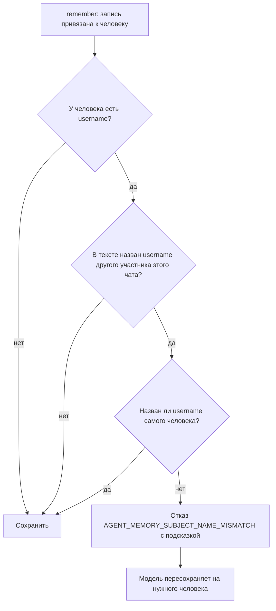

# Память групп: о ком запись — по привязке, а не по тексту — спецификация

**Статус:** согласовано 20.11.2026 (F1 — 1 и 2, пункт 3 отложен; F2 — без проверки опечаток; F3 — переиндексировать)
**Задача:** https://github.com/nyxandro/osinara/issues/556
**Дата:** 2026-11-20 · **Проект:** Osinara · **Тип фичи:** смешанный (что видит модель + проверка при
сохранении + разовая переиндексация) · **Где работает:** групповые и семейные чаты Telegram; ход агента, тихая
проверка памяти, сборщик векторов
**Не применяется:** 11 — ожиданий у человека нет: всё происходит внутри хода; 12 — текстов для людей нет, отказ
получает модель (раздел 9).

## Коротко

**Что строим и зачем.**
- **Проблема.** Сервер знает, о ком запись: она привязана к Telegram id человека. Но модели он этого не показывает.
  Модель видит только текст записи и имя автора исходного сообщения, без username. Поэтому бот путает тёзок
  (в группах 36 случаев одинаковых имён у разных людей), теряет человека после смены username и иногда хранит
  чужое мнение как факт об авторе сообщения.
- **Решение.** Сервер сам подписывает каждую привязанную запись текущим «Имя (@username)» человека. По этой же
  подписи поиск отличает людей. При сохранении сервер не даёт записать на автора факт, в тексте которого назван
  другой участник.
- **Успех.** Модель везде видит, о ком запись, по актуальному username. Поиск про Нину не ставит наверх
  записи про Тимура. Чужие факты на авторе больше не сохраняются молча.

**Как будет работать.**
1. Человек пишет в группе. Когда сообщение попадает в ход бота или в тихую проверку памяти, сервер обновляет имя
   участника, как и сейчас, и вместе с ним запоминает username.
2. Любая запись о человеке показывается модели с полем «о ком»: «Нина Соколова (@nina_s)». Это относится к
   подборке памяти, поиску, списку, нитям, ответам `remember` и `manage_memory`, а также к заголовку карточки
   профиля. Имя и username берутся текущие, поэтому после смены username старые записи показываются уже с новым.
3. Спрашивают «что знаешь про @nina_s» или «что Нина говорила про X». Записи о других людях опускаются ниже,
   а записи Нины остаются наверху. Это работает и для записей, где Нина не названа в тексте, и для людей без
   username. Записи самого спрашивающего не опускаются никогда: «что я обещал Нине?» — его вопрос о себе.
4. Модель сохраняет факт и привязывает его к автору сообщения, а в тексте назван другой участник чата, причём
   сам автор не назван. Тогда запись не сохраняется, модель получает объяснение и в том же ходе сохраняет факт
   правильно.
5. Сразу после выкатки служебные копии для смыслового поиска (векторы) всех привязанных записей пересобираются
   уже с «Имя (@username)». Сами записи не меняются.

**Как будем строить.**
- У участника чата появляется поле username. Оно обновляется тем же запросом, который обновляет имя. Для уже
  известных участников оно один раз заполняется из сырых обновлений Telegram: они хранятся с 12.07, а журнал
  сообщений большой группы держит только последние сообщения.
- Одна функция базы отвечает на вопрос «о ком запись»: имя и username по привязке к участнику или к аккаунту
  члена семьи. Её используют все пути показа, поиск, проверка дублей и сборщик векторов.
- Защита поиска от подмены человека (#343) и заголовок вектора (#193) берут человека из этой функции, а
  текстовую метку — только для записей без привязки.
- Проверка при сохранении живёт рядом с разбором источника записи, там, где сервер уже решает, к кому
  привязать запись. Отказ оформлен как остальные отказы памяти: результат с кодом, а не падение хода.
- Переиндексация — постановка привязанных записей в существующую очередь сборщика векторов, как в миграции 134.
  Сборщик получает две поправки:
  - записи без вектора идут первыми, поэтому новые факты не ждут за переиндексацией;
  - неудачная пересборка оставляет прежний вектор, а не выкидывает запись из смыслового поиска.
- Проверка дублей при сохранении строит свой вектор с той же подписью человека, что и сохранённые записи. Иначе
  после переиндексации повторы перестали бы ловиться.
- Ничего нового в устройстве: ни сервисов, ни очередей, ни настроек.

**За чем следить.**
- Ложные отказы при сохранении: например, username участника совпал со словом в скобках («(python)»). Смотреть
  долю отказов `AGENT_MEMORY_SUBJECT_NAME_MISMATCH` в первую неделю.
- Переиндексация 3 103 записей нагружает сервис векторов на king-server. Это фоновая работа: новые записи идут
  вперёд, старые векторы работают до замены и при сбое. Сколько она займёт, мерить после выкатки.
- Защита поиска узнаёт человека по имени из Telegram только по русским формам имени. «Nina S» или «Ниночка🌸» на
  вопрос «что Нина говорила» не совпадут, надёжно срабатывает вопрос с @username. Так же работает и сейчас для
  меток.
- Отложено: поиск по прежним username (пункт 3) и автоматическая пересборка векторов человека после смены
  имени — раздел 14.

**На чём основано.** Замер на проде 19–20.11 (раздел 1); существующие `bindSourceAuthorLabel` и
`preferNamedPeople`; переиндексация через очередь по образцу миграции 134; эталонный набор поиска v3 уже
содержит людей с подписью в заголовке (#193).

**Выкатка:** по инструкции проекта: релиз через CI/CD, кнопка обновления у владельца
(`docs/production-deployment.md`).

**Объём:** 7 шагов; работа агента около 4 ч (оценка); время уходит на интеграционные прогоны в Docker и CI. От
владельца нужна кнопка выкатки и, по желанию, живой вопрос в группе после выпуска.

**Не проверено:** сколько займёт переиндексация на проде. Это оценка по прецеденту миграции 134, мерить после
выкатки.

---

# Часть 1. Для владельца: как это работает

## 1. Что известно и что добавлено

- **Владелец сказал (20.11.2026):** делаем пункты 1 и 2 из #556, пункт 3 откладываем; проверку «неизвестный
  username = опечатка» убираем; векторы старых привязанных записей переиндексируем.
- **Найдено в проекте:**
  - Модель видит запись без привязки: `toModelMemory` (`agent/lib/model-memory.ts`) не передаёт субъект.
    Подпись автора — `display_name_snapshot` без username (`agent/lib/memory-explicit-claim-evidence.ts`).
  - У `conversation_participants` нет поля username. Username хранится только у сообщений
    (`telegram_group_messages.sender_username`). У `users.telegram_username` он есть, но обновляется только при
    принятии приглашения (`agent/lib/family-repository.ts`), то есть устаревает.
  - Защита поиска `preferNamedPeople` (`agent/lib/memory-named-people.ts`) и заголовок вектора
    `memoryEmbeddingInput` (`agent/lib/memory-embedding-header.ts`) берут человека из `memory_items.subject_label`.
    У 3 021 из 3 045 привязанных записей метки нет.
  - В группе запись привязывается к участнику (`subject_participant_id`), в семейном и личном чате — к аккаунту
    (`subject_user_id`). Ветвление — в `prepareExplicitClaimEvidence`.
  - Фоновая проверка памяти показывает модели username автора из последнего сообщения пакета
    (`agent/lib/memory-review/memory-review-known-memory.ts`): «последний увиденный username» в проекте уже
    используется.
  - Участник обновляется не на каждом сообщении, а когда сообщение попадает в ход бота
    (`telegram-on-message.ts`) или в пакет тихой проверки (`memory-review-dispatcher.ts`), то есть с запаздыванием.
  - Журнал сообщений обрезается (`pruneTelegramGroupJournal`): в большой группе он хранит сообщения только с
    23.10, и у 360 из 759 участников там нет ни одного сообщения; на них привязана 171 действующая запись. Сырые
    обновления `telegram_ingress_updates` хранятся с 12.07 (69 765 штук) и несут username отправителя.
  - Текст записи на месте не меняется: правка создаёт новую запись (`memory-repository.ts`). Значит, сохранённый
    вектор записи всегда соответствует её тексту, и устареть может только его заголовок.
  - Сбой сборщика векторов сейчас удаляет вектор записи и выводит её из смыслового поиска (`fail` и истёкшая
    аренда в `memory-index-repository.ts`). Сейчас в очереди ни одного сбоя, все 4 111 действующих записей
    проиндексированы.
  - Проверка дублей (`memory-neighbour-gate.ts`) строит пробный вектор «с шапкой, как у сохранённых», и сейчас у
    привязанной записи шапка без человека.
- **Замеры на проде (только чтение):**
  - 19.11: из 3 045 привязанных записей при живом username после правила 18.10 username нет в тексте у 27. Из них
    15 — смена username, 6 — чужой факт на авторе, 3 — опечатка, 3 — имя без username. Около 1 из 5 участников
    (69 из 370) пишут без username.
  - 20.11: после 18.10 в 1 371 записи 1 538 раз упомянут username. 56 из этих упоминаний (в 53 записях) — люди,
    которые в этом чате не писали. Из них около 11 похожи на опечатку, около 30 — люди и каналы, которых
    упоминали в чате, 15 не разобраны. Это причина решения F2.
  - 20.11: за всю историю (20 393 сообщения с 12.07) имя в Telegram сменили 9 раз (8 человек), username — 3 раза.
  - 20.11: проверка при сохранении на записях после 18.10 отклонила бы 6 из 1 200 привязанных, все шесть —
    факт с другим участником на авторе. У записей людей без username таких нет.
  - 20.11: заполнение из сырых обновлений нашло всех 764 участников, у 630 есть username; там, где в журнале
    есть сообщение, username совпадает с ним. Запрос занимает 2,4 с.
  - 20.11: переиндексация затронет 3 103 записи (3 045 о участниках групп, 58 о членах семьи).
- **Добавлено агентом:** раздел 15.

## 2. Цели, не-цели, анти-цели

- **Цели:**
  1. У каждой записи о человеке модель видит его текущее «Имя (@username)» во всех путях показа и в карточке
     профиля.
  2. Вопрос, называющий человека по имени или @username, опускает привязанные записи о других людях.
  3. Чужой факт на авторе с другим участником в тексте не сохраняется молча: модель получает отказ и
     пересохраняет факт.
  4. Векторы привязанных записей называют человека; с этим начинает работать защита #193.
- **Не-цели:** поиск по прежним username (F1), проверка опечаток в username (F2), переписывание сохранённых
  записей (решение владельца 21.10.2026).
- **Анти-цели:** проверка отклоняет законные записи и модель теряет факты; появляется вторая подпись человека,
  которая спорит с текстом записи и путает модель.
- **Сейчас:** модель угадывает человека по тексту; если в тексте нет username или он устарел, она может ответить
  про тёзку или не найти человека.

## 3. На чём основано

| Практика | Где взята | Берём? | Почему |
|---|---|---|---|
| Привязка к id вместо текста, текущая подпись при показе | `bindSourceAuthorLabel`, #479 (username на карточках гостя) | да | id стабилен, имя и username меняются; показ по id не требует переписывать записи |
| «Последний увиденный username» участника | `memory-review-known-memory.ts` | да | уже принят в проекте; журнал сообщений полный |
| Переиндексация через очередь сборщика | миграция 134 | да | векторы заменяются атомарно, старые работают до замены |
| Отказ модели с кодом и подсказкой вместо падения | `MemoryAttributeReplacementRefusal`, `MemoryNeighbourRefusal` | да | модель исправляет в том же ходе, отказ виден в логе |
| Отказ на неизвестный username | issue #556, первая версия | нет | по замеру больше половины отказов были бы ложными (F2) |

## 4. Варианты и масштаб

**Масштаб проекта:** около 4 000 действующих записей групп, 3 045 привязаны к участнику; 764 участника; 20 393
сообщения в журнале; один сервер, обслуживают владелец и агенты.

Путь один: показ по привязке при чтении. Другие варианты владелец отверг в #556: переписать сохранённые записи
нельзя (21.10.2026), а одно правило промпта не закрывает смену username и людей без username.

## 5. Как работает

**Точки входа:** сообщение в чате → 1; любой показ памяти модели → 2; вопрос о человеке → 3; `remember` в ходе или
в тихой проверке → 4; выкатка → 5.

**Сценарий 1 — username запоминается.** Нина (@nina_s) пишет в группе.
1. Сообщение попадает в ход бота или в пакет тихой проверки, и сервер обновляет участника: имя и username по
   самому свежему из увиденных сообщений.
2. Нина меняет username на @nina_new и пишет снова: у участника теперь @nina_new. Если она убрала username, поле
   становится пустым.
- **При сбое:** обновление участника — часть той же транзакции, что и раньше; если она не прошла, ход или пакет
  повторяются по своим правилам (как сейчас).

**Сценарий 2 — модель видит, о ком запись.** В подборке памяти запись «любит Postgres» привязана к Нине.
1. Модель получает запись с полем `about: "Нина Соколова (@nina_new)"`, даже если в тексте записано
   «Нина (nina_s)» или имени нет совсем.
2. **Ключевой момент:** тёзки различаются по username, а запись после смены username не теряет человека.
- У человека без username поле — просто имя: «Нина Соколова».
- У записи без привязки к человеку (итог обсуждения, проект) поля `about` нет.

**Сценарий 3 — вопрос о человеке.** В группе спрашивают «что Нина говорила про Стаю?».
1. Поиск находит записи Нины и запись Тимура о Стае.
2. Человек каждой записи берётся из привязки, а у непривязанных — из текстовой метки. Вопрос называет Нину,
   поэтому запись Тимура опускается ниже (в 4 раза, как сейчас для меток).
3. **Ключевой момент:** защита работает на всех привязанных записях, а не на 170 из 4 000.

**Сценарий 4 — чужой факт на авторе.** Олег (@oleg_p) пишет: «Нина говорила, что ей нравится Postgres». Модель
сохраняет «Нина Соколова (@nina_s) любит Postgres» и привязывает к автору, то есть к Олегу.
1. Сервер видит: запись привязана к Олегу, в тексте назван другой участник этого чата (@nina_s), а @oleg_p не
   назван.
2. Запись не сохраняется. Модель получает отказ `AGENT_MEMORY_SUBJECT_NAME_MISMATCH` с объяснением (раздел 9).
3. **Ключевой момент:** модель пересохраняет факт на Нину: через `verified_ref`, если Нина есть в карточках хода,
   иначе с меткой «Нина Соколова (@nina_s)». В тихой проверке — только с меткой.
- Запись «Олег (@oleg_p) работает вместе с Ниной (@nina_s)» сохраняется: назван и сам Олег.
- Если у Олега нет username, проверка не применяется (раздел 15).

**Сценарий 5 — переиндексация после выкатки.**
1. Миграция ставит все действующие записи с привязкой к человеку в очередь сборщика векторов.
2. Сборщик сначала берёт записи, у которых вектора ещё нет (новые факты), потом пересобирает старые с заголовком
   «Имя (@username). Вид: …». Старый вектор работает до замены, поиск не простаивает.
- **При сбое:** запись, у которой уже был вектор, сохраняет его и остаётся в смысловом поиске; задача остаётся в
  очереди со статусом `failed` и кодом ошибки. Временные ошибки сервиса векторов сборщик повторяет, как сейчас.
  Запись без вектора при сбое ведёт себя как сейчас.

**Сценарий 6 — проверка дублей.** Модель сохраняет «Нина Соколова (@nina_s) любит Postgres», а у Нины уже есть
почти такая запись.
1. До транзакции сервер коротким чтением определяет, к кому будет привязана запись, и строит пробный вектор с той
   же подписью, что у сохранённых записей Нины.
2. Сходство сравнивается с её записями, как сейчас (порог 0.93), и повтор ловится.

## 6. Решения владельца

### Принято

- **F1. Объём (20.11.2026):** пункты 1 и 2 сейчас, пункт 3 (поиск по прежним username) отложен. Это выбрано
  вместо «все три сразу» и «только пункт 1». Причина: смен username за всю историю три, а чужие факты на авторе
  появляются каждый месяц.
- **F2. Проверка опечаток (20.11.2026):** убрана. Пункт 2 проверяет только «назван другой участник вместо
  привязанного». Это выбрано вместо отказа на любой неизвестный username и вместо отказа только на похожий.
  Причина: по замеру больше половины таких отказов были бы ложными, а опечаток около 11 в месяц.
- **F3. Векторы (20.11.2026):** переиндексировать все привязанные записи, а не только новые. Причина: иначе
  защита #193 не работает на основной массе памяти.

---

# Часть 2. Для исполнителя: поведение подробно

## 7. Что видит модель

| Путь | Что добавляется | Где собирается |
|---|---|---|
| Подборка памяти хода и `search_memories` (по словам и за период) | `about` у каждой записи с привязкой к человеку | `memory-retrieval-repository.ts`, `memory-event-window-repository.ts` |
| `manage_memory` (список, обновление) | `about` | `memory-list-repository.ts`, `memory-repository.ts` |
| Ответ `remember` | `about` сохранённой записи: модель видит, к кому привязала | `memory-claim-writer.ts` |
| История нити памяти | `about` у записи нити | `memory-thread-query-repository.ts` |
| Карточка профиля | заголовок «Имя (@username)» | `profile-view-repository.ts` |

Формат `about`: `«<имя> (@<username>)»`; без username — `«<имя>»`. Нет привязки к человеку — поля нет. Модель
узнаёт смысл поля из одного предложения в инструкции памяти (шаг 6).

## 8. Механизм: данные и сбои

- **Источник истины для подписи:** `conversation_participants` — имя (`display_name_snapshot`) и username
  (`username_snapshot`, новое) по последнему сообщению; правило «последний по `last_observed_at` побеждает» то же,
  что для имени.
- **Запись о члене семьи (`subject_user_id`):** имя и username берутся из участника этого аккаунта с самым свежим
  `last_observed_at` в семейном или личном чате (это его собственные имя и username в Telegram, одинаковые во всех
  чатах; строки внешних групп не берутся). Если таких участников нет — из `users.display_name` и
  `users.telegram_username`.
- **Заполнение для существующих участников:** миграция берёт самое свежее сырое обновление
  (`telegram_ingress_updates`, наибольший `update_id`) от этого человека в этот чат. Username из него и становится
  снимком; если в нём username нет, снимок пустой. Тот же принцип при приёме: более свежее сообщение без username
  очищает поле.
- **Подпись в группе берётся только из строки участника этого чата:** память группы не заглядывает в другие чаты.
  Если Нина сменила username и написала только в другом чате, здесь подпись обновится с её следующим сообщением
  здесь.

| Что ломается | Как предотвращаем | Как узнаём | Как восстанавливаемся | Что теряется |
|---|---|---|---|---|
| Путь показа забыл подпись | `toModelMemory` требует подпись параметром: путь без неё не соберётся (типы TypeScript) | `npm run typecheck` | — | ничего |
| Пересборка вектора не удалась | старый вектор и `embedding_status = 'indexed'` остаются (текст записи не менялся) | `memory_embedding_jobs` со статусом `failed` | запись работает со старым заголовком; повторная постановка — отдельным решением | только новый заголовок у этой записи |
| Новые факты ждут за переиндексацией | сборщик берёт записи без вектора первыми | — | — | ничего |
| Человек сменил имя или username | подпись при показе и в поиске читается текущая | — | — | заголовок вектора устаревает до следующей пересборки записи (раздел 14) |

## 9. Ошибки и отказы

| Ситуация | Что получает модель | Как выходит |
|---|---|---|
| Запись привязана к человеку с username, в тексте назван username другого участника этого чата, а его собственный — нет | `code: "AGENT_MEMORY_SUBJECT_NAME_MISMATCH"`, `saved: false`, `reason: "Текст записи называет другого участника, а запись привязана к «<подпись>»."`, `correction` (ниже) | пересохраняет факт на нужного человека или называет привязанного в тексте |

`correction` в живом ходе: «Запись не сохранена: она привязана к «<подпись>», а в тексте назван другой участник
этого чата (<@username через запятую>) и не назван сам «<подпись>». Пересказ чужих слов — факт о том, о ком он,
а не о том, кто рассказал. Если факт о другом человеке — сохрани его на этого человека: subject verified_ref,
если он есть в карточках этого хода, иначе метка «Имя (@username)». Если это собственный факт «<подпись>» (его
мнение, событие или свойство, где другой только упомянут) — назови его в тексте и повтори вызов.»

В тихой проверке — без варианта `verified_ref`: «…сохрани его на этого человека с меткой «Имя (@username)»…».

Для записей с пробой дублей (всё, кроме эпизодов) отказ срабатывает в коротком чтении до вычисления вектора и
ничего не стоит, кроме шага модели; сама запись проверяет то же ещё раз внутри транзакции.

Отказ — результат инструмента, а не ошибка хода. В лог идёт `AGENT_MEMORY_WRITE_DEFERRED` с
`errorCode: AGENT_MEMORY_SUBJECT_NAME_MISMATCH`, без текста записи.

## 10. Крайние случаи и стыки

| Случай | Что происходит |
|---|---|
| Username в тексте в другом регистре (`@Nina_S`) | сравнение без учёта регистра |
| Формы упоминания | `@nina_s`, `(nina_s)`, `(@nina_s)`; слово без `@` и без скобок не считается упоминанием |
| Username участника совпал со словом в скобках («(python)») | ложный отказ возможен; модель называет привязанного человека, и запись проходит; доля — в «За чем следить» |
| В тексте неизвестный username (не участник) | не влияет (F2) |
| В тексте старый username самого человека | он не принадлежит другому участнику → проверка пропускает |
| Человек без username | проверка не применяется; `about` — только имя; защита поиска узнаёт его по имени |
| Тёзки в одной группе | `about` различает их по username; вопрос «про Нину» называет обеих, и между ними порядок не меняется |
| Личный чат | у участника нет других участников с username → проверка не срабатывает; `about` показывается так же |
| Запись привязана через `verified_ref` к другому человеку | проверяется так же: назван третий участник, а привязанный нет → отказ |
| Метка или `none` вместо привязки | проверка не применяется: метка — текст модели |

| Соседняя функция | Где встречаются | Как решаем |
|---|---|---|
| `bindSourceAuthorLabel` | метка с именем автора превращается в привязку до проверки | проверка идёт после неё, уже по привязке |
| Защита от дублей (`exactDuplicateIdentity`) | использует `subject_label` | не трогаем: подпись только для показа и поиска |
| Сводки обсуждений («итог: …») | `subject: none`, в тексте много людей | не проверяются |
| Тихая проверка памяти | тот же `remember` | тот же отказ, текст без `verified_ref` |
| Гостевой доступ (#479) | карточки гостей с username | не меняется: другой путь (`guests/`) |

## 13. Данные и приватность

Username — уже имеющиеся у бота данные Telegram из того же чата; новое хранение — одна колонка у участника. Модель
видит username только участников чата, к которому относится память (существующие права области памяти). Репозиторий
публичный: в тестах и документах только вымышленные имена.

## 14. Что сознательно не делаем

- Поиск по прежним username (пункт 3 #556) — решение владельца F1. Возвращаемся, если в живом чате бот не найдёт
  человека из-за смены username или таких смен станет 10 и больше.
- Автоматическая пересборка векторов человека после смены имени или username: за 4 месяца 12 таких смен, а показ и
  защита поиска и так берут текущую подпись. Возвращаемся, если смен станет больше 10 в месяц.
- Username в подписи автора исходного сообщения (`evidence.authorLabel`): issue просит подпись того, о ком запись;
  автор — другой вопрос. Возвращаемся, если модель будет путать, кто сказал.
- Подпись в блоке «уже известное» тихой проверки (`memory-review-known-memory.ts`): там нет путаницы людей по
  замеру. Возвращаемся, если тихая проверка начнёт дублировать записи тёзок.
- Привязка метки «Имя (@username)» к участнику чата с этим username (как `bindSourceAuthorLabel` делает для
  автора): факты о других людях попали бы в их карточку, но вместе с ними и пересказы, слухи и подброшенные
  утверждения о человеке. Таких записей 126 (после 18.10 — 30). Возвращаемся, если владелец захочет, чтобы
  карточка человека собирала и то, что о нём рассказали другие.
- `about` в сводке нити, которая попадает в ход сама (эпизоды и итог): это пересказ нескольких записей, а не одна
  запись. Возвращаемся, если модель будет путать людей в сводках нитей.
- Повторная постановка в очередь записей, чья пересборка не удалась: они работают со старым вектором.
  Возвращаемся, если после выкатки таких окажется больше нескольких.

## 15. Решения агента — на проверку

- Проверка при сохранении не применяется к человеку без username: имя в тексте проверять ненадёжно (падежи,
  прозвища), а ложный отказ стоит факта. (Замер: 1 из 5 участников без username.)
- `about` показывается и в личном чате, а не только в группах: правило одно для всех путей, цена — несколько слов
  на запись.
- Защита поиска узнаёт привязанного человека и без username — по имени из Telegram, как сейчас метку. Ключ такого
  человека — его привязка, а не текст.
- Поле называется `about`, а не `subject`: `subject` уже значит объект `{kind: …}` во входе `remember`, и одинаковое
  имя путало бы модель.
- Член семьи без участника ни в одном чате получает подпись из `users`: это единственный источник для него.
- Неудачная пересборка вектора записи, у которой вектор уже был, больше не удаляет его. Это меняет поведение
  сборщика для всех таких задач, но они возникают только из миграций переиндексации (008, 134, 157): текст записи
  на месте не меняется.
- Сборщик берёт записи без вектора раньше остальных: без этого 3 103 задачи переиндексации задержали бы
  смысловой поиск и проверку дублей для новых фактов.
- Подпись для проверки дублей определяется коротким чтением до транзакции тем же `prepareExplicitClaimEvidence`,
  что и при записи. Образец — `replayBeforeTitleEmbedding`, который так же разбирает источник до вычисления
  вектора названия нити.

---

# Часть 3. Для исполнителя: как строить

## 16. Что есть и что переиспользуем

- `conversation-repository.ts` — единственное место, где обновляется участник; туда же добавляется username.
- `memory-explicit-claim-evidence.ts` → `prepareExplicitClaimEvidence` — здесь решается привязка; сюда же встаёт
  проверка (у неё есть транзакция, разговор и итоговая привязка).
- Отказы памяти: класс-отказ + функция результата + ветка в `remember.ts` (образец —
  `memory-attribute-replacement-refusal.ts`).
- `memory-named-people.ts` — расширяется человеком по привязке, логика лемм имён остаётся.
- `memory-index-repository.ts` → `claim` (заголовок вектора по привязке; записи без вектора первыми), `fail` и
  истечение аренды (не удалять вектор у записи, которая уже была проиндексирована).
- `memory-write-guards.ts` и `memory-neighbour-gate.ts` → пробный вектор проверки дублей с подписью человека;
  `memory-claim-writer.ts` → короткое чтение до транзакции (образец `replayBeforeTitleEmbedding`).
- Все места, где запись отдаётся модели через `toModelMemory`: `memory-retrieval.ts` (подборка и поиск),
  `tools/search_memories.ts` (за период), `tools/manage_memory.ts` (список и обновление), `tools/remember.ts`. Плюс
  нити и карточка профиля со своими формами. Заголовок карточки сейчас — `profile_subjects.display_label_snapshot`,
  его заполняет триггер миграции 052 по каждому чату; триггер не трогаем, подпись читается при показе.
- Наследие в затронутой области не найдено: `subject_label` остаётся рабочим полем для записей без привязки.

## 17. Устройство

- **Миграция `157_memory_subject_person.sql`:**
  1. `conversation_participants.username_snapshot text` без проверки формата: значение приходит от Telegram, а
     ограничение уронило бы приём сообщения на неожиданном username; `NULL` — у человека нет username.
  2. Заполнение из последнего сообщения участника с его `telegram_user_id` в его разговоре.
  3. Функция `memory_subject_person(participant_id uuid, user_id uuid)` (STABLE) возвращает `name`, `username` и
     `telegram_user_id` по правилам раздела 8; ни одной строки, если оба id пустые.
  4. Представление `monitoring_memory_embedding_backlog` считает только записи без вектора: иначе 3 103 задачи
     переиндексации держали бы возраст самой старой задачи и зажгли бы `OsinaraMemoryIndexingStalled` впустую.
  5. Постановка всех действующих записей с `subject_participant_id` или `subject_user_id` в
     `memory_embedding_jobs` (`ON CONFLICT … DO UPDATE SET status = 'pending', attempts = 0, …` — как в 134).
- **Подпись для модели:** модуль `memory-subject-person.ts` — загрузка людей пачкой по id записей (одним запросом
  через `memory_subject_person`) и одна функция форматирования. `toModelMemory(memory, person, evidence?)` требует
  человека параметром (`null` — записи не о человеке), поэтому путь показа без подписи не соберётся. Строки
  `MemoryItem` и запросы записи не меняются.
- **Поиск:** `ScoredMemoryRetrievalResult` получает `subjectPerson: {key, name, telegramUserId, username} | null`.
  Ключ — username в нижнем регистре, иначе `participant:<id>` или `user:<id>`. `preferNamedPeople` берёт человека из
  привязки, а если её нет, разбирает метку, как сейчас; записи спрашивающего (`auth.telegramUserId`) не опускает.
- **Повтор вызова:** для всех записей, а не только создания нити, проверка повтора по ключу операции идёт до
  короткого чтения источника: повтор сохранённой записи возвращает её, даже если чтение теперь отказало бы.
- **Подпись после записи:** `remember` и правка `manage_memory` читают подпись после COMMIT; если база в этот миг
  недоступна, ответ уходит без `about` с записью `AGENT_MEMORY_SUBJECT_PERSON_UNAVAILABLE` в лог.
- **Проверка при сохранении:** чистая функция `subjectNameMismatch(content, boundUsername, otherUsernames)` в
  `memory-subject-name-check.ts` возвращает упомянутых других участников или `null`. В
  `prepareExplicitClaimEvidence` после решения о привязке: если привязка к человеку и у него есть username —
  выбрать username остальных участников этого разговора и при несовпадении бросить
  `MemorySubjectNameMismatchRefusal`. `remember.ts` превращает её в результат (раздел 9). Короткое чтение до
  транзакции (сценарий 6) вызывает ту же функцию, поэтому отказ случается до вычисления вектора.
- **Сборщик векторов:** в `claim` порядок `ORDER BY (item.embedding_status = 'indexed'), job.created_at`; в `fail` и
  при истечении аренды вектор и `embedding_status` записи не трогаются, если у неё уже есть вектор.
- **Наблюдаемость:** существующие `AGENT_MEMORY_WRITE_DEFERRED` с `errorCode`; число задач переиндексации — по
  `memory_embedding_jobs`.

## 18. Ловушки

- Telegram username нечувствителен к регистру: везде сравнивать в нижнем регистре.
- В `update_id` Telegram обновления идут по возрастанию, поэтому «самое свежее обновление» — наибольший
  `update_id`.
- `PERSON_LABEL` не разбирает имена с «—», «/» и «,»: для привязанных людей разбор метки не нужен, человек
  приходит структурой.

## 19. Сбои на новых путях

| Путь | Сбой | Чем закрыт |
|---|---|---|
| Приём сообщения | username длиннее или с символами вне формата | проверка формата в миграции; тест приёма с реальным форматом Telegram |
| Проверка при сохранении | ложный отказ из-за слова, совпавшего с username | модель называет привязанного и сохраняет; тест «назван и автор → сохраняется» |
| Показ | путь забыл подпись | не соберётся: `toModelMemory` требует человека параметром |
| Проверка дублей | пробный вектор без подписи, а сохранённые с подписью | тест шага 5: проба для привязанной записи содержит ту же подпись |
| Сборщик векторов | сервис векторов перегружен во время переиндексации | старый вектор остаётся; тест шага 5 на `fail` и истёкшую аренду |

## 20. Сопровождение

- Неделя после выпуска: число `AGENT_MEMORY_WRITE_DEFERRED` с `AGENT_MEMORY_SUBJECT_NAME_MISMATCH` и сколько из
  них модель пересохранила в том же ходе (`agent_tool_calls`).
- Сколько заняла переиндексация и сколько задач закончилось `failed` (`memory_embedding_jobs`); записи с
  `embedding_status = 'failed'` — 0.
- Повтор замера #556 через неделю: привязанные записи без username в тексте и чужие факты на авторе.

## 21. Приоритеты

- **P0:** всё из шагов 1–6.
- **P1:** нет.
- **P2:** раздел 14.

**Объём:** шаг 1 — 40 мин, 2 — 15 мин, 3 — 80 мин, 4 — 20 мин, 5 — 40 мин, 6 — 60 мин, 7 — 10 мин; итого около
4,5 ч работы агента плюс интеграционные прогоны и CI.

## 22. Шаги

**Правила каждого шага:** тест до кода (TDD), тесты рядом с кодом; новый source-файл не больше 500 строк; ошибки
с кодом `AGENT_*` и понятным русским текстом; username сравнивать в нижнем регистре; сохранённые записи
памяти не переписывать; в тестах только вымышленные люди; миграции запускать только в контейнере тестов.

### Шаг 1: username участника и функция «о ком»
**Файлы:** создать `migrations/157_memory_subject_person.sql`; тест — интеграционный рядом с
`conversation-repository`.
**Тест:** заполнение из сырых обновлений (два обновления с разным username → берётся с большим `update_id`;
последнее без username → `NULL`; обновление из другого чата не влияет); функция для участника, для члена семьи с
участником в семейном чате, для члена семьи без участника, для пустой привязки; участник внешней группы того же
человека не влияет на подпись семейной записи; постановка в очередь только действующих записей с привязкой.
**Закрывает:** сценарии 1, 5; цель 4.

### Шаг 2: username при приёме сообщения
**Файлы:** изменить `agent/lib/conversation-repository.ts` (выборка `sender_username`, upsert с тем же правилом
свежести).
**Тест:** смена username между сообщениями обновляет поле; более старое сообщение, пришедшее позже, не
перезаписывает его.
**Закрывает:** сценарий 1.

### Шаг 3: `about` во всех путях показа
**Файлы:** создать `agent/lib/memory-subject-person.ts` (загрузка пачкой и формат подписи); изменить
`model-memory.ts` и места из раздела 16, нити (`memory-thread-query-repository.ts`,
`memory-thread-source-evidence.ts`) и карточку (`profile-view-repository.ts`).
**Тест:** формат с username и без; интеграционные: подборка, поиск за период, список, `remember` и карточка
показывают `about` с текущим username после смены; запись без привязки — без поля.
**Закрывает:** сценарий 2; цель 1.

### Шаг 4: защита поиска по привязке
**Файлы:** изменить `agent/lib/memory-named-people.ts`, `memory-retrieval-ranking.ts`,
`memory-retrieval-repository.ts`.
**Тест:** вопрос «что Нина говорила про Стаю» опускает привязанную запись Тимура без метки; вопрос с @username
различает двух тёзок; человек без username узнаётся по имени; записи с меткой работают как раньше.
**Закрывает:** сценарий 3; цель 2.

### Шаг 5: заголовок вектора, сборщик и проверка дублей
**Файлы:** изменить `agent/lib/memory-index-repository.ts` (`claim`, `fail`, истечение аренды),
`memory-write-guards.ts`, `memory-neighbour-gate.ts`, `memory-claim-writer.ts`.
**Тест:** задача для привязанной записи без метки получает заголовок «Имя (@username). Вид: …»; запись с меткой —
как раньше; запись без вектора выдаётся раньше старой задачи переиндексации; `fail` и истёкшая аренда у
проиндексированной записи оставляют её куски и `indexed`, у новой — как раньше; пробный вектор проверки дублей для
`current_author` строится с той же подписью, что у сохранённых, и повтор ловится.
**Закрывает:** сценарии 5, 6; цель 4.

### Шаг 6: проверка при сохранении и одно предложение инструкции
**Файлы:** создать `agent/lib/memory-subject-name-check.ts` и `memory-subject-name-mismatch-refusal.ts`; изменить
`memory-explicit-claim-evidence.ts`, `tools/remember.ts`, инструкцию памяти в `agent/lib/prompt/` (смысл `about`).
**Тест:** чистая функция — формы `@h`, `(h)`, `(@h)`, регистр, слово без формы не считается; свойство: для любого
username из списка и текста без него результат не меняется от регистра и формы упоминания. Интеграционные: отказ
при чужом участнике в живом ходе и в тихой проверке (текст без `verified_ref`); назван и автор → сохраняется;
автор без username → сохраняется; неизвестный username → сохраняется.
**Закрывает:** сценарий 4; раздел 9; цель 3.

### Шаг 7: выпуск
По `docs/production-deployment.md`. После выкатки — проверки раздела 20.

## 23. Критерии приёмки

- Дано: Нина писала как @nina_s, потом как @nina_new; запись о ней с текстом «Нина (nina_s) любит Postgres».
  Когда: запись попадает в подборку. Тогда: `about` = «Нина Соколова (@nina_new)».
- Дано: в группе две Нины с разными username; вопрос «что знает @nina_s». Тогда: записи второй Нины ниже записей
  @nina_s.
- Дано: Олег (@oleg_p) — автор; модель сохраняет «Нина Соколова (@nina_s) любит Postgres» на автора. Тогда:
  `saved: false`, `code: AGENT_MEMORY_SUBJECT_NAME_MISMATCH`; запись не создана.
- Дано: то же, но в тексте «Олег (@oleg_p) работает с Ниной (@nina_s)». Тогда: запись сохранена.
- Дано: после выкатки 3 103 привязанные записи в очереди, и модель сохраняет новый факт. Тогда: новый факт
  индексируется первым; старые записи остаются в смысловом поиске всё время пересборки.
- Дано: сервис векторов отказал на пересборке записи. Тогда: запись в смысловом поиске со старым вектором.

## 24. Что смотреть на ревью

- Ни один путь показа не потерял `about`: `toModelMemory` без человека не собирается.
- Проверка дублей для привязанных записей после переиндексации по-прежнему ловит повторы.
- Проверка при сохранении не трогает метки и `none`.
- `exactDuplicateIdentity` по-прежнему строится из `subject_label`.
- Переиндексация не меняет `embedding_status` и не выключает смысловой поиск записей.
- Отказ не утекает текстом записи в лог.

## 25. Открытые вопросы

Нет.
