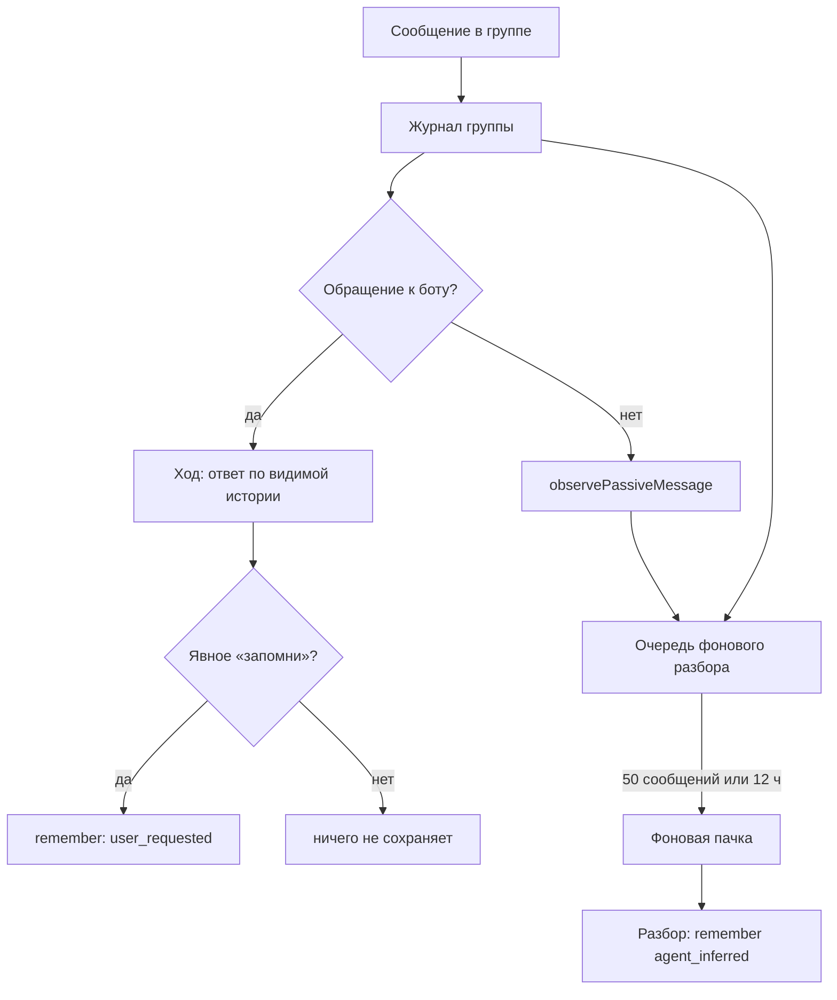

# Память групп: разбор только в фоне — спецификация

**Статус:** согласовано 21.11.2026 (F1 — только переключение, запуск по тишине отдельно; F2 — старый путь удалить
целиком); реализовано 21.11.2026, независимое ревью пройдено, ждёт выпуска
**Задача:** https://github.com/nyxandro/osinara/issues/569
**Дата:** 2026-11-21 · **Проект:** Osinara · **Тип фичи:** внутренний механизм + правка инструкций модели ·
**Где работает:** групповые и семейные чаты Telegram; ход агента, тихая проверка памяти (фоновый разбор)
**Не применяется:** 7 — новых экранов и инструментов нет; 11 — ожиданий у человека нет; 12 — новых текстов для
людей нет; 13 — данные и права не меняются.

## Коротко

**Что строим и зачем.**
- **Проблема.** Когда к боту обращаются в группе, все ещё не разобранные сообщения (до 50) прикладываются к его ответу.
  Считается, что факты из них бот запишет сам. Он почти не записывает, а эти сообщения помечаются разобранными, и
  фоновый разбор их больше не читает. За 30 дней (21.11.2026): так ушло 3 493 сообщения из 15 036 (23%), из них
  записано 31 факт (0,9 на 100, вместе с явными «запомни»). Фоновый разбор: 11 543 сообщения → 1 144 факта (9,9 на
  100). Сказанное незадолго до обращения к боту запоминается примерно в 11 раз хуже.
- **Решение.** Все сообщения групп разбирает только фоновый разбор. Бот в ответе сохраняет память только по явной
  просьбе человека. Путь «хвост к ответу» удаляется из кода целиком.
- **Успех.** Через неделю после выпуска 100% сообщений групп проходят фоновый разбор; доля записанных фактов на 100
  сообщений групп в целом растёт к уровню фона (~10).

**Как будет работать.**
1. Человек пишет в группе, к боту не обращаясь. Как и сейчас: сообщение ждёт в очереди фонового разбора.
2. Человек обращается к боту. Бот отвечает, видя последние сообщения разговора как сейчас (до 99 сообщений и 12 000
   знаков с прошлого хода). Хвост больше не прикладывается и не помечается разобранным: сообщения, включая само
   обращение, остаются в очереди фонового разбора. Обращение учитывается в очереди так же, как обычное сообщение:
   открывает очередь новой темы и режет пачку на 50-м сообщении.
3. Человек просит «запомни, что…». Бот сохраняет факт сразу, как сейчас. Факты, о которых его не просили, он сам
   не сохраняет: их найдёт фоновый разбор.
4. Фоновый разбор берёт пачку, когда набралось 50 сообщений (проверка раз в минуту) или самое старое ждёт 12 часов.
   Он видит последние записи разговора и не пишет повтор того, что бот уже сохранил по просьбе.
5. Выкатка: пакет «хвоста», подготовленный, но не начатый в момент остановки, превращается в обычную фоновую пачку
   с тем же набором сообщений. Ничего не теряется и не разбирается дважды.

**Как будем строить.**
- Ход в группе больше не создаёт пакет проверки памяти и не привязывается к нему. Код подготовки «хвоста»
  (`telegram-memory-review-turn.ts`, `prepareInteractiveTurn`, `failInteractivePreparation`), его завершение в
  Telegram-канале и уборка зависших таких пакетов удаляются.
- Фоновый разбор не меняется: те же пачки, тот же диспетчер, те же правила отбора.
- Инструкция бота в группе: вместо «разбери весь хвост» — «сохраняй только по явной просьбе, остальное прочтёт
  фоновый разбор». Правила оформления записи (кто, «Имя (username)», вид записи, свойство) остаются. Описание
  инструмента `remember` в семейной и внешней группе говорит то же; в личке оно прежнее.
- В инструкции фонового разбора исправляется одно предложение: она ссылается на блок `<memory_review_source_selection>`,
  который создавал только путь «хвоста»; сообщения пачки на деле лежат в `<untrusted_memory_review_batch>`.
- Миграция 158 переводит незавершённые пакеты «хвоста» без начатого хода в фоновые. На проде таких 0 (21.11), это
  страховка момента выкатки.
- Ничего нового в устройстве: ни сервисов, ни очередей, ни настроек.

**За чем следить.**
- **Задержка.** Факт из тихой группы попадает в память до 12 часов спустя. Сейчас 9 из 10 таких фактов не попадают
  никогда. Запуск по тишине — отдельный шаг (F1).
- **Дубли.** Факт, который бот сохранил по просьбе, фоновый разбор увидит в том же сообщении. Защиты: блок последних
  записей разговора в разборе и проверка дублей при сохранении. Смотреть повторы после выпуска.
- **Нагрузка.** Фоновому разбору прибавится ~3 500 сообщений в месяц (+30%). Пачки маленьких групп выйдут по
  12-часовому правилу.
- **Ходы, ждущие кнопки, в момент выкатки.** Их пакет «хвоста» закроет существующая страховка брошенных ходов
  (через час после конца хода): записал память — пакет засчитан; не записал — сообщения вернутся в очередь, а если
  за ним уже стоит следующая пачка, пакет пропускается с оповещением владельца. На проде 21.11 таких ходов 0.

**На чём основано.** Замер на проде 21.11 (выше); форк «Мия» выключил тот же путь 18.10, их замер — отдельный разбор
находит факты вдвое точнее (F1 0,65 против 0,33); код фонового разбора и диспетчера
(`memory-review-dispatch-repository.ts`: `materializeReadyBatches` раз в минуту создаёт полную и «старую» пачку).

**Выкатка:** по инструкции проекта — релиз через CI/CD, кнопка обновления у владельца
(`docs/production-deployment.md`).

**Объём:** 5 шагов; работа агента — около 3–4 ч (оценка); время уходит на интеграционные прогоны в Docker и CI. От
владельца — кнопка выкатки.

**Не проверено:** как изменится доля записанных фактов — мерить через неделю после выпуска.

---

# Часть 1. Для владельца: как это работает

## 1. Что известно и что добавлено

- **Владелец сказал (21.11.2026):** «поменяем механизм на полностью фоновый? по части запоминания»; на рекомендацию
  «сначала переключение, тишина — следующим шагом; старый путь удалить целиком, без выключателя» — «ок распланируй
  это и реализуй».
- **Агент рекомендовал, владелец согласился:** явное «запомни» бот сохраняет сразу; всё остальное — фоновый разбор.
- **Найдено в проекте:**
  - путь «хвоста»: `prepareTelegramMemoryReviewTurn` (`agent/lib/memory-review/telegram-memory-review-turn.ts`)
    вызывается для каждого обращения к боту в группе (`agent/lib/telegram-on-message.ts:408`); пакет вида
    `interactive` создаёт `prepareInteractiveTurn` (`memory-review-repository.ts:300`);
  - инструкция хода `GROUP_MEMORY_DELTA_CONTRACT` (`agent/lib/prompt/common-fragments.ts:124`) велит «разобрать весь
    хвост»; общая `MEMORY_WRITE_CONTRACT` велит сохранять «по своей инициативе»;
  - фоновые пачки создаются и без обращения: `observePassiveMessage` на каждое необращённое сообщение и
    `materializeReadyBatches` раз в минуту (50 сообщений или 12 ч);
  - на проде 21.11: пакетов `interactive` 1 945 завершены, 6 пропущены, незавершённых 0; незавершённых ходов 0.
- **Добавлено:** [ДОПУЩЕНИЕ] дубли от явных «запомни» редки: за 30 дней все сохранения ходов в группах — 31.

| Код | Что это | От кого, дата | Где | Вес |
|---|---|---|---|---|
| OWN | Решение «полностью фоновый», F1, F2 | владелец, 2026-11-21 | этот чат | требование |
| MES | Замер 30 дней по видам пакетов | агент, 2026-11-21 | прод, `memory_review_batches` + `memory_items_all.source` | справка |
| MIA | Разбор форка «Мия» | агент, 2026-11-19 | заметка сессии | справка |

## 2. Цели, не-цели, анти-цели

- **Цели:**
  - каждое сообщение группы проходит фоновый разбор (100%, а не 77%) **[OWN]**;
  - доля записанных фактов на 100 сообщений групп растёт с ~7,8 (1 175 на 15 036) к ~10 **[MES]**;
  - явное «запомни» в группе по-прежнему сохраняется сразу.
- **Не-цели:** запуск разбора по тишине (F1, следующий шаг); изменение правил отбора фонового разбора; личные чаты
  (фонового разбора там нет и не будет — решение владельца 19.11).
- **Анти-цели:** бот перестал отвечать на «запомни»; сообщения потерялись на переходе; появился второй путь
  создания пачек; фоновый разбор стал писать повторы того, что бот сохранил по просьбе.
- **Сейчас:** 23% сообщений групп разбирает бот на ходу и записывает почти ничего; оставшиеся 77% — фон.

## 3. На чём основано

| Практика | Кто делает | Где окупается | Берём? | Почему | Источник, дата |
|---|---|---|---|---|---|
| Один путь отбора памяти в группе — отдельный разбор | форк «Мия» | любой масштаб | да | ход занят ответом и пропускает разбор; отдельный разбор точнее | разбор 19.11.2026 |
| Разбор по тишине (10 мин) | «Мия» | живые группы | не сейчас (F1) | сначала измерить эффект переключения | там же |
| Выключатель старого пути | «Мия» (`MEMORY_REVIEW_INTERACTIVE_TAIL_ENABLED`) | при сомнениях в откате | нет (F2) | мёртвый код и ветки восстановления; правила проекта против настроек | решение владельца 21.11 |

## 4. Варианты и масштаб

**Масштаб:** 15 036 сообщений групп за 30 дней, из них 3 493 через ход; фоновых пачек 251 за 30 дней; одна модель
на хабе владельца. Сопровождают владелец и агенты.

Один путь: путь «хвоста» удаляется, фоновый остаётся единственным — выбрано владельцем (F2). Сравнение «оставить
оба» (фон перечитывает и хвост) отклонено в обсуждении: двойной расход модели и повторы записей.

## 5. Как это работает

**Точки входа:** сообщение в группе без обращения → сценарий 1; обращение к боту → 2; «запомни» → 3; выкатка → 4.

**Сценарий 1 — обычное сообщение.** Без изменений: журнал группы → `observePassiveMessage` → при 50 сообщениях пачка.

**Сценарий 2 — обращение к боту.**
1. Сообщение записано в журнал группы, ход готовится как сейчас (видимая история с прошлого хода).
2. **Ключевой момент:** пакет проверки не создаётся; сообщения остаются в очереди фонового разбора.
3. Через минуту диспетчер создаёт пачку, если набралось 50 сообщений, иначе — по 12-часовому правилу.
- **При сбое хода:** очередь разбора не затронута — ход к ней больше не привязан.

**Сценарий 3 — «запомни, что я переехал в Казань».** Бот сохраняет факт (`basis: user_requested`) из текущего
сообщения. Позже фоновый разбор видит это сообщение и в блоке известных записей — свежую запись; повтор не пишет.
Если просьба указывает на более раннее сообщение («запомни, что Маша выше написала»), бот передаёт его
`sourceSequence` (только из показанной истории хода).

**Сценарий 4 — выкатка.** Миграция 158 переводит незавершённые пакеты «хвоста» без начатого хода в фоновые с тем
же набором сообщений. Пакет с начатым ходом (ход ждёт кнопку) закрывает страховка брошенных ходов.



## 6. Решения владельца

### Принято

- **F1 (21.11.2026).** Сейчас только переключение на фоновый разбор; запуск по тишине — отдельным шагом с замером,
  чтобы видеть эффект каждого. Выбрано вместо «сразу с тишиной».
- **F2 (21.11.2026).** Путь «хвоста» удаляется из кода целиком, без выключателя. Выбрано вместо «оставить
  выключатель на откат».

---

# Часть 2. Для исполнителя: поведение подробно

## 8. Механизм: данные и сбои

| Что ломается | Как предотвращаем | Как узнаём | Как восстанавливаемся | Что теряется | Покрыто |
|---|---|---|---|---|---|
| Пакет «хвоста» подготовлен, ход не начат, выкатка | миграция 158 → фоновый `pending` с тем же диапазоном | аудит `memory_review.recovered` | фоновый разбор | ничего | шаг 1 |
| Пакет «хвоста» с ходом, ждущим кнопку, на выкатке | существующая `terminalizeAbandonedReviewTurns` (через 60 мин после конца хода) | `AGENT_MEMORY_REVIEW_BATCH_RESOLVED` в журнале; при пропуске — оповещение владельцу | засчитан / возвращён в очередь / пропущен | при пропуске — до 50 сообщений не разобраны | существующие тесты страховки |
| Устаревший `ambiguous` пакет «хвоста» (код до 09.2026) | миграция 158 переводит тем же правилом, что `recoverUnstartedReviewBatches` | аудит | фоновый разбор | ничего | шаг 1 |
| Ход в группе с атрибутом пакета (старый формат) после выкатки | при выкатке нет идущих ходов (`DEPLOY_RUNTIME_BUSY`); ход с таким атрибутом — отказ `AGENT_MEMORY_EXPLICIT_SOURCE_INVALID` (в журнале `AGENT_MEMORY_TURN_SOURCE_INVALID`) | ошибка хода | человек получает сообщение о сбое (#561) | ответ на одно сообщение | шаг 3 |
| Повтор записи после явного «запомни» | блок известных записей в разборе; проверка дублей при сохранении | замер повторов после выпуска | — | — | шаг 5 (замер) |

## 9. Ошибки и восстановление

Новых ошибок для людей нет. Ход с атрибутами пакета проверки отклоняется существующим отказом
`AGENT_MEMORY_EXPLICIT_SOURCE_INVALID` (в журнале — `AGENT_MEMORY_TURN_SOURCE_INVALID`).

## 10. Крайние случаи и стыки

| Случай | Что происходит | Как обрабатываем |
|---|---|---|
| Тема или группа, где к боту только обращаются | раньше очередь открывал только `observePassiveMessage` (необращённые) или подготовка хвоста; диспетчер видит только существующие очереди | обращение тоже вызывает `observeGroupMessage` (переименован из `observePassiveMessage`): очередь открывается, пачка режется на 50-м. Найдено ревью; на проде 21.11 таких тем нет |
| Группа без права `remember` | фоновый разбор без инструмента сохранения, ход — тоже | как сейчас: ничего не сохраняется |
| Тема форума | очередь по теме (`message_thread_id`) | без изменений |
| Сообщение — ответ на чужое с «запомни это» | бот передаёт `sourceSequence` того сообщения | разрешено для сообщений видимой истории хода (как сейчас) |
| Чувствительный факт | фоновый разбор их не сохраняет | бот сохраняет только из собственного текущего сообщения автора по явной просьбе (как сейчас) |

| Соседняя функция | Где встречаются | Что происходит | Кто побеждает |
|---|---|---|---|
| Подборка памяти к ходу | тот же ход | не меняется | — |
| Блокнот чата | ход | не меняется | — |
| Фоновые задачи, подагенты | дочерние ходы | память не сохраняют, как и раньше | — |
| Сценарии в группе | ход по расписанию | `remember` в сценарии нет, как и раньше | — |
| #556 «о ком запись» | `remember` | проверка имени при сохранении действует для обоих путей | без изменений |

## 14. Что сознательно не делаем

- Запуск разбора по тишине — решение владельца F1; вернёмся после замера через неделю.
- Выключатель старого пути — F2.
- Перенос записей, сделанных ходами из хвоста, — они уже в памяти, ничего не меняем.
- Удаление значения `interactive` из типа `memory_review_batch_kind` в базе — на нём 1 951 исторический пакет.

## 15. Решения агента — на проверку

- **Ход в группе сохраняет только по явной просьбе.** Иначе бот и фоновый разбор сохраняют один факт дважды.
  Общая инструкция `MEMORY_WRITE_CONTRACT` («по своей инициативе», «не рассчитывай, что кто-то извлечёт позже»)
  остаётся в личке, в группе её заменяет групповой контракт. Основа: слова владельца «полностью фоновый по части
  запоминания» и согласие с «явное „запомни“ сохраняет сразу».
- **Исправить одно предложение инструкции фонового разбора** (`<memory_review_source_selection>` →
  `<untrusted_memory_review_batch>`). Блок создавал только путь «хвоста»; в фоне ссылка указывает на то, чего нет.
- **Отдельное описание `remember` для групп.** Общее описание инструмента велит «не требуй просьбы» и спорило бы с
  групповым контрактом. Семейная группа получает групповое описание (`familyGroupRemember`), внешняя — новый текст
  своего описания (`groupRememberLead`); описание в личке не изменилось (проверено сравнением строк). Найдено при
  реализации.
- **Остальной текст инструкций лички и фонового разбора — без изменений байт в байт** (проверяется сравнением
  строк при реализации): правка не должна менять их поведение и сбрасывать кэш промпта.
- **Без переходного кода для ходов, ждущих кнопку:** их закроет существующая страховка брошенных ходов; на проде
  таких 0.
- **Продолжение после ответа человека освобождает источники ходов, которые оно продолжает**
  (`releaseResumed` по цепочке `agent_turns.resumes_turn_id`). Раньше это делалось только для хода с пакетом
  хвоста, то есть почти для каждого обращения в группе; без пакета до ~99 сообщений журнала на такой ход держались
  бы от очистки до удаления сессии чата. Найдено ревью.
- **Общая строка `agent/instructions.md`** («фонового разбора не жди») переписана, чтобы быть верной и для лички,
  и для групп; **связка «блокнот — память»** для семейной группы получила свой текст (сохранять только по
  просьбе), в личке прежний. Найдено ревью; правка `instructions.md` один раз сбрасывает кэш промпта всех чатов.
- **Групповой контракт** получил правила надёжности факта, итога обсуждения и запрет хранить слух даже по просьбе:
  без них явное «запомни итог» дало бы запись не по правилам фонового разбора и повтор. Найдено ревью.
- **Отпечаток привязки источников хода** (`turnSourceBindingHash`) сохраняет поле `memoryReviewBatchId: null`:
  это хранимый формат, повтор привязки старого хода должен совпасть.

---

# Часть 3. Для исполнителя: как строить

## 16. Что есть и что переиспользуем

- Без изменений: фоновый разбор (`memory-review-dispatch-repository.ts`, `memory-review-dispatcher.ts`,
  `channels/memory-review.ts`), страховка брошенных ходов (`terminalizeAbandonedReviewTurns`,
  `resolveAbandonedReviewBatch`), `observePassiveMessage`, метрики и тревоги (по статусам, без вида пакета).
- Удаляется (путь «хвоста», F2):
  - `agent/lib/memory-review/telegram-memory-review-turn.ts` и его тест;
  - `agent/lib/memory-review/memory-review-turn-binding.ts` и тест; `batchForTurn` в `memory-review-repository.ts`;
  - `prepareInteractiveTurn`, `failInteractivePreparation`; вид `interactive` в `insertBatch`;
  - `terminalizeStaleInteractiveBatches`, `MEMORY_REVIEW_INTERACTIVE_START_TIMEOUT_MILLISECONDS`;
  - `recoverUnstartedReviewBatches` (его работу один раз делает миграция 158);
  - `formatInteractiveMemoryReviewSelection`;
  - в Telegram-канале (`agent/channels/telegram.ts`): завершение пакета на `turn.completed/failed/cancelled`,
    `releaseResumedTurnSources`; учёт сессии (`recordTurnCompleted/Failed`) — всегда;
  - в `telegram-turn-preparation.ts`: `bindAgentTurn` для хода;
  - атрибуты хода `memoryReviewBatchId`, `memoryReviewMode: "interactive"`, `memoryReviewSourceEntryIds` у
    обычного хода (`telegram-turn-result.ts`) и поля `memoryReviewBatchId/memoryReviewSourceEntryIds` у
    `PreparedTelegramGroupTurnContext`;
  - в `memory-turn-source.ts` и `memory-turn-source-repository.ts`: пакет у обычного хода;
  - `GROUP_MEMORY_DELTA_CONTRACT`.
- Остаётся в базе: значение `interactive`, колонка `preparation_entry_id`, исторические строки.

## 17. Устройство

- **Данные.** Миграция `158_retire_interactive_memory_review.sql` (ограничения таблицы не меняет):
  1. Пакеты `interactive` со статусом `running`, без привязки хода (`agent_session_id`, `agent_turn_id` пусты) и
     без набора источников хода → `background`, `pending`; `application_session_id`, `preparation_entry_id`,
     `started_at`, `completed_at`, `diagnostic_code`, аренда — пусто; `aged_release_at = now()` (короткая пачка
     разрешена как выпущенная досрочно — существующее плечо ограничения); `recovery_attempts` не меняется, поэтому
     у пачки остаётся обычный повтор до старта хода; аудит `memory_review.recovered` с кодом
     `AGENT_MEMORY_REVIEW_INTERACTIVE_RETIRED`.
  2. Пакеты `interactive` в `ambiguous` с кодом `AGENT_MEMORY_REVIEW_INTERACTIVE_START_AMBIGUOUS` — по условиям
     целостности `recoverUnstartedReviewBatches` (привязки нет, источники сходятся, нет свидетельств записей в
     диапазоне, предшественник не позади курсора) → то же превращение, но `recovery_attempts = 1` и прежний код
     (старое плечо ограничения). Условие «сессия чата ушла» снято: оно защищало от старта хода на пакете, а ход
     чата пакеты больше не берёт.
  3. Пакеты с привязанным ходом не трогаются.
- **Ход в группе.** `handleTelegramMessage` передаёт в ход подготовленный контекст как есть; ход не знает о
  пакетах. Источники хода — видимая история и текущее сообщение (как у хода без хвоста сейчас).
- **Участники видимой истории.** Удалённая подготовка «хвоста» заодно обновляла имена и username людей из видимой
  истории группового хода (`syncTimelineParticipants`); из них строятся карточки профиля хода. Это обновление
  переносится в общий путь хода: тот же цикл пачками по 50, что у лички, для любого хода, кроме хода канала (канал
  его и раньше не делал). Найдено при реализации.
- **Наблюдаемость.** Новых метрик нет. Цель проверяется запросом из раздела 20.

## 18. Ловушки

- `memory-upgrade-ledger.integration.test.ts` держит список всех миграций — дописать 158.
- Ограничение источников фоновой пачки: короткая пачка без нового плеча не вставится (миграции 089, 104).
- `scripts/memory-quality/golden/candidate-pool.ts` хранит sha256 SQL-запроса поиска — здесь поиск не трогаем.
- Интеграционные тесты, которые создавали пакеты `interactive` как заготовку для общих путей (страховка брошенных
  ходов, повторы терминальных событий), переписаны на прямую вставку исторических строк
  (`insertHistoricalInteractiveBatch`, `bindHistoricalInteractiveTurn` в `memory-review.integration-fixtures.ts`).
  Тесты удалённых функций удалены: поиск пакета по продолжению хода, позднее завершение после смены сессии, уборка
  неначатых пакетов, восстановление устаревших `ambiguous` (его условия теперь проверяет тест миграции 158).
- Инструкция бота в группе стала короче: ~13 100 → 9 533 знака на ход.

## 19. Сбои на новых путях

| Путь | Сбой | Что видит человек | Покрыто |
|---|---|---|---|
| Миграция 158 | строка не проходит ограничение | выкатка останавливается до остановки бота (миграции в контейнере) | интеграционный тест миграции |
| Обращение к боту | — | нового пути нет | — |

## 20. Сопровождение

Через неделю после выкатки (только чтение, прод):
```sql
SELECT batch_kind, count(*), sum(source_count) FROM memory_review_batches
 WHERE created_at > <время выкатки> GROUP BY 1;
```
Ожидание: только `background`. Доля фактов: записи с `source` фоновых пачек на 100 сообщений. Повторы: пары
записей одного автора с одинаковым смыслом за неделю — сравнить с прошлой неделей.

## 21. Приоритеты и объём

- **P0:** шаги 1–4.
- **P1:** запуск по тишине — отдельная задача после замера (F1).

## 22. Шаги

**Правила каждого шага:** тест до кода; тесты рядом с кодом; новый source-файл ≤ 500 строк; ошибки — код `AGENT_*`
и русский текст; промпты модели — по-английски, формулировки проверять чтением диффа, а не тестами на фразы;
интеграционные тесты — только в контейнере `compose.test.yaml` с потолком памяти, точечно; сохранённые записи
памяти не переписывать.

### Шаг 1: миграция 158
**Файлы:** создать `migrations/158_retire_interactive_memory_review.sql`; тест
`agent/lib/memory-review/memory-review-interactive-retirement-migration.integration.test.ts`; дописать 158 в
`memory-upgrade-ledger.integration.test.ts`.
**Тест:** неначатый `running` пакет `interactive` (12 источников) → `background`/`pending`, тот же диапазон,
`application_session_id` пуст, `aged_release_at` задан, `recovery_attempts = 0`, аудит с кодом
`AGENT_MEMORY_REVIEW_INTERACTIVE_RETIRED`; пакет с привязанным ходом не
тронут; завершённые `interactive` не тронуты; устаревший `ambiguous` с кодом и выполненными условиями →
`background`/`pending`, `recovery_attempts = 1`, даже при живой сессии чата; тот же, но с набором источников хода
(ход мог записать) — не тронут;
короткая фоновая пачка без кода по-прежнему не вставляется.
**Закрывает:** сценарий 4; строки 1 и 3 раздела 8.

### Шаг 2: ход в группе без пакета
**Файлы:** изменить `telegram-on-message.ts`, `telegram-on-message-repositories.ts`, `telegram-group-turn-context.ts`,
`telegram-turn-result.ts`, `telegram-turn-preparation.ts`, `channels/telegram.ts`; удалить
`telegram-memory-review-turn.ts`, `memory-review-turn-binding.ts` с тестами; обновить фикстуры
`telegram-on-message.test-fixtures.ts` и тесты, которые проверяли пакет у хода.
**Тест:** обращение к боту в группе не создаёт пакет, атрибуты хода без `memoryReviewBatchId`; завершение и сбой
хода в группе ведут учёт сессии (`recordTurnCompleted/Failed`) и не вызывают `completeBatch/failRunning`.
**Закрывает:** сценарий 2.

### Шаг 3: репозиторий, источники хода, уборка
**Файлы:** изменить `memory-review-repository.ts`, `memory-review-terminal-repository.ts`,
`memory-review-dispatch-terminal-repository.ts`, `memory-review-lane-recovery.ts`, `memory-review-dispatch-repository.ts`,
`memory-review-config.ts`, `memory-review-prompt.ts`, `memory-review-session.ts`, `memory-turn-source.ts`,
`memory-turn-source-repository.ts`, `memory-turn-source-binding-hash.ts` (комментарий), `memory-claim-writer.ts`
(комментарий); переписать интеграционные тесты, создававшие пакеты `interactive`.
**Тест:** обычный ход с атрибутом пакета → `AGENT_MEMORY_TURN_SOURCE_INVALID`; отпечаток привязки обычного хода
совпадает с прежним для того же входа; `isMemoryReviewSession` отклоняет `interactive`; страховка брошенных ходов
по-прежнему закрывает исторический `running` пакет `interactive` с привязанным ходом (засчитан / возвращён /
пропущен).
**Закрывает:** раздел 8, строки 2 и 4.

### Шаг 4: инструкции
**Файлы:** изменить `agent/lib/prompt/common-fragments.ts` (групповой контракт хода вместо
`GROUP_MEMORY_DELTA_CONTRACT`; общие куски `MEMORY_WRITE_CONTRACT` и `GROUP_CONVERSATION_MEMORY_RULES` вынести
так, чтобы их текст не изменился), `mode-instructions.ts` (семейная и внешняя группа, список для подагента),
`memory-review-prompt.ts` (одно предложение).
**Тест:** существующие тесты режимов; сравнение строк: личный режим и фоновый разбор, кроме одного предложения, —
байт в байт как до правки (разовая проверка при реализации, не тест на фразы).
**Закрывает:** сценарий 3; цель «явное „запомни“».

### Шаг 5: выпуск
По `docs/production-deployment.md`. Перед выпуском — запрос: незавершённых ходов с `memoryReviewMode = interactive`
нет. После — проверки раздела 20 через неделю.

## 23. Критерии приёмки

- Дано: группа, 10 необращённых сообщений, затем обращение к боту. Тогда: пакет не создан; все 11 сообщений в
  очереди фонового разбора.
- Дано: 49 сообщений в очереди, 50-е — обращение к боту. Когда: следующий проход диспетчера. Тогда: фоновая пачка из
  50 сообщений, включая обращение.
- Дано: «запомни, что я переехал в Казань». Тогда: запись `user_requested` о текущем авторе в том же ходе.
- Дано: на выкатке неначатый пакет «хвоста» на 12 сообщений. Тогда: после миграции — фоновая пачка `pending` на те же
  12 сообщений; фоновый разбор её разбирает.
- Дано: на выкатке ход с пакетом «хвоста» ждёт кнопку; после выкатки ход завершился, ничего не записав, и за пакетом
  нет следующей пачки. Тогда: через час пакет удалён, его сообщения снова в очереди.

## 24. Что смотреть на ревью

- Нигде не осталось создания пакета вида `interactive` (`grep interactive` по `agent/lib/memory-review/`).
- Ход в группе без пакета ведёт учёт сессии так же, как ход в группе без хвоста раньше.
- Тексты лички и фонового разбора не изменились, кроме одного предложения.
- Миграция не трогает пакеты с привязанным ходом.
- Отпечаток привязки обычного хода не изменился.

## 25. Открытые вопросы

Нет.
