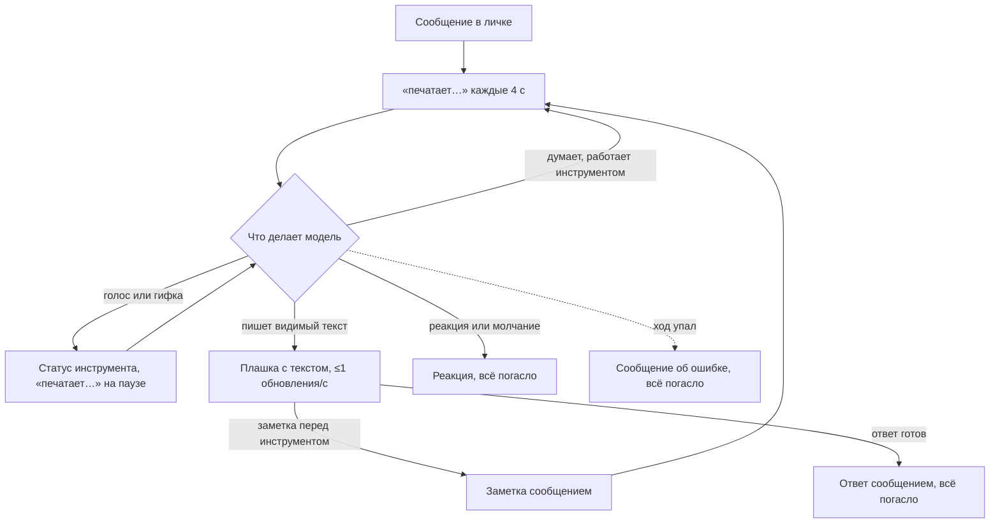
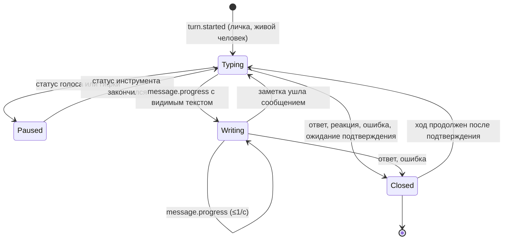

# Ответ по мере написания и «печатает…» на весь ход — чертёж

**Статус:** согласован 03.11.2026, реализован в v0.62.0 (04.11.2026)
**Дата:** 2026-11-03 · **Проект:** Osinara · **Тип фичи:** пользовательская · **Где работает:**
личные чаты Telegram; в группах — как сейчас

## Главное

**Что делаем и зачем.** Сейчас в личке человек после сообщения почти ничего не видит до готового
ответа: «печатает…» мелькает на 5 секунд, только когда агент берётся за инструмент. Делаем так:
«печатает…» горит весь ход, а когда модель пишет ответ, текст проявляется по мере написания.
Дописывать сообщение во время работы агента можно, как сейчас, — это владелец назвал главным.

**Почему этого сейчас нет.** Текст по мере написания был с первого дня и убран 14.07.2026
(`e4bc0c8`): тогдашняя модель MiniMax вписывала рассуждения прямо в текст, и они уходили человеку в
поток. Плашка «Думаю…» убрана 04.08.2026 (v0.6.0, `4f80261`) из-за реакций и не возвращается.

**Как это будет работать.**
1. Человек пишет в личку — сразу «печатает…» в шапке; статус продлевается каждые 4 с, пока идёт ход
   (Telegram сам гасит его через 5 с). Ввод не блокируется: дописанное встраивается в работу, как сейчас.
2. Пока агент озвучивает ответ или подбирает гифку, остаются их статусы — «записывает голосовое»,
   «выбирает стикер».
3. Модель начала писать видимый текст — вместо «печатает…» появляется плашка с растущим текстом,
   обновление примерно раз в секунду. На Android в эти секунды отправить сообщение нельзя — так
   Telegram показывает любую такую плашку; по оценке это несколько секунд, ответ к этому моменту
   почти готов `[ЗАМЕРИТЬ]`.
4. Готовый ответ уходит обычным сообщением, как сейчас, плашка исчезает. Заметка перед
   инструментом («Ищу рецепты») — так же; после неё снова «печатает…».
5. Ответ-реакция, молчание и служебные пометки плашки не дают: в них нет видимого текста.
6. В семейной и внешних группах всё как сейчас.

**Как будем делать.**
- Ядро научится отдавать «модель написала ещё кусок текста» — сейчас отдаёт только готовый шаг.
- Новый модуль для лички держит «печатает…» на весь ход и показывает плашку с текстом; один
  счётчик темпа на чат для обоих, потому что лимит Telegram у них общий.
- Предпросмотр проходит те же фильтры, что готовый ответ, и прячет служебные пометки, пути к
  файлам, разметку кнопок и рассуждения модели.
- Переиспользуем: `draftId` и `requestTelegramRichApi` (`agent/lib/telegram-rich-messages.ts`),
  повтор статуса каждые 4 с (`agent/lib/telegram-chat-action-status.ts`), фильтры rich-ответа.
  Своего нового канала доставки нет.

**На чём основано.**
- Документация Telegram: плашка ответа обновляется по мере генерации, живёт 30 с и исчезает при
  обычном сообщении бота; лимит 20 вызовов за 5 с и 40 за 30 с на чат, общий с «печатает…»;
  статус «печатает…» держится до 5 с.
- Баг-репорт Telegram 62189: на Android плашка блокирует отправку сообщений → плашка только на
  время письма, а не на весь ход (решение владельца Р1).
- История проекта: поток показал рассуждения MiniMax → предпросмотр вырезает их вторым рубежом.

**Объём работ:** оценка 2,5 дня (раздел 21).

**Не проверено:** отдаёт ли боевой хаб модели рассуждения отдельно от текста; сколько секунд
реально длится письмо ответа; как плашка выглядит на iPhone. Это шаг 0. Страницы Telegram взяты из
копий, прочитанных 03.11 (к концу исследования сайт перестал отвечать с сервера).

---

# Часть 1. Для владельца: как это работает

## 1. Что известно и что додумано

- **Сказал владелец (03.11.2026):** текст по мере написания «точно надо сделать»; возможность
  дописывать во время хода важнее плашки «Думаю…» (Р1); кнопку «Стоп» не делаем вообще.
- **Рекомендовал агент, владелец не возразил, но и не подтвердил:** оставить поток текста, хотя на
  Android он блокирует ввод на секунды письма. Поток — исходная просьба владельца, поэтому он в
  объёме; если блокировка окажется заметной, поток выключается одной константой (раздел 17).
- **Нашлось в проекте:**
  - ядро получает ответ модели потоком (`streamText` в `agent/runtime/turn/model-call.ts`), наружу
    отдаёт только готовый шаг (`stepText` в `agent/runtime/telegram/telegram-events.ts`);
  - «печатает…» сейчас шлётся только на старте инструментов (`toolsStarted` → `startTyping`);
  - статусы голоса и гифки повторяются каждые 4 с (`createChatActionStatus`);
  - сообщения, пришедшие во время хода, встраиваются в ход (`agent/lib/turn-interjection/`).
- **Додумано:** `[ДОПУЩЕНИЕ]` личкой пользуются единицы людей; на лимиты Telegram это не влияет.

## 2. Цели, не-цели, анти-цели

- **Цели:** в личке видимый статус меньше чем через 1 с после сообщения и до конца хода; текст
  ответа виден по мере написания с отставанием не больше ~1,5 с; ввод не блокируется, пока агент
  думает и работает инструментами.
- **Не-цели:** плашка «Думаю…»; кнопка «Стоп» и любая отмена хода; поток в группах (Telegram не
  показывает там такие плашки); поток для сценариев по расписанию и пробуждений.
- **Анти-цели:** плашка висит после готового ответа или возникает снова; «печатает…» горит после
  ответа; в предпросмотре видны разметка кнопок, путь `/workspace/…`, служебная пометка или мысли
  модели; статус перебивает «записывает голосовое».

## 3. На чём основано

| Практика | Кто так делает | При каком масштабе окупается | Берём сейчас? | Почему | Источник |
|---|---|---|---|---|---|
| Плашка ответа, обновляемая по мере генерации; итог — обычным сообщением | Telegram для ИИ-ботов | Любой, встроено в платформу | да, только на время письма | Ровно наш случай, только в личке | core.telegram.org/bots/features «Streaming Replies»; `sendRichMessageDraft` (Bot API 10.3) |
| Темп: ≤20 вызовов за 5 с и ≤40 за 30 с на чат, общий с `sendChatAction`; плашка живёт 30 с | Telegram | Любой | да | Отсюда ≤1 обновления в секунду и общий счётчик | core.telegram.org/api/bots/ai «Live response streaming»; api/config `message_typing_draft_ttl` = 30 |
| Статус «печатает…» держится ≤5 с, его надо повторять | Telegram; в проекте — голос и гифки | Любой | да | Повтор каждые 4 с уже работает в проекте | `sendChatAction`; `telegram-chat-action-status.ts` |
| Плашка блокирует ввод на Android, «так задумано» | Telegram, баг 62189 | — | учитываем | Поэтому плашка только на время письма | bugs.telegram.org/c/62189 (24.05–20.08.2026) |
| Поток только из текста, рассуждения отдельно | AI SDK `7.0.60` (`text-delta` / `reasoning-delta`) | Любой | да, плюс второй рубеж | В июле поток показал мысли MiniMax | история `019a91f`, `ddd8d42`, `e4bc0c8` |

## 4. Варианты и масштаб

**Масштаб:** один процесс агента на сервер, в личке единицы людей `[ДОПУЩЕНИЕ]`, ход — от секунд до
минут, при сбое хаба модели — ожидание до ~2 мин.

Путь один: плашка Telegram — единственный способ показать текст по мере написания без лавины правок
сообщения, а «печатает…» — единственный статус, который не мешает писать. Отвергнуто:
сообщение-заглушка, которое правится по мере письма, — лимит правок, след в истории при падении хода
и второй путь доставки; вернётся, только если понадобится поток в группах.

## 5. Как это работает

**Сценарий 1 — долгая задача с уточнением.** Владелец на Android просит найти три рецепта ужина.
1. Сразу «печатает…». Модель пишет «Ищу рецепты» — короткая плашка, затем это уходит сообщением.
2. Поиск идёт 90 с — «печатает…» продлевается; владелец дописывает «и без грибов» — сообщение
   уходит, агент встраивает его, как сейчас.
3. **Главный момент:** модель пишет ответ — текст растёт в плашке ~8 с, затем приходит сообщением.
- **Если сбой:** Telegram не принял обновление плашки — ответ всё равно приходит обычным
  сообщением; в журнале `AGENT_TELEGRAM_DRAFT_UPDATE_FAILED`.

**Сценарий 2 — «спасибо».** Агент ставит ❤️: «печатает…» гаснет, плашки не было.

**Сценарий 3 — голосом.** «Ответь голосом»: «печатает…» → «записывает голосовое» на время озвучки →
голосовое; «печатает…» после него не возвращается.



## 6. Решения владельца

### Принято
- **Р1 (03.11):** дописывать во время хода важнее плашки «Думаю…». Плашки на весь ход нет; пока агент
  думает и работает — «печатает…»; плашка только с текстом, пока он пишется.
- **Р2 (03.11):** закрыт следствием Р1 — у ответа-реакции нет текста, плашки не будет.
- **Кнопка «Стоп» (03.11):** не делаем вообще, ни на плашке, ни своей кнопкой, ни командой.

---

# Часть 2. Для исполнителя: поведение в деталях

## 7. Точки контакта и состояния

| Точка контакта | Начало хода | Думает / инструмент | Голос или гифка | Пишет текст | Готово | Ошибка хода | Ход ждёт подтверждения |
|---|---|---|---|---|---|---|---|
| Шапка «печатает…» (личка) | за <1 с | повтор каждые 4 с | пауза, виден статус инструмента | не шлётся: видна плашка | не шлётся | не шлётся | не шлётся: висит карточка |
| Плашка с текстом (личка) | нет | нет | нет | растущий текст, ≤1/с | исчезла: ушло сообщение | исчезла: ушло сообщение об ошибке | нет |
| Группы | как сейчас | как сейчас | как сейчас | как сейчас | как сейчас | как сейчас | как сейчас |

## 8. Внутренний механизм

Не относится: нового хранения, фоновых задач и данных нет. Состояние показа живёт в памяти процесса;
после перезапуска первое событие хода создаёт его заново, а Telegram сам гасит плашку через 30 с и
статус через 5 с.

## 9. Ошибки и восстановление

| Ситуация | Как предотвращаем | Что видит человек | Как выбирается | Что сохраняется |
|---|---|---|---|---|
| Telegram отклонил обновление плашки или статуса (429, сеть) | общий темп на чат | плашка застыла или статус погас; ответ приходит как обычно | ничего делать не нужно | всё; warn `AGENT_TELEGRAM_DRAFT_UPDATE_FAILED` с `retryAfter` |
| Обработчик показа бросил исключение | — | ничего: ход идёт дальше | — | всё; ошибка в журнале, ход не падает |

## 10. Крайние случаи

| Случай | Что происходит | Как обрабатываем |
|---|---|---|
| Модель снова вписывает рассуждения в текст | в плашку попали бы мысли | вырезаются `<think>…</think>` и незакрытый `<think>` до конца текста |
| Ответ начинается с `<telegram-reaction>`, `<empty-delivery/>`, `[[no-reply]]`, пометки сохранения в память | в плашке была бы пометка | начало, которое может оказаться пометкой, не показывается, пока не ясно, что это текст |
| На конце куска незакрытый тег кнопок, `<tg-time>`, ссылка или путь к файлу | разметка видна наполовину | хвост с незакрытой конструкцией отрезается до следующего обновления |
| Законченный `` | плашка не умеет загружать файлы | строка «📎 подпись», без подписи — «📎 имя файла» |
| Ответ вернули модели на исправление (файл не найден) | в плашке первый вариант до 30 с, потом новый | тот же номер плашки, Telegram заменит текст |
| Повтор вызова модели после сбоя хаба | текст начинается заново | плашка не обновляется, пока новый текст не догонит видимый; дальше заменяется |
| Ответ длиннее одного сообщения или с `[[split]]` | итог уйдёт несколькими сообщениями | плашка показывает только последнюю часть |
| Голосовой ответ | `sendVoice` — обычное сообщение | «печатает…» на паузе на время статуса голоса и не возобновляется после отправки |
| Ход ждёт подтверждения | висит карточка | статус и плашка не шлются до продолжения хода |
| Сценарий по расписанию, пробуждение | человек ничего не ждал | ни статуса на весь ход, ни плашки (как сейчас — только при старте инструмента) |
| Человек дописал во время письма текста | на Android ввод закрыт, пока видна плашка | особенность Telegram; после ответа сообщение уходит и становится новым ходом, как сейчас |

## 11. Скорость и обратная связь

| Действие | Ожидаемое время | Что видит человек | Если дольше |
|---|---|---|---|
| Статус после сообщения | <1 с `[ЗАМЕРИТЬ]` | «печатает…» | ничего — это только показ |
| Обновление текста | ~1 раз в секунду, отставание ≤1,5 с | растущий текст | застывший текст до следующего обновления |
| Письмо ответа (блок ввода на Android) | несколько секунд `[ЗАМЕРИТЬ]` | плашку | если чаще 15 с — вернуться к владельцу с цифрами |

## 12. Тексты интерфейса

| Где | Текст |
|---|---|
| Файл в предпросмотре | «📎 {подпись файла, иначе имя файла}» |

## 13. Доступность, локализация, деньги, данные, закон

Предпросмотр показывает только то, что ушло бы в готовом ответе: тот же фильтр ссылок и разметки.

## 14. Что сознательно не делаем

- Плашку «Думаю…» на весь ход — блокирует ввод на Android (Р1).
- Кнопку «Стоп» и отмену хода — решение владельца 03.11.
- Поток в группах — Telegram не показывает там плашки; заглушка с правками отвергнута (раздел 4).
- «Печатает…» на весь ход в группах — долгие задачи групп идут часами; статус на часы читается как
  зависание. В группах остаётся как сейчас.
- Настройку «показывать поток» — по правилу «без настроек для людей».

## 15. Решения агента — на проверку

- «Печатает…» на весь ход — только в личке, в группах как сейчас (раздел 14).
- Один номер плашки на ход (`draftId` по чату, теме и ходу): шаги одного хода заменяют текст, а не
  копят плашки.
- Поток включается константой `TELEGRAM_ANSWER_STREAMING_ENABLED` в `agent/config.ts`: если блок
  ввода на Android окажется заметным, поток выключается правкой кода без переделки.
- Предпросмотр вырезает `<think>` даже при провайдере, который отдаёт рассуждения отдельно.

---

# Часть 3. Для исполнителя: как реализовать

## 16. Что уже есть и переиспользуем

- `draftId`, `requestTelegramRichApi`, проверка ответа плашки `requireDraftSuccess` —
  `agent/lib/telegram-rich-messages.ts`.
- `createChatActionStatus`, `CHAT_ACTION_STATUS_REFRESH_MS` (4 с) — `agent/lib/telegram-chat-action-status.ts`;
  добавить действие `typing` и паузу, пока идёт статус инструмента.
- Фильтры: `sanitizeTelegramRichMarkdown`, `neutralizeTelegramRichLinks`, `readReplyButtonMarkup`,
  `readTelegramStandaloneDirective`, `stripTelegramAsideDirectives`, `EMPTY_DELIVERY_MARKER`,
  `telegramOutputWithoutMemoryDirective`, `readAnswerMedia`.
- **Устаревшее (удалено по согласию владельца 04.11):** `startTelegramRichThinkingDraft` и `TELEGRAM_THINKING_HTML` не
  вызываются с v0.6.0 (04.08.2026), живут только в своих тестах `telegram-rich-messages.test.ts`.
  Плашка «Думаю…» не возвращается (Р1), поэтому рекомендовано удалить их вместе с тестами в этой
  задаче. Без согласия — не трогать.
- Тест `agent/lib/telegram-channel-draft-policy.test.ts` остаётся верным (плашки на старте хода
  нет); в него добавляется новый контракт (шаг 3).

## 17. Устройство

- **Ядро.** В `StepModelCall` — необязательный `onTextDelta(textSoFar: string)`; `callOnce`
  накапливает части `text-delta` шага и зовёт его на каждой; при повторе вызова накопленное
  обнуляется. `TurnObserver` получает `stepTextProgress({ turn, stepIndex, textSoFar })`;
  `telegram-events.ts` переводит его в обработчик канала `message.progress(data, channel, ctx)`.
  Частоту в ядре не ограничиваем — темп держит канал.
- **Модуль** `agent/lib/telegram-answer-draft/` (файлы до 500 строк):
  - `answer-draft-preview.ts` — чистая `previewAnswerText(textSoFar: string): string | null`
    (`null` — показывать нечего);
  - `answer-draft-presenter.ts` — состояние одного хода в личке: `typing` → `writing` → `closed`;
    счётчик темпа на чат: плашка ≤1 вызова в секунду, «печатает…» каждые 4 с, вместе не больше 20
    за 5 с; на 429 — тишина до `retry_after`, следующее обновление несёт свежий текст.
- **Канал** (`agent/channels/telegram.ts`): `turn.started` в личке живого хода → старт;
  `message.progress` → текст; `message.completed`, реакция, `input.requested`, завершение и
  падение хода → закрытие (после закрытия — ни одного вызова до следующего старта).
- **Константы** в `agent/config.ts`: `TELEGRAM_ANSWER_STREAMING_ENABLED = true`,
  `TELEGRAM_DRAFT_MIN_INTERVAL_MS = 1_000`.



## 18. Ловушки платформы и библиотек

- Плашка исчезает при любом обычном сообщении бота и сама через 30 с: после отправки сообщения шагу
  нельзя слать обновления, иначе плашка возникнет снова. Тест — в шаге 3.
- Лимит общий у плашки и `sendChatAction`, включая статусы голоса и гифки. Тест — в шаге 3.
- `sendRichMessageDraft` не принимает загрузку файлов — в плашке файл только строкой.
- Плашка только в личке (`chat_id` — личный чат): в группах не вызывать.
- Страницы Telegram 03.11 к концу работы не открывались (TLS); методы, лимиты и TTL прочитаны раньше
  в тот же день.

## 19. Сбои на новых путях

| Путь | Реальный отказ | Что видит человек | Чем покрыт |
|---|---|---|---|
| `stepTextProgress` | исключение в обработчике канала | ничего, ход идёт дальше | тест: ошибка показа логируется, ход завершается |
| Повтор «печатает…» | ход завершился, а таймер жив | «печатает…» после ответа | тест: после закрытия 0 вызовов |

## 20. Обслуживание

Сигнал — warn `AGENT_TELEGRAM_DRAFT_UPDATE_FAILED` (`method`, `providerStatus`, `retryAfter`).
Частые 429 — поднять `TELEGRAM_DRAFT_MIN_INTERVAL_MS`. Регулярной работы нет.

## 21. Приоритеты и объём работ

- **P0:** «печатает…» на весь ход в личке; плашка с текстом и фильтром предпросмотра.
- **P1:** нет.
- **P2:** поток в группах — не делаем, дорогу не закрываем.

Объём (оценка): шаг 0 — 0,25 дня; ядро — 0,5; предпросмотр — 0,75; показ в канале — 0,75; живая
проверка — 0,25. Итого 2,5 дня. Удаление устаревшего кода, если согласовано, — в пределах шага 3.

## 22. Шаги

### Шаг 0: проверки и замеры

| Что проверяем | Как | Какое решение зависит | Что меняется |
|---|---|---|---|
| Рассуждения боевой модели приходят отдельно от текста | один ход на dev с боевым конфигом хаба, части потока в отладочном выводе | достаточно ли второго рубежа | если рассуждения внутри текста — тест на боевой формат обязателен |
| Сколько длится письмо ответа | после выкладки на dev: время от первого `text-delta` до конца шага на 20 обычных ходах | блок ввода на Android | дольше 15 с в среднем — вернуться к владельцу с цифрами |

### Шаг 1: ядро отдаёт текст по мере написания
**Файлы:** `agent/runtime/turn/model-call.ts`, `agent/runtime/turn/turn-observation.ts`,
`agent/runtime/telegram/telegram-events.ts`; тест `agent/runtime/turn/model-call.test.ts`.
**Тест:** поток `reasoning-delta "мысль"`, `text-delta "При"`, `text-delta "вет"` даёт ровно
`"При"`, `"Привет"`; при повторе вызова после сбоя следующий кусок начинается заново.

### Шаг 2: предпросмотр
**Файлы:** `agent/lib/telegram-answer-draft/answer-draft-preview.ts` и тест рядом.
**Тест:** `<telegram-reaction>❤️</telegram-reaction>` → `null`; `"Ищу<think>план"` → `"Ищу"`; хвосты
`"<tg-button-row><tg-but"` и `"`
→ `📎 Рецепты`; ссылка `tg://…` нейтрализована, как в готовом ответе; после `[[split]]` — только
последняя часть. Свойство (fast-check): для любого префикса готового ответа результат не содержит
`/workspace/`, `<tg-button`, `<think`, `<telegram-reaction`, `<empty-delivery`.

### Шаг 3: показ в личке
**Файлы:** `agent/lib/telegram-answer-draft/answer-draft-presenter.ts`; `agent/lib/telegram-chat-action-status.ts`
(действие `typing`, пауза под статус инструмента); `agent/channels/telegram.ts`; новый `it` в
`telegram-channel-draft-policy.test.ts`.
**Тест** (поддельные часы): старт → «печатает…» за 0 с и каждые 4 с; 30 кусков текста за 3 с → не
больше 4 вызовов плашки; статус голоса 10 с → ни одного `typing` за это время; после ответа и после
реакции — 0 вызовов; 429 с `retry_after: 5` → тишина 5 с; группа → ни одного вызова плашки.

### Шаг 4: живая проверка
В личке: обычный вопрос, долгая задача с дописанным сообщением, «спасибо», голосовой ответ, ответ с
файлом и кнопками. Сверить с разделом 23.

## 23. Критерии приёмки

```
Дано: владелец пишет в личку «что посмотреть вечером?»
Тогда: «печатает…» за <1 с; потом текст растёт в плашке; итог пришёл сообщением;
       ни плашка, ни «печатает…» после этого не появились
```
```
Дано: агент 90 с ищет рецепты
Когда: владелец дописывает «и без грибов»
Тогда: сообщение отправилось (ввод не заблокирован), агент учёл его, как сейчас
```
```
Дано: ответ с файлом и кнопками-ответами
Тогда: в плашке нет тегов кнопок и пути, есть «📎 подпись»; в итоге — файл и кнопки
```
```
Дано: агент отвечает реакцией ❤️
Тогда: плашки не было, «печатает…» погас сразу после реакции
```

## 24. На что смотреть при ревью

- Заметка перед инструментом: после неё снова «печатает…», а не плашка (тест в шаге 3).
- Ход ждёт подтверждения: ни статуса, ни плашки, пока висит карточка (тест в шаге 3).
- Ответ вернули на исправление: плашка заменяется, а не копится (тест в шаге 3).
- Сценарий по расписанию в личке: ни плашки, ни статуса на весь ход (тест в шаге 3).
- Перезапуск процесса посреди хода: после подхвата статус и плашка возобновляются с нового события
  (тест в шаге 3).
