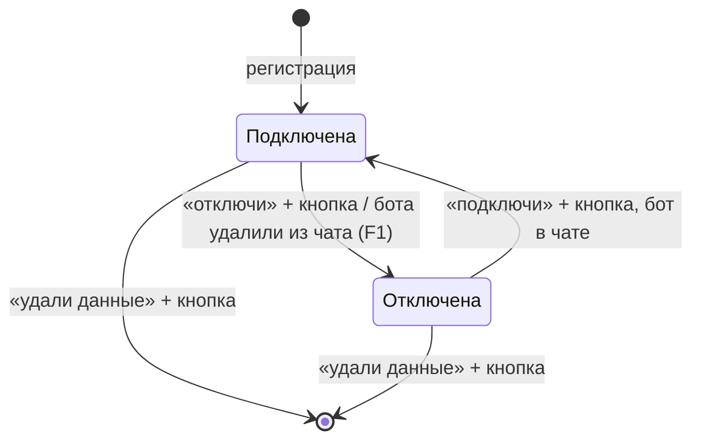

# Отключение внешней группы с сохранением данных и починка удаления — спецификация

**Статус:** согласовано 2026-11-04; выпущено в v0.63.0 (05.11.2026). Отключение (#465) закрыто; причина сбоя удаления (#464, F2) ждёт разрешения владельца
**Дата:** 2026-11-04 · **Проект:** Osinara · **Тип:** смешанный (действие владельца + фоновые механизмы) ·
**Где работает:** личный чат владельца с агентом, внешние группы Telegram, вход вебхука, фоновые диспетчеры
Репозиторий публичный: названий групп, id чатов и личных данных в документе нет.

## Коротко

**Что делаем и зачем.** Сейчас у владельца нет способа «выключить» агента во внешней группе, сохранив всё, и потом
вернуть. Режим «только владелец» продолжает записывать чат и запускать напоминания; удаление стирает всё безвозвратно,
сломано (01.11 и 02.11 дважды упало с «внутренним сбоем») и вдобавок не трогает сырые копии сообщений в служебной
очереди. Делаем три понятных действия — отключить, подключить обратно, удалить данные — и чиним удаление.

**Как это будет работать.**
1. Владелец пишет агенту в личке «отключи группу …» и подтверждает кнопкой. Агент перестаёт отвечать в группе;
   её сообщения не записываются нигде, включая служебную очередь; напоминания, сценарии, проверка памяти и ключи
   группы встают. Бот остаётся участником чата и молчит.
2. Всё накопленное — история, память, файлы, навыки, права, напоминания — хранится без срока.
3. «Подключи группу …» и кнопка — всё продолжается как было. Что должно было сработать за время отключения, не
   отправляется и не показывается; повторяющееся продолжается со следующего раза. В истории группы стоит отметка
   о перерыве, чтобы агент не утверждал, что «этого не обсуждали».
4. «Удали данные группы …» и кнопка — стирается всё, включая сырые копии сообщений в служебной очереди.
5. Задача, которую агент делал в группе в момент отключения, обрывается: в чат больше ничего не уходит.
6. Предлагается (F1): если бота удалили из чата в Telegram, приложение само отключает группу и пишет владельцу;
   если добавили обратно — пишет, что группу можно подключить.

**Как будем строить.**
- У внешней группы появляется состояние «отключена» (когда, кем: владелец или удаление бота из чата). Новых таблиц нет.
  Семейные группы в этой задаче не отключаются — отказ с понятным текстом (раздел 15).
- Вход: сообщения отключённой группы отбрасываются ещё до записи в очередь — так сейчас отбрасываются медиа
  незарегистрированных чатов.
- Права инструментов группы уже перечитываются при каждом вызове — для отключённой группы они пусты, поэтому
  идущая задача обрывается на первом же инструменте; её итоговый ответ гасится.
- Последний рубеж — одна проверка в самом низком слое отправки в Telegram: всё, что адресовано отключённой группе,
  не уходит, а в журнал пишется ошибка. Это ловит любой путь, забывший проверку.
- Диспетчеры напоминаний, сценариев, проверок мониторов, проверки памяти и уведомлений о навыках пропускают
  отключённую группу; выдача ключей в прокси её не содержит; песочницы группы останавливаются.
- Удаление: точная причина сбоя (F2), исправление, вынос остановки песочниц из транзакции, чистка сырых копий
  в очереди; исходная ошибка любого инструмента начинает попадать в журнал.
- Для F1: подписка на событие Telegram «изменилось членство бота»; на серверах её обновляет шаг выкатки.

**За чем следить.** Отключённая группа не должна ни звучать, ни записываться ни по одному пути — включая задачу,
начатую до отключения, ожидающие кнопки подтверждения и мониторы. Пропущенные срабатывания не должны «выстрелить»
после подключения. Проверка памяти, шедшая в момент отключения, не должна поднять ложную тревогу.

**На что опирается.** Bot API 10.3: событие `my_chat_member`, подписка `allowed_updates` (раздел 3); практика GitHub
Apps — приостановка установки отдельно от удаления: события не приходят, доступа нет, вернуть можно.

**Найдено попутно.**
- Исходная ошибка инструмента теряется: обёртка подменяет её общим `AGENT_TOOL_DEPENDENCY_FAILED`. Чиним здесь.
- Удаление останавливает песочницы по сети внутри открытой транзакции базы. Выносим.
- Служебная очередь входящих хранит сырые копии всех сообщений всех чатов без срока: 68,6 тыс. записей, 99 МБ;
  из них 63,5 тыс. (62 МБ, с 03.08) — живая внешняя группа. Здесь чистим только удаляемую группу; общий срок хранения
  очереди — вне задачи (раздел 14).
- Незарегистрированный чат, где состоит бот, тоже копит сырые сообщения в очереди (отбрасываются только медиа).
  Это касается и группы после удаления данных — F4.
- Переезд группы в супергруппу (у чата меняется id) не обрабатывается: бот в группе замолкает. Вне задачи.
- Повторная регистрация группы с другим типом молча стирает её данные. Для отключённой группы регистрацию
  запрещаем; общий случай — вне задачи.

**Ждут вашего решения.**
1. Замечать ли удаление бота из чата и писать ли вам — рекомендую да (F1).
2. Как выяснить причину сбоя удаления — рекомендую повтор на проде в транзакции с отменой (F2).
3. Как выпускать — рекомендую одним релизом со слиянием инструментов и ключами API (F3).
4. Что делать с сообщениями чата после удаления данных, если бот остаётся в нём — рекомендую не записывать
   сообщения никаких незарегистрированных групп (F4).

**Выкатка:** обычным релизом (F3). После — живая проверка в тестовой группе (раздел 21).

**Объём:** 11 шагов; работа агента — около 7 ч (оценка) плюс прогоны CI. От владельца: ответы на F1–F4,
разрешение на шаг 0 и живая проверка в тестовой группе.

**Не проверено:** точная причина сбоя удаления; поддерживает ли лента группы служебную отметку; как вернуть
в очередь уже начатую проверку памяти; может ли контроллер выкатки перерегистрировать вебхук — всё в шаге 0.

---

# Часть 1. Для владельца: как это работает

## 1. Что известно и что добавлено

- **Владелец сказал (04.11.2026):** пока группа отключена — сообщения чата не записываются; бот остаётся в чате
  молча; пропущенные за время отключения напоминания и сценарии не отправляются и не показываются — «раз отключён,
  все процессы не работали»; данные отключённой группы хранятся бессрочно, удалить — по запросу в боте. Исходная цель:
  отключить агента от внешней группы и иметь возможность вернуть его со всеми настройками, памятью и историей.
- **Агент рекомендовал, владелец не подтвердил:** замечать удаление бота из чата и сообщать владельцу (F1).
- **Найдено в проекте:**
  - отключения как состояния нет; `owner_only` отвечает только владельцу, но записывает чат, напоминания и сценарии
    работают; `remove` стирает регистрацию и данные, бот остаётся в чате;
  - `remove` дважды упал после подтверждения (01.11 20:37 и 02.11 04:04 UTC, `AGENT_TOOL_DEPENDENCY_FAILED`);
    исходная ошибка не сохранилась; логи контейнеров за те дни стёрты выкаткой 04.11;
  - вход подписан только на `message` и `callback_query` (`scripts/provider-installer/telegram-webhook.ts`);
  - каждое сообщение группы записывается целиком в служебную очередь (`telegram_ingress_updates.payload`) до проверки
    группы, строки не удаляются никогда;
  - масштаб: 5 групп; у живой — около 14 тыс. сообщений в истории, 3,9 тыс. записей памяти, 63,5 тыс. сырых копий;
    база 376 МБ.
- **Добавлено:** решения агента — раздел 15.
- **Противоречий между источниками нет.**

**Источники**

| Код | Что это | От кого, дата | Где | Вес |
|---|---|---|---|---|
| OWN | Ответы владельца на четыре вопроса об отключении | владелец, 2026-11-04 | этот разговор | требование |
| PROD | Разбор попыток удаления и данных групп на проде (только чтение) | агент, 2026-11-04 | журнал вызовов, схема и счётчики БД прода | факт |
| REV | Проверка черновика свежим агентом | агент-исполнитель, 2026-11-04 | этот разговор | гипотезы, проверены по коду |

## 2. Цели, не-цели, анти-цели

- **Цели:**
  - после подтверждённого отключения ни одно сообщение группы не записывается (ни в историю, ни в служебную очередь)
    и в группу не уходит ни одно сообщение, реакция, файл или правка карточки **[OWN]**;
  - подключение возвращает всё как было: историю до отключения, память, файлы, навыки, права, режим ответа **[OWN]**;
  - пропущенное за время отключения не всплывает после подключения **[OWN]**;
  - удаление данных работает и стирает всё, включая сырые копии в очереди **[OWN]**;
  - любой будущий «внутренний сбой» инструмента оставляет в журнале исходную причину.
- **Не-цели:** автоудаление данных отключённой группы; сообщение в чат группы об отключении; отключение семейной группы;
  переезд группы в супергруппу; срок хранения служебной очереди для подключённых чатов.
- **Анти-цели:** отключённая группа хоть раз «звучит» или записывается; после подключения разом приходят пропущенные
  напоминания; ложные тревоги о сбоях из-за отключения; подключение незаметно меняет права или стирает данные;
  удаление снова падает без причины в журнале.

## 3. На что опираемся

| Практика / факт | Кто | При каком масштабе окупается | Берём сейчас? | Почему | Источник, дата |
|---|---|---|---|---|---|
| Приостановка установки отдельно от удаления: событий нет, доступа нет, обратимо | GitHub Apps | любой | да | ровно то, что выбрал владелец: «выключить» ≠ «стереть» | docs.github.com «Suspending a GitHub App installation», changelog 2020-05-01; 2026-11-04 |
| `my_chat_member` — событие «изменилось членство бота в чате» | Telegram Bot API 10.3 | любой | да, если F1 = A или B | единственный способ узнать, что бота удалили или добавили | тип `Update`, `ChatMemberUpdated`; 2026-11-04 |
| `allowed_updates`: пустой список — всё, кроме `chat_member` и реакций; не передан — остаётся прежний | Telegram Bot API 10.3 | — | да | наш вебхук явно ограничен `message` и `callback_query`; без перерегистрации событие не придёт | метод `setWebhook`; 2026-11-04 |
| Подписка на `chat_member` (чужие участники) | Telegram Bot API | — | нет | нужна для чужих участников и требует прав администратора; нам хватает `my_chat_member` | там же |
| Пауза через статус `paused` напоминаний и сценариев | проект | — | нет | `paused` — решение человека; при подключении не отличить «поставил владелец» от «встало из-за отключения» | `reminder-mutation.ts`, `agent-schedule-repository.ts` |
| Отбрасывание до записи в очередь | проект (`acceptMedia` для медиа чужих чатов) | — | да | тот же приём для всех сообщений отключённой группы | `agent/lib/telegram-durable-ingress.ts` |

## 4. Варианты и масштаб

**Масштаб:** 5 групп, одна живая; подключают и отключают единицы раз в месяц; сопровождает владелец с агентами.

Путь один: состояние «отключена» на самой группе плюс проверки там, где группа участвует в работе, и одна общая
проверка на выходе в Telegram. Отдельный архив данных не нужен: данные и так лежат на месте, задача — чтобы с ними
ничего не происходило. Архив понадобится, только если отключённые группы начнут заметно занимать место (сотни групп).

**Отвергнуто:** статус `paused` у напоминаний и сценариев (раздел 3); перерегистрация вебхука при каждом старте
приложения — постоянный механизм ради разового изменения, и окружение разработки с тем же токеном могло бы
переписать боевой вебхук своим секретом.

## 5. Как это работает

**Точки входа:** просьба владельца в личке → сценарии 1–3; удаление бота из чата → сценарий 4 (F1); бота добавили
обратно → сценарий 5 (F1); сообщения, кнопки, голос в отключённой группе → сценарий 6; сценарий по расписанию
в личке владельца → только статус групп, менять их не может.

**Сценарий 1 — отключить.** Владелец обсуждал с ботом проект во внешней группе и хочет, чтобы бот там больше не
участвовал, но всё сохранилось.
1. В личке: «отключи группу …». Агент находит группу в списке и вызывает отключение; приходит кнопка «Отключить
   агента от группы «…»? Он перестанет читать и отвечать; сообщения за время отключения не сохранятся; напоминания
   и сценарии группы встанут. История, память и файлы останутся».
2. **Ключевой момент:** после нажатия сообщения группы отбрасываются до записи; песочницы группы остановлены;
   ожидающие кнопки подтверждения в группе закрыты; задача, которую агент делал в группе, обрывается на первом
   же действии, её ответ в чат не уходит.
3. Приложение само присылает в личку подтверждение (текст — раздел 12): что остановлено, что данные сохранены, но
   с этой минуты не обновляются, что запись возобновится с момента подключения и что данные можно удалить навсегда.
   Агент этот текст не повторяет.
- **При сбое:** состояние не меняется, агент называет ошибку с кодом.

**Сценарий 2 — подключить обратно.** Через месяц владелец хочет вернуть бота.
1. «Подключи группу …». Приложение проверяет, что бот всё ещё участник чата; если нет — отказ с подсказкой.
2. Кнопка «Подключить агента к группе «…»? Он снова будет читать и отвечать по прежним правилам».
3. **Ключевой момент:** возвращаются режим ответа, права, навыки, ключи, история до отключения, память. Разговор
   начинается с чистого контекста модели, а в истории на месте перерыва стоит отметка «агент был отключён с … по …,
   сообщения этого времени не записаны».
4. Напоминания и сценарии, чей срок прошёл за время отключения, не отправляются и не показываются; повторяющиеся
   сработают в следующий раз по расписанию.
5. Приложение присылает подтверждение подключения (раздел 12).
- **При сбое:** группа остаётся отключённой, агент называет причину.

**Сценарий 3 — удалить данные.** Владелец решил, что группа больше не нужна.
1. «Удали данные группы …» — кнопка с перечнем: история, память, файлы, напоминания, сценарии, ключи группы и
   служебные копии её сообщений. Действие необратимо.
2. **Ключевой момент:** удаление проходит; сырые копии сообщений группы в очереди тоже стёрты; дальше — по F4.
3. Приложение присылает подтверждение удаления (раздел 12).
- **При сбое:** ничего не удалено (одна транзакция), агент называет код; в журнале — исходная причина.

**Сценарий 4 — бота удалили из чата (F1 = A).** Администратор группы убрал бота → Telegram присылает событие членства →
приложение отключает группу с причиной «бота удалили» и пишет владельцу (раздел 12). Повтор того же события второго
сообщения не даёт.

**Сценарий 5 — бота добавили обратно (F1 = A).** Группа отключена → владельцу приходит сообщение, что её можно
подключить; подключается она только по просьбе владельца (сценарий 2). Незарегистрированная группа — по F4.

**Сценарий 6 — жизнь отключённой группы.** Участник пишет боту, жмёт старую кнопку, шлёт голосовое или файл —
ничего не происходит и ничего не записывается. Нажатие кнопки гасится без текста, чтобы не крутилось ожидание.

## 6. Решения владельца

### F1. Замечать ли, что бота удалили из чата в Telegram, и писать ли вам
**Ситуация:** автор чата сам убрал бота. Сейчас приложение этого не видит: группа «подключена», напоминания пытаются
уйти в чат, где бота нет, и копят ошибки.
**Почему решать вам:** это новые сообщения вам и поведение без вашей команды.
- **A. Отключать группу и писать вам, в том числе когда бота вернули** — даёт: вы знаете, что произошло, ничего не
  ломается тихо. Стоит: подписка на событие Telegram (обновляется на серверах шагом выкатки), два текста, ~1 ч работы.
  Закрепляет: событие членства становится частью входа.
- **B. Отключать молча** — даёт: напоминания не копят ошибок. Стоит: то же без текстов; об отключении вы узнаете,
  только спросив статус групп.
- **C. Как сейчас — не замечать** — стоит: напоминания группы без бота падают с ошибками; после возвращения бота
  группа «подключена» без вашего решения.
**Рекомендую A:** удаление бота — событие, о котором владелец хочет знать, а без подписки приложение к нему слепо.
**Если никто не решит:** B — без новых сообщений людям.

### F2. Как выяснить точную причину сбоя удаления
**Ситуация:** удаление падает, исходная ошибка не сохранилась. Возможны две причины: отказ базы на данных этой группы
или сбой связи с песочницами внутри транзакции. По схеме базы причина не видна.
**Почему решать вам:** варианты A и B нагружают боевую машину.
- **A. Повторить на проде только удаление в базе, внутри транзакции, и сразу отменить** — даёт: за минуты ясно, база
  это или песочницы (если база проходит — причина в песочницах, их остановку мы и так выносим из транзакции); данные
  не меняются, песочницы не трогаются. Стоит: несколько секунд сообщения этой группы ждут; разовая запись журнала базы
  на медленный диск. Делаю в тихое время.
- **B. Копия базы из резервной копии в отдельном контейнере** — прод не трогается; заметная нагрузка на память и диск.
- **C. Сначала выпустить запись исходной ошибки, потом вы ещё раз жмёте «удалить»** — ноль риска; починка удаления
  уходит в следующий релиз, вам — лишняя попытка (и она удалит данные, если сбой был случайным).
**Рекомендую A:** самый короткий и лёгкий путь к причине; данные не меняются.
**Если никто не решит:** C — запись ошибки и вынос песочниц выходят в этом релизе, остальное — следующим.

### F3. Как выпускать
- **A. Одним релизом со слиянием инструментов (#457–#459) и ключами API (#461), на их ветке** — даёт: один выпуск,
  действия сразу в новом инструменте настроек. Стоит: выпуск ждёт готовности слияния инструментов.
- **B. Отдельно от `develop`, раньше слияния** — даёт: быстрее. Стоит: слияние потом переносится поверх этих правок.
**Рекомендую A:** слияние лежит готовым коммитом, правки в одном и том же инструменте групп; двух переносов не нужно.
**Если никто не решит:** A, выпуск — по вашей команде.

### F4. Что делать с сообщениями чата после удаления данных группы
**Ситуация:** вы удалили данные группы, бот остался участником чата. Сейчас любой незарегистрированный чат, где есть
бот, копит сырые копии всех сообщений в служебной очереди навсегда — значит, после удаления переписка снова начнёт
собираться.
**Почему решать вам:** это касается данных людей и поведения всех незарегистрированных чатов, не только этой группы.
- **A. Не записывать сообщения никаких незарегистрированных групп** — даёт: после удаления ничего не копится; бот,
  добавленный в чужую группу, тоже ничего не собирает. Стоит: одна проверка регистрации на входе для каждого
  группового сообщения (так уже делается для медиа). Закрепляет: до регистрации история группы не накапливается
  (её и сейчас никто не читает).
- **B. При удалении данных бот выходит из чата** — даёт: точно ничего не придёт. Стоит: видно всем участникам;
  чтобы вернуть, администратор чата добавит бота заново; прочие незарегистрированные чаты по-прежнему копят.
- **C. Как сейчас** — после удаления сообщения снова копятся в очереди.
**Рекомендую A:** закрывает дыру целиком и незаметно для людей; регистрация группы на эти копии не опирается.
**Если никто не решит:** C — поведение незарегистрированных чатов не меняется; копии удалённой группы стёрты,
но новые снова копятся.

### Принято
- 2026-11-04: сообщения отключённой группы не записываются **[OWN]**.
- 2026-11-04: при отключении бот остаётся в чате и молчит, в чат ничего не пишет **[OWN]**.
- 2026-11-04: пропущенное за время отключения не отправляется и не показывается **[OWN]**.
- 2026-11-04: данные отключённой группы хранятся бессрочно; удаление — по запросу в боте **[OWN]**.
- 2026-11-04: подтверждение после отключения говорит, что данные сохранены и с этого момента не обновляются, запись
  возобновится с момента подключения, данные можно удалить навсегда **[OWN]** (раздел 12).
- 2026-11-04, по рекомендации, владелец может поменять: F1 = A, F3 = A, F4 = A. F2 — ждёт разрешения; до него
  действует C.

---

# Часть 2. Для исполнителя: поведение в деталях

## 7. Инструменты для агента

Действия добавляются в `manage_telegram_group` (раздел `groups` у `owner_settings`).

| Действие | Когда / когда нет | Параметры | Возвращает | Меняет | Повтор | Ошибки |
|---|---|---|---|---|---|---|
| `disconnect` | «отключи / выключи агента в группе»; не для «отключи навык» (`update_skills`) и не для «отвечай только мне» (`update_policy`) | `telegramChatId` из `status` | `{ status: "disconnected" \| "already_disconnected", telegramChatId, title }` | обратимо; кнопка | `already_disconnected` без кнопки | `AGENT_GROUP_NOT_FOUND`, `AGENT_GROUP_DISCONNECT_EXTERNAL_ONLY` |
| `reconnect` | «подключи / верни агента в группу» | `telegramChatId` | `{ status: "reconnected" \| "already_connected", … }` | кнопка | `already_connected` без кнопки | `AGENT_GROUP_NOT_FOUND`, `AGENT_GROUP_BOT_NOT_MEMBER`, `AGENT_GROUP_MEMBERSHIP_CHECK_FAILED` |
| `remove` | «удали данные / удали группу совсем» | `telegramChatId` | `{ groupId }` | необратимо; кнопка с перечнем | `AGENT_GROUP_NOT_FOUND` | исходная причина в журнале |
| `status` | как сейчас | — | у группы `connection: { state, since, reason: "owner" \| "bot_removed" }` | — | — | — |
| `register` отключённой группы | — | — | — | — | — | `AGENT_GROUP_DISCONNECTED` |

В сценарии по расписанию (`OWNER_SETTINGS_SCHEDULED_SECTIONS` в `agent/lib/owner-settings/owner-settings-sections.ts`)
`disconnect`, `reconnect` и `remove` отказывают кодом `AGENT_GROUP_CHANGE_NOT_SCHEDULED`. Описание инструмента и скилл
`config/service-skills/group-admin/SKILL.md` объясняют разницу с `owner_only` и `remove`; формулировки английские.

## 8. Внутренний механизм: гарантии, данные, сбои

**Гарантии:** после фиксации отключения ни одно новое обновление группы не записывается; ни один путь не отправляет
в группу; ни одно срабатывание группы не исполняется. Источник правды — `telegram_groups.disconnected_at`.

| Что ломается | Как предотвращаем | Как узнаём | Как восстанавливаем | Что теряется | Чем покрыто |
|---|---|---|---|---|---|
| Путь в коде забыл проверку и отправляет в отключённую группу | проверка в нижнем слое отправки | `console.error` `AGENT_GROUP_DISCONNECTED_SEND_BLOCKED` (идёт в `OsinaraErrorBurst`) | исправить путь | ничего не ушло | шаг 7 |
| Ход шёл в момент отключения | права инструментов пусты; песочницы остановлены и не создаются; итоговый ответ гасится до отправки | `console.info` `AGENT_GROUP_DISCONNECTED_TURN_SILENCED` (ожидаемо) | ход заканчивается сам | ответ хода (так задумано) | шаг 7 |
| Ожидающая кнопка подтверждения в группе | при отключении закрывается как «отклонена» обычным путём закрытия, без правки карточки в чате | — | запаркованный ход продолжается без прав и замолкает | — | шаг 5 |
| Монитор каждую минуту проверяет в песочнице группы | диспетчер проверок пропускает отключённую группу, неудачей не считает | — | — | — | шаг 8 |
| Проверка памяти шла в момент отключения | пакет возвращается в очередь без статуса сбоя и без тревоги; новые не берутся | — | продолжится после подключения | — | шаг 8, [VERIFY] шаг 0 |
| Событие Telegram о членстве пришло дважды или старое после нового | изменение только при смене состояния; событие старше записанного игнорируется | — | — | — | шаг 10 |
| Сбой при подключении на полпути | одна транзакция | ошибка с кодом владельцу | повторить | — | шаг 5 |
| Удаление падает | шаг 0 → исправление; исходная ошибка в журнале | `AGENT_TOOL_EXECUTION_FAILED` с причиной | исправить | ничего (откат) | шаги 1–2 |

## 9. Ошибки и восстановление

| Ситуация | Что видит человек (полный текст) | Как выйти |
|---|---|---|
| Подключить группу, откуда бота удалили | «Меня нет в группе «…». Добавьте меня в группу и попросите подключить снова. Код: AGENT_GROUP_BOT_NOT_MEMBER» | добавить бота, повторить |
| Проверка членства не удалась | «Не удалось проверить, есть ли я в группе. Попробуйте позже. Код: AGENT_GROUP_MEMBERSHIP_CHECK_FAILED» | повторить |
| Зарегистрировать отключённую группу | «Группа «…» отключена. Чтобы вернуть агента с прежними данными, попросите подключить её. Код: AGENT_GROUP_DISCONNECTED» | `reconnect` |
| Отключить семейную группу | «Отключать можно только внешние группы. Семейную группу можно удалить или ограничить её права. Код: AGENT_GROUP_DISCONNECT_EXTERNAL_ONLY» | — |
| Изменение групп из сценария по расписанию | «Подключать, отключать и удалять группы можно только по вашей просьбе в личном чате. Код: AGENT_GROUP_CHANGE_NOT_SCHEDULED» | попросить в личке |
| Удаление упало | «Не удалось удалить данные группы, ничего не удалено. Код: …» | повторить; причина в журнале |

## 10. Крайние случаи и стыки

| Случай | Что происходит / как обрабатываем |
|---|---|
| Двойная просьба «отключи» | второй раз — `already_disconnected`, без кнопки |
| Старая кнопка подтверждения или ответа в группе | нажатие гасится без текста; подтверждения закрыты при отключении |
| Многочасовая задача с подагентами в момент отключения | подагенты наследуют права группы — пусты; песочницы остановлены |
| Повтор хода группы после перезапуска приложения | права пусты, ответ гасится |
| Пробуждение в разговоре группы уже взято в работу | ход замолкает как любой ход группы; новое не берётся |
| Сообщения группы уже в очереди в момент отключения | обработка видит отключённую группу → отбрасываются |
| Владелец пишет боту в отключённой группе | молчание; подключение — только из лички |
| Бота удалили из уже отключённой группы | состояние не меняется, причина остаётся «владелец», сообщений нет |
| Перерыв в истории после подключения | в ленте группы отметка о перерыве (раздел 17) |

| Соседняя функция | Где встречаются | Как решаем, кто главный |
|---|---|---|
| `owner_only` | обе «приглушают» | отключение главнее; после подключения режим прежний |
| Напоминания группы | срабатывание в отключении | разовое закрывается без отправки, повторяющееся — к следующему сроку; без тревог |
| Сценарии и мониторы группы | запуск, проверка в песочнице | не запускаются, неудачей не считаются; разовые закрываются, повторяющиеся — к следующему сроку |
| Проверка памяти группы | фоновые ходы по истории | новые пакеты не берутся; идущий возвращается в очередь |
| Уведомления о навыках в группу | изменение навыка семьи | не отправляются и позже не досылаются |
| Ключи API группы | файл прокси | выдача не попадает в файл; после подключения возвращается |
| `update_policy`, `update_skills` для отключённой группы | настройки | разрешено, действует после подключения |
| Создание сценария для группы из лички | инструмент сценариев | отказ `AGENT_GROUP_DISCONNECTED` |
| Чтение истории отключённой группы владельцем из лички | инструменты истории | работает как сейчас |

## 11. Скорость и обратная связь

| Действие | Время | Что видит человек | Если дольше |
|---|---|---|---|
| Отключить | до 2 с после кнопки; остановка песочниц — после ответа | карточка, затем ответ | сбой остановки — в журнал |
| Подключить | до 3 с (проверка членства) | карточка, затем ответ | — |
| Удалить данные | [MEASURE] шаг 0 на живой группе | карточка, затем ответ | если десятки секунд — показать «удаляю…» и ответ по завершении |

## 12. Тексты

Подтверждения действий отправляет приложение сразу после успешного действия, в личку владельца; результат инструмента
говорит модели, что владелец уже извещён, и просит закончить ход без повтора (как у инструментов отправки Telegram —
`nextStep` со строкой пустой доставки). Формулировка владельца от 2026-11-04 — **[OWN]**.

| Где | Текст |
|---|---|
| Владельцу: группа отключена **[OWN]** | «⏸ Группа «{title}» отключена. Я больше не читаю и не отвечаю там, напоминания и сценарии группы остановлены.\n\nДанные группы — история, память, файлы и настройки — сохранены, но с этого момента не обновляются: то, что напишут в группе, пока она отключена, не сохранится. Когда подключите группу снова, запись возобновится с момента подключения.\n\nЕсли группа больше не понадобится, попросите меня удалить её данные целиком — это навсегда, без возможности восстановления, и освободит место.» |
| Владельцу: группа подключена | «▶️ Группа «{title}» снова подключена. Читаю и отвечаю по прежним правилам, напоминания и сценарии работают, запись сообщений возобновлена с этого момента. Сообщения за время отключения ({с} — {по}) не сохранены.» |
| Владельцу: данные удалены | «🗑 Данные группы «{title}» удалены навсегда: история, память, файлы, напоминания, сценарии и служебные копии сообщений. Восстановить их нельзя.» + при F4 = A: «Я остаюсь в чате, но ничего из него не сохраняю.» |

Тексты при F1 = A:

| Где | Текст |
|---|---|
| Владельцу: бота удалили из чата | «Меня удалили из группы «{title}», и я отключился от неё: не читаю, не отвечаю, напоминания и сценарии группы стоят. История, память и файлы сохранены. Если добавите меня обратно — попросите подключить группу, и всё продолжится.» |
| Владельцу: бота вернули в отключённую группу | «Меня снова добавили в группу «{title}». Пока я её не слушаю. Чтобы подключить с прежними историей и памятью, попросите меня подключить группу.» |

Тексты карточек — сценарии 1–3. Если отправить подтверждение не удалось, действие всё равно выполнено: результат
инструмента говорит модели передать суть самой, в журнале — строка с кодом.

## 13. Деньги, данные, право

Хранение данных отключённой группы бессрочно — решение владельца. Сообщения за время отключения не записываются нигде.
Удаление стирает и сырые копии в служебной очереди. После удаления — по F4.

## 14. Что сознательно не делаем

- Сообщение в чат группы об отключении — владелец выбрал «молча».
- Автоудаление данных отключённой группы — владелец выбрал бессрочное хранение.
- Отключение семейной группы — ход семейной группы не перепроверяет права по базе, календарь пишет напоминания
  в семейную группу; цель владельца — внешняя группа. Вернёмся по просьбе.
- Переезд группы в супергруппу; запрет смены типа при регистрации подключённой группы.
- Срок хранения служебной очереди для подключённых чатов (сейчас бессрочно, 99 МБ) — отдельная задача.

## 15. Решения агента — на проверку

- Все три действия — с кнопкой: отключение лишь частично обратимо (сообщения за перерыв и разовые напоминания
  пропадают), а модель может спутать «отключи группу» с «отключи навык». Из сценария по расписанию — запрещены.
- Только внешние группы (раздел 14).
- При отключении разговор группы помечается на новый контекст модели (как `start_new_context`); ожидающие
  подтверждения закрываются как отклонённые. История, память, файлы не трогаются.
- При подключении в ленту группы ставится служебная отметка «агент был отключён с … по …, сообщения этого времени
  не записаны» — иначе агент уверенно скажет, что «этого не обсуждали». [VERIFY] шаг 0: принимает ли лента запись
  приложения; если нет — план меняется и показывается владельцу.
- Пропуск срабатываний делает диспетчер в момент срабатывания тем же путём, каким закрывает успешное, без отправки
  и без тревоги — не через статус `paused` и без пересчёта при подключении.
- Подписку `my_chat_member` на работающих серверах обновляет шаг выкатки существующим `configureTelegramWebhook`,
  новые установки — установщик. [VERIFY] шаг 0: у контроллера выкатки есть токен, адрес и секрет.
- Остановка песочниц при удалении и отключении — после фиксации транзакции.
- Удаление идёт через отключение: сначала группа отключается (новые сообщения и ходы прекращаются), затем сырые копии
  её чата стираются пачками вне транзакции, затем одной транзакцией удаляется группа с остатком копий. Так нет большой
  транзакции на медленном диске, а прерывание на любом шаге оставляет группу отключённой — повторная просьба продолжит.
- Две строки журнала: ожидаемое гашение ответа хода — `info`; блок на нижнем уровне отправки — `error`.
- Подтверждения отключения, подключения и удаления отправляет приложение, а не модель: текст с предупреждениями
  владельца (раздел 12) должен приходить целиком, а боевая модель небольшая и может его пересказать или сократить.

---

# Часть 3. Для исполнителя: как строить

## 16. Что есть и что переиспользуем

- Администрирование: `agent/lib/telegram-group-administration-repository.ts` (`removeRegistration`, статус),
  `agent/lib/telegram-group-policy-repository.ts` (`stopGroupSandboxes`), `agent/lib/tools/manage_telegram_group.ts`
  (действия, правило подтверждений), `agent/lib/owner-settings/owner-settings-sections.ts`.
- Вход: `agent/lib/telegram-durable-ingress.ts` (`handleVerifiedUpdate`, `acceptMedia`), `agent/lib/telegram-repository.ts`
  (`findGroup`), `agent/lib/telegram-voice-authorization.ts`, `agent/lib/telegram-hitl/approval-auth.ts`,
  `agent/lib/reply-buttons/`; маршрут — `agent/runtime/telegram/telegram-channel.ts`.
- Подтверждения: `agent/lib/telegram-hitl/approval-timeout.ts` (`respond`, `finalizePrompt`).
- Права при исполнении: `agent/lib/tool-policy/external-group-live-policy.ts`; песочницы — `agent/lib/sandbox-runner/group-sandbox-policy.ts`.
- Выход: нижний слой — `agent/runtime/telegram/api.ts` (`callTelegramApi`, `sendTelegramMessage`); через него идут
  rich-ответы (`telegram-rich-messages.ts`), нативные отправки (`telegram-sends/telegram-native-send.ts`), гифки,
  кнопки, карточки, напоминания, уведомления. Итог хода — `agent/channels/telegram.ts`.
- Диспетчеры: `reminders/reminder-dispatch-repository.ts`, `agent-schedules/agent-schedule-dispatch-repository.ts`,
  проверки мониторов (`agent-schedules/agent-schedule-check-*`), `conversation-wakeups/conversation-wakeup-preparation.ts`,
  `memory-review/memory-review-dispatch-repository.ts`, `family-skills/family-skill-notices.ts`; ключи — `api-keys/api-key-repository.ts`.
- Сообщения владельцу от приложения — по образцу `agent/lib/api-keys/api-key-telegram.ts`.
- Ошибки: `agent/lib/model-facing-error.ts`, `agent/runtime/turn/tool-calls.ts`.
- Вебхук: `scripts/provider-installer/telegram-webhook.ts`, контроллер выкатки (`docs/production-deployment.md`).

## 17. Устройство

**Данные (миграция `150_telegram_group_connection.sql`, номер — следующий после `develop`):**
`telegram_groups.disconnected_at timestamptz NULL`, `disconnected_reason text NULL CHECK (in ('owner','bot_removed'))`,
`disconnected_by uuid NULL REFERENCES users`, `bot_membership_changed_at timestamptz NULL`; CHECK: причина задана
тогда и только тогда, когда задано `disconnected_at`. Существующие группы — подключены.

**Одно определение.** «Группа работает» = запись есть и `disconnected_at IS NULL`. Пути, где группа участвует в
работе, проверяют его; пути владельца (статус, подключение, удаление, чтение истории) видят отключённые.

**Отключение (одна транзакция):** владелец → блокировка группы → `disconnected_*` → пометка разговора на новый
контекст → фиксация. После: закрытие ожидающих подтверждений группы как отклонённых без правки карточки; публикация
ключей; остановка песочниц (сбой — в журнал).

**Подключение:** `getChatMember(чат, id бота)` до транзакции → транзакция: снятие `disconnected_*`, запись отметки
о перерыве в ленту → фиксация → публикация ключей.

**Удаление:** если группа работает — сначала отключение (как выше, без отдельной кнопки: её заменяет кнопка удаления);
затем пачками вне транзакции стираются завершённые строки `telegram_ingress_updates` её чата; затем одна транзакция:
владелец → блокировка → оставшиеся строки очереди чата → `DELETE` группы; после фиксации — остановка песочниц и
публикация ключей. Прерывание до последней транзакции оставляет группу отключённой; повторное `remove` продолжает.

**Вход:** в `handleVerifiedUpdate` до `enqueue` — обновление отключённой группы (и, при F4 = A, любой
незарегистрированной) отбрасывается так же, как сейчас медиа чужих чатов; нажатие кнопки гасится `answerCallbackQuery`
без текста. На обработке из очереди отключённая группа = незарегистрированная.

**Выход:** (1) `agent/channels/telegram.ts` перед доставкой итога, прогресса и реакции хода группы проверяет состояние;
отключена → ход засчитывается как молчание, `info` `AGENT_GROUP_DISCONNECTED_TURN_SILENCED`. (2) `agent/runtime/telegram/api.ts`:
перед методами отправки и правки с `chat_id` группы вызывается проверка, которую приложение регистрирует один раз при
старте (`agent/application.ts`); отключена → вызов не делается, `error` `AGENT_GROUP_DISCONNECTED_SEND_BLOCKED`, вызывающему —
отказ с этим кодом. Без зарегистрированной проверки отправка в группы отказывает.

**Членство бота (F1):** маршрут вебхука распознаёт `my_chat_member` для `group`/`supergroup` и передаёт приложению
отдельным крюком, в очередь не ставит. `left`/`kicked` и группа работает → отключить с причиной `bot_removed`, написать
владельцу. `member`/`administrator` и группа отключена → написать владельцу. Событие старше `bot_membership_changed_at`
игнорируется; сообщение — только при смене состояния.

**Ошибки:** `normalizeModelFacingError` передаёт исходную ошибку как `cause`; `logFailure` пишет её текст и поля ошибки
PostgreSQL (`code`, `table`, `constraint`, `detail`) одной строкой `AGENT_TOOL_EXECUTION_FAILED`.

**Наблюдаемость:** `AGENT_GROUP_DISCONNECTED`, `AGENT_GROUP_RECONNECTED`, `AGENT_GROUP_BOT_MEMBERSHIP_CHANGED`,
`AGENT_GROUP_DISCONNECTED_TURN_SILENCED` — `info`, в исключения `OsinaraErrorBurst` (`monitoring-alert-rules.test.ts`);
`AGENT_GROUP_DISCONNECTED_SEND_BLOCKED` — `error`, без исключения.

**Откат релиза:** колонки допускают NULL, старый код их не читает. Отключённые к моменту отката группы снова станут
активными — перед откатом подключить их или принять это.

## 18. Ловушки платформы

- `allowed_updates` без указания сохраняет прежнее значение — событие не придёт без перерегистрации.
- `setWebhook` без `secret_token` — секрет не передаётся → передавать всегда; `drop_pending_updates` не задавать.
- `my_chat_member` приходит и для лички (блокировка бота) — обрабатываем только группы.
- `getChatMember` для бота требует id бота — из `getMe` один раз при старте.
- `answerCallbackQuery` — сразу на входе, иначе у человека крутится ожидание.

## 19. Сбои на новых путях

| Путь | Сбой | Что видит человек | Чем покрыто |
|---|---|---|---|
| Отключение | песочница не остановилась | ничего; новые не создаются | журнал; тест шага 7 |
| Подключение | `getChatMember` недоступен | текст `AGENT_GROUP_MEMBERSHIP_CHECK_FAILED` | тест шага 5 |
| Чистка сырых копий при удалении | прервалась | «Не удалось удалить данные группы до конца; группа отключена. Попросите удалить ещё раз. Код: …» | группа остаётся отключённой, повторное `remove` продолжает; тест шага 2 |
| Перерегистрация вебхука на выкатке | Telegram недоступен | ничего; события членства не приходят | выкатка сообщает ошибку с кодом установщика |
| Сообщение владельцу о членстве | Telegram отказал | ничего | журнал; состояние группы сменено |

## 20. Сопровождение

Как понять, что работает: `status` показывает состояние; `AGENT_GROUP_DISCONNECTED_SEND_BLOCKED` в журнале — дыра в каком-то
пути (тревога `OsinaraErrorBurst`); причина любого сбоя удаления — в `AGENT_TOOL_EXECUTION_FAILED`. Регулярной работы нет.

## 21. Приоритеты и объём

- **P0:** всё ниже; шаг 10 — при F1 = A или B; запрет записи незарегистрированных групп — при F4 = A.
- **P1:** нет. **P2:** переезд группы в супергруппу; срок хранения очереди.

**Объём:** шаг 0 — 0,5 ч; 1 — 0,3; 2 — 0,8; 3 — 0,3; 4 — 0,5; 5 — 0,8; 6 — 0,5; 7 — 1,0; 8 — 1,0; 9 — 0,3; 10 — 0,8;
итого около 6,8 ч работы агента плюс CI. Интеграционные тесты — в CI (на этой машине они отнимают память у бота).
**Выкатка:** по F3. Живая проверка: отключить тестовую группу, написать в неё — сообщения нет ни в истории, ни в очереди,
ответа нет; разовое напоминание со сроком внутри отключения не пришло; подключить — агент видит отметку о перерыве;
удалить данные тестовой группы — сырых копий в очереди нет.

## 22. Шаги

### Шаг 0: проверки и замеры

| Что проверяем | Как | От чего зависит | Что меняется |
|---|---|---|---|
| Причина сбоя `remove` [VERIFY] | по F2 | шаг 2 | исправление по причине |
| Время удаления живой группы [MEASURE] | там же | раздел 11 | долго — ответ «удаляю…» |
| Лента принимает служебную запись приложения [VERIFY] | схема `telegram_group_messages`, рендер истории | шаг 6 | нет — альтернатива владельцу |
| Возврат начатого пакета проверки памяти [VERIFY] | `memory-review-lane-recovery.ts` | шаг 8 | способ возврата |
| Контроллер выкатки может вызвать `configureTelegramWebhook` [VERIFY] | `docs/production-deployment.md`, скрипт контроллера | шаг 10 | иначе — ручной шаг в описании релиза |

### Шаг 1: исходная ошибка в журнале
**Файлы:** `agent/lib/model-facing-error.ts`, `agent/runtime/turn/tool-calls.ts`; тесты рядом.
**Тест:** ошибка PostgreSQL `23503` с `table`/`constraint` → модель получает `AGENT_TOOL_DEPENDENCY_FAILED`, в журнале одна
строка с исходным текстом и полями.

### Шаг 2: починка удаления
**Файлы:** `telegram-group-administration-repository.ts` (исправление по шагу 0; порядок «отключить → чистка пачками →
транзакция удаления»; песочницы после фиксации); интеграционный тест на найденной форме данных. Шаг идёт после шагов 3–5,
на которые опирается отключение.
**Тест:** группа с такими данными удаляется; данных группы и строк очереди её чата не осталось; песочницы
останавливаются после фиксации; прерывание после чистки оставляет группу отключённой, повторное `remove` завершает.

### Шаг 3: миграция состояния
**Файлы:** `migrations/150_telegram_group_connection.sql`; строки в `memory-upgrade-ledger.integration.test.ts`.
**Тест:** CHECK отвергает причину без даты и дату без причины.

### Шаг 4: вход
**Файлы:** `telegram-durable-ingress.ts`, `telegram-repository.ts`, голос, подтверждения, кнопки ответа; тесты.
**Тест:** текст, голос, файл, нажатие кнопки в отключённой группе — нет строки в очереди, нет записи в истории, хода нет,
кнопка погашена; при F4 = A — то же для незарегистрированной группы.

### Шаг 5: действия `disconnect`, `reconnect`, `status`, запрет `register`
**Файлы:** `telegram-group-administration-repository.ts`, `manage_telegram_group.ts`, `owner-settings-sections.ts`,
`config/service-skills/group-admin/SKILL.md`, `approval-timeout.ts`; тесты.
**Тест:** отключение — кнопка, дата и причина, новый контекст, ожидающее подтверждение закрыто без правки карточки и
запаркованный ход продолжился; повтор — `already_disconnected`; семейная — `AGENT_GROUP_DISCONNECT_EXTERNAL_ONLY`;
из сценария — `AGENT_GROUP_CHANGE_NOT_SCHEDULED`; подключение без бота — `AGENT_GROUP_BOT_NOT_MEMBER`; `register` —
`AGENT_GROUP_DISCONNECTED`; после отключения, подключения и удаления владельцу ушло ровно одно подтверждение из раздела 12,
а результат инструмента просит модель не повторять его; при сбое отправки подтверждения действие выполнено, модель
получает указание передать суть сама.

### Шаг 6: отметка о перерыве
**Файлы:** по итогам шага 0 — запись приложения в ленте группы и её показ в истории; тест.
**Тест:** после подключения первый ход группы видит отметку с датами перерыва на месте перерыва.

### Шаг 7: идущий ход и выход
**Файлы:** `external-group-live-policy.ts`, `group-sandbox-policy.ts`, `agent/channels/telegram.ts`, `agent/runtime/telegram/api.ts`,
регистрация проверки в `agent/application.ts`; тесты.
**Тест:** инструмент хода отключённой группы — `AGENT_GROUP_DISCONNECTED`; песочница не создаётся; итог хода не отправлен,
`TURN_SILENCED`; прямой вызов `sendMessage` / rich-отправки / `editMessageReplyMarkup` с id отключённой группы не делается,
`SEND_BLOCKED`; отправка в личку и в работающую группу не затронута; без зарегистрированной проверки отправка в группу отказывает.

### Шаг 8: фоновые процессы
**Файлы:** диспетчеры напоминаний, сценариев, проверок мониторов, пробуждений, проверки памяти, уведомлений о навыках;
`listProjectionGrants`.
**Тест:** разовое напоминание со сроком сейчас — закрыто без отправки и тревоги; повторяющееся — следующий срок; сценарий
не запускает модель; монитор не проверяет и неудачу не считает; идущий пакет проверки памяти вернулся в очередь без
`failed`; новый не взят; ключ группы не в файле прокси.

### Шаг 9: подключение не «стреляет» пропущенным
**Тест:** отключить, сдвинуть время за сроки разового и повторяющегося напоминания и сценария, подключить — ни одной
отправки; повторяющееся сработает в следующий срок.

### Шаг 10 (F1 = A/B): членство бота
**Файлы:** `telegram-channel.ts` (крюк `my_chat_member`), обработчик рядом с администрированием групп,
`telegram-webhook.ts` (`my_chat_member` в `allowed_updates`), шаг выкатки; тесты.
**Тест:** `kicked` работающей группы → отключена, причина `bot_removed`, одно сообщение владельцу; тот же `update_id`
второй раз — без второго сообщения; событие старше записанного — игнор; `member` отключённой → сообщение, группа
остаётся отключённой; личка — игнор.

## 23. Критерии приёмки

- **Дано:** подключённая внешняя группа. **Когда:** владелец отключил её, участник пишет боту. **Тогда:** в очереди и
  истории нет новой записи, хода нет, в чат ничего не ушло.
- **Дано:** разовое напоминание группы на 12:00, отключение в 11:00, подключение в 13:00. **Тогда:** напоминание не пришло
  ни в 12:00, ни после подключения; владельцу ничего не показано; тревог нет.
- **Дано:** отключённая группа, бот в чате. **Когда:** «подключи» и кнопка. **Тогда:** режим, права, навыки прежние;
  агент видит историю до отключения и отметку о перерыве.
- **Дано:** группа с историей, памятью и сырыми копиями. **Когда:** удаление и кнопка. **Тогда:** всё стёрто, включая
  строки очереди её чата; при сбое — строка с исходной причиной.
- **Дано (F1 = A):** администратор удалил бота. **Тогда:** группа отключена, владельцу одно сообщение.

## 24. На что смотреть при ревью

1. Нет ли отправки в группу в обход `agent/runtime/telegram/api.ts` (прямой `fetch` к Bot API) — поиск в тесте шага 7.
2. Подагент группы получает права через ту же проверку — тест шага 7 с дочерним ходом.
3. Повтор хода после перезапуска в отключённой группе — тест шага 7.
4. Пробуждение группы, взятое в работу до отключения, — тест шага 8.
5. Публикация ключей после отключения и подключения — тест шага 8.

## 25. Открытые вопросы

| Вопрос | Кто отвечает | Блокирует старт? |
|---|---|---|
| F1 — членство бота | владелец | шаг 10 |
| F2 — как воспроизвести сбой удаления | владелец | шаг 2 |
| F3 — порядок выпуска | владелец | выкатку |
| F4 — сообщения незарегистрированных групп | владелец | часть шага 4 |

---

## 26. Как сделано (2026-11-04) и отличия от плана

Реализовано поверх слияния инструментов и #461 (F3 = A), выпущено в v0.63.0 (05.11.2026).

- **Подтверждения в группе.** Не закрываются отдельным путём: ожидающая кнопка, как и раньше, закрывается обычным
  таймаутом через 5 минут; для отключённой группы карточка при этом не правится (`approval-timeout-prompt.ts`),
  а продолженный ход замолкает. Второй путь закрытия не нужен.
- **Отметка о перерыве.** Не запись в ленте: у записи ленты обязателен номер настоящего сообщения Telegram. Вместо
  неё при подключении у группы сохраняется последний перерыв (`last_pause_*`, миграция 150), а ход группы получает
  доверенную строку `<group_pause>`, пока видимая история захватывает место перерыва (`telegram-turn-result.ts`).
- **Идущий ход.** Проверка не в правах внешней группы, а в общей обёртке всех инструментов (`model-facing-tool.ts`):
  базовые инструменты (память, отправки) иначе прошли бы мимо. Исключение — фоновая проверка памяти, взятая до
  отключения: она дорабатывает уже записанную историю; новые пакеты не берутся.
- **Выход.** Ожидаемое гашение — в обработчике хода (`agent/channels/telegram.ts`: ответ, прогресс, реакция,
  «печатает», запрос подтверждения). Последний рубеж — `registerTelegramGroupSendGate` в `agent/runtime/telegram/api.ts`,
  его же зовут два пути с собственным `fetch` (файлы из папки, выгрузка памяти).
- **Напоминания** пропускаются в диспетчере (`skipWhileGroupDisconnected`), **сценарии и мониторы** — в запросе
  захвата (`passDisconnectedGroupSchedules`), оба через существующий расчёт следующего срока.
- **Вход.** Проверка `acceptMedia` переименована в `acceptChatUpdate` и решает судьбу любого обновления группового
  чата (F4 = A): незарегистрированная и отключённая группа не пишется в очередь, нажатие кнопки гасится без текста.
- **Подписка на `my_chat_member`** на работающих серверах — разовая команда в контейнере агента после выкатки:
  `node .runtime/scripts/telegram-webhook-subscription.js` (контроллер выкатки на bash не трогали). Новые установки —
  через установщик.
- **Удаление.** Чистка сырых копий до и после удаления группы (удалённые до сбоя служебные копии не возвращаются,
  группа и её данные остаются); песочницы — после фиксации; перед чисткой проверяется, что группа своей семьи.
  Точная причина сбоя 01–02.11 не воспроизведена: F2 ждёт разрешения. Если причиной была сеть к песочницам внутри
  транзакции, она устранена выносом; если база — исходная ошибка теперь будет в журнале.
- **Текст подключения** без дат: у группы нет своего часового пояса; даты получает агент в `<group_pause>`.
- **По независимой проверке:** кнопка подтверждения в оборванном ходе отказывается ещё на этапе решения о кнопке
  (иначе ход падал и владельцу приходило сообщение об ошибке); инструмент делегирования `agent` во внешней группе
  тоже проверяет отключение; строка группы блокируется `FOR NO KEY UPDATE` (с `FOR UPDATE` возможна взаимоблокировка
  с подготовкой хода); на приёме убрана лишняя блокировка строки на каждом сообщении; поле `detail` ошибки базы не
  пишется в журнал (в нём бывает вся строка с данными); событие членства бота записывается до ответа Telegram, а
  остановка песочниц и сообщение владельцу — в фоне; остановка песочниц пробует все, наружу — первая ошибка.
- **Известные пределы:** строки очереди, которые в момент удаления ещё в обработке, и сообщение, принятое в доли
  секунды до отключения, остаются в очереди; номера отброшенных обновлений (без содержимого) копятся в
  `telegram_ingress_ignored_updates`.
- Проверки: модульные тесты целиком (в контейнере с потолком), 15 интеграционных файлов по изменённому SQL,
  сквозные тесты, `tsc` — зелёные.
