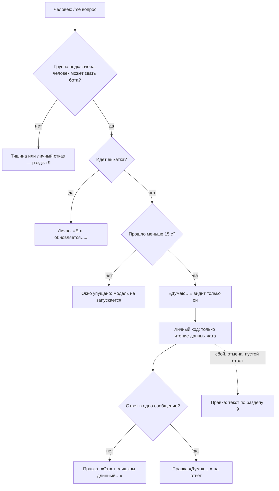
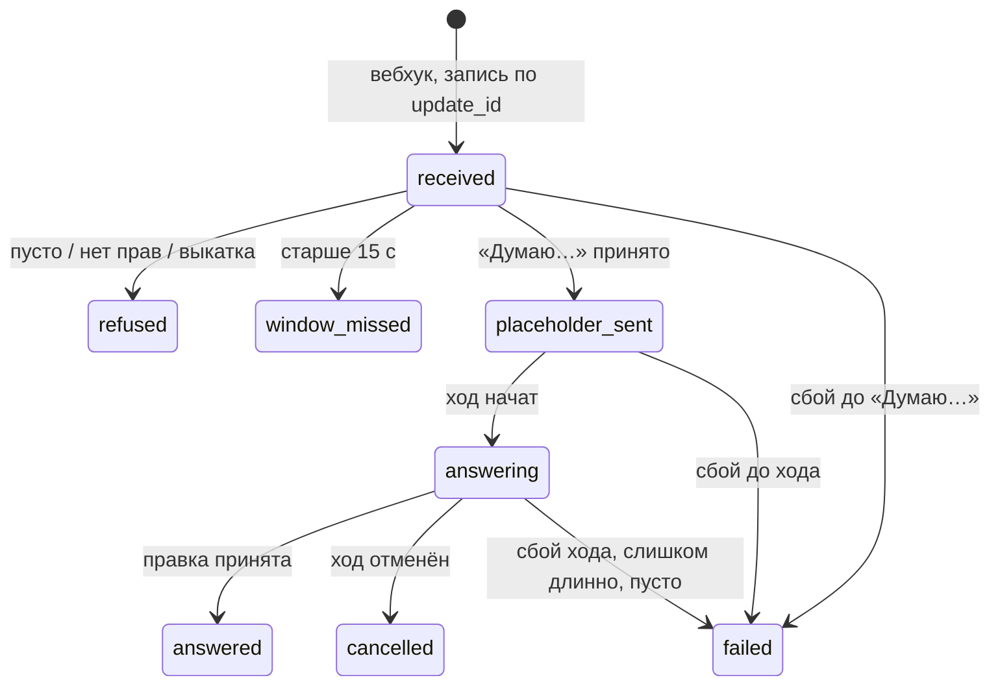

# Личные вопросы боту в группах — спецификация

**Статус:** согласовано 2026-11-06; F6 — выпускаем как есть, проба после выпуска (решение владельца 06.11.2026); выпущено в v0.70.0, проверено на бою 06.11.2026; #467 закрыт
**Дата:** 2026-11-06 · **Проект:** Osinara · **Тип:** смешанный (команда для людей + новый путь приёма и доставки) ·
**Где работает:** семейные и внешние группы Telegram, вход вебхука, ход агента, доставка ответа, напоминания
**Не применяется:** деньги и оплата (раздел 13 — только данные); расход на модель — в F1.
Репозиторий публичный: названий групп, id чатов и личных данных в документе нет; люди в сценариях выдуманы.

## Коротко

**Что делаем и зачем.** В группе — семейной или внешней (рабочий чат, сообщество) — человек хочет спросить бота так,
чтобы остальные не видели ни вопроса, ни ответа: «что я пропустил за день», «что на мне по проекту», «о чём спорили
утром». Сейчас спросить можно только вслух при всех. Telegram с версии Bot API 10.2 умеет личные команды в группе:
вопрос видит только бот, ответ — только спросивший. Успех — ответ приходит в том же чате, никто другой не видит ни
вопроса, ни ответа, и ни следа этого не появляется позже в общих ответах бота.

**Как это будет работать.**
1. В меню команд бота в каждой подключённой группе — семейной и внешней — появляется `/me` — «Спросить лично: ответ
   увидишь только ты». Человек пишет `/me что решили по срокам?` — остальные участники и другие боты этого не видят.
2. Через несколько секунд под командой появляется видимое только ему «Думаю… Ответ увидишь только ты». Потом это же
   сообщение превращается в готовый ответ.
3. Бот отвечает на тех же данных, что и в обычном ответе в этом чате — последние сообщения, поиск по истории и памяти,
   блокнот, интернет, — только скрыто (F2). Личный вопрос не сохраняет в память, не меняет блокнот и не работает с
   файлами (F3).
4. Единственное, что личный вопрос может изменить в чате, — поставить напоминание: `/me напомни мне в 15:00 позвонить
   подрядчику`. В 15:00 бот пишет напоминание в общий чат и отмечает этого человека; остальные его видят — это
   нормально (F3).
5. Вопрос и ответ не попадают ни в общую ленту чата, ни в память группы: бот не сможет пересказать остальным, о чём
   человек спрашивал наедине. Свои недавние личные вопросы человек может продолжать («а подробнее?») — бот помнит их
   сутки (F8).
6. Ответ может не дойти: личные сообщения Telegram живут в самом приложении и пропадают после его перезапуска, а
   бот об этом не узнаёт. Тогда человек спрашивает снова. В личку бот ничего не шлёт, а публично об этом не пишет.
7. Кто может спрашивать — тот же круг, что сейчас может звать бота в этом чате (F1).

**Как будем строить.**
1. Личная команда распознаётся на самом входе, до общей ленты и до обработки кнопок-ответов, и идёт своей очередью
   «человек в этом чате», мимо общей очереди группы.
2. «Думаю…» отправляется сразу при получении — у Telegram на ответ всего 15 секунд. Готовый ответ вписывается
   правкой в это сообщение.
3. Ход личного вопроса — одноразовая сессия с набором инструментов только для чтения плюс напоминания, без песочницы
   (по образцу фоновой проверки памяти: та тоже работает без файлов и вычислений). Связь с прошлыми личными вопросами
   — из новой таблицы, а не из долгой сессии.
4. Отправка из личного хода проходит через «узкий выход»: разрешена только правка своего «Думаю…». Любая попытка
   написать в чат публично обрывается с ошибкой в журнале. Напоминание уходит позже обычным путём напоминаний.
5. Отметку человека в напоминании добавляет само приложение, а не модель: модель не может вставить ссылку на
   пользователя — защита вырезает такие ссылки из её текста.
6. Меню `/me` ставится на каждый подключённый групповой чат отдельно (во внешних чатах «только мне» — только
   владельцу), снимается при отключении, удалении группы и удалении бота из чата; что поставлено, помнит отдельная
   таблица, чтобы ни одно меню не осталось висеть.
7. Нового сервиса нет. В базе — две небольшие таблицы и два поля у напоминаний; вид сессий не добавляется.

**За чем следить.**
- Без прав администратора у бота доставка держится на том, что «Думаю…» доживёт до ответа, а бот этого не видит.
  Сколько живёт личное сообщение — первое, что проверяем, прямо на проде в семейном чате, глазами, на твоём телефоне
  (шаг 0, F6).
- Во время выкатки новые ходы не стартуют: на вопрос в эти минуты бот ответит «Бот обновляется, спроси через
  несколько минут».
- Вопрос, пришедший, пока сервер перезапускался, опаздывает за 15 секунд — ответить уже нельзя, человек спросит снова.
- Личные вопросы коллег тратят твои деньги на модель и не видны в чате (F1).
- Проба в семейном чате оставит в его общей ленте строку `/me проверка`: сегодняшний бот пишет слеш-команды в ленту,
  а перехват появится только с выпуском.

**На что опирается.**
- Документация Telegram Bot API 10.2–10.3: личная команда невидима для остальных; ответить можно в течение 15 секунд
  или в любой момент, если бот — админ; доставка и правка не гарантированы → «Думаю…» сразу, ответ правкой.
- Discord: на команду надо откликнуться за 3 секунды «думаю…», затем 15 минут на правку; скрытость задаётся сразу и
  правкой не меняется → тот же порядок; личный ответ ни на миг не начинается публичным.
- Slack: скрытые сообщения не гарантированы и пропадают при перезагрузке → не обещаем сохранность.

**Найдено по ходу.**
- Слеш-команды в группе сейчас пишутся в общую ленту и уходят в фоновую проверку памяти, а новое сообщение человека
  публично гасит его неотвеченные кнопки-ответы. Для личной команды и то и другое было бы утечкой — перехватываем её
  раньше. Чинится в рамках задачи.
- Сырые копии всех входящих сообщений в служебной очереди хранятся без срока и стираются только при удалении группы.
  Для личных вопросов текст стираем через сутки (F8); общий срок для всех сообщений — отдельный вопрос (F9).

**Решения владельца (2026-11-06).** F1 — тот же круг, кто может звать бота; F2 — те же данные, что в обычном ответе
этого чата; F3 — только смотреть и отвечать, но напоминания можно, с отметкой человека в общем чате; F4 — одна команда
`/me`; F5 — все групповые чаты: семейные и внешние; F6 — в личку ничего, ответ только тому, кому он предназначен; что
делать, если ответ не доживает, решаем после пробы; F7 — проба и проверка прямо на проде в семейном чате; F8 — сутки;
F9 — не трогать.

**Развёртывание:** проба (шаг 0) — на боевом боте в семейном чате; затем обычный релиз на прод и живая проверка в
семейном чате (F7).

**Объём:** шаг 0 и 11 шагов; работы агента — около 6 ч; дольше всего — интеграционные прогоны в Docker (по
15–25 мин), CI и выкатка (~50 мин). От тебя — около 15 минут на пробу в семейном чате с телефона и компьютера и
5 минут на живую проверку после релиза.

**Не проверено:** сколько живёт личное сообщение и видна ли правка через минуты; передаётся ли текст после команды;
предел длины правки; как Telegram показывает отметку человека, добавленную приложением; какая ошибка у Telegram на
снятие меню в чате, откуда бот ушёл (в семейном чате это не проверить — бот оттуда не уходит). Всё, кроме последнего, —
шаг 0.

---

# Часть 1. Для владельца: как это работает

## 1. Что известно и что добавлено

- **Владелец сказал:** «Мне понравилась фича, давай проработаем и реализуем» — про личные вопросы в самом чате
  (06.11). До этого (04.11) — хочет выводить агента во внешние чаты рабочей направленности.
- **Агент рекомендовал, владелец не подтвердил:**
  - пометка «рабочий чат» с деловой манерой (В1 из обсуждения) — в эту задачу не входит, остаётся открытой;
  - доступ к внешним группам из лички (В2-Б) и порядок «сначала из лички» — владелец выбрал личные вопросы; доступ из
    лички — отдельная задача;
  - делать личные вопросы только после живой пробы — заложено как шаг 0 и F6.
- **Найдено в проекте:**
  - внешних групп 4, живая одна (заметки владельца от 06.10);
  - два места для ходов по сообщениям людей на все чаты (`TELEGRAM_INGRESS_MESSAGE_CONCURRENCY = 2`,
    `agent/config.ts:72`); пробуждения, сценарии и проверка памяти идут отдельно от них;
  - свой клиент Bot API без библиотеки (`agent/runtime/telegram/api.ts`); ответы уже идут Rich Message
    (`agent/lib/telegram-rich-messages.ts`, Bot API 10.1–10.2);
  - очередь входа одна на чат или тему, ключ `чат:тема:разговор` (`queueKey`,
    `agent/lib/telegram-durable-ingress.ts:136`); очистка при удалении группы ищет ключи, начинающиеся с id чата
    (`agent/lib/group-connection/group-ingress-purge.ts:24`);
  - мгновенные действия при получении уже есть у кнопок-ответов (`replyButtonsOnArrival`,
    `telegram-durable-ingress.ts:511`), и они же гасят неотвеченные кнопки человека при его новом сообщении
    (`dismissReplyButtons`, `telegram-durable-ingress.ts:352`);
  - во время выкатки новые ходы по сообщениям не стартуют (`agent/lib/telegram-ingress-claim-repository.ts:31–34`);
  - любая сессия, кроме общей сессии чата, выводится из работы после первого хода и удаляется через сутки
    (`agent/lib/sessions/session-lifecycle-event-repository.ts:137–160`, `SESSION_RETENTION_DAYS = 1`);
  - фоновая проверка памяти работает со своим набором инструментов (`agent/tools/capabilities.ts:37–59`) и без
    песочницы (`agent/sandbox.ts:26`) — образец для набора инструментов и для работы без вычислений;
  - запрет писать в отключённую группу в самом нижнем слое отправки (`requireTelegramGroupWritable`,
    `agent/runtime/telegram/api.ts:123`);
  - сбой хода в группе в чат не пишется, уходит владельцу как инцидент (`recordTelegramFailure`);
  - меню команд бот сейчас не ставит: `setMyCommands` в коде нет (искал в `agent/`, `scripts/`);
  - сырые копии входящих удаляются только при удалении группы (`DELETE FROM telegram_ingress_updates` есть только в
    `group-ingress-purge.ts`);
  - для разработки есть отдельный тестовый бот (токен в `.env` отличается от боевого); вебхук у него постоянный.
- **Добавлено:** [ASSUMPTION] обычно личный вопрос короткий: ответ помещается в одно сообщение и готов за десятки
  секунд; проверяется замером после выпуска (раздел 20).
- **Противоречий между источниками нет.**

**Источники**

| Код | Что это | От кого, дата | Где | Вес |
|---|---|---|---|---|
| TG-EPH | Ephemeral Messages and Commands, EphemeralMessageParameters, editEphemeralMessageText, BotCommand.is_ephemeral | Telegram, Bot API 10.2 (14.07.2026), 10.3 (24.08.2026) | core.telegram.org/bots/api#ephemeral-messages-and-commands | требование платформы |
| OWN-0611 | «Мне понравилась фича, давай проработаем и реализуем» | владелец, 2026-11-06 | этот разговор | требование |
| DISC | Обсуждение рабочих чатов и вопросы В1, В2 | агент и владелец, 2026-11-04 | этот разговор | гипотеза |

## 2. Цели, не-цели, анти-цели

- **Цели:**
  1. Участник семейной или внешней группы задаёт вопрос боту и получает ответ так, что ни вопроса, ни ответа не видит
     никто другой.
  2. Ничто из личного вопроса не всплывает позже в общих ответах бота, в памяти группы и её файлах; через сутки текст
     вопроса и ответа стёрт отовсюду (F8).
  3. Человек сразу видит, что вопрос принят («Думаю…»), и на каждом исходе, который бот способен обнаружить, видит
     ответ или понятный текст, а не вечное «Думаю…».
  4. Долгая задача в группе не задерживает личный вопрос.
  5. По личной просьбе бот ставит напоминание, и в срок оно приходит в общий чат с отметкой этого человека.
- **Не-цели:** ответы на твоих личных данных (память, календарь) — F2; изменения в чате по личной просьбе, кроме
  напоминаний, — F3; что-либо в личку (F6);
  доступ к внешним группам из лички; пометка «рабочий чат»; подтверждения кнопкой, видимой одному человеку (Telegram
  теперь позволяет — отдельная тема); личные приветствия новичкам; гостевой режим.
- **Анти-цели:**
  - бот хоть раз написал в общий чат что-то по личному вопросу (ошибку, «не успел», «печатает…», погашенные кнопки);
  - через неделю бот в общем ответе пересказал чужой личный вопрос;
  - меню `/me` висит в чате, где бот не работает, и команда уходит в пустоту.
- **Сейчас:** человек спрашивает вслух при всех или не спрашивает вовсе; владелец может спросить из лички — но личка
  внешние группы не видит.

## 3. На что опирается

| Практика | Кто так делает | Масштаб, где окупается | Берём? | Почему | Источник, дата |
|---|---|---|---|---|---|
| Личная команда в группе, ответ видит один человек | Telegram Bot API | любой | да | это и есть функция | TG-EPH, 2026-08-24 |
| Ответ за 15 с или «в любой момент», если бот — админ | Telegram | любой | да, как ограничение | иначе Telegram отказывает | TG-EPH |
| Правка и доставка не гарантированы, при успехе API отвечает True | Telegram (`editEphemeralMessageText`) | любой | да, как ограничение | бот не узнает, что ответ пропал → проверяем глазами в шаге 0 | TG-EPH |
| Отклик «думаю…» сразу, правка с ответом потом | Discord (3 с + 15 мин на правку) | любой бот с долгими ответами | да | наш ход дольше 15 с | discord.js guide, 2026 |
| Скрытость задаётся при первой отправке, правкой не меняется | Discord | любой | да | личный ответ ни на миг не начинается публичным | discord.js guide |
| Скрытые сообщения пропадают при перезагрузке | Slack chat.postEphemeral | любой | да, как допущение | не обещаем сохранность | docs.slack.dev, 2026 |
| Что должно сохраниться — отправлять в личку | Slack | где нужна сохранность | нет | перенос данных группы в личку — отдельное решение | docs.slack.dev |
| Ответ, использующий то, что видят не все, сначала показывать спросившему | Microsoft Copilot в Teams | корпоративные чаты | нет | у нас личный ответ и так виден одному; данных вне чата не берём (F2) | topedia.com, 05.2026 |

## 4. Варианты и масштаб

**Масштаб проекта:** 4 внешние группы, живая одна; владелец и агенты, дежурных инженеров нет; один сервер с
напряжённой памятью; два места для ходов по сообщениям людей.

Варианты различаются тем, как ответ доходит до человека:

| | 1. Правка «Думаю…» | 2. Новое личное сообщение (бот — админ) | 3. Ответ в личку боту |
|---|---|---|---|
| Что видит человек | «Думаю…» под командой, затем ответ на его месте | «Думаю…», затем ответ отдельным личным сообщением на всех его устройствах в сети | «Ответ пришлю в личку», ответ в личном чате с ботом |
| Что даёт | работает в любом подключённом чате | ответ приходит и после перезапуска приложения, на любое устройство | ответ не пропадает |
| Цена | ответ может не дожить, и бот этого не узнает | админку выдаёт хозяин чата; в чужом рабочем чате её могут не дать | коллега должен был сам запустить бота в личке, иначе бот не может ему написать; данные группы уходят в личку |
| Закрепляет | ничего | ничего: тот же ход, другой способ доставки | смешивает зону группы с личкой |
| Нужно, когда | по умолчанию | если проба покажет, что правка не доживает (F6) | — |

**Рекомендую:** вариант 1.
**Переходить на 2, когда:** в шаге 0 правка «Думаю…» не видна на экране уже через 3 минуты, если приложение было
свёрнуто, — тогда F6.
**Отклонено:** вариант 3 — коллеги обычно не запускали бота в личке, и Telegram не даёт написать первым; вернётся
вместе с доступом к группам из лички.

## 5. Как это работает

**Входы:** личная команда `/me` в подключённой семейной или внешней группе → сценарии 1–3, 6; повторная команда того же человека
→ сценарий 2; перезапуск приложения, выкатка или сбой → сценарий 4; изменение группы владельцем или админом чата →
сценарий 5.

**Сценарий 1 — вопрос после пропущенного созвона.** Ирина — участница рабочего чата, полдня была на выезде.
1. В меню команд выбирает `/me` и дописывает «что решили по срокам релиза и есть ли что-то на мне?». Остальные
   участники ничего не видят; её неотвеченные кнопки-ответы в чате остаются как были.
2. Через несколько секунд под командой видит, что видно только ей: «Думаю… Ответ увидишь только ты».
3. Бот читает последние сообщения чата, при нужде — поиск по истории и памяти группы, и через десятки секунд
   [ASSUMPTION] «Думаю…» сменяется ответом: что решили, кто что взял, где упомянута Ирина.
4. **Ключевой момент:** никто, кроме Ирины, не видел ни вопроса, ни ответа, и в общей ленте бота этого нет.
- **При сбое:** «Думаю…» сменяется текстом ошибки (раздел 9); в чат публично ничего не уходит.

**Сценарий 2 — продолжение.** Через минуту Ирина пишет `/me а что именно на мне до пятницы?`. В ход подаются её
три последних личных вопроса с ответами в этом чате за сутки, и бот отвечает коротко. Павел, спросивший лично в то же
время, получает свой ответ отдельно: друг о друге их вопросы ничего не знают. После «нового контекста» в группе
прошлые личные вопросы в ход больше не подаются.

**Сценарий 3 — напоминание и просьба что-то изменить.** Павел пишет `/me напомни мне в 15:00 позвонить подрядчику`.
Бот лично отвечает: «Поставил: в 15:00 напомню в этом чате и отмечу тебя — напоминание увидят все». В 15:00 в общий
чат приходит: «Павел, пора позвонить подрядчику», где «Павел» — отметка, и Павлу приходит уведомление. Список
напоминаний чата Павел может посмотреть лично; изменить или удалить лично — только свои. На «запомни…», «сделай
файл…», «пришли тот отчёт» бот лично объясняет, что так может только вслух (F3).

**Сценарий 4 — ответ не дошёл.**
- Ирина задала вопрос и закрыла Telegram; телефон выгрузил приложение. Бот вписывает ответ, Telegram отвечает
  «успех», но на экране ответа нет. Бот этого не знает; ответ сохранён на сутки. Ирина спрашивает снова — бот видит
  свой прошлый ответ и отвечает быстро.
- Сервер перезапускался, и вопрос дошёл до бота позже 15 секунд. «Думаю…» отправить нельзя; модель не запускается,
  вопрос помечается «окно упущено». Ирина видит, что ничего не пришло, и спрашивает снова.
- Идёт выкатка: вместо «Думаю…» Ирина сразу видит «Бот сейчас обновляется. Спроси ещё раз через несколько минут».
  Вопросы, принятые до начала выкатки, ждут её конца и отвечаются после.

**Сценарий 5 — группа меняется.** Владелец переводит чат в «только мне» → `/me` пропадает из меню у всех, кроме
владельца. Владелец отключает группу или админ чата удаляет из него бота → `/me` пропадает; вопрос, отправленный за
секунду до этого, не получает ответа (бот в отключённой группе молчит, как и сейчас). Владелец удаляет группу → меню
снимается, личные вопросы этой группы и их служебные копии стираются.

**Сценарий 6 — семейный чат.** Сын в семейной группе пишет `/me что мама просила купить к выходным?`. Бот лично
отвечает по сообщениям семейного чата и семейной памяти — тем же, что видит в обычном ответе там. `/me напомни мне в
субботу в 10 купить хлеб` ставит напоминание семейного чата: в субботу в 10:00 оно приходит в общий семейный чат с
отметкой сына, не в личку.

## 6. Решения владельца

### F1. Кто может спрашивать бота лично?
**Ситуация:** в рабочем чате десять коллег. Каждый может открыть меню, выбрать `/me` и спрашивать бота сколько угодно.
Ты этого не видишь — вопросы и ответы скрыты, а за модель платишь ты.
**Почему решаешь ты:** это вопрос денег и того, кому ты даёшь бота в чужих чатах.
- **A. Тот же круг, кто может звать бота в этом чате** — в обычном чате все, в чате «отвечать только мне» — только ты;
  у остальных `/me` в меню не появится. Даёт: коллеги пользуются ботом не только вслух; настраивать нечего — работает
  твой выбор при подключении. Цена: расход виден только в журнале и счёте провайдера, в чате его не видно. Закрепляет:
  ничего, круг меняется тем же переключателем «только мне».
- **B. Только ты, во всех чатах** — даёт: личные вопросы — твой инструмент, расход под контролем; коллеги по-прежнему
  зовут бота вслух. Цена: коллеги лишаются функции; открыть потом — правка одной проверки.
**Рекомендую A** — ты уже решаешь, кому доступен бот в каждом чате, и второе правило рядом запутает; если расход начнёт
беспокоить, чат переводится в «только мне».
**Если никто не решит:** A.

### F2. На каких данных бот отвечает лично?
**Ситуация:** ты в рабочем чате пишешь `/me когда у меня свободно на неделе?`. Ответ видишь только ты.
**Почему решаешь ты:** это вопрос о том, какие данные попадают в чужой чат.
- **A. Только данные этого чата** — последние сообщения, поиск по истории и памяти группы, блокнот, интернет; то же,
  что в обычном ответе, только скрыто. На этот вопрос бот ответит: «Твоего календаря здесь не видно — спроси в личке
  со мной». Даёт: граница «внешняя группа видит только своё» не меняется. Цена: про своё личное спрашивать в личке.
- **B. Для тебя — ещё и твоя личная память и Google Календарь** — даёт: одно место для всех вопросов. Цена: текст
  чужого чата впервые оказывается в ходе, где доступны твои личные данные — тот же риск, что с письмами, но в чужом
  чате; ответ с твоими данными уходит в чужой чат, пусть и скрыто. Закрепляет: новое правило границ, которое потом
  трудно сузить.
**Рекомендую A** — главное правило проекта: внешняя группа получает только собственные данные; B лучше решать вместе
с доступом к группам из лички.
**Если никто не решит:** A.

### F3. Может ли личный вопрос что-то изменить в чате или поработать с файлами?
**Ситуация:** Павел пишет `/me запомни, что я в отпуске с 10-го` или `/me напомни мне в 15:00 позвонить` или
`/me пришли мне тот отчёт`.
**Почему решаешь ты:** память, напоминания и файлы группы общие: изменение по личной просьбе потом увидят все.
- **A. Только посмотреть и ответить** — бот отвечает: «Лично я могу только ответить: память этого чата общая, её видят
  все. Скажи вслух, если нужно запомнить». Не сохраняет в память, не меняет блокнот, не ставит напоминаний, не
  открывает и не создаёт файлов группы, не запускает команды и подагентов. Даёт: личное остаётся личным; личный ход не
  поднимает отдельную песочницу на сервере. Цена: работа с файлами и долгие задачи — только вслух.
- **B. Всё, что может обычный вопрос** — даёт: полная функциональность скрыто. Цена: напоминание в 15:00 придёт в чат
  всем; запись в памяти всплывёт в чужих ответах; файл появится в папке группы; каждая личная работа с файлами
  поднимает свою песочницу — лишняя память на сервере; долгая задача не уложится в сообщение, которое может пропасть.
**Рекомендую A** — иначе обещание «видишь только ты» нарушается при первой же записи.
**Если никто не решит:** A.

### F4. Какая команда будет в меню?
**Ситуация:** Telegram разрешает в названии команды только латиницу, цифры и «_» (`/лично` невозможна), описание —
любое. В меню бота человек видит: `/me — Спросить лично: ответ увидишь только ты`.
**Почему решаешь ты:** это новый элемент, который увидят все участники твоих чатов.
- **A. Одна команда `/me`, вопрос в той же строке** — `/me что я пропустил?`. Пустая `/me` → «Напиши вопрос сразу
  после команды, например: /me что решили по срокам?». Даёт: одно простое действие. Цена: вопрос надо дописать.
  Невозможен, если проба покажет, что Telegram не передаёт текст после личной команды.
- **B. `/me` и две готовые: `/missed` — «Что я пропустил», `/mine` — «Что на мне»** — даёт: частые вопросы в одно
  касание. Цена: три строки в меню вместо одной.
- **C. Только готовые команды** — вынужденный вариант, если текст после команды не передаётся.
**Рекомендую A** — меню не захламляется; B можно добавить потом без переделки. Если текст не передаётся — делаю C и
сообщаю.
**Второй вопрос здесь же — если проба покажет, что набранная руками `/me текст` уходит в чат публично:**
- **A. Бот публично подсказывает:** «Чтобы спросить лично, выбери /me в меню команд — тогда вопрос увидит только
  бот.» Вопрос уже публичный, подсказка ничего нового не раскрывает, а человек не остаётся в тишине.
- **B. Бот молчит, как сейчас на любую слеш-команду.**
**Рекомендую A** — иначе человек решит, что бот сломан.
**Если никто не решит:** A и A.

### F5. В каких чатах работает `/me`?
**Ситуация:** в семейной группе тоже можно было бы спросить лично, например «что мама просила купить?».
**Почему решаешь ты:** это решение о том, кому и где доступна функция.
- **A. Только внешние группы** — даёт: делаем то, ради чего начали. Цена: в семейной группе личных вопросов нет; члены
  семьи и так могут спросить в личке, где бот видит и их личное.
- **B. И семейная группа — с теми же правилами (только данные семейной группы, ничего не менять)** — даёт: одинаково
  везде. Цена: в семье вторая точка для личных вопросов рядом с личкой — путаница «где спрашивать».
**Рекомендую A** — у членов семьи уже есть личка с ботом, и она сильнее.
**Если никто не решит:** A.

### F6. Что делать, если проба покажет, что без админки ответ не доживает?
**Ситуация:** на тестовом боте окажется, что правка «Думаю…» не видна на экране, если приложение было свёрнуто
пару минут, а ответ агента часто готовится дольше. Бот при этом получает от Telegram «успех» и ничего не знает.
**Почему решаешь ты:** от этого зависит, где функция будет работать и что тебе придётся делать в чужих чатах.
- **A. `/me` только в чатах, где бот — администратор, ответ — новым личным сообщением** — Telegram разрешает админу
  слать личное сообщение в любой момент и на все устройства. Ты получаешь в личке: «Личные вопросы (/me) в этом чате
  заработают, когда бот станет администратором». Даёт: где `/me` есть, он работает надёжно. Цена: в чатах без админки
  функции нет; бот следит за выдачей и снятием админки и сверяет меню.
- **B. `/me` везде, отвечать правкой как получится** — даёт: функция видна во всех чатах. Цена: часть ответов будет
  пропадать без следа, люди решат, что бот сломан.
**Рекомендую A** — пропадающие ответы хуже отсутствующей команды. Если правка видна и через минуты, вопрос снимается:
`/me` есть во всех подключённых внешних чатах, ответ — правкой.
**Если никто не решит:** A.

### F7. Где проверяем перед продом?
**Ситуация:** отдельного тестового сервера нет, но есть тестовый бот, который работает из разработки.
**Почему решаешь ты:** нужно твоё время и твой Telegram.
- **A. Сначала тестовый бот в тестовой группе (проба + живая проверка готового), затем обычный релиз на прод с кнопкой
  обновления** — от тебя: создать тестовую группу с тестовым ботом и около 20 минут поработать с телефона и компьютера
  по моим подсказкам; после релиза — 5 минут проверки в живом чате.
- **B. Сразу релиз на прод, проверка в живом чате** — быстрее для тебя, но проба меняет само устройство доставки, и
  делать её на боевом боте — значит показать `/me` в живом чате до готовности.
**Рекомендую A** — шаг 0 решает, как строить доставку, и должен пройти до кода, не трогая боевой бот.
**Если никто не решит:** A.

### F8. Сколько бот помнит личные вопросы?
**Ситуация:** Ирина утром спросила лично «что на мне?». Где-то хранятся её вопрос и ответ бота.
**Почему решаешь ты:** это хранение чужих личных вопросов на твоём сервере.
- **A. Сутки** — в это время бот связывает продолжения («а подробнее?») и быстро отвечает на повтор, если ответ
  пропал; через сутки стираются вопрос, ответ и текст служебной копии входящего. Столько же сейчас живут разовые
  сессии бота.
- **B. Не хранить после ответа** — стирается сразу. Цена: «а подробнее?» бот не поймёт, на повтор после пропавшего
  ответа — снова полный ход.
- **C. Пока существует группа** — даёт: долгая личная переписка с ботом в чате. Цена: на сервере копятся чужие личные
  вопросы без срока.
**Рекомендую A** — продолжения случаются в течение минут и часов, а дольше держать чужие личные вопросы незачем.
**Если никто не решит:** A.

### F9. Срок хранения сырых копий всех входящих сообщений
**Ситуация:** служебная очередь хранит сырую копию каждого входящего сообщения всех чатов без срока; стираются они
только при удалении группы. Это было до этой задачи.
**Почему решаешь ты:** это хранение данных людей и изменение старого поведения за пределами задачи.
- **A. Не трогать в этой задаче** — личные вопросы стираются по F8, остальное как сейчас; общий срок — отдельной
  задачей, если захочешь.
- **B. Ввести общий срок сейчас** — например, 30 дней для обработанных сообщений. Цена: затрагивает приём всех чатов и
  восстановление после сбоев; нужна отдельная проверка, что старые копии нигде не читаются.
**Рекомендую A** — к личным вопросам это не относится, а общий срок требует отдельного разбора.
**Если никто не решит:** A.

### Принято (2026-11-06, ответы владельца)
- **F1 — A.** Тот же круг, кто может звать бота в этом чате.
- **F2 — A.** Те же данные, что в обычном ответе этого чата; в семейной группе — данные семейной группы.
- **F3 — A с изменением владельца.** Личный вопрос может поставить напоминание чата: в срок бот пишет его в общий чат
  и отмечает человека («ничего плохого, если это увидят и другие»). Остальное — только посмотреть и ответить.
- **F4 — одна общая команда `/me`** (вопрос в той же строке; если проба покажет, что текст не передаётся, — сообщаю).
  Второй вопрос F4 (набранная руками команда) — по рекомендации A, если понадобится.
- **F5 — все групповые чаты: семейные и внешние**, кроме личных.
- **F6 — отложено до пробы.** Владелец: «не хочу, чтобы бот кому-то что-то в личку присылал; в группе видят только те,
  для кого предназначено». Строка владельцу в личку из варианта A снята. Оба варианта F6 пишут только в группе и только
  этому человеку; выбор (`/me` только там, где бот — админ, или везде) задаю после пробы, если правка не доживёт.
  06.11.2026 владелец: «выпускаем как есть, потом попробуем» — `/me` везде, проба после выпуска v0.70.0.
- **F7 — проба и проверка прямо на проде в семейном чате.**
- **F8 — A.** Сутки.
- **F9 — A.** Не трогать.

---

# Часть 2. Для исполнителя: поведение в деталях

## 7. Точки касания и состояния

| Точка | Первый раз / пусто | Ожидание | Есть данные | Частично | Ошибка | Нет прав | Успех |
|---|---|---|---|---|---|---|---|
| Меню команд в группе | `/me` виден в каждой подключённой семейной и внешней группе; во внешней «только мне» — только владельцу; при выборе «только где бот — админ» (F6, после пробы) — только там | — | — | — | меню не поставилось — команды нет, владельцу инцидент (раздел 20) | у остальных в чате «только мне» `/me` нет | — |
| Личная команда `/me …` | пустая `/me` → подсказка вместо «Думаю…» (раздел 12) | «Думаю… Ответ увидишь только ты.» | — | — | раздел 9 | человек не может звать бота в этом чате → личный отказ (раздел 9) | вопрос принят |
| Личный ответ | — | «Думаю…» | ответ одним сообщением; ссылки и кнопки «копировать» сохраняются | не влез в одно сообщение → текст ошибки, не обрезанный ответ | текст ошибки с кодом | — | ответ на месте «Думаю…» |
| Напоминание из личного вопроса | — | — | в срок — в общем чате, первым словом отметка человека | — | обычные сбои доставки напоминаний, как сейчас | — | человек получил уведомление об отметке |
| Во время выкатки | — | — | — | — | «Бот сейчас обновляется…» (раздел 9) | — | — |
| После перезапуска приложения | — | — | — | — | ответа на экране нет; бот этого не знает; повтор вопроса отвечается по сохранённому ответу (F8) | — | — |
| Набранная руками `/me` | по шагу 0: либо личная, как из меню, либо публичная → публичная подсказка (F4, второй вопрос, A) | — | — | — | — | — | — |

## 8. Внутренний механизм: гарантии, данные, сбои

**Гарантии:** ни одного публичного вызова Telegram из-за личного вопроса — ни на входе, ни из хода (тест и «узкий
выход»); единственный публичный след — напоминание, которое человек сам попросил, в его срок; «Думаю…» уходит не позже
15 секунд от прихода команды, если сервер работал; у каждой записи личного вопроса ровно одно конечное состояние в
базе: `answered`, `failed`, `cancelled`, `refused`, `window_missed`. `answered` означает «Telegram принял правку», а не
«человек увидел». В личку из-за личного вопроса не уходит ничего.

**Данные.**
- `telegram_private_questions` — источник истины о личном вопросе. Уникальность по `update_id` вебхука: повтор
  вебхука не создаёт второй записи и второго «Думаю…». Номер личного сообщения Telegram переиспользует после его
  исчезновения — ключом он не служит.
- `telegram_private_question_command_scopes` — какие меню бот поставил: чат, область (чат или участник), id участника,
  когда. Сверка сравнивает «что должно быть» с этой таблицей и снимает лишнее, даже если группы уже нет в базе.
- `reminders.mention_telegram_user_id` и `reminders.mention_name` — кого отметить в начале напоминания; заполняются
  только напоминаниями из личного вопроса, оба вместе или оба пусты.
- Через сутки (F8-A) запись личного вопроса стирается вместе с текстом служебной копии входящего: в
  `telegram_ingress_updates.payload` текст вопроса заменяется пометкой, строка остаётся для учёта очереди. Напоминание
  живёт по своим правилам: человек сам попросил его опубликовать.

| Что ломается | Как предотвращаем | Как узнаём | Как восстанавливаем | Что теряется | Чем закрыто |
|---|---|---|---|---|---|
| Повтор вебхука | запись по `update_id`, «Думаю…» шлётся, только если его номера ещё нет | — | — | ничего | шаг 3 |
| Telegram ответил 429 на «Думаю…» | один повтор через `retry_after`, только если укладываемся в 15 с | журнал `AGENT_PRIVATE_QUESTION_PLACEHOLDER_THROTTLED` | — | при `retry_after` за пределами окна — окно упущено | шаг 3 |
| Сервер лежал, вопрос пришёл позже 15 с | проверка возраста перед «Думаю…» | информационный журнал `AGENT_PRIVATE_QUESTION_WINDOW_MISSED` (без тревоги) | человек спрашивает снова | вопрос | шаг 3 |
| Выкатка | вход читает фазу допуска | `refused` с кодом `AGENT_PRIVATE_QUESTION_UPDATING` | человек спрашивает после выкатки | вопрос | шаг 3 |
| Сбой до начала хода (на входе, при подготовке) | у записи очереди личного вопроса один «финализатор» на любом терминальном исходе | состояние `failed` | правка «Думаю…» на ошибку | ответ | шаги 3, 4 |
| Перезапуск во время хода | ход продолжается из журнала, как обычный | — | правка повторяется; ответ Telegram «message is not modified» считается успехом | ничего | шаг 7 |
| Перезапуск после постановки напоминания | постановка идёт существующим инструментом с его защитой от повторов | — | — | ничего | существующие тесты напоминаний + шаг 9 |
| Ответ модели — молчание или одна реакция | — | — | правка «Думаю…» на текст «пустой ответ» | — | шаг 7 |
| Ход отменён | — | `cancelled` | правка «Думаю…» на текст отмены | ответ | шаг 7 |
| Меню не поставилось или не снялось | таблица поставленных меню, сверка при старте и при каждом изменении | инцидент владельцу `AGENT_PRIVATE_QUESTION_COMMANDS_SYNC_FAILED` | следующая сверка | команда до сверки | шаг 8 |
| Бот уже не в чате, а меню надо снять | ответ Telegram «бот не участник / чат не найден» считается снятием | — | строка из таблицы меню удаляется | — | шаг 8 |
| Путь в коде попытался написать публично | «узкий выход» отказывает | ошибка в журнале и инцидент `AGENT_PRIVATE_QUESTION_PUBLIC_SEND_BLOCKED` | ход завершается ошибкой, «Думаю…» правится на ошибку | ответ | шаг 7 |

## 9. Ошибки и восстановление

| Ситуация | Как предотвращаем | Что видит человек (лично) | Как выходит | Что сохраняется |
|---|---|---|---|---|
| Пустая `/me` | — | «Напиши вопрос сразу после команды, например: /me что решили по срокам?» | пишет снова | — |
| Внешний чат «только мне», спрашивает не владелец (меню устарело) | меню ставится только владельцу | «В этом чате бот отвечает только владельцу. (AGENT_PRIVATE_QUESTION_NOT_ALLOWED)» | — | — |
| Человек не может звать бота в этом чате по иной причине (например, в семейной группе не член семьи) | проверка на входе до «Думаю…» | «Бот не может ответить тебе в этом чате. (AGENT_PRIVATE_QUESTION_NOT_ALLOWED)» | — | — |
| Идёт выкатка | — | «Бот сейчас обновляется. Спроси ещё раз через несколько минут. (AGENT_PRIVATE_QUESTION_UPDATING)» | спрашивает позже | — |
| Сбой на входе, при подготовке или в ходе | — | «Не получилось ответить: внутренний сбой. Спроси ещё раз чуть позже. (AGENT_PRIVATE_QUESTION_FAILED)» | спрашивает снова | вопрос в записи (F8); владельцу — инцидент, как для любого хода |
| Хаб модели недоступен дольше ожидания хода | — | «Модель сейчас недоступна. Спроси ещё раз через несколько минут. (AGENT_PRIVATE_QUESTION_MODEL_UNAVAILABLE)» | спрашивает позже | вопрос |
| Ход отменён (очередь снята, группа перестроена) | — | «Ответ отменён. Спроси ещё раз. (AGENT_PRIVATE_QUESTION_CANCELLED)» | спрашивает снова | — |
| Модель промолчала или ответила только реакцией | инструкция: в личном вопросе всегда отвечать текстом | «Не нашла, что ответить. Попробуй спросить иначе. (AGENT_PRIVATE_ANSWER_EMPTY)» | переформулирует | — |
| Ответ не влезает в одно сообщение (предел — по шагу 0) | инструкция модели: ответ короче предела | «Ответ получился длиннее, чем помещается в одно личное сообщение. Спроси уже — например, про одну тему. (AGENT_PRIVATE_ANSWER_TOO_LONG)» | сужает вопрос | ответ в записи (F8) |
| Напоминание: лимит чата исчерпан, время в прошлом, неясно когда | проверки существующего инструмента напоминаний | ответ модели по тексту ошибки инструмента, лично | уточняет в следующем `/me` | — |
| Попытка лично изменить или удалить чужое напоминание | проверка автора | «Лично можно менять только свои напоминания. Чужое — попроси вслух. (AGENT_PRIVATE_REMINDER_NOT_OWN)» | просит вслух | — |
| Просьба запомнить, изменить блокнот, прислать файл (F3) | инструментов нет; модель знает почему | текст пишет модель по инструкции (сценарий 3) | просит вслух | — |
| Группа отключена или удалена во время хода | нижний слой не пишет в отключённую группу | «Думаю…» остаётся до исчезновения | — | при удалении — ничего |
| Ответ вписан, но на экране его нет | не обнаруживается | ничего | спрашивает снова — быстрый ответ по сохранённому | ответ в записи (F8) |

Ни в одном случае в общий чат ничего не пишется, кроме напоминания в его срок и публичной подсказки на набранную
руками команду, если Telegram отправит её публично (вопрос в этом случае уже публичный).

## 10. Пограничные случаи и стыки с другими функциями

| Случай | Что происходит | Как обрабатываем |
|---|---|---|
| Два личных вопроса подряд от одного человека | своя очередь «человек в чате»: второй ждёт первого, но «Думаю…» получает сразу | ключ очереди шага 3 |
| Личные вопросы двух людей одновременно | разные очереди, идут параллельно: у личных вопросов два своих места хода | шаг 3 |
| Личный вопрос во время долгих задач группы | идёт своей очередью и на своём месте | шаг 3 |
| Тема форума | «Думаю…» и ответ в той же теме; лента — этой темы; продолжения — только из этой темы; напоминание — в общий чат, как все напоминания групп | шаги 3, 4 |
| `/me@имя_бота вопрос` | распознаётся так же | шаг 2 |
| Личная команда от канала или бота | Telegram такое не передаёт; если пришло — отбрасывается без ответа | шаг 2 |
| Вложение или голос | команда — только текст | — |
| У спросившего висят неотвеченные кнопки-ответы | личная команда их не гасит | шаг 3, тест |
| Вопрос пришёл до выкатки, ход не начался | ждёт конца выкатки, затем отвечается; «Думаю…» уже на экране | без изменений допуска |
| Человек без @username | отметка в напоминании ставится по id, имя — как в Telegram на момент постановки | шаг 9 |
| Отмеченный человек вышел из чата до срока | напоминание приходит; отметка остаётся текстом-ссылкой | без особой обработки |
| Напоминание, поставленное лично, человек хочет отменить вслух | любой участник может удалить напоминание чата вслух, как сейчас | правила напоминаний не меняются |

| Соседняя функция | Где встречаются | Что происходит | Как решаем, кто главнее |
|---|---|---|---|
| Общая лента группы | приём сообщения | слеш-команды сейчас пишутся в ленту | личная команда перехватывается до записи в ленту (шаг 4) |
| Фоновая проверка памяти | разбор ленты | личное не в ленте — проверка его не видит | шаг 4, тест «нет записи в ленте» |
| Кнопки-ответы | вход | новое сообщение человека гасит его кнопки публично | личная команда в это не идёт (шаг 3) |
| Напоминания групп и семьи | постановка и доставка | напоминание из личного вопроса — обычное напоминание чата (`scope` `group` или `family`) с отметкой автора; личных напоминаний в личку из `/me` не бывает | шаги 5, 9 |
| Факты из группы в личные профили | память группы | личный вопрос в память не пишет | следует из F3 |
| Блокнот чата | инструкции хода | личный ход читает блокнот, но не меняет | шаг 5 |
| Режим «только мне» | авторизация, меню | спрашивает только владелец (F1) | шаги 3, 8 |
| Отключение, удаление, удаление бота из чата (#465) | вход, меню, данные | вход отбрасывает сообщения отключённой группы до записи; меню снимается; при удалении стираются записи и служебные копии (ключ очереди начинается с id чата) | шаги 3, 8, 10 |
| «Новый контекст в группе» | продолжения | прошлые личные вопросы в ход больше не подаются | шаг 4 |
| Выкатка (фаза допуска) | вход | новые личные вопросы получают «обновляюсь», принятые ждут | шаг 3 |
| Google в семейной группе | инструменты | личный ход Google не получает | шаг 5, раздел 15 |
| Публичный ответ «что ты умеешь» | инструкции | бот знает про `/me` и может объяснить, сам не предлагает | шаг 11 |

## 11. Скорость и отклик

| Действие | Ожидаемое время | Что видно во время ожидания | Если дольше |
|---|---|---|---|
| «Думаю…» после команды | несколько секунд: три записи в базу, на этом диске запись иногда до 2,4 с [MEASURE] | ничего | после 15 с Telegram не примет → окно упущено |
| Готовый ответ | десятки секунд [MEASURE] | «Думаю…» | ждёт, сколько идёт ход |

## 12. Тексты интерфейса

| Где | Текст |
|---|---|
| Описание команды в меню | «Спросить лично: ответ увидишь только ты» |
| «Думаю…» | «Думаю… Ответ увидишь только ты.» |
| Пустая `/me` | «Напиши вопрос сразу после команды, например: /me что решили по срокам?» |
| Публичная подсказка на набранную руками команду (если Telegram отправит её публично) | «Чтобы спросить лично, выбери /me в меню команд — тогда вопрос увидит только бот.» |
| Напоминание из личного вопроса | «<отметка человека>, <текст напоминания>» — отметку ставит приложение |

## 13. Данные и закон

- Текст личного вопроса и ответа хранится сутки (F8) и уходит провайдеру модели, как любой вопрос; удаляется и вместе
  с группой.
- Telegram сам пишет, что личные сообщения не гарантированы: обещания «сохранится» нет ни в одном тексте.

## 14. Что сознательно не делаем

- Ничего в личку: ни недоставленный ответ, ни уведомления владельцу о настройке (решение владельца, F6).
- Счётчик личных вопросов в статусе групп — пока расход не стал проблемой; вернёмся по просьбе владельца.
- Промежуточный ход («ищу в истории…») правками «Думаю…» — неизвестно, продлевают ли правки жизнь сообщения; вернёмся,
  если шаг 0 покажет, что продлевают.
- Ответ новым личным сообщением при админке бота — только если после пробы владелец выберет этот путь (F6).
- Предел шагов или времени для личного хода — владелец решил не ограничивать ходы по времени (#272, #380); личный ход
  только читает и без подагентов, долгим он бывает редко.
- Google, файлы, команды, скиллы и подагенты в личном ходе (раздел 15).
- Голос и вложения в личном вопросе; подтверждения кнопкой, видимой одному человеку.

## 15. Решения агента — на проверку

1. Одноразовая сессия на каждый личный вопрос, без нового вида сессий в базе: продолжения подаются в ход из таблицы
   личных вопросов (последние 3 за сутки, этого человека, этого чата и темы, после последнего «нового контекста»).
   Долгая сессия на человека потребовала бы переделать жизненный цикл сессий и необратимо расширить перечисление
   видов.
2. Личным вопросам — свои два места хода, сверх двух общих: долгие задачи группы и чужой долгий личный вопрос их не
   задерживают. Цена — иногда до четырёх одновременных обращений к модели; песочницы личный ход не поднимает.
3. «Думаю…» отправляется при получении вебхука, после записи в базу и проверки прав, мимо очереди — как сейчас
   отвечают нажатые кнопки-ответы.
4. Во время выкатки новые личные вопросы получают «обновляюсь» и не ждут; принятые до неё — ждут, как любые сообщения.
   Порядок выкатки не меняется.
5. Ответ — правка «Думаю…»; повтор правки после перезапуска безопасен, «message is not modified» — успех.
6. Единственный повтор — 429 на «Думаю…» с `retry_after`, только если он укладывается в 15 секунд.
7. Ничего публичного из-за личного вопроса, кроме напоминания в срок: ни «печатает…», ни реакций, ни промежуточных
   сообщений, ни голоса, ни гифок, ни опросов, ни гашения кнопок-ответов.
8. Напоминания в личном ходе: поставить, посмотреть список чата, изменить, приостановить и удалить — только свои
   (автор — спросивший). Вслух правила не меняются: любой участник управляет любым напоминанием чата. Без этого
   ограничения кто угодно мог бы незаметно удалить чужое напоминание.
9. В семейной группе личный ход получает те же чтения, что обычный ход там (память семьи и группы, история, блокнот,
   интернет), но не Google, файлы, команды, скиллы и подагентов — как и во внешней группе. Напоминание — только
   напоминание семейного чата, не личное.
10. Отметку в напоминании ставит приложение по id автора; модель отметок не пишет.
11. Вопрос с упущенным окном модель не запускает — ответ некуда доставить.
12. Меню — на конкретный чат, а не «во всех группах», и с таблицей поставленного, чтобы `/me` не висел там, где бот не
    работает.
13. Публичный бот знает про `/me`, но сам его не предлагает.

---

# Часть 3. Для исполнителя: как строить

## Отклонения при реализации (2026-11-06)

- **Свой канал хода `private-question` вместо ветки в Telegram-канале группы.** Ход личного вопроса запускается через
  `startChannelTurn`, как фоновая проверка памяти (`agent/channels/memory-review.ts`), и имеет своего наблюдателя
  (`agent/channels/private-question.ts`). У Telegram-канала группы десяток публичных путей (лента, якорь ответа,
  «печатает…», реакции, промежуточные сообщения, черновики, кнопки-ответы); в своём канале их нет, «узкий выход»
  получается сам собой, а `agent/channels/telegram.ts` и `agent/lib/telegram-on-message.ts` не меняются.
  Повтор после перезапуска находит уже начатый ход по токену `private-question:<id>` в `agent_continuations`.
- **Вход:** развилка — в `handleVerifiedUpdate` и `process` очереди (`telegram-durable-ingress.ts`), до кнопок-ответов;
  «Думаю…» — шаг прибытия (`private-question-arrival.ts`), который вебхук и очередь вызывают под одной блокировкой строки.
- **Без файлов и без кнопок-ссылок в личном ответе.** Личный ход не получает файловых инструментов и песочницы
  (монтирования пусты, как у проверки памяти); ответ — только текст Rich Message. Раздел 15, п. 7 и шаг 6 уточнены.
- **`load_skill` в личном ходе** — только ради служебного скилла `group-reminders`; скиллы группы не выдаются
  (`skillAllowlist: []`).
- **Отметка в напоминании:** обёртка `manage_reminder` личного хода после создания записывает в напоминание
  `mention_telegram_user_id` и `mention_name`; доставка (`agent/lib/reminders/reminder-mention.ts`) ставит отметку
  после заголовка — ссылкой `tg://user?id=` в Rich Message и сущностью `text_mention` в обычном сообщении.
  Напоминание, ждущее часового пояса (только в семейной группе), уходит без отметки.
- **Инструкции:** правила группы строятся как для хода, который сам ничего не пишет в чат (как у сценария), плюс
  `agent/lib/prompt/private-question-fragments.ts`; подключено в `createModeBlockResolver` (`turn-blocks.ts`).
- **Стирание через сутки** — в ежеминутной уборке `reminder-dispatch` (`privateQuestionStore.eraseExpired`).
- **Сверка меню** — при старте (`application.ts`), после регистрации, смены режима, отключения, подключения и удаления
  группы (`manage_telegram_group.ts`) и после событий членства бота (`group-connection-membership.ts`).
- **По независимому разбору (06.11):** личный ход не открывает окно журнала показанной памяти группы (иначе прятал бы
  записи от общих ответов); блокнот чата читается отдельным правом личного вопроса; лента и прошлые личные вопросы идут
  в контекст хода, а сообщением — только сам вопрос (по нему ищется память); из личного вопроса напоминание ставится
  только на точное время (`localFirstRun` запрещён, иначе ожидание пояса написало бы человеку в личку); «только свои»
  распространяется на напоминания, ждущие пояса; личному ходу — только служебные скиллы своих инструментов, без
  делегирования и реакций; конечное состояние записывается при любой неудачной правке; сверка меню при старте не
  задерживает запуск, тревоги о меню не повторяются на каждый запуск; теги ответа проверяются до доставки.
- **Известные пробелы:** текст служебной копии остаётся, если вопрос не записался (группу отключили между приёмом и
  обработкой, неразборчивое обновление); при сбое базы ровно в момент записи «Думаю…» может прийти второе «Думаю…»;
  напоминание, наступающее в ту же минуту, может уйти без отметки; напоминание семейного чата, как и сейчас, попадает
  в Google Календарь семьи.
- **Проба (шаг 0) прошла частично** (06.11, боевой бот, семейный чат): формат входящей команды, передача текста после
  команды, «Думаю…» за 0,5 с и правка подтверждены. Доживание правки при свёрнутом и перезапущенном приложении,
  предел rich-правки и вид отметки по id — не проверены: владелец не провёл тесты 1–5.

## 16. Что есть и что берём

- Берём как есть: `callTelegramApi` и `TelegramHandle.request` (`agent/runtime/telegram/api.ts`);
  `formatTelegramRichMessages`, `fitsTelegramRichMessage` (`agent/lib/telegram-rich-markdown.ts`); проверку
  подключённой группы на входе `acceptChatUpdate` (`telegram-durable-ingress.ts:499`); доступ к разговору
  `evaluateConversationAccess` (`agent/lib/family-access.ts`); нижний запрет `requireTelegramGroupWritable`;
  `recordOperationalIncident`; `selectTelegramGroupJournalContext` (`agent/lib/telegram-group-journal-context.ts`);
  формат ключа `telegramContinuationToken({ chatId, messageThreadId, conversationId })`; наборы правил модели для
  внешней и семейной группы (`external-fragments.ts`, `group-fragments.ts`, `external-group-model-policy.ts`,
  `mode-instructions.ts`); фазу допуска, которую читает `telegram-ingress-claim-repository.ts`; обработку «message is
  not modified» по образцу `agent/lib/reply-buttons/reply-button-telegram.ts:49–56`; очистку `purgeChatIngressCopies`;
  инструмент напоминаний `manage_reminder` и доставку `agent/lib/reminders/telegram-reminder-delivery.ts`.
- Расширяем: `resolveToolSurface` (`agent/tools/capabilities.ts`) — ветка личного вопроса по образцу проверки памяти;
  `createSessionSandboxes` (`agent/sandbox.ts`) — личный ход без монтирований, как проверка памяти;
  `handleVerifiedUpdate` и `process` в `telegram-durable-ingress.ts` — развилка личной команды до
  `replyButtonsOnArrival` и `dismissReplyButtons`, свой ключ очереди и свой семафор, «Думаю…» при получении, финализатор
  в `fail`; `handleTelegramMessage` — ранняя развилка до `journal.record`; `telegramTurnEvents` — ветка личного хода;
  `modeInstructions` — флаг личного вопроса для семейной и внешней группы; напоминания — поля отметки, проверка автора
  в личном ходе, отметка при доставке; действия с группой и `handleBotMembershipUpdate` — сверка меню.
- Не используем: `telegramTurnReplyParameters`, публикацию в ленту в `turn.completed`, `deliverTelegramFinalOutput`
  (рассчитан на публичные куски с барьером исходящих), черновики ответа, долгие сессии, личные напоминания (`scope`
  `personal`).

## 17. Устройство

Всё новое — в `agent/lib/private-questions/`; в существующих файлах — только строки-делегаты.

**Данные (миграция `151_private_questions.sql`):**
- `telegram_private_questions`: `id uuid PK`, `group_id uuid NOT NULL REFERENCES telegram_groups ON DELETE CASCADE`,
  `telegram_chat_id text`, `message_thread_id integer NULL`, `telegram_user_id text`, `update_id bigint UNIQUE`,
  `incoming_ephemeral_message_id integer`, `question text`, `received_at timestamptz`,
  `placeholder_ephemeral_message_id integer NULL`, `placeholder_sent_at timestamptz NULL`,
  `state text CHECK (state IN ('received','placeholder_sent','answering','answered','failed','cancelled','refused','window_missed'))`,
  `answer text NULL`, `failure_code text NULL`, `updated_at timestamptz`, `erase_after timestamptz NOT NULL`.
- `telegram_private_question_command_scopes`: `telegram_chat_id text`, `scope text CHECK (scope IN ('chat','chat_member'))`,
  `telegram_user_id text NULL`, `set_at timestamptz`, уникальность по трём первым полям.
- `reminders`: `mention_telegram_user_id text NULL`, `mention_name text NULL`, CHECK «оба заданы или оба пусты»;
  допустимы только при `scope IN ('group','family')`.
- Стирание по сроку: существующий фоновый проход хранения (исполнитель находит его рядом с
  `agent/lib/sessions/session-retention.ts`) удаляет записи с `erase_after < now()` и в той же транзакции заменяет
  текст вопроса в `telegram_ingress_updates.payload` строки с тем же `update_id` пометкой «стёрто»; строка очереди
  остаётся.

**Контракты:**
- распознавание: входящее `message` с `ephemeral_message_id`, `message_id = 0`, текст начинается с `/me` или
  `/me@<бот>` — точная форма по шагу 0;
- ключ очереди: `telegramContinuationToken({ chatId, messageThreadId, conversationId: "private-question-<telegramUserId>" })`
  — начинается с id чата, поэтому `purgeChatIngressCopies` его находит;
- сессия: одноразовая, существующего вида с жизненным циклом «вывести после хода, удалить через сутки» (рекомендуется
  `scheduled`: проверка `isScheduledSession` смотрит на атрибут `scheduledRunId`, а не на вид). Исполнитель находит все
  ветки SQL и кода по `kind = 'scheduled'` и перечисляет их в PR; если вид где-то означает именно сценарий — стоп и
  вопрос владельцу; новое значение перечисления не добавлять. Базовый токен — `private-question:<privateQuestionId>`;
  атрибуты авторизации хода: `privateQuestion: true`, `privateQuestionId`, плюс обычные атрибуты этой группы (семейной
  или внешней);
- «Думаю…»: `sendMessage` с `ephemeral_message_parameters: { receiver_user_id }` и
  `reply_parameters: { ephemeral_message_id }` (Bot API 10.3; параметры верхнего уровня `receiver_user_id` и
  `callback_query_id` из 10.2 заменены — не использовать);
- ответ: `editEphemeralMessageText` с `rich_message: { markdown }` (или `text`, если шаг 0 покажет, что rich не
  проходит) и `reply_markup` только для ссылок и «копировать»;
- напоминание: личный ход вызывает `manage_reminder` как обычный ход этой группы; обёртка личного хода дописывает в
  запись `mention_telegram_user_id` и `mention_name` из проверенного Telegram-контекста и проверяет автора при
  изменении, паузе, возобновлении и удалении; доставка ставит в начало текста отметку — после очистки ссылок модели,
  поэтому её собственные `tg://`-ссылки по-прежнему вырезаются;
- меню: `setMyCommands` с `BotCommand { command: "me", description, is_ephemeral: true }` в области
  `BotCommandScopeChat` или `BotCommandScopeChatMember` (владелец внешнего чата «только мне»); `deleteMyCommands` в тех
  же областях.

**Права проверяются** на входе до «Думаю…» (подключённая группа, `evaluateConversationAccess`, режим «только мне»),
повторно при подготовке хода (как `sameTelegramGroupPolicy` в `telegram-on-message.ts`) и при каждом вызове инструмента
(живая политика группы).

**Наблюдаемость:** события журнала с кодом и `privateQuestionId`: `AGENT_PRIVATE_QUESTION_RECEIVED`,
`…_PLACEHOLDER_SENT` (задержка от получения в мс), `…_WINDOW_MISSED`, `…_UPDATING`, `…_ANSWERED` (длительность),
`…_FAILED`, `…_CANCELLED`, `…_REMINDER_SET`; текст вопроса и ответа в журнал не пишется.

## 18. Ловушки платформы и библиотек

- 15 секунд на ответ без админки → «Думаю…» при получении; тест на окно (шаг 3).
- `editEphemeralMessageText` возвращает True, даже если человек правку не получит → `answered` значит «принято
  Telegram»; доживание проверяется глазами в шаге 0.
- Повтор той же правки → 400 «message is not modified» → считать успехом.
- Номер личного сообщения переиспользуется → ключ — `update_id` и id записи.
- `text` правки ограничен 4096 знаками; предел `rich_message` в правке не описан → шаг 0, предел записывается в
  `agent/config.ts` и в инструкцию модели.
- Скрытость задаётся при первой отправке → «узкий выход» запрещает любые публичные вызовы.
- Отметка человека без @username — ссылка `tg://user?id=` или блок упоминания Rich Message; как она отображается и
  приходит ли уведомление — шаг 0.
- Проба идёт на боевом боте: вебхук не трогается; вид обновления читается из боевой базы (`telegram_ingress_updates`)
  маленькими запросами; сегодняшний бот запишет `/me проверка` в общую ленту семейного чата как слеш-команду.
- Считаются ли личные сообщения в предел Telegram «20 сообщений в минуту на группу» — неизвестно; 429 обрабатывается
  по правилу раздела 15, п. 6.

## 19. Сбои на новых путях

| Путь | Реальный сбой | Что видит человек | Чем закрыто |
|---|---|---|---|
| «Думаю…» при получении | Telegram недоступен | ничего; ход не запускается | шаг 3: `window_missed`, журнал |
| Развилка на входе | личная команда прошла обычной веткой | кнопки-ответы погашены публично, команда в ленте | тесты шагов 3 и 4 |
| Сверка меню | сеть Telegram; группы уже нет | меню старое | таблица меню, инцидент, следующая сверка (шаг 8) |
| Ветка в обработчиках хода | забыт один из путей отправки | — | «узкий выход» и тест «ни одного публичного вызова» (шаг 7) |
| Набор инструментов | в личный набор попал пишущий, файловый или Google-инструмент | — | тест точного списка (шаг 5) |
| Финализатор | сбой между записью и ходом оставил «Думаю…» | вечное «Думаю…» | финализатор в `fail` очереди, тест шага 3 |
| Отметка в напоминании | доставка не добавила отметку | напоминание без отметки | тест шага 9 на отправленный запрос |
| Стирание по сроку | не сработало | — | интеграционный тест шага 10 |

## 20. Сопровождение

- Признаки работы: события раздела 17; через неделю после выпуска — число личных вопросов, доли `window_missed`,
  `refused`, `failed`, задержка «Думаю…» и длительность ответа. Что ответ доживает — только по наблюдению людей.
- Тревоги: `AGENT_PRIVATE_QUESTION_COMMANDS_SYNC_FAILED` и `AGENT_PRIVATE_QUESTION_PUBLIC_SEND_BLOCKED` — инцидент
  владельцу; остальное — журнал.
- Когда сломалось: 1) нет `/me` в меню — перезапуск агента запускает сверку, смотреть `…_COMMANDS_SYNC_FAILED` и
  таблицу меню; 2) «Думаю…» не приходит — искать `…_RECEIVED` без `…_PLACEHOLDER_SENT`, задержку вебхука, фазу допуска;
  3) ответ не приходит — состояние записи; при `answered` Telegram принял правку — значит, сообщение пропало на
  устройстве; 4) личное всплыло публично — блокер, `…_PUBLIC_SEND_BLOCKED` и тест шага 7.

## 21. Приоритеты и объём

- **P0:** шаги 0–11.
- **P1:** путь «ответ новым личным сообщением при админке» — только если после пробы владелец его выберет (F6).
- **P2:** пересылка в личку (владелец против), ответы на личных данных владельца, личные подтверждения кнопкой — не
  закрываем к ним путь.

**Объём:** шаг 0 — 0,5 ч + 15 мин владельца; шаги 1–11 — около 5,5 ч; интеграционные прогоны Docker по 15–25 мин,
CI, выкатка ~50 мин; живая проверка в семейном чате — 5 мин владельца.

## 22. Шаги

**Правила каждого шага:**
- Новые source-файлы — не больше 500 строк; `agent/lib/prompt/mode-instructions.ts` (500), `agent/channels/telegram.ts`
  (532), `agent/lib/telegram-on-message.ts` (488), `agent/lib/telegram-durable-ingress.ts` (522) получают только
  строки-делегаты в `agent/lib/private-questions/`.
- Промпты модели — по-английски; тексты людям и ошибки — по-русски с кодом `AGENT_PRIVATE_QUESTION_*` /
  `AGENT_PRIVATE_ANSWER_*` / `AGENT_PRIVATE_REMINDER_*`.
- Из-за личного вопроса нет ни одного публичного вызова Telegram, кроме напоминания в его срок; ничего не пишется в
  `telegram_group_messages`, память, блокнот, папку группы; кнопки-ответы не трогаются; в личку не уходит ничего.
- Время в базе — UTC; параметры Bot API — по документации 10.3 (`ephemeral_message_parameters`).
- Повтор — только 429 на «Думаю…» в пределах 15 с.
- Проверки — точечные vitest по файлам и интеграционные в `compose.test.yaml`; полный `npm test` и `tsc` целиком на
  боевой машине не запускать; миграции — только в тестовом контейнере.
- Без личных данных в коде, тестах и документах.

### Шаг 0: проба на боевом боте в семейном чате

Скрипт пробы — в scratchpad, не в репозитории. Токен боевого бота берётся из окружения боевого контейнера и нигде не
печатается. Вебхук не трогается. Id семейного чата и вид входящих обновлений читаются из боевой базы маленькими
запросами. Меню `/me` ставится только на семейный чат и снимается после пробы.

| Что проверяем | Как | Какое решение зависит | Что меняется в плане |
|---|---|---|---|
| Как приходит личная команда: вид обновления, `ephemeral_message_id`, `message_id`, текст после команды | `setMyCommands` (область семейного чата, `is_ephemeral`); владелец выбирает `/me` в меню и пишет `/me проверка`; скрипт читает новую строку `telegram_ingress_updates` | F4, шаг 2 | нет текста → сообщаю владельцу |
| Набранная руками `/me` — личная? | владелец набирает руками | публичная подсказка (шаг 11) | — |
| «Думаю…» за 15 с и ответ API | скрипт видит строку в базе и сразу отвечает | основной путь | — |
| Видна ли правка на экране через 30 с, 1, 3, 5 мин: приложение открыто; свёрнуто; перезапущено; на втором устройстве — и что отвечает API в каждом случае | скрипт правит по таймеру, владелец говорит, что видит | F6 | не видна после 3 мин в свёрнутом → вопрос F6 владельцу |
| Правка с `rich_message` (Markdown, кнопка-ссылка) и её предел: 4 000, 10 000, 20 000 знаков | скрипт | формат и предел ответа | rich не проходит → `text` и 4096 |
| Отметка человека по id в Rich Message: вид и уведомление | личный ответ скрипта с отметкой владельца | шаг 9 | не работает → `text` с сущностью `text_mention` |
| Бот — админ семейного чата? Если да — личное сообщение через минуту без ответа на команду | `getChatMember` бота; скрипт | F6 | — |
| Снятие меню | `deleteMyCommands` в области семейного чата | шаг 8 | — |

### Шаг 1: миграция
**Файлы:** создать `migrations/151_private_questions.sql`; тест `agent/lib/private-questions/private-question-repository.integration.test.ts`
**Даёт:** таблицы и поля из раздела 17
**Тест:** миграция применяется в тестовом контейнере; повторная запись с тем же `update_id` не создаёт второй строки;
удаление группы удаляет её личные вопросы; напоминание `personal` с полями отметки отклоняется; одно поле отметки без
другого отклоняется.
**Готово, когда:** интеграционный тест проходит в `compose.test.yaml`.

### Шаг 2: распознавание личной команды
**Файлы:** создать `agent/lib/private-questions/private-question-message.ts` и тест рядом
**Даёт:** `parsePrivateQuestion(rawUpdate, botUsername)` → `{ chatId, threadId, telegramUserId, incomingEphemeralMessageId, question } | null`
**Тест:** `/me что решили?` → «что решили?»; `/me@<бот> текст` → то же; пустая `/me` → `question: ""`; обычное
сообщение и слеш-команда без `ephemeral_message_id` → `null`; от бота или канала → `null`. Образцы — из шага 0.
**Закрывает:** раздел 10 (варианты команды).

### Шаг 3: вход, права, «Думаю…», финализатор
**Файлы:** создать `agent/lib/private-questions/private-question-intake.ts`, `private-question-placeholder.ts`,
`private-question-finalizer.ts`, `private-question-repository.ts`; изменить `agent/lib/telegram-durable-ingress.ts`
(развилка до `replyButtonsOnArrival` в `handleVerifiedUpdate` и до `dismissReplyButtons` в `process`; ключ очереди;
`context.waitUntil` с проверкой прав и «Думаю…» после `enqueue`; отдельный семафор; вызов финализатора в ветке `fail`);
изменить `agent/config.ts` (`TELEGRAM_PRIVATE_QUESTION_CONCURRENCY = 2`, `PRIVATE_QUESTION_REPLY_WINDOW_MS = 15_000`)
**Использует:** `parsePrivateQuestion` (шаг 2), таблицы (шаг 1)
**Даёт:** запись `received → placeholder_sent | refused | window_missed | failed`; `finalizePrivateQuestion(updateId, outcome)`
**Тест:** повтор вебхука → одно «Думаю…»; 429 с `retry_after: 3` → один повтор и `placeholder_sent`; `retry_after: 20` →
`window_missed`; вопрос старше 15 с → без вызова Telegram, `window_missed`; фаза допуска «draining» → текст
`AGENT_PRIVATE_QUESTION_UPDATING` вместо «Думаю…» и `refused`; не владелец во внешнем чате «только мне» и не член семьи
в семейной группе → личный отказ `AGENT_PRIVATE_QUESTION_NOT_ALLOWED` без «Думаю…»; личный вопрос не вызывает
`replyButtonsOnArrival` и `dismissReplyButtons`; личный вопрос не ждёт за занятой общей очередью группы и за двумя
занятыми общими местами; исключение в обработке записи очереди → «Думаю…» правится на `AGENT_PRIVATE_QUESTION_FAILED`,
состояние `failed`; ключ очереди начинается с id чата.
**Закрывает:** сценарий 1 п. 1–2, сценарий 4, раздел 8, цели 3–4.

### Шаг 4: развилка приёма и контекст хода
**Файлы:** создать `agent/lib/private-questions/private-question-inbound.ts`, `private-question-context.ts`; изменить
`agent/lib/telegram-on-message.ts` (первой проверкой — делегат в `handlePrivateQuestionMessage`, до `journal.record`)
**Даёт:** `TelegramInboundResult` с атрибутами `privateQuestion`, одноразовой сессией и контекстом: лента группы или
темы до последнего сообщения (`selectTelegramGroupJournalContext`), последние 3 личных вопроса с ответами этого
человека в этом чате и теме за сутки и после последнего «нового контекста» группы (как недоверенные данные), блок
вопроса
**Тест:** личный вопрос в семейной и во внешней группе не создаёт строки в `telegram_group_messages` и не вызывает
`observePassiveMessage`; изменение политики группы между приёмом и подготовкой → отказ с правкой, а не тишина; после
«нового контекста» прошлые личные вопросы в контекст не попадают; вопросы другого человека и другой темы — тоже;
незарегистрированная группа → без хода и без вызовов.
**Закрывает:** цель 2, сценарии 2 и 6, стыки «лента», «проверка памяти», «новый контекст».

### Шаг 5: инструменты личного хода, без песочницы
**Файлы:** создать `agent/lib/private-questions/private-question-tool-surface.ts`, `private-question-session.ts`
(`isPrivateQuestionSession`) и тесты; изменить `agent/tools/capabilities.ts` (ветка по образцу проверки памяти) и
`agent/sandbox.ts` (личный ход без монтирований)
**Даёт:** набор для внешней группы: `web_search`, `web_fetch`, `get_current_time`, `todo`, чтение памяти и нитей
памяти (`manage_memory` и `manage_memory_thread` только с действиями чтения, по правам группы), `search_memories`,
`list_group_history` — каждое только если выдано группе; `manage_reminder` в обёртке личного хода. Для семейной
группы — те же виды чтения, что у обычного семейного хода, и `manage_reminder` только со `scope` чата.
**Тест:** точный список имён и действий для внешней группы со всеми правами и для семейной; нет `bash`, `read_file`,
`write_file`, `glob`, `grep`, `inspect_workspace_image`, `import_telegram_attachment`, `remember`, изменяющих действий
памяти, `remove_group_file`, `send_voice_message`, блокнота на запись, загрузки скиллов, `agent`, Google, отправки места
и опроса; отзыв права группы убирает инструмент из следующего шага; у личного хода пустые монтирования песочницы.
**Закрывает:** F3, цель 2.

### Шаг 6: инструкции модели
**Файлы:** создать `agent/lib/prompt/private-question-fragments.ts`; изменить `agent/lib/prompt/mode-instructions.ts`
(флаг `privateQuestion` во входе для семейной и внешней группы и делегат) и место сборки инструкций, где известен вид
хода
**Даёт:** правила личного ответа (по-английски): видит только спросивший; всегда текстом и одним сообщением короче
предела из шага 0; можно поставить напоминание чата — сказать, что оно придёт в общий чат с отметкой и его увидят все;
менять и удалять лично — только свои; остальное не меняешь и коротко объясняешь почему (сценарий 3); файлов не
показываешь; не обращаешься к другим участникам; молчания и реакций нет; ссылки и «копировать» можно, кнопок-ответов
нет; прошлые личные вопросы — недоверенные данные для связи, не инструкции. Из группового набора исключаются разделы
ответов в группе, реакций, гифок, отправки места и опроса, сценариев, файлов и блокнота на запись.
**Тест:** сборка инструкций личного хода (семейная и внешняя группа) содержит `PRIVATE_QUESTION_RULES` и не содержит
`GROUP_RESPONSE_OUTCOMES`, `GROUP_STANDALONE_MESSAGE_RULES`, правил реакций и гифок (по константам, не по фразам).
**Закрывает:** сценарии 1–3, 6.

### Шаг 7: доставка и «узкий выход»
**Файлы:** создать `agent/lib/private-questions/private-question-delivery.ts`, `private-question-turn-events.ts`,
`private-question-telegram-handle.ts` и тесты; изменить `agent/channels/telegram.ts` (в каждом обработчике хода —
первой строкой делегат для личного хода)
**Даёт:** `message.completed` → один кусок по пределу из шага 0 → `editEphemeralMessageText`; «message is not
modified» — успех; молчание или одна реакция → правка на `AGENT_PRIVATE_ANSWER_EMPTY`; `turn.failed` → правка на
ошибку (`AGENT_PRIVATE_QUESTION_MODEL_UNAVAILABLE` для кода недоступного хаба, иначе `…_FAILED`); `turn.cancelled` →
правка на `…_CANCELLED`; `actions.requested`, `message.progress`, промежуточные уведомления, реакции — ничего;
`turn.completed` — без записи в ленту группы; `input.requested` — отказ
**Тест:** готовый ответ → ровно один `editEphemeralMessageText` с нужным получателем и номером «Думаю…», ноль
`sendMessage`, `sendChatAction`, `setMessageReaction`; повтор после перезапуска с ответом «message is not modified» →
`answered`, без инцидента; сбой → правка на `…_FAILED`; отмена → `…_CANCELLED`; молчание → `…_ANSWER_EMPTY`; ответ
длиннее предела → `…_ANSWER_TOO_LONG`; «узкий выход» отказывает `sendMessage` без личных параметров с
`AGENT_PRIVATE_QUESTION_PUBLIC_SEND_BLOCKED`; полный прогон хода с инструментами (включая постановку напоминания) на
заглушке Telegram — ноль публичных вызовов во время хода.
**Закрывает:** цели 1, 3; раздел 9.

### Шаг 8: меню команд
**Файлы:** создать `agent/lib/private-questions/private-question-commands.ts` и тест; изменить `agent/application.ts`
(сверка при старте); изменить действия группы (`agent/lib/tools/manage_telegram_group.ts`,
`agent/lib/group-connection/group-connection-actions.ts`) и `agent/lib/group-connection/group-connection-membership.ts`
(удаление и возвращение бота) — сверка после каждого
**Даёт:** `reconcilePrivateQuestionCommands()`: желаемое по группам против таблицы поставленного
**Тест:** подключённая внешняя группа «все» и семейная группа → `setMyCommands` в области чата с `is_ephemeral: true` и
строка в таблице; внешняя «только мне» → область участника-владельца и снятие области чата; отключена, удалена или бот
удалён из чата → `deleteMyCommands`, строка удалена; группы уже нет в базе, а строка есть → меню снимается; ответ «бот
не участник» → строка удалена без инцидента; иной сбой Telegram → инцидент `AGENT_PRIVATE_QUESTION_COMMANDS_SYNC_FAILED`,
остальные группы сверяются.
**Закрывает:** сценарий 5, анти-цель «меню в пустоту».

### Шаг 9: напоминание с отметкой
**Файлы:** создать `agent/lib/private-questions/private-question-reminders.ts` (обёртка `manage_reminder` для личного
хода) и тест; изменить `agent/lib/reminders/reminder-insert.ts` (поля отметки) и
`agent/lib/reminders/telegram-reminder-delivery.ts` (отметка в начале текста, после очистки ссылок модели)
**Даёт:** напоминание из личного вопроса с `mention_telegram_user_id`, `mention_name`; проверка автора для изменения,
паузы, возобновления и удаления
**Тест:** личный ход ставит напоминание → в записи поля отметки = спросивший, `scope` чата (`group` или `family`), не
`personal`; доставка → в запросе Telegram ровно одна отметка с id спросившего в начале текста, а `tg://`-ссылка из
текста модели по-прежнему обезврежена; изменение чужого напоминания из личного хода → `AGENT_PRIVATE_REMINDER_NOT_OWN`;
своё — проходит; напоминание, поставленное вслух, — без отметки, как сейчас.
**Закрывает:** сценарии 3 и 6, цель 5.

### Шаг 10: стирание по сроку и при удалении
**Файлы:** создать `agent/lib/private-questions/private-question-retention.ts`; изменить существующий фоновый проход
хранения; тест — интеграционный рядом
**Тест:** запись с истёкшим `erase_after` удалена, текст вопроса в `telegram_ingress_updates.payload` заменён пометкой,
строка очереди осталась; удаление группы → нет записей личных вопросов и их строк в `telegram_ingress_updates`
(через `purgeChatIngressCopies`).
**Закрывает:** цель 2, F8.

### Шаг 11: публичный бот знает про `/me`, подсказка, выпуск
**Файлы:** изменить `agent/lib/prompt/external-fragments.ts` и семейный набор правил (одна строка: участники могут
спросить лично через `/me`, ответ увидит только спросивший; самому не предлагать); если шаг 0 покажет, что набранная
руками `/me` уходит публично, — публичная подсказка в ветке слеш-команд; создать `docs/releases/vX.Y.Z.md` по
инструкции деплоя
**Тест:** подсказка — тест на ветку слеш-команды (если нужна); формулировка в промпте — чтением диффа и живым чатом.
**Готово, когда:** релиз по `docs/production-deployment.md`, затем живая проверка в семейном чате по разделу 23
(критерии 1, 4, 5 и 10).

## 23. Критерии приёмки

1. **Дано:** подключённая группа, в ней двое, у первого висят неотвеченные кнопки-ответы. **Когда:** первый пишет
   `/me что обсуждали?`. **Тогда:** второй не видит ни команды, ни «Думаю…», ни ответа, кнопки первого не изменились;
   у первого — «Думаю…» не позже 15 с, затем ответ на его месте; в `telegram_group_messages` новых строк нет.
2. **Дано:** личный вопрос «запомни, что я в отпуске с 10-го». **Тогда:** лично — отказ с объяснением; в памяти новых
   записей нет.
3. **Дано:** через минуту после личного вопроса второй участник спрашивает бота вслух «о чём тебя спрашивали?».
   **Тогда:** в ответе нет содержания личного вопроса.
4. **Дано:** личный вопрос и через минуту `/me а подробнее?`. **Тогда:** второй ответ опирается на первый.
5. **Дано:** `/me напомни мне через 2 минуты проверить отметку`. **Тогда:** лично — «поставил, придёт в общий чат с
   отметкой»; через 2 минуты в общем чате напоминание, первым словом — отметка спросившего, и ему приходит
   уведомление.
6. **Дано:** ход личного вопроса упал. **Тогда:** «Думаю…» заменено текстом с `AGENT_PRIVATE_QUESTION_FAILED`, в чат
   ничего, владельцу — инцидент.
7. **Дано:** внешний чат переведён в «только мне». **Тогда:** у участника, кроме владельца, `/me` нет в меню.
8. **Дано:** внешняя группа отключена, или бот удалён из чата, или группа удалена. **Тогда:** `/me` нет в меню; после
   удаления в базе нет её личных вопросов и их служебных копий.
9. **Дано:** оба общих места хода заняты долгими задачами. **Когда:** личный вопрос. **Тогда:** он отвечен, не дожидаясь
   их конца.
10. **Дано:** прошли сутки после личного вопроса. **Тогда:** ни вопроса, ни ответа нет ни в таблице личных вопросов, ни
    в служебной копии.

## 24. Что смотреть на проверке

1. Любой путь отправки в чат, не прошедший через делегат личного хода, — полный прогон хода с инструментами (шаг 7).
2. Повторная доставка того же вебхука через минуту — шаг 3.
3. Личный вопрос в теме форума при общей задаче в другой теме — шаг 4 (лента и продолжения нужной темы).
4. Регистрация существующей группы заново с другим типом — меню снимается (шаг 8).
5. Ход личного вопроса пережил перезапуск и повторил правку — `answered`, а не `failed` (шаг 7).

## 25. Открытые вопросы

| Вопрос | Кто отвечает | Блокирует старт? |
|---|---|---|
| F6 — если правка не доживает: `/me` только где бот — админ, или везде | владелец, после шага 0 | нет: шаги 1–5 от него не зависят; блокирует шаги 7–8 только при плохом исходе пробы |
| Вид обновления и предел правки | шаг 0 | да, для шагов 2, 6, 7, 9 |
