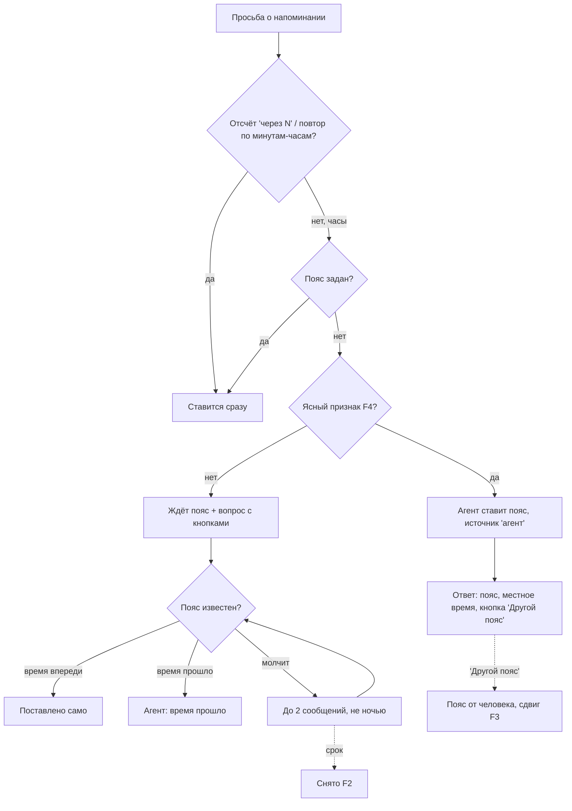
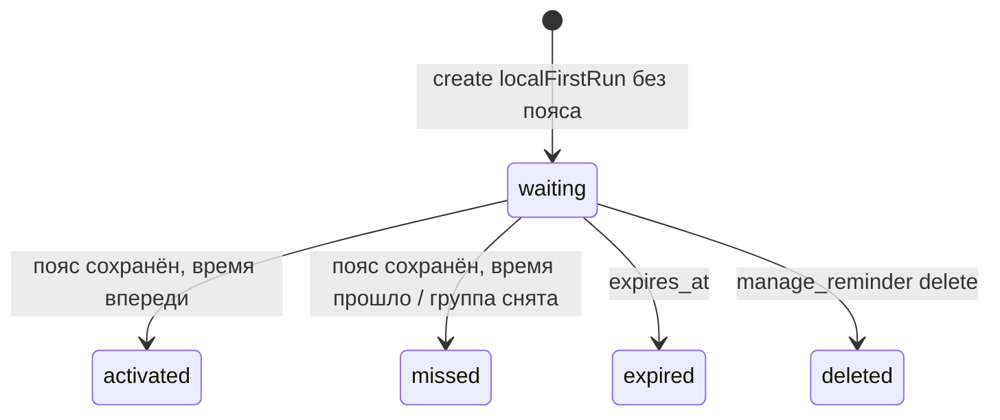

# Часовой пояс для напоминаний — спецификация

**Статус:** согласовано 04.11, реализовано и выпущено в v0.63.0 (05.11.2026); #451 закрыт
**Дата:** 2026-11-04 · **Проект:** Osinara · **Тип фичи:** смешанная (поведение агента + фоновый механизм повторных сообщений) ·
**Где работает:** личный чат и семейная группа Telegram, минутный диспетчер, PostgreSQL

## Коротко

**Что строим и зачем.** Сейчас напоминание не создаётся, пока у человека не задан часовой пояс. Агент задаёт вопрос, и если человек не ответил, просьба пропадает молча; 02.11 так пропало напоминание о приёме у врача. Вдобавок без пояса агент сам считает день недели и ошибается. Цель: просьба о напоминании выполняется сразу или ждёт пояс и не теряется, а о поясе бот спрашивает сам, не больше двух раз.

**Как будет работать.**
1. **Обратный отсчёт ставится сразу.** «Через 20 минут» и «каждые 2 часа» от пояса не зависят и ставятся сразу, даже без пояса.
2. **Пояс по признаку.** Просьба по часам («в среду в 12:20»), а пояса нет. Если ясно, где человек (назвал город, прислал свою геолокацию, в памяти записано, где живёт — F4), агент сам ставит пояс и сразу создаёт напоминание. В ответе он называет пояс и местное время («Поставила по Москве — у тебя сейчас 10:53») и даёт кнопку «Другой пояс». Тихие часы не спрашивает. Уже заданный пояс агент никогда не меняет сам.
3. **Без признаков напоминание ждёт пояс.** Агент спрашивает, где человек, с кнопками «Да, Москва» / «Другой пояс». Как только пояс известен — кнопкой, текстом или позже в любом разговоре, — ждущие напоминания ставятся сами по названным часам. Если время уже прошло, агент так и говорит, в том числе про ожидания, снятые по сроку.
4. **Человек молчит — бот пишет сам**, не больше двух раз: примерно через 3 часа (не ночью) и в 09:00 дня напоминания. Второе сообщение содержит сам текст напоминания и уже этим служит подсказкой. Если до напоминания 25 минут или меньше, остаётся только вопрос агента в разговоре. Потом ожидание снимается (F2).
5. **Поправка угаданного пояса.** Человек жмёт «Другой пояс» и называет город. Личные напоминания, поставленные под угаданный пояс, сдвигаются: «12:20» остаётся «12:20» по его времени (F3).
6. **Мелкие правки (F1).** Без пояса агент видит дату и день недели по UTC; запись «поставила напоминание» попадает в память только после ответа сервера.

**Как построим.**
- **Отдельная таблица ожидающих.** Основная таблица `reminders` не меняется: рассылка, зеркало Google Календаря и список рассчитывают, что у напоминания всегда есть пояс и момент отправки.
- **`manage_reminder` понимает два новых вида времени**: часы, названные человеком, без смещения, и «через N минут». Модели больше не нужно угадывать смещение.
- **Настройки помнят, кто и когда поставил пояс**: человек или агент по признаку. Без этого нельзя понять, что сдвигать при поправке.
- **Одна транзакция.** Ожидающие ставятся там же, где сохраняется пояс, и при поправке там же идёт сдвиг; пояс и напоминания не расходятся.
- **Повторные сообщения** шлёт новый шаг существующего минутного диспетчера по образцу уведомлений календаря: кнопки, запись в историю чата, нажатие приходит агенту как ответ человека.
- **Модели** — правки инструкции `schedules` и описаний трёх инструментов; поведение проверяем на стенде промптов.
- **Новых зависимостей и внешних сервисов нет.**

**На что смотреть.**
- **Неверный пояс по признаку.** Например, город в памяти устарел. Защита: пояс и местное время вслух, кнопка, сдвиг при поправке.
- **Ночь.** Повторные сообщения не уходят ночью по предполагаемому поясу — поясу семьи или общему поясу продукта. Человек в другом поясе может получить сообщение в неудобный час (раздел 10).
- **Нажатие кнопки обрабатывает модель.** Если она не сохранит пояс, ожидание снимется по сроку. Это ловит стенд, а на проде — отметка «кнопку нажали, ожидание истекло».
- **Сценарии** (`manage_agent_schedule`) уже сейчас берут пояс прямо от модели и при поправке не сдвигаются. Вне задачи.

**На что опирается.**
- Telegram не отдаёт пояс пользователя; боты-напоминалки определяют его по городу или геолокации и дают поменять → отсюда признаки и кнопка.
- Календари держат личные дела «по часам на стене» при смене пояса → отсюда сдвиг с сохранением часов.
- В проекте уже есть общий пояс продукта для внешних групп (`GROUP_REMINDER_TIMEZONE = Europe/Moscow`) и сообщение бота с кнопкой (`calendar-mirror-notice.ts`) → отсюда предлагаемый пояс и механика повторных сообщений.

**Найдено попутно.**
- Сценарии принимают от модели любой пояс без настроек человека (`agent-schedule-repository.ts`). Не трогаю без решения.
- 02.11 запись в память «поставила напоминание» ушла тем же шагом, что и попытка поставить напоминание, и осталась ложной (F1).

**Решения владельца (04.11).**
1. Мелкие правки включены: дата без пояса и память только после результата (F1-A).
2. Человек так и не ответил — ожидание снимается, напоминание по догадке не шлётся (F2-A).
3. Поправка угаданного пояса сдвигает личные напоминания с сохранением часов (F3-A).
4. Ясные признаки — город из разговора, своя геолокация, запись памяти «где живёт»; пояс семьи — не признак (F4-B).
5. Сообщения бота — на «вы» (F5-A).
6. Выкатка — по умолчанию обычный релиз по команде владельца, ждёт подтверждения (F6).

**Выкатка:** PR в `develop`, CI, релиз по `docs/production-deployment.md` по вашей команде. После неё — проверка по базе и одна живая просьба без пояса. Правило тревоги едет пакетом наблюдения.

**Объём:** 10 шагов; работа агента — около 4,5 ч (оценка). Время уходит на точечные интеграционные тесты в Docker (весь набор гоняет CI, не боевая машина). От вас — подтверждение F6, команда на старт и живая проверка после выкатки.

**Не проверено (шаг 0):**
- подхватит ли зеркало календаря сдвиг;
- как сдвиг сочетается с тихими часами;
- как отличить напоминания, пришедшие из Google.

---

# Часть 1. Для владельца: как это работает

## 1. Что известно и что добавлено

- **Владелец сказал (04.11.2026)** **[ЧАТ-0411]**:
  - делать А + Б;
  - А — агент сам ставит пояс по ясным признакам, называет его, кнопка «Другой пояс», тихие часы не спрашивает;
  - Б — несозданное напоминание ждёт; бот сам пишет не больше двух раз (через 2–3 ч и утром дня напоминания) с кнопками «Москва» / «Другой»; после ответа напоминание создаётся само;
  - «писать раз в неделю всем без пояса» — отклонено.
- **Рекомендовал агент, подтверждено владельцем 04.11:** мелкие правки (F1), состав признаков (F4). Ответ по F4 дан буквой «В» и понят как вариант B (латинская буква в вопросе); если имелся в виду третий вариант — пересмотреть F4.
- **Найдено в проекте:**
  - создание без настроек падает с `AGENT_NOTIFICATION_SETTINGS_REQUIRED`;
  - `notification_settings` требует пояс и тихие часы парой и запрещает угадывать;
  - инструкция `schedules` запрещает выводить пояс из геолокации и языка;
  - без пояса `get_current_time` отдаёт `weekday: null`;
  - смена пояса не сдвигает поставленные напоминания;
  - тревога всплеска ошибок срабатывает от 10 строк за 5 минут;
  - логи на проде ограничены 5×20 МБ.
- **Масштаб:** на боевом сервере 2 человека, пояс задан у одного; есть другие установки без автообновления.
- **Добавлено [ДОПУЩЕНИЕ]:**
  - числа расписания: 3 ч, ночь 22:00–08:00, утро 09:00, «слишком близко» — 25 мин (запас 10 мин до напоминания, 15 мин после просьбы);
  - повторяющиеся ожидания живут 7 дней.
  
  Всё это — константы в `reminder-config.ts`.
- **Противоречие:** правило «никогда не угадывать пояс» против решения А. Решение владельца снимает его для ясных признаков; угадывать по языку и по поясу семьи по-прежнему нельзя.

## 2. Цели, не-цели, анти-цели

- **Цели:**
  - просьба о напоминании не теряется молча: она поставлена, или ждёт и о ней спрашивают, или человеку прямо сказано, что время прошло;
  - когда признак есть, лишних вопросов нет;
  - агент не путает дату и день недели из-за отсутствия пояса (F1).
- **Не-цели:**
  - сообщения всем без пояса без повода;
  - пояс по устройству через мини-приложение;
  - сдвиг при смене пояса, заданного человеком (переезд — как сейчас);
  - сценарии;
  - напоминания, пришедшие из Google Календаря, и семейные напоминания при поправке не сдвигаются.
- **Анти-цели:**
  - больше двух сообщений по одной просьбе или сообщение ночью по предполагаемому поясу;
  - напоминание в неверный час, а человек не видел, по какому поясу оно стоит;
  - агент сам меняет уже заданный пояс.

## 3. На что опирается

| Практика | Кто | Масштаб | Берём? | Почему | Источник, дата |
|---|---|---|---|---|---|
| Пояс по городу или геолокации, можно поменять | боты-напоминалки Telegram | любой | да | Bot API пояс не отдаёт | Stack Overflow, Latenode, 2026-11-04 |
| Пояс устройства через мини-приложение | отдельные боты | много поправок | нет | новая веб-страница и точка отказа; условие подъёма — раздел 4 | MDN `resolvedOptions`, 2026-11-04 |
| Личные дела «по часам на стене» при смене пояса | Apple Calendar, BusyCal | любой | да, для поправки угаданного | человек называл часы, а не момент | TidBITS 2025-03-19 |
| Сообщение бота с кнопкой, нажатие идёт модели | этот проект, `calendar-mirror-notice.ts` | — | да | готовая механика | код |
| Общий пояс продукта | этот проект, `GROUP_REMINDER_TIMEZONE` | — | да, как предлагаемый | решение уже принято для групп | код |

## 4. Варианты и масштаб

**Масштаб:** единицы людей на установку, ожидающих — единицы в месяц. Сопровождают владелец и агенты.

Путь один — выбранный владельцем А + Б.

**Подниматься, когда:** за 30 дней больше трёх поправок угаданного пояса или больше трёх ожиданий, снятых без ответа (запрос по базе, раздел 20). Тогда добавляем пояс по устройству.

**Отклонено:**
- «Раз в неделю всем без пояса» — решение владельца.
- «Сервер возвращает список, агент двигает каждое напоминание обычной правкой» — правка не меняет пояс у повторяющегося напоминания, его следующие разы считались бы по старому поясу.

## 5. Как это работает

**Входы:**
- просьба в личном чате → сценарии 1–3;
- просьба в семейной группе → 4;
- кнопка «Другой пояс» → 5;
- кнопка в повторном сообщении или ответ текстом → 3;
- город назван позже, в другом разговоре → 3;
- «какие у меня напоминания» → ждущие видны отдельным списком.

**1 — отсчёт.** У Бориса нет пояса. «Напомни через 20 минут выключить духовку» — напоминание ставится сразу, пояс не нужен.

**2 — признак есть.** Анна утром писала, что ищет врача «у нас в Туле». «Напомни в среду в 12:20, что в 13:20 приём».
- Агент сохраняет `Europe/Moscow` (источник «агент», основание «город Тула из разговора»), создаёт напоминание и отвечает: «Напомню в среду, 4 ноября, в 12:20. Поставила по Москве — у тебя сейчас 10:53», с кнопкой «Другой пояс».
- **При сбое:** сервер не принял пояс — агент переспрашивает город.

**3 — признаков нет.** «Напомни завтра в 9 полить цветы».
1. Сервер сохраняет ожидание.
2. Агент: «Поставлю, как только узнаю твой пояс. Ты по Москве?» с кнопками.
3. Борис молчит: через 3 часа (или в 08:00, если это ночь) бот пишет сам; в 09:00 дня напоминания второе сообщение не уходит, потому что напоминание раньше.
4. **Ключевой момент:** Борис жмёт «Да, Москва» или пишет «я в Казани» — агент сохраняет пояс, ждущие ставятся в той же транзакции: «Готово, напомню завтра в 9:00».
- **Время прошло:** «Время напоминания „полить цветы“ (9:00) уже прошло. Поставить на другое время?»
- **Ответа нет:** после последнего сообщения бот молчит. Разовое ожидание снимается, когда названное время прошло во всех поясах; повторяющееся — через 7 дней. Если пояс назовут позже (до 7 дней после снятия), агент скажет, что эти напоминания так и не были поставлены.

**4 — семейная группа.** Борис без пояса: «напомни всем в субботу в 10 про дачу».
1. Пояс меняется только в личном чате, поэтому напоминание ждёт с назначением «эта группа».
2. Агент в группе: «Поставлю, как только узнаю твой часовой пояс — напиши мне в личку, где ты сейчас».
3. Через минуту бот пишет Борису в личный чат, дальше как в сценарии 3; напоминание уйдёт в группу.
- **При сбое:** личного чата нет (Telegram отказал) — лог; в группе Борис уже знает, что делать.

**5 — поправка.** Анне поставили Москву, а она в Ереване.
1. «Другой пояс» → «где ты?» → «Ереван».
2. **Ключевой момент:** пояс `Asia/Yerevan` сохраняется от лица Анны. Её личные напоминания, созданные после угадывания, сдвигаются: «12:20» — по ереванскому времени (F3). Агент говорит, сколько напоминаний сдвинуто.
3. Разовое, чьё новое время уже прошло, ставится на паузу, и агент спрашивает, что с ним делать.
- **При сбое:** откат транзакции, пояс прежний, агент говорит, что не получилось.



## 6. Решения владельца

### F1. Включить две мелкие правки?
**Почему сейчас:** обе ошибки из эпизода 02.11.
- **A. Обе** — даёт: без пояса агент видит дату и день недели по UTC с пометкой «около полуночи местная дата может отличаться»; в памяти нет записей о действиях, которых не было. Стоит: правка `get_current_time` и одна фраза в правилах памяти.
- **B. Только дата.**
- **C. Без них** — как сейчас.

**Рекомендую A** — дёшево и закрывает реальные ошибки. **По умолчанию:** A.

### F2. Человек так и не ответил — что с напоминанием?
**Почему сейчас:** решается, уйдёт ли напоминание по догадке.
- **A. Снять без отправки** — даёт: бот не шлёт напоминание в, возможно, неверный час; утреннее сообщение уже содержит текст напоминания. Закрепляет: молчаливое снятие.
- **B. Отправить по предполагаемому поясу с пометкой** «по московскому времени — пояс вы не указали» — даёт: напоминание придёт. Стоит: исключение из правила «не подставлять значения»; человек в другом поясе получит его не вовремя.

**Рекомендую A:** утреннее сообщение уже напоминает, а правило против подстановок остаётся целым. **По умолчанию:** A.

### F3. Поправка угаданного пояса сдвигает напоминания?
**Почему сейчас:** иначе после поправки напоминания придут на час-другой не тогда.
- **A. Сдвигать с сохранением часов** — только личные напоминания, созданные после угадывания, кроме пришедших из Google. Стоит: сдвиг в транзакции, проверка зеркала на шаге 0.
- **B. Не сдвигать** — как сейчас.

**Рекомендую A** — в этом смысл кнопки «Другой пояс». **По умолчанию:** A.

### F4. Что считать ясным признаком?
**Почему сейчас:** от этого зависит, как часто вопрос не нужен и как часто пояс окажется неверным.
- **A. Только слова человека в текущем разговоре** («я в Казани», «у нас в Туле»).
- **B. A + своя геолокация + запись памяти «где живёт».** Своя — это живая трансляция или точка, о которой человек сказал «я здесь»; присланное место встречи не считается.
- **C. B + пояс членов семьи** — это уже догадка.

**Рекомендую B:** геолокация точнее города, а запись памяти — слова самого человека; пояс вслух и кнопка ловят устаревшее. **По умолчанию:** B.

### F5. «Вы» или «ты» в сообщениях бота?
**Почему сейчас:** это новые сообщения людям. Их шлёт сервер, а он тон разговора не знает.
- **A. «Вы»** — как в уведомлениях календаря и текстах ошибок.
- **B. «Ты»** — как агент обычно говорит с семьёй, но чужой установке может не подойти.

**Рекомендую A.** **По умолчанию:** A.

### F6. Выкатка
- **A. Обычный порядок** — PR, CI, релиз по вашей команде, правило тревоги — пакетом наблюдения; живая проверка: просьба без пояса и без города.
- **B. Сразу после CI.**

**Рекомендую A:** миграция только добавляет. **По умолчанию:** A, жду команду.

### Принято
- **F1 — A** (04.11.2026): обе мелкие правки — дата и день недели по UTC без пояса; запись о собственном действии в память только после результата инструмента.
- **F2 — A** (04.11.2026): без ответа ожидание снимается, напоминание по предполагаемому поясу не отправляется.
- **F3 — A** (04.11.2026): поправка угаданного пояса сдвигает личные напоминания, созданные после угадывания, кроме пришедших из Google; часы сохраняются.
- **F4 — B** (04.11.2026): признаки — слова в разговоре, собственная геолокация человека, запись памяти «где живёт»; язык и пояс членов семьи признаками не являются.
- **F5 — A** (04.11.2026): сообщения бота на «вы».
- **F6** (04.11.2026): после реализации собрать в релиз всё накопленное в проекте и выкатить.

---

# Часть 2. Для исполнителя: поведение в деталях

## 7. Точки контакта и состояния

| Инструмент | Когда | Параметры | Возвращает | Меняет | Повтор | Ошибки |
|---|---|---|---|---|---|---|
| `manage_reminder` create | как сейчас | ровно одно из трёх: `firstRunAt`+`timezone` (как сейчас); `localFirstRun` `"YYYY-MM-DDTHH:MM"` — часы человека; `firstRunInMinutes` (1–525600) — отсчёт | с поясом — напоминание; `firstRunInMinutes` без пояса — напоминание с `timezone:"UTC"`; `localFirstRun` без пояса — `status:"awaiting_timezone"`, `id`, `localFirstRun`, `suggestedTimezone`, `suggestedLabel` | создаёт | ключ `ctx.callId` | `AGENT_REMINDER_LOCAL_TIME_REQUIRED` — `firstRunAt` без пояса; `AGENT_REMINDER_TIME_INPUT_AMBIGUOUS` — больше одного поля; `firstRunInMinutes` без пояса с повтором `daily` и реже → `AGENT_REMINDER_LOCAL_TIME_REQUIRED` |
| `manage_reminder` update/delete ждущего | изменить текст или часы, отменить | `id` ждущего, `content`, `localFirstRun` | ждущее / `deleted:true` | ждущее | ключ вызова | pause/resume → `AGENT_REMINDER_AWAITING_ACTION_UNSUPPORTED` |
| `notification_settings` set | `source:"agent"`+`basis` — только когда пояса нет; `source:"person"` — по словам или кнопке человека | `timezone`, `source`, `basis` (≤200, при `agent`), `quietStart`/`quietEnd` — необязательны, парой | пояс, `localTimeNow`, `source`; `activated[]`, `missed[]`, `expiredRecently[]`, `shifted[]`, `shiftedIntoPast[]` | настройки, постановка, сдвиг | тот же пояс повторно — без изменений | `AGENT_NOTIFICATION_TIMEZONE_ALREADY_SET` — `agent` при заданном поясе; `AGENT_TIMEZONE_INVALID` |
| `list_reminders` | как сейчас | — | прежний список + `awaiting[]` (до 20, без страниц) | — | — | — |
| `get_current_time` (F1) | как сейчас | — | без пояса: `utcDate`, `utcWeekday`, `note` | — | — | — |

| Сообщение | Нажата кнопка | Ответ текстом | Устарело | Ошибка доставки |
|---|---|---|---|---|
| Ответ агента с «Другой пояс» | агенту приходит «Другой пояс» → он спрашивает город | «я в Ереване» → `source:"person"` | после новой поправки — агент видит текущий пояс | — |
| Вопрос агента / повторное №1, №2 с «Да, {город}» · «Другой пояс» | → `source:"person"`, постановка | то же | пояс задан или ждущее удалено — повторное не уходит; старое нажатие — «уже стоит» | 403/400 — лог `…_FOLLOWUP_FAILED`, без повтора; отказ кнопок — словами |

## 8. Внутренний механизм: гарантии, данные, отказы

- **Гарантии:**
  - не больше двух повторных сообщений на ожидание; одно сообщение на человека за проход (ждущие объединяются);
  - ничего между 22:00 и 08:00 по предполагаемому поясу;
  - неясный исход отправки не повторяется — как у напоминаний.
- **Источник истины:**
  - пояс — `user_notification_settings`;
  - ожидание — `reminder_timezone_waits`;
  - после постановки — `reminders`; в ожидании хранится `reminder_id`.
- **Отправка без аренды.** Один `UPDATE … RETURNING` выбирает ждущие с наступившим `next_followup_at`, у автора которых пояса всё ещё нет. В нём же увеличивается `followups_sent` и выставляется следующее время. Затем ровно одна отправка: падение после этого `UPDATE` даёт максимум одно непосланное сообщение, но никогда не два.

| Что ломается | Как предотвращаем | Как узнаём | Как восстанавливаем | Что теряется | Чем закрыто |
|---|---|---|---|---|---|
| Падение между `UPDATE` и отправкой | счётчик увеличен до отправки | счёт по базе: `followups_sent` без `last_followup_message_id` | — | одно сообщение | тест шага 5 |
| Человек заблокировал бота / нет лички | — | `last_followup_error_code` | без повтора, снятие по сроку | повторные | тест с фейком |
| Telegram отказал кнопкам | — | лог | словами, как в календаре | кнопки | тест |
| Пояс сохранён, постановка упала | одна транзакция | ошибка инструмента | откат: пояс не сохранён, ожидания целы | ничего | тест шага 3 |
| Два хода одновременно ставят пояс | `FOR UPDATE` на ожиданиях | — | второй видит «уже поставлено» | ничего | тест |
| Модель не сохранила пояс после нажатия | стенд | у истёкшего ожидания `followup_pressed=true` | разбор хода | одно напоминание | шаг 9, раздел 20 |

## 9. Ошибки и восстановление

| Ситуация | Что видит человек (полный текст) | Как выходит | Что сохраняется |
|---|---|---|---|
| Город не распознан | агент: «Не поняла, какой это часовой пояс. Напиши город, где ты сейчас.» | пишет город | ожидания |
| Время ожидания прошло к ответу | «Время напоминания „…“ (12:20) уже прошло. Поставить на другое время?» | называет время | текст в `missed[]` |
| После поправки разовое ушло в прошлое | «Напоминание „…“ по новому поясу должно было прийти в 11:20 — это уже прошло, я его приостановила. Прислать сейчас или поставить на другое время?» | отвечает | напоминание на паузе |
| Сдвиг не удался | «Не получилось сменить часовой пояс, напоминания остались как были. Попробуйте ещё раз. Код: AGENT_NOTIFICATION_SETTINGS_FAILED» | повтор | всё как было |

## 10. Края и стыки

| Случай | Решение |
|---|---|
| Несколько ждущих у человека | одно сообщение, до 5 штук, дальше «и ещё N» |
| Повторяющееся ожидание | при постановке — ближайшее будущее вхождение (`reminder-repository-helpers.ts`); срок жизни 7 дней |
| Ожидание создано за 25 мин или меньше до своего времени (`R − 10 мин` уже наступило к `T0 + 15 мин`) | повторных нет, только вопрос агента |
| Несуществующее местное время (летнее время) | PostgreSQL сдвигает вперёд; тест на `America/New_York` 2026-03-08 02:30 |
| Город с несколькими поясами | агент спрашивает город |
| Человек в поясе, далёком от предполагаемого | «не ночью» считается по предполагаемому поясу, сообщение может прийти в неудобный час — принято, признак есть в разделе 20 |
| Ответ «я по Москве» в семейной группе | пояс меняется только в личном чате; агент просит написать в личку |

| Сосед | Где встречаются | Как решаем |
|---|---|---|
| Рассылка напоминаний | `reminders` | ожидания туда не попадают до постановки |
| Зеркало Google Календаря | сдвиг, напоминания из Google | пришедшие из Google не сдвигаются; копии сдвинутых переписываются (проверка на шаге 0) |
| Тихие часы | постановка, сдвиг | у нового пояса тихих часов нет; заданные сохраняются |
| Блокнот чата | агент может дублировать «ждёт пояс» | инструкция: ожидания видны в `list_reminders`, в блокнот не писать |
| Кнопки-ответы | новое сообщение человека убирает прежние кнопки | без изменений |
| Тревога всплеска ошибок | новые информационные коды | вносятся в исключения правила |

## 11. Скорость

| Действие | Время | Если дольше |
|---|---|---|
| Постановка по признаку или после ответа | в том же ходе | как любой ход |
| Повторное сообщение | ±1 мин от расчётного | при простое машины уходит позже, ночные переносятся на 08:00 |

## 12. Тексты (на «вы» — F5)

| Где | Текст |
|---|---|
| Повторное №1 | «Напоминание «{текст до 60 знаков}» ({день недели}, {дата}, {часы}) пока не поставлено: я не знаю ваш часовой пояс. Ваш пояс — {город}?» |
| Повторное №2 | «Сегодня у вас «{текст}» в {часы}, но напоминание так и не поставлено — не знаю ваш часовой пояс. Если ваш пояс — {город}, нажмите кнопку, и я поставлю.» |
| Несколько ждущих | «Пока не поставлены напоминания: «…» ({когда}), «…» ({когда}) — не знаю ваш часовой пояс. Ваш пояс — {город}?» |
| Кнопки | «Да, {город}» · «Другой пояс» |

`{город}` — `Intl.DateTimeFormat("ru", {timeZone, timeZoneName: "shortGeneric"})`: «Москва», «Самара», «Екатеринбург»; если названия нет — смещение «UTC+3».

## 13. Данные, приватность

Основание пояса («город Тула из разговора») хранится в настройках человека. Видят его только сам человек и агент в его личном чате. В семейной группе пояс не называется.

## 14. Что сознательно не делаем

- **Пояс по устройству** — пока поправок мало; условие подъёма — раздел 4.
- **Сдвиг при смене пояса, заданного человеком** — переезд остаётся решением человека, как сейчас.
- **Сценарии и семейные напоминания** при поправке не сдвигаем: сценарии — отдельная задача; семейные идут по часам семьи, а не одного человека.
- **Сообщения людям без ожиданий** — отклонено владельцем.

## 15. Решения агента — на проверку

- **Отдельная таблица ожиданий** — не ломать допущения рассылки, зеркала и списка о непустом поясе.
- **Новые поля времени в `manage_reminder`** (`localFirstRun`, `firstRunInMinutes`) вместо вырезания часов из полного времени. Модель не угадывает смещение; `firstRunAt` без пояса отклоняется.
- **Отсчёт без пояса — напоминание с `timezone:"UTC"`.** Для разового отсчёта и повторов по минутам и часам момент точный, пояс ни на что не влияет; это не догадка.
- **Нажатие кнопки идёт к агенту**, как у кнопки календаря. Риск ловят стенд и отметка `followup_pressed`.
- **Предлагаемый пояс** — самый частый среди членов семьи с настройками, иначе `GROUP_REMINDER_TIMEZONE`. Только для кнопки и расчёта «не ночью»; поставлен он будет только по ответу человека.
- **Агент ставит пояс только когда его нет**; любую смену делает человек. Поэтому сдвиг бывает только по поправке человека.
- **Ожидание из семейной группы** — первое сообщение в личку через минуту.
- **Сроки:** разовое ожидание снимается в момент «часы человека по `Etc/GMT+12`»; повторяющееся — через 7 дней; о снятых за 7 дней агент узнаёт при постановке пояса.
- **Существующие настройки получают `source='person'`** — до фичи пояс ставился только со слов человека.
- **По независимому ревью (04.11):**
  - создание напоминания и сохранение пояса одного человека берут общую блокировку (`pg_advisory_xact_lock`) первым действием: модель вызывает оба инструмента одним шагом, и без неё ожидание оставалось бы «висеть» при заданном поясе;
  - отсчёт при поправке пояса не сдвигается (пометка `time: countdown` в аудите создания);
  - пояс, переданный рядом с `localFirstRun` или `firstRunInMinutes`, должен совпадать с заданным;
  - отсчёт без пояса нельзя перевести на повтор по дням;
  - снятое по сроку называется один раз (`expiry_reported_at`);
  - ожидания ставятся во всех семьях автора;
  - отпечаток повтора для точного момента сохраняет прежний порядок ключей;
  - напоминание, которое доставляется в секунду поправки, не сдвигается и попадает в журнал как `AGENT_NOTIFICATION_TIMEZONE_SHIFT_SKIPPED`.

---

# Часть 3. Для исполнителя: как строить

## 16. Что есть и что переиспользуем

- `agent/lib/reminders/reminder-repository.ts`:
  - `create` — ветки нового времени и «нет настроек» уходят в новые модули;
  - `configureNotifications` — вызывает постановку и сдвиг внутри своей транзакции.
- `reminder-repository-helpers.ts` (повторы), `requireTimezone` (проверка IANA).
- `calendar-mirror-notice.ts` — образец: `replyButtonRepository.stage/activate/discard`, `telegramRichMessageRequest`, отправка словами при отказе, `proactiveDeliveryRepository.record`. Пишем по образцу, модуль календаря не трогаем.
- `agent/schedules/reminder-dispatch.ts` — минутный цикл с heartbeat; добавляем шаг, нового планировщика нет.
- `GROUP_REMINDER_TIMEZONE`; в `reminder-config.ts` добавляем `PRODUCT_SUGGESTED_TIMEZONE = GROUP_REMINDER_TIMEZONE`.
- Устаревшего кода в области нет. Запрет «не угадывать пояс» в `notification_settings.ts` и `SKILL.md` заменяется новым правилом.

## 17. Устройство

**Миграция `migrations/149_reminder_timezone_waits.sql`:**
- `user_notification_settings`:
  - `timezone_source text NOT NULL DEFAULT 'person' CHECK IN ('person','agent')`;
  - `timezone_basis text NULL CHECK (char_length <= 200)`;
  - `timezone_set_at timestamptz NOT NULL DEFAULT now()`;
  - `CHECK (timezone_source='person' OR timezone_basis IS NOT NULL)`.
- `reminder_timezone_waits`:
  - назначение: `id uuid PK`, `family_id`, `author_user_id`, `owner_user_id NULL`, `scope`, `group_id NULL`, `telegram_chat_id`, `message_thread_id NULL`, `forum_topic_id NULL`;
  - содержание: `content`, `reply_buttons jsonb NULL`, `local_first_run timestamp`, `recurrence_unit NULL`, `recurrence_interval NULL`;
  - защита от повтора: `operation_key`, `input_hash`, `UNIQUE (family_id, operation_key)`;
  - жизненный цикл: `status CHECK IN ('waiting','activated','missed','expired','deleted')`, `reminder_id NULL REFERENCES reminders`, `expires_at timestamptz`;
  - повторные: `followups_sent smallint DEFAULT 0 CHECK (followups_sent BETWEEN 0 AND 2)`, `next_followup_at NULL`, `last_followup_message_id NULL`, `last_followup_button_id uuid NULL`, `last_followup_error_code NULL`, `followup_pressed boolean DEFAULT false`;
  - служебные: `created_at`, `updated_at`;
  - индекс `(next_followup_at) WHERE status='waiting'`.

**Расписание** — чистая функция `followupSchedule` в `reminder-timezone-followup-schedule.ts`, константы в `reminder-config.ts`.
- Обозначения: W — часы человека; Z — предлагаемый пояс; R — W, прочитанное в Z; T0 — момент просьбы.
- №1 в момент `T0 + 3 ч`:
  - если попадает в 22:00–08:00 по Z — переносится на ближайшие 08:00 по Z;
  - если не раньше `R − 10 мин` — переносится на `T0 + 15 мин`, а если и это не раньше `R − 10 мин`, повторных нет;
  - для ожидания из группы — `T0 + 1 мин`.
- №2 в 09:00 по Z в день W — только если он не раньше №1 + 1 ч и раньше R.
- Срок: разовое — `W AT TIME ZONE 'Etc/GMT+12'`; повторяющееся — `T0 + 7 дней`.



**Постановка и сдвиг** в транзакции `configureNotifications` (`reminder-timezone-activation.ts`):
1. `FOR UPDATE` ожиданий автора со статусом `waiting`.
2. Вставка в `reminders` той же логикой, что `create`, ключ операции `wait:<id>`. Для повторяющихся — ближайшее будущее вхождение. Семейная группа проверяется так же, как в `create`.
3. `expiredRecently[]` — ожидания, снятые за последние 7 дней.
4. Сдвиг F3: только если прежний `timezone_source='agent'` и пояс другой. Затрагивает `reminders`, где `author_user_id` = человек, `scope='personal'`, `timezone` = прежний, `status IN ('active','paused')`, `created_at >= timezone_set_at`, кроме пришедших из Google (признак — шаг 0). Пересчёт: `due_at`, `available_at`, `recurrence_anchor_at` из местных часов в новый пояс, `timezone` = новый. Разовое, чьё новое время прошло, → `paused` и в `shiftedIntoPast[]`.

**Модель:**
- `config/service-skills/schedules/SKILL.md`, абзац «Where they live» — новый порядок:
  1. отсчёт → `firstRunInMinutes`;
  2. часы при заданном поясе → как сейчас;
  3. часы без пояса и признак F4 → `notification_settings set source=agent` + создание + фраза с поясом и местным временем + кнопка «Другой пояс»;
  4. часы без признака → создание с `localFirstRun` + вопрос с кнопками из `suggestedLabel`;
  5. ответ или кнопка человека → `source=person`;
  6. `missed`, `expiredRecently`, `shiftedIntoPast` — сказать прямо;
  7. в группе — попросить написать в личку.

  Язык и пояс семьи признаками не являются.
- Описания `manage_reminder` и `notification_settings` — те же правила, коротко.
- F1 — в `MEMORY_WRITE_CONTRACT` (`agent/lib/prompt/common-fragments.ts`): «Do not save your own action, such as a reminder set or a message sent, before its tool result confirms it; the reminder itself is the record».

**Наблюдаемость:**
- Счёт по базе:
  - `reminder_timezone_waits.status`, `followup_pressed`, `last_followup_error_code`;
  - `audit_events`: `reminder.timezone_wait_created`, `notifications.configured` с `source` и `shifted`.
- Логи по одной строке: `AGENT_REMINDER_AWAITING_TIMEZONE`, `AGENT_REMINDER_TIMEZONE_FOLLOWUP_SENT`, `AGENT_REMINDER_AWAITING_ACTIVATED`, `…_MISSED`, `…_EXPIRED`, `AGENT_NOTIFICATION_TIMEZONE_INFERRED`, `…_CORRECTED`. Все они вносятся в исключения `OsinaraErrorBurst` (`infra/monitoring/rules/metrics/osinara.yaml`), а `AGENT_REMINDER_TIMEZONE_FOLLOWUP_FAILED` остаётся ошибкой.

**Запуск и откат:** миграция только добавляет. При откате кода таблица остаётся безвредной; ожидания, созданные до отката, не ставятся.

## 18. Ловушки платформы

- **Telegram и личка.** Бот не пишет человеку без лички (403) — без повтора, лог один раз.
- **Telegram и кнопки.** Отказ `sendRichMessage` с кнопками — повтор словами.
- **PostgreSQL.** `timestamp AT TIME ZONE` для несуществующего местного времени сдвигает вперёд — тест.
- **Названия поясов.** `Intl` `shortGeneric` в `ru` — проверка в контейнере на шаге 0.
- **Разбор времени.** `requiredIsoDate` теряет смещение при разборе, поэтому `localFirstRun` разбирается отдельной функцией без пояса (`YYYY-MM-DDTHH:MM`, проверка существования даты).

## 19. Отказы на новых путях

| Путь | Отказ | Что видит человек | Чем закрыто |
|---|---|---|---|
| Признак → пояс | модель назвала не тот пояс | пояс и местное время вслух | кнопка, F3, стенд |
| Нажатие кнопки | модель не сохранила пояс | ожидание истечёт | стенд; `followup_pressed` в разделе 20 |
| Постановка | модель не сказала про `missed` | — | инструкция, стенд |
| Отсчёт | модель передала часы как отсчёт или наоборот | неверный момент | правило в инструкции, стенд |
| Повторные | расписание ушло в ночь Z | неудобный час | property-тест |

## 20. Сопровождение

**Признак работы и условие подъёма** — запрос раз в месяц или по просьбе владельца:

```sql
SELECT status, followup_pressed, count(*) FROM reminder_timezone_waits
WHERE created_at > now() - interval '30 days' GROUP BY 1, 2;
```

`expired` при `followup_pressed=true` — модель не обработала нажатие: разобрать ход.

**Если сломалось:**
1. Ожидания висят после `expires_at` — проверить heartbeat цикла `reminder-dispatch`.
2. Посмотреть `last_followup_error_code`.
3. Неясные отправки вручную не повторять.

## 21. Приоритеты и объём

- **P0:** всё из разделов 7–12, по решениям F1–F5.
- **P1:** нет.
- **P2:** пояс по устройству, сдвиг сценариев.

**Объём:** шаги 0–9 — около 4,5 ч работы агента. Точечные интеграционные тесты через `compose.test.yaml` по одному файлу; весь набор гоняет CI.

**Выкатка:** по F6. После неё:
- запрос раздела 20;
- живая просьба без пояса: ожидание есть, повторное пришло днём, после кнопки напоминание в `list_reminders`;
- правило тревоги раскатано на хаб.

Откат — предыдущий релиз.

## 22. Шаги

### Шаг 0: проверки

**Итог 04.11:** зеркало считает отпечаток события вместе с поясом напоминания, поэтому сдвинутое напоминание перепишется само; тихие часы применяются при рассылке, сдвиг ставит `available_at = due_at` и сбрасывает флаг; напоминание из Google отличается записью `audit_events` `reminder.created` с `source: google_calendar`, колонка не нужна; `shortGeneric` в контейнере даёт «Москва», «Армения», «Самара».

| Что | Как | Что меняется |
|---|---|---|
| [ПРОВЕРИТЬ] Зеркало переписывает копию после смены `due_at`/`timezone` | интеграционный тест на фейковом Google (`calendar-mirror-reminder-writes.integration.test.ts`) | если нет — сдвиг дополнительно помечает копию к перезаписи |
| [ПРОВЕРИТЬ] `available_at` и `delayed_by_quiet_hours` при доставке | чтение `reminder-dispatch-repository.ts` | если тихие часы применяются только при создании — сдвиг ставит `available_at = due_at`, флаг сбрасывает |
| [ПРОВЕРИТЬ] Как отличить напоминание из Google | `calendar-mirror-reminder-writes.ts`, `reminder_operations`, `audit_events` | признак для исключения в сдвиге; если надёжного нет — колонка `reminders.created_via` в миграции 149 |
| [ПРОВЕРИТЬ] `shortGeneric` в `ru` в контейнере | `node -e` в тестовом контейнере | смещение вместо названия |

### Шаг 1: миграция
**Файлы:** `migrations/149_reminder_timezone_waits.sql`; тест `agent/lib/reminders/reminder-timezone-waits-migration.integration.test.ts`.
**Тест:** старая строка настроек получает `person`; `agent` без основания отклоняется; `followups_sent=3` отклоняется.

### Шаг 2: новые поля времени и ожидания
**Файлы:** создать `agent/lib/reminders/reminder-timezone-wait-repository.ts` и `.integration.test.ts`, `agent/lib/reminders/reminder-local-time.ts` и `.test.ts`; изменить `reminder-repository.ts` (`create`), `agent/lib/tools/manage_reminder.ts`, `agent/lib/tools/list_reminders.ts`.
**Даёт:** `createWaitingReminder`, `listWaitingReminders`, `updateWaitingReminder`, `deleteWaitingReminder`, `parseLocalFirstRun`.
**Тест:**
- `localFirstRun "2026-11-04T12:20"` без пояса → ожидание с `local_first_run = 2026-11-04 12:20`;
- с поясом `Europe/Moscow` → напоминание на 09:20Z;
- `firstRunInMinutes: 20` без пояса → напоминание `UTC` на now+20 мин;
- `firstRunInMinutes` + `daily` без пояса → `AGENT_REMINDER_LOCAL_TIME_REQUIRED`;
- `firstRunAt` без пояса → `AGENT_REMINDER_LOCAL_TIME_REQUIRED`;
- два поля времени → `…_AMBIGUOUS`;
- `"2026-02-30T10:00"` → ошибка ввода;
- повтор с тем же `callId` → та же строка;
- pause → `…_AWAITING_ACTION_UNSUPPORTED`;
- `list_reminders` → `awaiting[]`.

### Шаг 3: постановка и сдвиг
**Файлы:** создать `agent/lib/reminders/reminder-timezone-activation.ts` и `.integration.test.ts`; изменить `configureNotifications`, `agent/lib/tools/notification_settings.ts`.
**Тест:**
- ожидание 12:20, `Europe/Moscow`, сейчас 10:00 МСК → `activated`, 09:20Z;
- сейчас 13:00 → `missed`;
- «каждый день 09:00», сейчас 10:00 → завтра 06:00Z;
- ожидание снято 3 дня назад → `expiredRecently`;
- агент поставил Москву, человек — Ереван → личное 12:20 становится 08:20Z;
- семейное и пришедшее из Google не тронуты;
- разовое на 12:20 МСК при сейчас 11:30 МСК после смены на Ереван → `paused`, `shiftedIntoPast`;
- `source=agent` при заданном поясе → `…_ALREADY_SET`;
- сбой вставки → пояс не сохранён;
- два параллельных set → одна постановка;
- удалённое ожидание не ставится;
- семейное ожидание уходит в группу.

### Шаг 4: расписание
**Файлы:** `agent/lib/reminders/reminder-timezone-followup-schedule.ts`, `.test.ts`, `.property.test.ts` (fast-check); константы в `reminder-config.ts`.
**Тест:**
- T0 = вт 10:53 МСК, W = чт 12:20 → №1 вт 13:53, №2 чт 09:00;
- T0 = 23:30 → №1 08:00;
- W − T0 = 40 мин → №1 T0+15 мин, без №2;
- W − T0 = 20 мин → нет повторных;
- из группы → T0+1 мин.
- Свойства: не больше двух; не в 22–08 по Z; раньше R; №2 ≥ №1+1 ч.

### Шаг 5: отправка и снятие по сроку
**Файлы:** `agent/lib/reminders/reminder-timezone-followup.ts` и `.test.ts` (тексты раздела 12, группировка, кнопки, история, `UPDATE … RETURNING`); `agent/schedules/reminder-dispatch.ts` (шаг цикла); отметка `followup_pressed` ставится при снятии ожидания по состоянию набора кнопок `last_followup_button_id` (`selected`).
**Тест:**
- два ожидания → одно сообщение;
- пояс задан между проходами → не уходит;
- отказ кнопок → словами;
- 403 → код ошибки, без повтора;
- `expires_at` → `expired` без сообщения;
- нажатие → `followup_pressed=true`.

### Шаг 6: `get_current_time` без пояса (F1)
**Файлы:** `agent/lib/current-time.ts`, `get_current_time.ts`, `current-time.test.ts`.
**Тест:** 2026-11-02T10:55Z без пояса → `utcWeekday: "понедельник"`, `utcDate: "2026-11-02"`.

### Шаг 7: правило тревоги
**Файлы:** `infra/monitoring/rules/metrics/osinara.yaml` (исключения `OsinaraErrorBurst`) и его тест.
**Тест:** новые информационные коды исключены, `…_FOLLOWUP_FAILED` — нет.

### Шаг 8: инструкции модели
**Файлы:** `config/service-skills/schedules/SKILL.md`, описания `manage_reminder`, `notification_settings`, `get_current_time`; `agent/lib/prompt/common-fragments.ts` (F1).
**Готово, когда:** тесты `agent/lib/prompt` и инструментов зелёные, дифф прочитан.

### Шаг 9: стенд промптов
**Файл вне git:** `/home/vps/osinara-eval/tools/prompt-eval/reminder-tz-eval.mts` по образцу `thread-eval.mts`.
**Случаи, по 5 прогонов:**
- город в истории → `source=agent` + создание + пояс вслух;
- без признаков → `localFirstRun` + вопрос с кнопками;
- «через 20 минут» → `firstRunInMinutes`;
- нажатие «Да, Москва» после повторного → `source=person`;
- `missed` в ответе → сказано прямо;
- пояс задан → ничего не меняется;
- семейная группа → ожидание + «напиши в личку»;
- контроль: русский язык без города → пояс не ставится.

**Готово, когда:** каждый случай — не меньше 4 из 5.

## 23. Критерии приёмки

- **Дано:** пояса нет. **Когда:** «напомни через 20 минут». **Тогда:** напоминание на now+20 мин, без вопросов.
- **Дано:** пояса нет, в истории «у нас в Туле». **Когда:** «напомни в среду в 12:20». **Тогда:** пояс `Europe/Moscow`, источник «агент»; напоминание на 09:20Z; в ответе «по Москве» и местное время.
- **Дано:** пояса и признаков нет, просьба во вторник 10:53 МСК на четверг 12:20. **Тогда:**
  - ожидание;
  - повторные во вторник ~13:53 и в четверг ~09:00 МСК;
  - после «Да, Москва» в 09:10 четверга напоминание на 12:20 МСК.
- **Дано:** ответ в 12:30 четверга. **Тогда:** не поставлено, агент говорит, что время прошло.
- **Дано:** ответа нет. **Тогда:** после 00:20Z пятницы `expired`, третьего сообщения нет; если в понедельник человек назвал пояс, агент упоминает это напоминание.
- **Дано:** агент поставил Москву, человек назвал Ереван. **Тогда:** личное 12:20 приходит в 12:20 по Еревану, семейное не сдвинуто, копия в календаре обновлена.

## 24. На что смотреть в ревью

1. Сдвиг не трогает пояс, заданный человеком, семейные и пришедшие из Google напоминания (шаг 3).
2. Повторное не уходит, если пояс задан между проходами — условие в том же `UPDATE` (шаг 5).
3. `localFirstRun` не принимает смещение и несуществующие даты (шаг 2).
4. Удалённое ожидание не ставится (шаг 3).
5. Новые коды не зажигают тревогу, а ошибка отправки остаётся в ней (шаг 7).

## 25. Открытые вопросы

| Вопрос | Кто | Блокирует? |
|---|---|---|
| F6: выкатка по умолчанию A? | владелец | нет — реализация от неё не зависит, выкатка в любом случае по команде |
