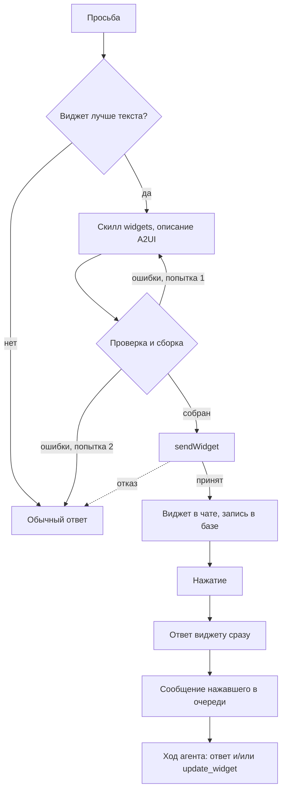
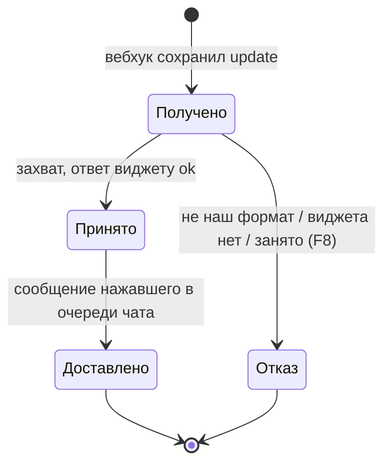

# Виджеты в сообщениях Telegram на протоколе A2UI — спецификация

**Статус:** согласовано 06.11.2026 (F1–F8 и A2UI); реализация — ветка `feat/telegram-widgets`
**Дата:** 2026-11-06 · **Проект:** Osinara · **Тип:** смешанный (новый вид ответа и инструменты модели + новый путь
приёма нажатий и хранение виджетов) ·
**Где работает:** живой ход агента в личке с ботом (владелец и члены семьи; группы — позже); вход вебхука (нажатия); методы Bot API
10.4 через бета-адрес Telegram (в обычной сети работает — проверено отправкой 06.11.2026)
**Не применяется:** 13 — деньги не затронуты, данные — в разделах 8 и 10.
Репозиторий публичный: люди в сценариях выдуманы, id чатов и личных данных в документе нет.

## Коротко

**Что делаем и зачем.** Telegram запустил виджеты: маленькую интерактивную страничку прямо в пузыре чата, с
вёрсткой, графикой и нажатиями, без выхода в интернет. Агент научится присылать виджеты, когда ответ лучше показать,
чем пересказать: расписание недели, сравнение, график расходов, рецепт по шагам, викторина для ребёнка, «кто идёт»,
выбор блюд на неделю. Нажатия в виджете доходят до агента, и он отвечает или обновляет виджет. Успех — наглядный и
одинаково аккуратный ответ в обеих темах, а выбор в виджете агент получает так же надёжно, как нажатие кнопки.

**Что уже работает.** 5–6 ноября вышли Telegram 13.2 (Android, iOS, macOS) и Desktop 7.4 — они показывают виджеты;
сервер Telegram включает их постепенно. Методы для ботов (Bot API 10.4) ещё не в официальной документации, но работают
на бета-адресе Telegram в обычной сети: 06.11 наш бот прислал владельцу пробный виджет, кнопка-счётчик работала.

**Как это будет работать.**
1. Человек просит «составь меню на неделю, я выберу». Агент описывает виджет не кодом, а готовыми деталями по
   протоколу A2UI: заголовок, список блюд с отметками, кнопка «Готово».
2. Система проверяет описание по каталогу деталей и собирает из него виджет сама — вёрстку, цвета темы, поведение
   кнопок. Ошибка в описании — агент получает точное место и исправляет один раз; не вышло — отвечает текстом.
3. В чат уходит виджет с подписью «что это и факты для действия» (F3); её видят и те, у кого виджеты ещё не
   показываются.
4. Маша отмечает «Борщ» и «Плов» и жмёт «Готово». Виджет сразу пишет «Отправлено», а агент получает её выбор как её
   сообщение и отвечает в чате: «Записала, список покупок ниже».
5. Агент может обновить уже отправленный виджет — например, отметить «Принято» или пересчитать «идут 4 из 6». Telegram
   меняет его тихо, без уведомления.
6. Пока — только в личке с ботом (владелец и члены семьи); в группах Telegram виджеты сейчас не работают, включим
   для всех позже (решение 06.11). Напоминания, сценарии по расписанию и `/me` виджеты не шлют.
7. Для игр и анимаций, которых нет в каталоге, агент может прислать свой HTML-виджет (F6 B). Такой виджет живёт только
   на устройстве и с ботом не связан.

**Как будем строить.**
1. В слой Telegram добавляем отдельные методы виджетов — `sendWidget`, `editMessageWidgetData`, `answerWidgetQuery` —
   через бета-адрес; после официального выпуска меняется один адрес.
2. Свой каталог деталей A2UI для Telegram — только то, что Telegram умеет рисовать в виджете: текст, строки и
   колонки, карточки, вкладки, кнопки, отметки, выбор, таблица, график, прогресс, отсчёт, викторина.
3. Свой сборщик: из описания A2UI получается вёрстка виджета в пределах Telegram (4 КБ в сжатом виде). Агент больше
   не пишет HTML и скрипты — не гадает с вёрсткой и не может сломать виджет кодом.
4. Инструменты агента: `send_widget` (прислать: описание A2UI или, для игр, свой HTML) и `update_widget` (обновить
   данные отправленного A2UI-виджета).
5. Нажатия: новый вид событий от Telegram принимается вебхуком, ответ виджету уходит сразу, а сам выбор встаёт в
   очередь чата как сообщение нажавшего — по образцу кнопок-ответов.
6. Отправленные виджеты хранятся в базе: чтобы понимать нажатия и разрешать обновление только своему чату.
7. Обучение агента: короткое правило «когда виджет» и служебный скилл `widgets` с каталогом деталей и примерами —
   читается только перед отправкой.

**За чем следить.**
- Бета-адрес — не официальный контракт: Telegram может что-то переименовать. Тогда отправка откажет, агент ответит
  текстом, мы увидим это в журнале и поправим одним релизом.
- Нажатия приходят только с бета-сервера Telegram, у которого своя очередь событий. Подписываем бету на наш вебхук
  строго на нажатия и со сбросом накопленного — иначе на нас высыплются сотни копий старых сообщений, и агент ответит
  на них второй раз. Основная подписка бота не меняется.
- Каждое нажатие, дошедшее до агента, — платный ход модели. Защита: пока прошлое нажатие человека в этом виджете не
  обработано, новое не принимается.
- Свой HTML для игр модель пишет сама: это тяжелее (12–20 тыс. знаков кода) и может ломаться. Перед отправкой — своя
  проверка и официальная проверка Telegram (F4); связи с ботом у такого виджета нет.
- Данные, которые агент может потом обновить, ограничены 1 КБ; большой виджет обновить нельзя — только прислать новый.
- Часть семьи ещё не видит виджеты (старое приложение или Telegram не включил) — им остаётся подпись.

**На что опирается.** Протокол A2UI 1.0 (стабильный, Apache-2.0, «проверка описания и исправление моделью» — его
штатный цикл); формат и пределы виджетов Telegram (widget-sandbox v0.6.1) и проба отправки 06.11; собственные образцы
Osinara — `send_poll` и кнопки-ответы.

**Найдено по пути.** У widget-sandbox Telegram нет лицензии — его код не переносим в наш публичный репозиторий;
официальной проверкой пользуемся только при разработке для проверки нашего сборщика (F4, решение 06.11 и раздел 15).

**Решения владельца (06.11.2026):** F1 — включаем сразу через бету; F2 — нажатия доходят до агента; F3 — подпись «что
это и факты для действия»; F4 — официальная проверка Telegram; F5 → пока только личка с ботом, позже всем; F6 — A2UI
и свой HTML для игр без связи с ботом; F7 — в группах нажимает любой участник (когда включим группы); F8 — одно
необработанное нажатие на виджет от человека; протокол — A2UI.

**Выкатка:** одним релизом с личными вопросами, виджеты включены (F1).

**Объём:** шаг 0 и 14 шагов; работа агента — около 18 ч (оценка); долго — прогоны тестов с базой в Docker, замер на
боевой модели, CI релиза; от владельца — ~15 минут посмотреть пробные виджеты и понажимать в личке.

**Проверено 06.11.2026:** бета-адрес знает `sendWidget`, `answerWidgetQuery`, `editMessageWidgetData` для нашего бота;
пробный виджет показался у владельца, кнопка-счётчик работала.

Бета — отдельный сервер Telegram со своей очередью событий бота; вебхук на нём не задан (проверено чтением).

**Не проверено:** примет ли бета подписку только на нажатия и дойдёт ли нажатие; принимает ли `sendWidget` ответ на
сообщение и тему группы; предел подписи; у всех ли членов семьи включены виджеты.

---

# Часть 1. Для владельца: как это работает

## 1. Что известно и что добавлено

- **Владелец сказал / решил (06.11.2026):**
  - разработать виджеты и научить агента; выкатить вместе с личными вопросами (#467);
  - отправка виджета — отдельный метод API; люди уже присылают виджеты своими ботами, и это работает;
  - F1 — включаем сразу (через бета-адрес); F2 — нажатие в виджете доходит до агента; F3 — подпись «что это и факты
    для действия»; F4 — официальная проверка Telegram, «я пока потестирую в личке, а как лицензию добавят — сообщу,
    и про лицензию зафиксируем»; F5 — везде, где доступен опрос;
  - внедрить протокол A2UI, «чтобы агент верстал как положено и не гадал каждый раз», и пусть он участвует в
    построении виджетов;
  - «для работы делай всё, что необходимо».
- **Агент рекомендовал, владелец не подтвердил:** вместе с A2UI отказаться от свободного HTML (F6); как понимать F4
  после перехода на A2UI (раздел 15); не брать AG-UI (раздел 15).
- **Найдено в проекте:**
  - свой клиент Telegram без библиотеки (`agent/runtime/telegram/api.ts`), адрес `https://api.telegram.org`;
    `callTelegramApi` принимает `apiBaseUrl` (`api.ts:156`), `sendTelegramNativeMessage` его пока не передаёт;
  - образец особой отправки — `agent/lib/tools/send_poll.ts` поверх `agent/lib/telegram-sends/telegram-native-send.ts`;
    общий модуль сводит любой отказ Telegram (кроме 5xx) в один код (`telegram-native-send.ts:92-99`);
  - образец нажатий: кнопки-ответы — решение и ответ Telegram сразу при приёме (`agent/lib/reply-buttons/reply-button-arrival.ts`),
    нажатие становится сообщением нажавшего в очереди чата (`reply-button-press.ts`), данные нажатия — только токен и
    номер, смысл читается из базы (`reply-button-contract.ts`);
  - вебхук подписан на `message`, `callback_query`, `my_chat_member` (`scripts/provider-installer/telegram-webhook.ts:18`);
    подписка на проде меняется скриптом `scripts/telegram-webhook-subscription.ts`;
  - правило об отправках входит в каждый живой ход без условия (`agent/lib/prompt/mode-instructions.ts:240, 318, 472`);
    условная выдача — как у гифок (`liveGifReplies`);
  - служебные скиллы выдаются вместе со своим инструментом (`config/service-skills/`, `agent/lib/family-skills/service-skills.ts`);
  - предел ответа боевой модели — 16 384 токена (`agent/lib/provider-catalog/neuraldeep-models.ts:19`);
  - личный вопрос `/me` имеет свой точный набор инструментов (`agent/lib/private-questions/`), виджеты туда не попадают;
  - последняя миграция — `151_private_questions.sql`;
  - стенд замера промптов на боевой модели вне репозитория (`/home/vps/osinara-eval/tools/prompt-eval/`).
- **Проба 06.11.2026 (PROBE):** обычный адрес на `sendWidget` — `404`; бета-адрес `https://api.telegram.org/beta` —
  «parameter "html" is required»; `answerWidgetQuery` и `editMessageWidgetData` известны; `sendWidget` в личку
  владельцу с подписью — `ok: true`, у сообщения поле `widget` с `html`. Владелец: виджет показался, 5 нажатий счётчик
  посчитал.
- **Проба вебхука 06.11.2026 (PROBE-HOOK), только чтение:** обычный адрес — вебхук задан, список `message`,
  `callback_query`, `my_chat_member`; бета-адрес — вебхук **не задан**, в очереди беты 871 непрочитанное событие
  (копии сообщений и правок бота с 09:28 UTC, своя нумерация ~69,45 млн против ~57,12 млн у основного сервера).
  Основной бот при этом получает всё (115 событий с 09:00). Вывод: бета — отдельный сервер с отдельной очередью;
  нажатия на виджеты (`widget_query`) обычный сервер не знает, они придут только с беты.
- **Добавлено:** [ДОПУЩЕНИЕ] типичные просьбы семьи: расписание, сравнение, график, рецепт по шагам, викторина, «кто
  идёт», выбор из списка; [ДОПУЩЕНИЕ] боевая модель уверенно пишет описание A2UI — проверяется в шаге 0.

**Источники:**

| Код | Что это | От кого, дата | Где | Вес |
|---|---|---|---|---|
| A2UI | Протокол A2UI 1.0: сообщения, каталоги, привязка данных, действия, цикл «описание → проверка → исправление» | a2ui-project (Google), Apache-2.0, 1.0 «stable» | github.com/a2ui-project/a2ui `specification/v1_0` | требование (решение владельца) |
| A2UI-BASIC | Базовый каталог A2UI: 18 деталей, 14 функций | там же | `catalogs/basic/v1/catalog.json` | образец |
| TGW | Формат виджета, пределы, ошибки, Bot API 10.4 | Telegram, widget-sandbox `docs/tgw-format.md`, 06.11.2026 | github.com/TelegramMessenger/widget-sandbox | требование платформы (бета) |
| TGW-GUIDE | Что работает в виджете (профиль 1), ввод, пределы | Telegram, `docs/widget-runtime-profile.md` v0.2.3 | там же | требование платформы (бета) |
| APPS | Telegram 13.2 и Desktop 7.4 показывают виджеты | Tginfo 4447/4448, Код.ру 05.11.2026 | t.me/tginfo, kod.ru | факт (вторичный) |
| PROBE | Бета-адрес в обычной сети принимает виджеты нашего бота | своя проба, 06.11.2026 | раздел 1 | факт |
| OWNER | Решения владельца | 06.11.2026 | этот разговор | требование |

## 2. Цели, не цели, антицели

- **Цели:**
  1. Агент сам решает, когда ответ лучше показать виджетом, и собирает его из деталей A2UI **[OWNER]**. Мера: в шаге 0
     агент выбирает виджет в ≥ 5 из 6 подходящих просьб и ≤ 1 из 4 неподходящих; ≥ 9 из 10 описаний проходят
     проверку с 1–2 попыток.
  2. Все виджеты выглядят одинаково аккуратно в обеих темах и на узком телефоне — за это отвечает сборщик, а не модель.
  3. Нажатие в виджете доходит до агента как сообщение нажавшего не позже чем через 3 с после нажатия попадает в
     очередь чата; виджет сразу показывает «Отправлено» **[OWNER F2]**.
  4. Никто не теряет суть: без виджета — подпись с фактами для действия; при сбое — обычный текст **[OWNER F3]**.
  5. Виджет не открывает новых путей к данным и не уводит людей в чужие чаты; нажатие разрешает ровно то же, что
     текстовое сообщение того же человека.
- **Не цели:** свободный HTML и игры (F6); общие «живые» виджеты, одинаковые во всех пересылках; удаление виджетов
  агентом; виджеты в напоминаниях, сценариях и `/me`; инлайн-режим; платежи; AG-UI.
- **Антицели:** виджет там, где хватило бы двух строк; виджет и его пересказ текстом; агент отвечает на каждое
  случайное нажатие длинным сообщением; факт для действия есть только внутри виджета.
- **Сейчас:** rich-ответ (таблицы, списки, сворачиваемые блоки), кнопки-ответы до 6 вариантов, опросы. Выбор из
  12 вариантов, несколько отметок за раз, вкладки, графики — нет.

## 3. На что опирается

| Практика | Кто так делает | Когда окупается | Берём? | Почему | Источник |
|---|---|---|---|---|---|
| Модель описывает интерфейс деталями из каталога, приложение рисует | A2UI, CopilotKit, рендереры Lit/Angular/React | когда интерфейс строит модель | да | решение владельца; модель не пишет код — нечему ломаться | A2UI |
| Свой каталог вместо базового | A2UI прямо предлагает «свой каталог — ровно ваши детали» | когда платформа умеет не всё | да | Telegram-виджет не умеет поля ввода, видео, модальные окна | A2UI, TGW-GUIDE |
| Цикл «описание → проверка → ошибка в стандартном виде → исправление» | A2UI | всегда | да | совпадает с нашим «одна попытка исправить» | A2UI |
| Нажатие отвечается сразу, работа — в очереди | Osinara: кнопки-ответы | когда ход модели дольше ответа платформы | да | Telegram ждёт ответ на нажатие 15 с | TGW, `reply-button-arrival.ts` |
| Данные нажатия — короткий номер, смысл — из базы | Osinara: кнопки-ответы | всегда | да | данные нажатия до 64 байт и приходят от клиента | TGW, `reply-button-contract.ts` |
| Транспорт AG-UI | CopilotKit | когда фронтенд — своё веб-приложение | нет | у нас транспорт — сам Telegram; A2UI от транспорта не зависит | A2UI «Transport decoupling» |
| Официальная проверка Telegram на нашем сборщике | widget-sandbox `sandbox-node.ts` | при изменении сборщика | да, только при разработке | нет лицензии — в продукт не кладём | TGW-GUIDE, F4 |
| Свободный HTML от модели | Telegram (их блок для промпта модели) | игры, анимации | нет (F6) | ломкий, тяжёлый для модели, обходит A2UI | TGW-GUIDE |

## 4. Варианты и масштаб

**Масштаб проекта:** одна семья и одна активная внешняя группа; виджетов в день — единицы, нажатий — десятки
[ДОПУЩЕНИЕ]; боевая модель через хаб владельца; одна машина, поддержка — владелец и агенты.

**Как строится виджет — один путь:** агент пишет описание A2UI по нашему каталогу, сборщик превращает его в вёрстку,
потому что так решил владелец (A2UI). Свободный HTML — F6.

**Где живут данные виджета — один путь:** вёрстка неизменна после отправки (правило Telegram), поэтому сборщик
вписывает данные в вёрстку, а то, что агент может потом обновить, кладёт в «общее состояние» сообщения (до 1 КБ,
Telegram отдаёт его виджету и пересылкам). Не влезает — виджет присылается без возможности обновления, и агент это знает.

**Связь с агентом — уровень 2 по F2:** нажатие → ответ виджету сразу → сообщение нажавшего в очереди → ход агента.
Уровень 3 (общие объекты Telegram, одинаковые во всех пересылках, счёт голосов без модели) — не нужен на нашем
масштабе; вернётся при конкретной просьбе вроде общего списка покупок.

## 5. Как это работает

**Точки входа:** просьба в живом разговоре → 1, 2; нажатие в виджете → 3, 4; ход агента после нажатия или новых
данных → 5; пересланный виджет → 6; нажатие в пересланной копии → 7.

**Сценарий 1 — Расписание в личке.** Маша пишет боту: «покажи расписание кружков на неделю».
1. Агент берёт расписание из памяти, загружает скилл `widgets` и пишет описание: вкладки по дням, в каждой — список
   занятий карточками, сегодняшний день открыт.
2. Проверка проходит, сборщик собирает виджет 3,1 КБ в сжатом виде, Маше уходит виджет с подписью
   «Кружки на неделю. Ближайшее — плавание у Пети, вт 17:30».
3. **Ключевой момент:** аккуратная неделя в цветах её темы, вкладки переключаются без бота.

**Сценарий 2 — Ошибка в описании.** Агент сослался на деталь `TextField` (поле ввода) и забыл деталь `root`.
1. Проверка возвращает ошибки в формате A2UI: `UNKNOWN_COMPONENT /components/3 «TextField нет в каталоге: в
   виджете нельзя печатать, спроси текстом»`, `VALIDATION_FAILED /components «нет детали с id root»`.
2. Агент исправляет, вторая попытка проходит. Не прошла — ответ обычным текстом.

**Сценарий 3 — Выбор блюд.** Аня пишет в личку «составь меню на неделю, я выберу».
1. Агент присылает виджет: 12 блюд с отметками и кнопка «Готово» с действием `menu_done`.
2. Аня отмечает «Борщ» и «Плов» — отметки ставятся сразу, без бота.
3. Аня жмёт «Готово» → Telegram передаёт нажатие нашему вебхуку → мы сразу отвечаем виджету → кнопка показывает
   «✓ Отправлено».
4. В очередь чата встаёт сообщение Ани: `[нажатие в виджете «Меню на неделю»: Готово] выбрано: Борщ, Плов` с точными
   данными действия.
5. Агент отвечает в чате списком покупок и обновляет виджет: «Принято: борщ, плов».
- **При сбое:** ответ виджету не ушёл за 15 с (база недоступна) → у Ани в кнопке «Не отправлено, нажмите ещё раз»;
  нажатие сохранено — когда база вернётся, оно всё равно дойдёт до агента ровно один раз.

**Сценарий 4 — Частые нажатия.** Петя в личке получил виджет «Дела на неделю» с кнопкой «Отметить сделанное».
1. Петя отмечает два дела и жмёт кнопку → его сообщение в очереди → агент обновляет виджет: «Сделано 2 из 7».
2. Петя быстро жмёт ещё раз, пока первое нажатие в очереди → «Ещё обрабатываю прошлое нажатие» (F8).
3. Когда виджеты включатся в группах, тот же виджет «кто идёт» сможет нажимать любой участник (F7).

**Сценарий 4а — Игра своим HTML.** Аня просит «давай сыграем в крестики-нолики».
1. Такой детали в каталоге нет — агент пишет свой HTML (F6 B), загрузив скилл.
2. Своя проверка и официальная проверка Telegram проходят — Аня получает игру; ходит, игра живёт на её телефоне.
3. С ботом игра не связана: агент не узнаёт счёт.
- **При сбое:** официальная проверка нашла ошибку скрипта — агент исправляет один раз, потом отвечает текстом.

**Сценарий 5 — Обновить нельзя.** Агент пытается обновить большой виджет, чьи данные больше 1 КБ.
`update_widget` отвечает `AGENT_WIDGET_NOT_UPDATABLE`; агент присылает новый виджет или пишет текстом.

**Сценарий 6 — Пересланный чужой виджет.** Петя пересылает боту виджет-трекер из бота магазина. Агент видит строку
«[виджет] Заказ №… в пути» (подпись) и отвечает, что видит только подпись.

**Сценарий 7 — Нажатие в пересланной копии.** Маша переслала наш виджет-меню подруге. У подруги отметки работают, а
«Готово» пишет «Нажатия работают в исходном сообщении»: Telegram не даёт пересланной копии связаться с ботом.

## 6. Решения владельца

### Принято 06.11.2026

- **F1 — A.** Включаем сразу, одним релизом с личными вопросами, через бета-адрес; на обычный адрес — после
  официального выпуска 10.4 (шаг 13). Выбрано вместо «включать после выпуска» и «ждать».
- **F2 — B.** Нажатие в A2UI-виджете доходит до агента в этой же задаче. Выбрано вместо «следующей задачей».
- **F3 — A.** Подпись: что это и факты для действия, 1–3 строки до 300 знаков.
- **F4 — официальная проверка Telegram.** Слова владельца: «я пока потестирую в личке, а как лицензию добавят — я
  сообщу, и мы про лицензию зафиксируем». Применение — раздел 15.
- **F5 → только личка с ботом.** Сначала было «везде, где опрос»; затем владелец: «это сейчас всё равно не работает
  дальше личного чата с ботом… даже можно не пытаться сделать. Только личка с ботом. Потом включим для всех».
  Значит: инструменты виджетов — только в живых ходах личных чатов с ботом (владелец и члены семьи); семейная и
  внешние группы — без виджетов; групповые случаи (ответ на сообщение, темы, кто нажимает) не строим.
- **F6 — B.** A2UI плюс свой HTML для игр и анимаций, без связи с ботом. Выбрано вместо «только A2UI» (рекомендация
  агента).
- **F7 — A, на потом.** Когда включим группы, нажимать может любой участник от своего имени. Сейчас не строится.
- **F8 — A.** Одно необработанное нажатие на виджет от человека.
- **A2UI.** Агент строит виджеты по протоколу A2UI 1.0.

---

# Часть 2. Для исполнителя: поведение подробно

## 7. Точки касания и состояния

| Инструмент | Когда вызывать / когда нет | Параметры | Что возвращает | Читает / меняет / необратимо | Защита от повтора | Ошибки |
|---|---|---|---|---|---|---|
| `send_widget` | ответ лучше видеть или нужен выбор больше 6 вариантов, несколько отметок, вкладки, график, прогресс, отсчёт, викторина; **не**: 1–3 строки, обычная таблица или список (rich-ответ), 2–6 вариантов с одним выбором (кнопки-ответы), голосование (`send_poll`), напоминание, ввод текста | `caption` — 1–300 знаков (F3); ровно одно из: `surface` — объект A2UI 1.0 `createSurface` (`surfaceId`, `catalogId`, `components`, `dataModel`) по каталогу `urn:osinara:a2ui:telegram-widget:1`, или `html` — свой HTML-виджет для игры или анимации, которых нет в каталоге (F6 B), с необязательным `height` 50–600 | `delivered`, `widget` (короткий номер для `update_widget`), `updatable` (у `html` всегда `false`), `actions` (имена действий; у `html` нет), `telegramMessageId`, `nextStep` | шлёт сообщение; запись в базе | при неизвестном исходе не повторяет | раздел 9 |
| `update_widget` | данные отправленного виджета изменились (принят выбор, пересчёт «кто идёт», прогресс); **не**: другая раскладка — прислать новый | `widget` — номер из `send_widget` или из истории; `updates` — 1–10 сообщений A2UI `updateDataModel` (`path`, `value`) | `updated: true`, `revision` | тихо меняет виджет у всех в чате | повтор той же правки — успех без вызова Telegram | раздел 9 |

| Точка касания | Показывает виджеты | Не показывает | Пересланная копия | Нажатие ушло | Нажатие не принято |
|---|---|---|---|---|---|
| Виджет | пузырь с виджетом и подписью | «Сообщение не поддерживается» + подпись | тот же вид, данные на момент пересылки; отметки работают, действия к агенту — «Нажатия работают в исходном сообщении» | кнопка «✓ Отправлено» до ответа агента или 60 с | «Ещё обрабатываю прошлое нажатие» / «Виджет больше не принимает нажатия» / «Не отправлено, нажмите ещё раз» |
| Сообщение нажавшего (для агента) | `[нажатие в виджете «<подпись>»: <надпись кнопки>] <userMessage>` и данные действия | — | — | — | — |

## 8. Внутренний механизм: нажатия и хранение

**Гарантии:** нажатие, на которое виджет получил «Отправлено», доходит до агента ровно один раз, даже после
перезапуска; ответ виджету — в пределах 15 с Telegram (цель ≤ 3 с); правка виджета применяется по порядку ревизий.

**Источник правды:** таблица `telegram_widgets` — описание виджета (детали, исходные данные, текущие данные, ревизия,
действия), чат, сообщение, разговор; Telegram хранит только собранную вёрстку и общее состояние.

| Что ломается | Как предотвращаем | Как узнаём | Как восстанавливаемся | Что теряется | Чем закрыто |
|---|---|---|---|---|---|
| Telegram прислал нажатие повторно | нажатие хранится по `update_id` во входной очереди, решение — идемпотентно | — | повтор отвечается тем же решением | ничего | шаг 10 |
| Процесс упал между ответом виджету и очередью | нажатие сохранено до ответа; шаг очереди решает его снова, если ответ уже был | журнал | очередь доставляет сообщение один раз | ничего | шаг 10 |
| База недоступна при нажатии | ответ виджету только после сохранения | `AGENT_WIDGET_QUERY_STORE_FAILED` | виджет: «Не отправлено, нажмите ещё раз» | одно нажатие, человек повторяет | шаг 10 |
| Две правки виджета одновременно | правка под блокировкой строки, ревизия +1 | — | вторая применяется поверх первой | ничего | шаг 9 |
| Нажатие на виджет, которого нет в базе (удалён чат, отключена группа) | поиск по чату и сообщению | — | «Виджет больше не принимает нажатия» | — | шаг 10 |
| Нажатие в отключённой внешней группе | та же проверка группы, что у текста | — | как текст из отключённой группы | — | шаг 10 |

**Доступ:** нажатие — сообщение нажавшего, проходит ту же проверку пользователя, роли, группы и очереди, что текст
(образец `reply-button-press.ts`); `update_widget` разрешён только ходу того же чата и разговора, где виджет отправлен.

## 9. Ошибки и восстановление

Ошибки инструментов получает модель; человек узнаёт о сбое из ответа модели. Коды и подробности — в журнал. Ошибки
описания — в стандартном формате A2UI (`code`, `path`, `message`), все сразу.

| Ситуация | Код (модели) | Что видит человек | Как выходим |
|---|---|---|---|
| Описание не по схеме A2UI / каталогу: неизвестная деталь, поле, функция; нет `root`; ссылка на несуществующую деталь; цикл; неверная вложенность | `AGENT_WIDGET_SURFACE_INVALID` + список ошибок A2UI (`VALIDATION_FAILED`, `UNALLOWED_PARENT`, `UNALLOWED_CHILD`) | ничего | одна попытка, затем текст |
| Собранный виджет больше 3800 Б сжатый или 32 768 байт | `AGENT_WIDGET_TOO_LARGE`: размер, что сократить (сколько строк/деталей) | ничего | одна попытка, затем текст |
| Действий больше 8 или выборов больше 60 вариантов на виджет | `AGENT_WIDGET_SURFACE_INVALID` | ничего | одна попытка |
| Telegram: `INPUT_MEDIA_WIDGET_TOO_LARGE` | `AGENT_WIDGET_TOO_LARGE`, ошибка ввода | ничего | одна попытка |
| Telegram: нет права на медиа, чат не принимает виджеты, прочий отказ | `AGENT_WIDGET_DELIVERY_FAILED` | ответ текстом и фраза, что виджет отправить не получилось | больше не вызывать в ходе |
| Telegram не ответил / 5xx / нет номера сообщения | `AGENT_WIDGET_DELIVERY_AMBIGUOUS` | только слова, без упоминания сбоя (общий контракт) | не повторять |
| Виджет отправлен, запись в базу не удалась | журнал `AGENT_WIDGET_RECORD_FAILED`; `updatable: false`, нажатия: «Виджет больше не принимает нажатия» | виджет есть, нажатия не работают | — |
| `update_widget`: нет такого виджета в этом чате | `AGENT_WIDGET_NOT_FOUND` | ничего | прислать новый |
| `update_widget`: данные не помещаются в 1 КБ или меняется число строк списка | `AGENT_WIDGET_NOT_UPDATABLE`: почему | ничего | прислать новый или текст |
| `update_widget`: Telegram отказал | `AGENT_WIDGET_UPDATE_FAILED` (`message is not modified` — успех) | ничего | текстом |
| Нажатие: прошлое того же человека в этом виджете не обработано (F8) | — | «Ещё обрабатываю прошлое нажатие» | после ответа агента |
| Нажатие: данные не разбираются (не наш формат, номер действия вне списка) | журнал `AGENT_WIDGET_QUERY_INVALID` | «Не отправлено» | — |
| `html`: больше 32 768 байт или 3800 Б сжатый | `AGENT_WIDGET_TOO_LARGE` | ничего | одна попытка, затем текст |
| `html`: ломающие находки своей проверки — поля ввода, запросы в сеть, `TelegramWidget.request`/`wallet`, `alert`, сторонние библиотеки, внешние ресурсы, ошибка синтаксиса скрипта, ссылки на t.me / `openTelegramLink` | `AGENT_WIDGET_HTML_REFUSED` + все находки с подсказками | ничего | одна попытка, затем текст |
| `html`: официальная проверка Telegram нашла ошибку скрипта при запуске, вырезанное или остановку | `AGENT_WIDGET_HTML_REFUSED` + находки проверки | ничего | одна попытка, затем текст |
| `html`: официальная проверка не ответила за 10 с или упала | журнал `AGENT_WIDGET_HTML_CHECK_UNAVAILABLE`; `AGENT_WIDGET_DELIVERY_FAILED` | ответ текстом | — |
| Ответ модели оборван на 16 384 токенах | существующий `AGENT_MODEL_OUTPUT_TRUNCATED` | «Модель оборвала ответ…» | повторить просьбу; описание A2UI в 3–5 раз короче HTML — риск мал, меряем в шаге 0 |
| Бета изменилась (`404`, новое поле) | `AGENT_WIDGET_DELIVERY_FAILED` / `UPDATE_FAILED`, описание Telegram в журнале | текст | поправить одним релизом |

## 10. Крайние случаи и стыки

| Случай | Что происходит | Как обрабатываем |
|---|---|---|
| Детали, которых виджет не умеет (`TextField`, `DateTimeInput`, `Modal`, `Video`, `AudioPlayer`, `Image` по адресу) | в нашем каталоге их нет | ошибка описания с подсказкой: ввод — спросить текстом |
| `openUrl` на t.me или `tg://` | функция каталога принимает только `https` веб-адреса не Telegram | ошибка описания |
| Дата без смещения часового пояса в данных | `formatDate` требует ISO-время со смещением | ошибка описания — без угадывания пояса |
| Длинный список (40 занятий) | сборщик меряет размер | `AGENT_WIDGET_TOO_LARGE` с советом разбить на вкладки или сократить |
| Тёмная тема, 320 px | сборщик берёт только цвета темы Telegram и резиновую раскладку | проверка сборщика официальной проверкой на 320 и 600 px |
| Нажатие пришло, когда агент уже обновил виджет (ревизия новее) | данные нажатия несут ревизию | нажатие доходит с пометкой «нажато в версии N» — агент видит, что виджет менялся |
| Отметки до «Готово» | хранятся на устройстве (на этот виджет на этом телефоне) | после перезапуска приложения сохраняются; на другом устройстве — пусто |
| Нажатие в `/me`, в отключённой группе, от бота | как текст в тех же условиях | общие правила приёма |
| Ход по расписанию, подагент, `/me` | инструментов и правила нет | модель отвечает текстом |
| Агент обновляет виджет из другого чата | `AGENT_WIDGET_NOT_FOUND` | только свой чат |
| Внешняя группа: виджет из её данных | как любой ответ в группе | правила данных группы не меняются |

| Соседняя функция | Где встречаются | Кто главнее |
|---|---|---|
| Кнопки-ответы | выбор | 2–6 вариантов, один выбор — кнопки-ответы; больше, несколько отметок или нужен вид — виджет |
| Rich-ответ | таблицы, списки | обычная таблица и список — rich-ответ; виджет — когда нужны вкладки, график, выбор, прогресс |
| `send_poll` | голосование | голосование с подсчётом Telegram — опрос; «кто идёт» с именами — виджет |
| Напоминания | «напомни» | только напоминание; отсчёт в виджете не напоминает |
| Очередь чата | нажатие — сообщение | стоит в общей очереди чата, порядок с текстом сохраняется |
| Поток ответа (черновик) | виджет — отдельное сообщение | приходит раньше финального текста, как опрос |
| История и сжатие | описание виджета в ходе | в историю чата — строка `[виджет wN «подпись»]`; полное описание — в базе, `update_widget` берёт его оттуда |
| Ответы на сообщение бота в группе | ответ на виджет | маршрут ответа привязывается, как у опроса |
| Личные вопросы `/me` | набор инструментов | виджетов нет; тест точного набора не меняется |
| Отключение группы (#464) | виджеты группы в базе | остаются с группой; нажатия отключённой группы не доходят, как текст |

## 11. Скорость и отклик

| Действие | Ожидаемо | Что видит человек | Если дольше |
|---|---|---|---|
| Модель пишет описание A2UI 2–6 КБ | [ЗАМЕР] цель ≤ 30 с | «печатает», поток ответа | > 60 с — пересмотреть каталог и примеры |
| Проверка и сборка | < 100 мс [ЗАМЕР] | — | — |
| Нажатие → «Отправлено» | ≤ 3 с (вебхук → база → ответ) | кнопка «Отправляю…» сразу, затем «✓ Отправлено» | 15 с — Telegram отдаёт виджету «нет ответа» → «Не отправлено, нажмите ещё раз» |
| Нажатие → ответ агента | как обычное сообщение в очереди чата | «✓ Отправлено» на кнопке | как у текста |
| `update_widget` | 1–2 с | виджет меняется у всех | — |

## 12. Тексты интерфейса

Внутри виджета (собирает сборщик, по-русски):

| Где | Текст |
|---|---|
| Кнопка после нажатия, ждём ответ | «Отправляю…» |
| Ответ получен | «✓ Отправлено» |
| Прошлое нажатие не обработано | «Ещё обрабатываю прошлое нажатие» |
| Виджет не принимает нажатия | «Виджет больше не принимает нажатия» |
| Ошибка, нет ответа | «Не отправлено, нажмите ещё раз» |
| Пересланная копия | «Нажатия работают в исходном сообщении» |
| Частые нажатия (Telegram) | «Слишком часто, подождите пару секунд» |

Сообщение нажавшего для агента: `[нажатие в виджете «<подпись>»: <надпись кнопки>] <userMessage>`. Описание
инструментов, правило и скилл — на английском (правило проекта).

## 14. Что сознательно не делаем

- Виджеты в группах (семейной и внешних) — по решению владельца, «потом включим для всех»; ответ на сообщение, темы
  групп и «кто нажимает» (F7) не строим до этого.
- Связь с ботом у своего HTML-виджета — по F6 B его нажатия к агенту не идут.
- Общие виджеты Telegram (`is_shared`), живые пересылки, счёт голосов без модели — нет просьбы; вернёмся с общим списком.
- Смена раскладки отправленного виджета (`updateComponents`) — вёрстка неизменна; присылается новый.
- Удаление виджета (`deleteSurface`) — старый остаётся, как текст.
- Поля ввода, даты, ползунки, модальные окна, видео, картинки по адресу — Telegram-виджет их не умеет или они не
  нужны семье; ползунок вернётся по просьбе.
- Функции, которые агент вызывает в виджете (`callRendererFunction`), и функции агента из виджета (`callAgentFunction`)
  — нечего вызывать; действие `action` покрывает нажатия.
- AG-UI — транспорт для своих веб-приложений; наш транспорт — Telegram.
- Чтение вёрстки чужих пересланных виджетов — недоверенный код.
- Кошелёк, платежи, инлайн-режим, виджеты в напоминаниях и сценариях.

## 15. Решения агента — на проверку

- **Как применяем F4.** Виджет из описания A2UI собирает наш сборщик — каждую деталь каталога и примеры скилла
  официальная проверка Telegram прогоняет при изменении сборщика (тест разработки, со скачиванием widget-sandbox
  нужной версии). Свой HTML (F6 B) пишет модель — его официальная проверка проверяет **в проде перед каждой
  отправкой**: без браузера она работает (проверено 06.11.2026: 1,4 с и ~150 МБ на виджет) и сообщает вырезанное
  (`validator:profile`), заблокированные адреса (`validator:url-blocked`), сетевые запросы (`network-blocked`) и
  ошибки скрипта при запуске (`logs` с `error`). Отказ — за ошибки скрипта, сеть, внешние адреса, вырезанные элементы
  и размер; вырезанное оформление (шрифт, `vh`, `sticky`) — предупреждения в результате, без отказа. Без проверки
  (упала, дольше 10 с) свой HTML не отправляется.
- **Лицензия официальной проверки.** Код widget-sandbox не попадает в git-репозиторий: стадия сборки образа скачивает
  архив тега v0.6.1 с проверкой sha256 и ставит его зависимости. Но образ приложения публикуется в GHCR, поэтому код
  Telegram без лицензии в нём распространяется — это риск, который владелец принял по F4 («как лицензию добавят — я
  сообщу, и мы про лицензию зафиксируем»). Пакет `quickjs-wasm` внутри него — MIT.
- **Свой каталог `urn:osinara:a2ui:telegram-widget:1`** по правилам A2UI: из базового — `Text` (простая разметка),
  `Icon` (набор эмодзи вместо значков), `Row`, `Column`, `List` (без прокрутки), `Card`, `Tabs`, `Divider`, `Button`
  (`default` / `primary` / `borderless`), `CheckBox`, `ChoicePicker`; свои — `Table`, `Chart` (столбцы / линия /
  доли, рисуется заранее), `Progress`, `Badge`, `Countdown`, `Quiz` (вопросы с вариантами, проверка на устройстве,
  итог можно отправить агенту действием). Функции: `formatString`, `formatNumber`, `formatCurrency`, `formatDate`,
  `pluralize`, `and`, `or`, `not`, `required`, `openUrl` (только https не Telegram, по нажатию), `copyText` (своя, до
  256 знаков).
- **Вычисления — на нашей стороне при сборке и правке:** виджет получает готовые строки, а не формулы; скрипт в
  виджете только переключает вкладки и отметки, считает отсчёт и викторину и отправляет нажатия. Так скрипт маленький и
  один на все виджеты.
- **Данные для обновления** — в общем состоянии сообщения (`public_data`), а не в состоянии чата: пересланная копия
  показывает данные на момент пересылки, а не исходные. Приватность одинакова: вёрстка с данными пересылается в любом
  случае.
- **Данные нажатия** — `a<номер действия>.<ревизия>.<отметки>` до 64 байт: номер действия из списка в базе, ревизия
  виджета и отметки выбора битами. Смысл (имя действия, контекст) берётся из базы. Ограничение: на виджет до 8 действий
  и до 60 вариантов отметок.
- **Ответ виджету** — `{"ok":1}` или `{"err":"busy"|"closed"|"invalid"}`; состояния и тексты — сборщик.
- **Ревизия в общем состоянии** (`"r"`), чтобы виджет не показывал устаревшее, — как советует Telegram (TGW-GUIDE).
- **Без `is_shared`**: пересланные копии к боту не обращаются (TGW).
- **Адрес** — `TELEGRAM_WIDGET_API_BASE_URL = "https://api.telegram.org/beta"` только для методов виджетов;
  выключатель `TELEGRAM_WIDGETS_AVAILABLE` — константа в коде (правило о `.env`).
- **Подпись обязательна**, под виджетом (F3; время сообщения не закрывает угол виджета).
- **Свой предел 3800 Б** сжатого виджета при пределе Telegram 4096 Б — запас, которого держатся инструменты Telegram.
- **Сообщение нажатия** строится сервером из базы, а не из данных клиента: надпись кнопки и контекст — из описания,
  выбор — по битам отметок.
- **Подписка на нажатия — отдельная, на бета-сервере** (PROBE-HOOK): `setWebhook` через бету на тот же адрес и с тем
  же секретом, `allowed_updates: ["widget_query"]`, `drop_pending_updates: true`. Основная подписка (`TELEGRAM_ALLOWED_UPDATES`)
  не меняется. Вебхук принимает `widget_query` только в путь нажатий и никогда не кладёт его во входную очередь
  сообщений; любое другое обновление, пришедшее с беты (по виду и диапазону), отбрасывается с записью в журнал —
  защита от копий сообщений. Нажатия хранятся в `telegram_widget_queries` по номеру обновления беты; сообщение
  нажавшего ставится в очередь чата со своим номером, не пересекающимся с настоящими.
- **Официальные тесты A2UI** (`specification/v1_0/test/cases`, Apache-2.0) берём для проверки валидатора в части,
  применимой к нашему каталогу, с отметкой в `THIRD_PARTY_NOTICES.md`.
- **Своя проверка схемы на `zod` 4** (уже в проекте), без пакета `@a2ui/web_core`: он тянет `lit`, `zod` 3 и сигналы
  для браузерных рендереров.

---

# Часть 3. Для исполнителя: как строить

## 16. Что есть и что переиспользуем

- `agent/lib/telegram-sends/telegram-native-send.ts` — расширяем: `"sendWidget"`, необязательные `apiBaseUrl` и
  `refusals`; остальное как есть.
- `agent/lib/telegram-sends/telegram-send-errors.ts` — `TelegramSendTool.name` + `"send_widget"`.
- `agent/lib/tools/send_poll.ts` — образец инструмента и записи в историю (`recordToolDeliveryInTimeline`).
- Кнопки-ответы — образец нажатий: `reply-button-arrival.ts` (решение при приёме под `withRuntimeAdmission`),
  `reply-button-press.ts` (сообщение нажавшего, номер сообщения выше настоящих — `REPLY_BUTTON_PRESS_MESSAGE_ID_BASE`),
  `reply-button-repository.ts` (захват нажатия), `telegram-durable-ingress.ts` (входная очередь), `telegram-ingress-claim-repository.ts`.
- `agent/runtime/telegram/inbound.ts` — разбор обновлений: добавляется вид `widget_query`.
- `scripts/provider-installer/telegram-webhook.ts` (`TELEGRAM_ALLOWED_UPDATES`), `scripts/telegram-webhook-subscription.ts`.
- `agent/lib/telegram-content/telegram-content-description.ts` — строка входящего виджета.
- `agent/lib/tool-policy/trusted-mode-tool-catalog.ts`, `mode-tool-surface.ts` — выдача; `agent/lib/prompt/mode-instructions.ts`,
  `telegram-send-fragments.ts` — правило по условию.
- `config/service-skills/`, `agent/lib/family-skills/service-skills.ts` — скилл.
- Не используем: rich-ответ, `@a2ui/web_core` (раздел 15), свободный HTML.
- Устаревших путей в просмотренных местах не найдено.

## 17. Устройство

**Папка `agent/lib/widgets/`:**
- `widget-config.ts` — `TELEGRAM_WIDGETS_AVAILABLE = true`, `TELEGRAM_WIDGET_API_BASE_URL`, пределы
  (`WIDGET_COMPRESSED_MAX_BYTES = 3800`, `WIDGET_HTML_MAX_BYTES = 32768`, `WIDGET_PUBLIC_DATA_MAX_BYTES = 1024`,
  `WIDGET_CAPTION_MAX_LENGTH = 300`, `WIDGET_ACTIONS_MAX = 8`, `WIDGET_CHOICES_MAX = 60`, `WIDGET_QUERY_DATA_MAX_BYTES = 64`).
- `a2ui/catalog.ts` — каталог на `zod`: детали, функции, правила вложенности; `a2ui/catalog.json` в скилле
  генерируется из него скриптом, тест сверяет.
- `a2ui/validate.ts` — `validateSurface(input): { surface } | { errors: A2uiError[] }`: конверт `createSurface`
  версии `1.0`, каталог, состав (есть `root`, ссылки существуют, нет циклов, вложенность), привязки `@path` (JSON
  Pointer), функции и их аргументы, ограничения действий и отметок.
- `a2ui/evaluate.ts` — вычисление значений по данным: `@path`, шаблоны списков и `@index`, функции каталога; локаль
  `ru-RU`; дата — со смещением из значения.
- `a2ui/render.ts` — `renderWidget(surface): { html, compressedBytes, publicData | null, actions, choiceSlots }`:
  вёрстка из деталей, стили на переменных темы Telegram, один общий скрипт `a2ui/widget-runtime.js` (вкладки,
  отметки в `localStorage`, отсчёт, викторина, нажатия через `TelegramWidget.request` только по касанию, ответы,
  обновление из общего состояния по ревизии).
- `a2ui/update.ts` — применение `updateDataModel` к сохранённым данным → новое общее состояние или «нельзя обновить».
- `widget-repository.ts` + миграция `152_telegram_widgets.sql`:
  - `telegram_widgets`: `id` uuid, `short_ref` (номер для модели, уникален в чате), `chat_id`, `message_id`,
    `message_thread_id`, `conversation_session_id`, `caption`, `surface` jsonb (детали и исходные данные), `data_model`
    jsonb (текущие), `actions` jsonb, `choice_slots` jsonb, `revision` int, `updatable` bool, `created_at`, `updated_at`;
    уникальность (`chat_id`, `message_id`);
  - `telegram_widget_queries`: `update_id` (уникален), `widget_id`, `telegram_user_id`, `action_index`, `revision`,
    `choices` bit, `status` (`accepted` / `refused_busy` / `refused_closed` / `refused_invalid`), `answered_at`,
    `dispatched_at`; частичный уникальный индекс «одно `accepted` без `dispatched_at` на (`widget_id`, `telegram_user_id`)»
    — правило F8 в базе.
- `widget-query-arrival.ts` — шаг при приёме: разбор данных → захват в `telegram_widget_queries` → `answerWidgetQuery`;
  повтор безопасен.
- `widget-query-press.ts` — шаг очереди: сообщение нажавшего (текст по разделу 7, данные действия A2UI `action` в
  атрибутах хода), номер сообщения — выше настоящих, производный от `update_id`.
- `html/html-preflight.ts` — своя быстрая проверка своего HTML до официальной: байты, размер (`zlib` 9), ссылки на
  Telegram, внешние ресурсы, поля ввода, сетевые вызовы, `TelegramWidget.request`/`wallet`/`sendMessage`, диалоги,
  сторонние библиотеки, синтаксис скриптов (`vm.Script` без запуска) — все находки разом.
- `html/official-check.ts` — запуск официальной проверки Telegram дочерним процессом (`node` с пределом памяти
  256 МБ, таймаут 10 с, не больше одной проверки одновременно — `async-sema`), разбор её `--json` в находки.
- `Dockerfile` — стадия `widget-check`: архив widget-sandbox v0.6.1 по sha256, зависимости точных версий
  (`css-tree` 3.2.1, `esbuild` 0.28.2, `linkedom` 0.18.13, `parse5` 8.0.1, `quickjs-emscripten-core` 0.32.0, `tsx`),
  копия в `/opt/widget-check` образа приложения; путь — константа в `widget-config.ts`.
- `agent/lib/tools/send_widget.ts`, `agent/lib/tools/update_widget.ts`.

**Состояния нажатия:**

**Контракты:** `sendWidget` (`chat_id`, `message_thread_id`, `reply_parameters`, `html`, `caption`, `public_data`,
`allow_queries: true` если есть действия), `editMessageWidgetData` (`chat_id`, `message_id`, `public_data`),
`answerWidgetQuery` (`widget_query_id`, `data`), обновление `widget_query` (`id`, `from`, `chat`, `message_id`,
`data`) — по TGW, сверка в шаге 0.

**Наблюдаемость:** `AGENT_WIDGET_SENT` (размеры, число действий, вид чата), `AGENT_WIDGET_SURFACE_REFUSED` (коды
ошибок), `AGENT_WIDGET_QUERY` (решение, время ответа виджету в мс), `AGENT_WIDGET_UPDATED`; содержимое виджетов и
подписи в журнал не пишем.

## 18. Ловушки платформы

- Методы только на бета-адресе (PROBE); обычный — `404`; неизвестные параметры Telegram молча пропускает → после
  изменений проверяем живой отправкой.
- Бета — отдельный сервер Bot API с отдельной очередью и нумерацией (PROBE-HOOK); `allowed_updates` не действует на
  события, накопленные до `setWebhook` → обязательно `drop_pending_updates: true`; откат — `deleteWebhook` через бету.
- Ответ на нажатие — в пределах 15 с; одно нажатие в полёте на виджет; 5 запросов за 5 с на человека.
- Вёрстка неизменна; правки состояния тихие, проходят ограничения частоты `sendMessage`; правка без изменений —
  `message is not modified`, считать успехом.
- `public_data` до 1024 байт UTF-8 (кириллица — 2 байта на букву).
- Пересланная копия без `is_shared` не может обращаться к боту и состояния чата не имеет.
- Виджет не может быть черновиком или скрытым сообщением; в группах нужен право на медиа.
- В виджете нет полей ввода, клавиатуры, прокрутки, видео; высота до 600 px; 2000 узлов; 16 элементов с прозрачностью
  или тенью; вертикальные жесты всегда у чата (TGW-GUIDE) → правила сборщика.

## 19. Сбои на новых путях

| Путь | Сбой | Что видит человек | Чем закрыто |
|---|---|---|---|
| Сборщик | деталь рисуется криво на телефоне | кривой виджет | официальная проверка примеров каждой детали + пробы владельца в шаге 0 и шаге 12 |
| Сборщик | список не помещается по высоте 600 px | низ обрезан | сборщик считает строки и ставит «показать ещё» или вкладки; тест на 40 строках |
| Нажатие | вебхук не подписан на `widget_query` | «Не отправлено» у всех | шаг 0; тест подписки в скрипте; проверка после выкатки |
| Нажатие | ответ виджету дольше 15 с | «Не отправлено» | ответ сразу после записи; журнал времени ответа |
| Правка | гонка двух ходов | неверные данные | блокировка строки, ревизия |
| Модель | плохие описания A2UI | ошибки → текст | замер шага 0, примеры в скилле |

## 20. Поддержка

- Признаки работы: `AGENT_WIDGET_SENT`, доля `AGENT_WIDGET_SURFACE_REFUSED`, `AGENT_WIDGET_QUERY` с временем ответа,
  `AGENT_WIDGET_UPDATE_FAILED`. Отдельной тревоги не заводим: сбой не теряет ответ, нажатие повторяется.
- Когда сломалось: 1) коды в журнале; 2) `DELIVERY_FAILED` с `404` — Telegram изменил бету: сверить документацию,
  поправить адрес/поля; 3) нажатия не доходят — `getWebhookInfo` через бету, есть ли `widget_query`; 4) кривая деталь —
  прогнать официальную проверку по её примерам; 5) рост ошибок описания — какая ошибка чаще, поправить пример в скилле.
- Регулярно: при выпуске Telegram нового профиля виджетов — прогнать официальную проверку по каталогу.

## 21. Приоритеты и объём

- **P0:** шаги 0–12 — всё, что выше.
- **P1:** ползунок; игра как деталь каталога по просьбе.
- **P2:** общие виджеты Telegram; виджеты в группах (по решению владельца — позже).

**Объём (оценка, часы работы агента):** шаг 0 — 2; каталог и проверка — 2,5; вычисления — 1,5; сборщик и общий
скрипт — 3; свой HTML и официальная проверка — 1,5; хранение — 1; методы Telegram — 0,5; `send_widget` — 1;
`update_widget` — 1; нажатия — 2; выдача и обучение — 1,5; входящий виджет — 0,3; ревью и правки — 1. Итого ~18 ч. Долго: Docker-прогоны с базой, замер на
боевой модели, CI. От владельца — ~15 минут проб в личке.

## 22. Шаги

**Правила каждого шага:**
- новый файл кода — не больше 500 строк; тесты рядом с кодом, vitest;
- ошибки — стабильные коды `AGENT_WIDGET_*`, человеку — понятный русский текст, подробности в журнал;
- промпты, описания инструментов и скилл — на английском; строки для людей и истории — по-русски;
- поведение — в коде, не в `.env`; время в базе — UTC;
- на этой машине — только точечные `npx vitest run <файл>`; полный `npm test` и `npm run typecheck` не запускать;
  тесты с базой — только в `compose.test.yaml`, миграции — только через `npm run migrate` в тестовом контейнере;
- в документах и коммитах — без личных данных (репозиторий публичный);
- ветка `feat/telegram-widgets` (от `edfd625`, личные вопросы).

### Шаг 0: проверки и замеры

| Что проверяем | Как | Что зависит | Исходы |
|---|---|---|---|
| ~~Бета в обычной сети; показ у владельца~~ | сделано 06.11.2026 | F1 | — |
| ~~Как устроена подписка на беты~~ | сделано 06.11.2026 (PROBE-HOOK), только чтение | шаг 9 | бета — отдельный сервер, вебхук не задан |
| [ПРОВЕРИТЬ] подписка беты только на нажатия | после шага 9 (код уже отбрасывает чужое): `setWebhook` через бету — тот же адрес и секрет, `allowed_updates: ["widget_query"]`, `drop_pending_updates: true`; `getWebhookInfo` обоих адресов; основная подписка не изменилась; откат — `deleteWebhook` через бету | шаг 9, выкатка | бета шлёт что-то кроме нажатий — код отбрасывает, журнал; не принимает — к владельцу |
| [ПРОВЕРИТЬ] нажатие доходит и ответ работает | пробный виджет с `allow_queries` и `public_data` владельцу; он жмёт; читаем сохранённое обновление `widget_query` во входной очереди; отвечаем `answerWidgetQuery`; правим `editMessageWidgetData` | шаги 6, 10 | поля отличаются — правим контракты |
| [ПРОВЕРИТЬ] предел подписи | подпись 1024/1025 знаков владельцу | шаг 6 | — |
| ~~Официальная проверка без браузера~~ | сделано 06.11.2026: работает без `--width` (1,4 с, ~150 МБ); высота — только с Chromium, её не берём | раздел 15 | — |
| [ЗАМЕР] выбор виджета и качество описаний | стенд: +10 просьб (6 подходящих, 4 нет) × 3 прогона, полный промпт, `load_skill` настоящим скиллом; токены, время, доля прошедших проверку | цель 1 | ниже порога — правим примеры и правило |

### Шаг 1: каталог
**Файлы:** `agent/lib/widgets/widget-config.ts`, `agent/lib/widgets/a2ui/catalog.ts`, `scripts/widgets/generate-a2ui-catalog.ts`,
`config/service-skills/widgets/references/catalog.json`; тест `agent/lib/widgets/a2ui/catalog.test.ts`.
**Тест:** каталог описан по правилам A2UI (имена, `ComponentId`/`ChildList`, `instructions`); сгенерированный JSON
совпадает с закоммиченным; нет `TextField`, `DateTimeInput`, `Modal`, `Video`, `AudioPlayer`, `Image`.

### Шаг 2: проверка описания
**Файлы:** `agent/lib/widgets/a2ui/validate.ts`; тест `validate.test.ts` + применимые официальные случаи A2UI.
**Тест:** правильный `createSurface` из примера — ок; нет `root` — `VALIDATION_FAILED` с `path`; неизвестная деталь;
ссылка на несуществующую деталь; цикл; `Tabs` внутри `Button` — `UNALLOWED_CHILD`; `@path` не JSON Pointer; функция
не из каталога; `openUrl("https://t.me/x")` — ошибка; 9 действий — ошибка; все ошибки возвращаются разом.

### Шаг 3: вычисления
**Файлы:** `agent/lib/widgets/a2ui/evaluate.ts`; тест рядом + свойства (fast-check): `formatNumber`/`formatCurrency`
не теряют знак и порядок; шаблон списка даёт ровно столько строк, сколько элементов.
**Тест:** `formatString("Идут ${/count} из ${/total}")`; `pluralize` для 1/2/5/21; `formatDate` со смещением `+03:00`;
дата без смещения — ошибка.

### Шаг 4: сборщик и общий скрипт
**Файлы:** `agent/lib/widgets/a2ui/render.ts`, `a2ui/widget-runtime.js`, `a2ui/render-styles.ts`; тест `render.test.ts`;
`scripts/widgets/check-with-official-sandbox.ts` (скачивает widget-sandbox v0.6.1 во временную папку, проверяет
собранные примеры, удаляет папку).
**Тест:** каждая деталь каталога собирается; 6 примеров скилла ≤ 3800 Б; в вёрстке нет внешних адресов, `t.me`,
`openTelegramLink`, полей ввода; `TelegramWidget.request` вызывается только в обработчике касания; список 40 строк —
«показать ещё» или ошибка размера; официальная проверка всех примеров — без ошибок и вырезанного, высота ≤ 600 на 320 px.

### Шаг 4а: свой HTML и официальная проверка
**Файлы:** `agent/lib/widgets/html/html-preflight.ts`, `agent/lib/widgets/html/official-check.ts`, стадия `widget-check`
в `Dockerfile`; тесты рядом (официальная проверка в тесте — через подменный исполняемый файл с записанными ответами
`--json` от настоящей проверки: чистый виджет, `<input>`, `fetch`, ошибка скрипта, внешняя картинка).
**Тест:** своя проверка — каждая находка и «слово fetch в тексте — без находки»; официальная — разбор в отказ и
предупреждения по правилу раздела 15; таймаут 10 с и падение — `AGENT_WIDGET_HTML_CHECK_UNAVAILABLE`, отправки нет;
две проверки одновременно — вторая ждёт.

### Шаг 5: хранение
**Файлы:** `migrations/152_telegram_widgets.sql`, `agent/lib/widgets/widget-repository.ts`; тест
`widget-repository.integration.test.ts`.
**Тест (Docker):** запись виджета; поиск по чату и сообщению; правка с ревизией под блокировкой; второе «принятое»
нажатие того же человека на тот же виджет отклоняется индексом; повтор `update_id` — то же решение.

### Шаг 6: методы Telegram
**Файлы:** `telegram-native-send.ts` (`sendWidget`, `apiBaseUrl`, `refusals`), `agent/lib/widgets/widget-telegram.ts`
(`editMessageWidgetData`, `answerWidgetQuery` через бету); тесты рядом.
**Тест:** адреса и тела запросов; `INPUT_MEDIA_WIDGET_TOO_LARGE` → свой код; `message is not modified` → успех; старые
отправки без изменений.

### Шаг 7: `send_widget`
**Файлы:** `agent/lib/tools/send_widget.ts`; тест `agent/lib/telegram-sends/send-widget-tool.test.ts`.
**Тест:** успех — запись в базе, строка истории `[виджет w1 «…»]`, `actions`, `updatable`; ошибки описания — все
разом в формате A2UI; размер; отказы Telegram; неизвестный исход; журнал без содержимого.

### Шаг 8: `update_widget`
**Файлы:** `agent/lib/tools/update_widget.ts`, `agent/lib/widgets/a2ui/update.ts`; тесты рядом.
**Тест:** правка числа «идут» → новое общее состояние с ревизией +1; чужой чат — `NOT_FOUND`; больше 1 КБ или новое
число строк — `NOT_UPDATABLE`; `message is not modified` — успех.

### Шаг 9: нажатия
**Файлы:** `agent/runtime/telegram/inbound.ts` (вид `widget_query`), вход вебхука (направление `widget_query` в путь
нажатий до входной очереди сообщений), `agent/lib/widgets/widget-query-arrival.ts`, `widget-query-press.ts`,
`scripts/widgets/subscribe-beta-widget-queries.ts` (подписка беты, проверка обоих `getWebhookInfo`, откат); тесты
рядом и интеграционный в Docker.
**Тест:** нажатие → ответ `{"ok":1}` → сообщение нажавшего с текстом раздела 7 и данными действия; повтор
`update_id` беты — один ответ и одно сообщение; второе нажатие до доставки первого — `busy`; виджета нет — `closed`;
мусорные данные — `invalid`; группа отключена — как текст; падение между ответом и очередью — сообщение один раз;
`message` с номером из диапазона беты не попадает во входную очередь; скрипт подписки отправляет ровно
`allowed_updates: ["widget_query"]` и `drop_pending_updates: true` и не трогает основную подписку.

### Шаг 10: выдача, правило, скилл
**Файлы:** `trusted-mode-tool-catalog.ts`, `mode-tool-surface.ts`, `mode-instructions.ts`, `telegram-send-fragments.ts`
(`TELEGRAM_WIDGET_RULES`), `config/service-skills/widgets/SKILL.md` (каталог кратко, правила, 6 примеров A2UI);
тесты выдачи и правила.
**Тест:** оба инструмента — только в живых ходах личных чатов с ботом (владелец, член семьи); нет в семейной и внешних
группах, в ходах по расписанию, у подагента, в `/me`; правило — только вместе с инструментами; нажатие из группы
(если вдруг придёт) — «Виджет больше не принимает нажатия».

### Шаг 11: входящий виджет
**Файлы:** `telegram-content-description.ts`; тест рядом. `[виджет]` + подпись; `widget.html` не показывается.

### Шаг 12: самопроверка, независимое ревью, пробы владельца
Свой обзор диффа; подагент-ревьюер по этому документу; повтор замера стенда; 6 пробных A2UI-виджетов, 1 свой HTML и
нажатия у владельца в личке.

### Шаг 13 (после официального выпуска Bot API 10.4): переход с беты
Сверить поля; заменить `TELEGRAM_WIDGET_API_BASE_URL` обычным адресом; подписку вебхука — через обычный адрес;
пробный виджет и нажатие у владельца.

**Выкатка (в релиз с личными вопросами):** миграция 152; после выкатки нового кода — подписка беты скриптом
`subscribe-beta-widget-queries.ts` (не раньше: старый код не умеет отбрасывать копии с беты); пробный виджет и
нажатие у владельца.

## 23. Критерии приёмки

1. Дано: личка владельца. Когда: «покажи расписание кружков на неделю». Тогда: виджет с вкладками по дням,
   подпись ≤ 300 знаков, запись в базе, строка `[виджет wN «…»]` в истории.
2. Дано: описание с `TextField` и без `root`. Тогда: обе ошибки в формате A2UI одним ответом; после второй неудачи —
   текст.
3. Дано: виджет-меню с отметками. Когда: Аня отмечает два блюда и жмёт «Готово». Тогда: за ≤ 3 с кнопка «✓ Отправлено»;
   в очереди чата одно сообщение Ани с двумя блюдами и данными действия.
4. Дано: первое нажатие Пети ещё не доставлено. Когда: он жмёт снова. Тогда: «Ещё обрабатываю прошлое нажатие», до
   агента второе не доходит.
5. Дано: Telegram прислал то же нажатие дважды. Тогда: один ответ и одно сообщение.
6. Дано: виджет «Дела на неделю». Когда: агент вызывает `update_widget` с `/done`. Тогда: «Сделано 2 из 7», ревизия +1,
   без уведомления.
7. Дано: `update_widget` из другого чата. Тогда: `AGENT_WIDGET_NOT_FOUND`.
8. Дано: пересланная копия. Когда: жмут «Готово». Тогда: «Нажатия работают в исходном сообщении».
9. Дано: ход по расписанию, подагент, `/me`. Тогда: инструментов и правила нет.
10. Дано: стенд шага 0. Тогда: пороги цели 1; официальная проверка всех примеров каталога без ошибок.

## 24. Что посмотреть на ревью

1. Сборщик никогда не вызывает `TelegramWidget.request` вне касания — тест шага 4 по тексту общего скрипта и проба.
2. Сообщение нажатия строится только из базы, не из данных клиента — тест шага 9 с подменёнными данными.
3. Правило F8 держится в базе, а не только в памяти процесса — тест шага 5.
4. В группах инструментов виджетов нет, а нажатие из группы не доходит до агента — тест шага 10.
5. Копии сообщений с беты никогда не попадают во входную очередь — тест шага 9; основная подписка не тронута —
   тест скрипта подписки.

## 25. Открытые вопросы

| Вопрос | Кто | Блокирует? |
|---|---|---|
| F6–F8 | владелец | да |
| Принимает ли бета подписку только на нажатия | шаг 0 после шага 9 | выкатку нажатий |
| Когда Telegram официально выпустит Bot API 10.4 | Telegram | шаг 13 |
| Появится ли лицензия у widget-sandbox | Telegram, владелец сообщит | только раздел 15 (F4) |
